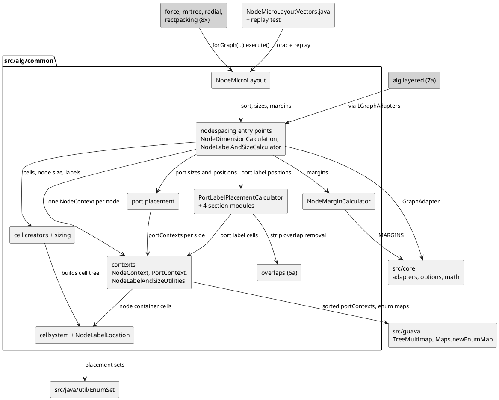

<!-- SPDX-License-Identifier: EPL-2.0 -->

# alg.common (missions 6a and 6b)

What mission 6a (`alg-common`, roadmap row 6, first half) ported, the evidence for each package, how the HashSet order
of `NaiveMinST` is reproduced, and a runbook for the three failure modes the plan expected; section 7 covers mission
6b (`alg-common-nodespacing`, the second half). Decisions cited are `plans/alg-common/decisions.md` (AC1-AC6, P1-P7)
and `plans/alg-common-nodespacing/decisions.md` (NS1-NS6, Q1-Q6); task ids (T1-T13, and 6b's T1-T8) are in the two
missions' `decision-journal.md`.
AD-n are `plans/elk-engine-skeleton/decisions.md`. Nothing here is exported from `src/index.ts` (AD-14), and no
algorithm provider is ported. Counts of oracle scenarios live in [conformance.md](../conformance.md#alg-common).

| Section                                   | Answers                                                        |
| ----------------------------------------- | -------------------------------------------------------------- |
| [1. Package map](#package-map)            | What 6a ported, where it lives, and what 6b adds               |
| [2. Evidence](#evidence)                  | JUnit ports and `alg-common.json` sections per package         |
| [3. Hash order (V6-V8)](#hash-order)      | How `BowyerWatsonTriangulation` and `NaiveMinST` match the JVM |
| [4. PolyominoOptions](#polyomino-options) | How the options class is generated                             |
| [5. Design notes](#design-notes)          | Facades, stand-ins, explicit stacks, AC4                       |
| [6. Runbook](#runbook)                    | Re-recording, regenerating, and the three failure modes        |
| [7. Nodespacing (6b)](#nodespacing)       | The cell system, contexts, algorithms, oracle replay, runbook  |

## 1. Package map {#package-map}

Java packages are under `org.eclipse.elk.alg.common`; TS paths are under `src/alg/common/` (P1). Nested classes and
enums live in prefixed files (M15). Class counts exclude `*.test.ts`.

| Java package           | TS directory           | Ported in 6a (task)                                                                                                                           |
| ---------------------- | ---------------------- | --------------------------------------------------------------------------------------------------------------------------------------------- |
| (root)                 | `.`                    | `TEdge`, `TTriangle`, `Point`, `Tree`, `ICostFunction` (T2); `BowyerWatsonTriangulation`, `NaiveMinST`, `RectilinearConvexHull` (T8)          |
| `utils`                | `utils`                | `SVGImage`, `UniqueTriple`, `Utils` (T2, T6)                                                                                                  |
| `compaction`           | `compaction`           | `Scanline`, `DebugUtil` (T2, T9)                                                                                                              |
| `compaction.options`   | `compaction/options`   | the three enums (T1) and the generated `PolyominoOptions` (T1)                                                                                |
| `compaction.oned`      | `compaction/oned`      | `OneDimensionalCompactor` facade plus section modules, `CGraph`, `CGroup`, `CNode`, both constraint calculators, `LongestPathCompaction` (T9) |
| `networksimplex`       | `networksimplex`       | `NGraph`, `NNode`, `NEdge` (T3); `NetworkSimplex` facade plus `Subtrees`, `Tree`, `CutValues`, `Pivot`, `Normalize` sections (T7)             |
| `overlaps`             | `overlaps`             | `RectangleStripOverlapRemover`, `GreedyRectangleStripOverlapRemover` (T10)                                                                    |
| `spore`                | `spore`                | `InternalProperties` (T2), `Node`, `ScanlineOverlapCheck`, `DepthFirstCompaction` (T11)                                                       |
| `polyomino.structures` | `polyomino/structures` | `TwoBitGrid`, `PlanarGrid`, `Polyomino`, `Polyominoes`, `Direction`, `IThreeValueGrid` (T6)                                                   |
| `polyomino`            | `polyomino`            | `PolyominoCompactor`, the six comparators, the successors, `ProfileFill` (T6, T12)                                                            |
| `issues` (test)        | `issues`               | `Issue475Test` (T5)                                                                                                                           |

**Mission 6b added** (AC1): `nodespacing/**` (`cellsystem`, `internal`, `internal/algorithm`, 26 classes) and
`NodeMicroLayout`, the only root class that imports `nodespacing`. Its evidence is the AC2 oracle `NodeMicroLayout`
sweep ([section 7](#nodespacing)), because `NodeMicroLayoutTest` needs five other algorithms.

## 2. Evidence {#evidence}

| Package                   | JUnit ports (green)                                                      | `alg-common.json` section (rows, all replay)                        |
| ------------------------- | ------------------------------------------------------------------------ | ------------------------------------------------------------------- |
| root geometry             | `RectilinearConvexHullTest` (T8)                                         | `triangulation` (22), via `TriangulationVectors.test.ts`            |
| `networksimplex`          | `NetworkSimplexTest` (T7)                                                | none: the JUnit is the evidence                                     |
| `compaction.oned`         | `OneDimensionalCompactorTest`, 17 of 17 (T9)                             | none: the JUnit is the evidence                                     |
| `overlaps`                | none                                                                     | `overlaps` (34), via `OverlapsVectors.test.ts`                      |
| `spore`                   | none                                                                     | `spore` (18: 8 scanline, 10 depth-first compaction), `SporeVectors` |
| `polyomino`, `structures` | none                                                                     | `polyomino` (108, 3 expect `IndexOutOfBoundsException`)             |
| `issues`                  | `Issue475Test` (T5)                                                      | none                                                                |
| generated options         | freshness and `.melk` cross-check, `test/melk/polyomino-options.test.ts` | none                                                                |

The recorder is `tools/vectors/AlgCommonVectors.java` (T4, P6): fixed seeds 7001, 7101, 7201, 7301 and 7401, every
scenario run twice inside the recording and identical, two full recordings byte-identical. Replay compares edge order,
costs, tree shapes and numbers within the AD-4 bar; rows that the JVM answers with an exception must throw.

## 3. Hash order (V6-V8) {#hash-order}

`NaiveMinST` copies a `HashSet<TEdge>` to a list and sorts it by weight, so the tie order of equal weights is the
HashSet iteration order (AD-10, [collections 2.1](../translation-rules-collections.md#21-iterated-value-hashed-containers-port-with-javahashmap)).
The sites and their ports:

| Site                                 | Java container                      | TS                                                      |
| ------------------------------------ | ----------------------------------- | ------------------------------------------------------- |
| `BowyerWatsonTriangulation.java:85`  | `HashSet<TTriangle>` (V6)           | `JavaHashSet` with `TTRIANGLE_STRATEGY`                 |
| `BowyerWatsonTriangulation.java:155` | `HashSet<TEdge>` (V7)               | `JavaHashSet` with `TEDGE_STRATEGY`                     |
| `NaiveMinST.java:52`                 | `HashSet<TEdge>`, copied and sorted | `JavaHashSet` with `TEDGE_STRATEGY`, then a stable sort |
| `NaiveMinST.java:65`                 | `HashMap<KVector, …>`               | `JavaHashMap` with a `KVector` strategy                 |
| `NaiveMinST.java:60`                 | `LinkedHashSet`                     | `Set` (insertion order already)                         |

The strategies (`TEDGE_STRATEGY`, `TTRIANGLE_STRATEGY`, `POINT_STRATEGY`, T2) port `hashCode` and `equals` verbatim
with `Int32` arithmetic, and their expected hashes were computed by an independent script from the Java formulas.
V8 is now implemented and proven: the 22 `triangulation` rows pin the triangulation edge iteration order and both cost
trees, including the `constant` cost function, which gives every edge the same weight so the tree is decided entirely by
tie order (it is order-sensitive in 18 of the 22 rows). The sort is `Array.prototype.sort` with the `Double.compare`
shim, which is stable like `Collections.sort`, so ties keep HashSet order.

## 4. PolyominoOptions {#polyomino-options}

`PolyominoOptions` has no Java source in the tree: Xtext generates it from `Polyomino.melk`, and the only copy is in the
oracle's `src-gen`. T1 ported the three enums under `compaction/options/` by hand and generated the class with
`npm run melk:generate Polyomino`, which places it at `src/alg/common/compaction/options/PolyominoOptions.ts`.
`DEFAULT_BUNDLES` in `tools/melk/generate.ts` stays `['Core', 'Labels']` because `test/melk/emit.test.ts:110-119` pins
it (stop 6). Regenerating `Core`, `Labels` and `Polyomino` together left every landed file byte-identical.
Defaults are `QUADRANTS_LINE_BY_LINE`, `BY_SIZE_AND_SHAPE`, `NUM_OF_EXTERNAL_SIDES_THAN_NUM_OF_EXTENSIONS_LAST` and
fill `true`. Each property is a `static readonly` after its private default; no default reads another options class, so
no cached getter was needed, and nothing registers the class until disco (8a). `test/melk/polyomino-options.test.ts`
holds the freshness test, a regex cross-check of id, default and target against the `.melk` source (independent of the
generator), and an import-first test for the TDZ failure below.

## 5. Design notes {#design-notes}

- **Facades (P1).** `NetworkSimplex` and `OneDimensionalCompactor` exceed 500 lines in Java and are split into a
  facade plus section modules that never import the facade. Helper splits follow Java section boundaries.
- **Explicit stacks (AC6).** `NetworkSimplex.tightTreeDFS` and `postorderTraversal` recurse as deep as the input
  (4,000 levels in `NetworkSimplexTest`). Interpreted V8 frames overflow the default stack, and the failure is
  deterministic under `--jitless`. They are explicit-stack loops that reproduce the Java visit, mutation and
  accumulation order, proven by `NetworkSimplexTree.test.ts` against a verbatim recursive reference on 16 seeded graphs
  and a 50,000-node path. `DepthFirstCompaction` still recurses per spanning-tree level; check it with `--jitless`
  before 8x feeds it a large graph.
- **`TreeSet` stand-ins.** `src/java/util` has no live `TreeSet`, so three task-local sorted-array sets exist
  (`ScanlineConstraintCalculatorTreeSet.ts`, a file-private set in `RectangleStripOverlapRemover.ts`, and
  `SortedNodeSet` in `ScanlineOverlapCheckHandler.ts`). Each keeps `TreeSet.add`'s rejection of a comparator-equal
  element. One is to be promoted to `src/java/util/TreeSet.ts` before layered.
- **No debug files (AC4).** `SVGImage.save`/`isave`, `DebugUtil` and `NGraph.writeDebugGraph` keep their logic up to the
  file write and write nothing, because `src/` is browser-safe. Every `/*d*/` call stays, since some compute values.
- **Overloads.** `Scanline.execute`, `TTriangle.contains`, and the `PlanarGrid` Polyomino overloads dispatch at run
  time (translation rules 6.5). `PlanarGrid` uses `import type` for `Polyomino` and a duck-typed guard to avoid an ESM
  cycle (`Polyomino extends PlanarGrid`).
- **Bits.** `TwoBitGrid` words are Java `long`: 32 cells of 2 bits fill 64 bits, so cell 31's weak bit is the sign bit.
  Words are `bigint` through `Int64`, and indices through `Int32`.

## 6. Runbook {#runbook}

Run from the repository root. `$ELK_SOURCE_DIR`, `$ELK_ORACLE_DIR` and `$ELK_MODELS_DIR` default to the repo-relative
paths of AD-15; the oracle must be built (`tools/oracle/build.sh`). Never edit `tools/vectors/vector-cache.sh` or
`tools/vectors/JavaVectors.java`, and never regenerate a landed ref to get a test green (AD-13).

### 6.1 Re-record the vectors

```bash
tools/vectors/alg-common-vectors.sh test/golden/refs/java
git status --short test/golden/refs/java    # must show nothing for a same-JDK re-record
ELK_VECTORS_CACHE=off tools/vectors/alg-common-vectors.sh test/golden/refs/java   # cold, touches no cache
```

The recorder prints one `cache:` line. It must be byte-stable across two runs (stop 8). A diff after a same-JDK
re-record means the oracle jars, the classpath or `AlgCommonVectors.java` changed: journal the cause. Adding a file
under `tools/vectors/` changes the inputs digest, so the next recorder runs are cold once.

### 6.2 Regenerate PolyominoOptions

```bash
npm run melk:generate Polyomino
git status --short src test    # must show nothing unless the generator or `Polyomino.melk` changed
npx vitest run test/melk
```

Never change `DEFAULT_BUNDLES` to include `Polyomino`. If generating changes any file other than
`PolyominoOptions.ts`, or the output needs a hand edit, stop and journal it (stop 6). The Java class to compare with is
`$ELK_ORACLE_DIR/plugins/org.eclipse.elk.alg.common/src-gen/.../compaction/options/PolyominoOptions.java`.

### 6.3 Failure modes

| Failure                        | Detection                                                                                                                                                                                                        | Fix                                                                                                                                                                                                                                                                                                                                                                                                                          |
| ------------------------------ | ---------------------------------------------------------------------------------------------------------------------------------------------------------------------------------------------------------------- | ---------------------------------------------------------------------------------------------------------------------------------------------------------------------------------------------------------------------------------------------------------------------------------------------------------------------------------------------------------------------------------------------------------------------------- |
| HashSet tie order              | `TriangulationVectors.test.ts` shows a different edge order or a different `constant`-cost tree while ids and counts match                                                                                       | Compare the `TEDGE_STRATEGY`/`TTRIANGLE_STRATEGY`/`POINT_STRATEGY` hash with the Java formula first (`TEdge.java:56`, `TTriangle.java:119`, `KVector.java:155`). Then follow [collections 2.5](../translation-rules-collections.md#25-runbook-javahashmap-order-mismatch-in-a-ported-site): a new vector from a separate generator, never an edit of `JavaVectors.java`. A mismatch traced to `JavaHashSet` itself is stop 7 |
| `PolyominoOptions` TDZ         | a `ReferenceError` (TDZ) when `PolyominoOptions` and `CoreOptions` load in the wrong order; the `loads without a TDZ error when imported before CoreOptions` case in `test/melk/polyomino-options.test.ts` fails | Today no default reads another options class, so plain `static readonly` fields are safe. If one does, the constant must be a cached static getter (M12). Do not hand edit the file: fix the generator and regenerate (6.2)                                                                                                                                                                                                  |
| `Int32` bit maths in the grids | `TwoBitGrid.test.ts` or `PlanarGrid.test.ts` fails at cell 31 of a word, or `PolyominoVectors.test.ts` rows differ in profile or intersection results; a word loses its top bit or reads as a negative `number`  | Words are `bigint` through `Int64.shl/ushr`, never `number` shifts (those wrap at 32 bits). Indices go through `Int32.shr/and`. Reads past the width inside the last word return 0 and writes throw, as Java; do not "fix" the asymmetry                                                                                                                                                                                     |

A fourth source of surprise is stack depth: if a ported recursion fails with `RangeError` only under suite load, run
the test under `--jitless` (a scratch vitest config with `pool: 'forks'` and `execArgv`), then convert it per AC6.

## 7. Nodespacing (mission 6b) {#nodespacing}

Mission 6b ported `org.eclipse.elk.alg.common.nodespacing` (26 classes) and `NodeMicroLayout`. Decisions are NS1-NS6
and Q1-Q6 in `plans/alg-common-nodespacing/decisions.md`; task ids below (T1-T8) are that mission's. Row counts and
the kept quirks live in [conformance.md](../conformance.md#alg-common-nodespacing).

### 7.1 Package layout

Four layers, each importing only the ones below it. TS paths are under `src/alg/common/nodespacing/`.

| Layer        | Java package                          | Classes (task)                                                                                                                                                                                                                                                                                            |
| ------------ | ------------------------------------- | --------------------------------------------------------------------------------------------------------------------------------------------------------------------------------------------------------------------------------------------------------------------------------------------------------- |
| cell system  | `nodespacing.cellsystem`              | `Cell`, `AtomicCell`, `LabelCell`, `ContainerCell`, `StripContainerCell` (+ `StripContainerCellStrip`, M15), `GridContainerCell`, the three enums (T2); `internal.NodeLabelLocation` (T2)                                                                                                                 |
| contexts     | `nodespacing.internal`                | `NodeContext`, `PortContext` (T3)                                                                                                                                                                                                                                                                         |
| algorithms   | `nodespacing.internal.algorithm`      | `PortContextCreator`, `NodeLabelAndSizeUtilities` (T3); `PortPlacementCalculator`, `Horizontal`/`VerticalPortPlacementSizeCalculator` (T4); `PortLabelPlacementCalculator` (T5); `CellSystemConfigurator`, `NodeLabelCellCreator`, `InsidePortLabelCellCreator`, `LabelPlacer`, `NodeSizeCalculator` (T6) |
| entry points | `nodespacing` root, `alg.common` root | `NodeMarginCalculator` (T5); `NodeLabelAndSizeCalculator`, `NodeDimensionCalculation` (T7); `../NodeMicroLayout` (T7)                                                                                                                                                                                     |



### 7.2 Phase sequence

`NodeMicroLayout.execute()` runs `NodeDimensionCalculation.sortPortLists`, `calculateLabelAndNodeSizes` and
`calculateNodeMargins` on the adapter, in that order. `calculateLabelAndNodeSizes` calls
`NodeLabelAndSizeCalculator.process(graph, node, applyStuff, ignoreInsidePortLabels)` per node, whose Java code-name
comments are kept verbatim:

1. preparatory preparations: one `NodeContext` per node (options read once, in Java order), then
   `PortContextCreator.createPortContexts`;
2. phase 1 (Wonderous Waterfowl): `NodeLabelCellCreator` and `InsidePortLabelCellCreator` build the cell tree;
3. phase 2 (Defective Duck): `CellSystemConfigurator.configureCellSystemSizeContributions`;
4. phase 3 (Salvageable Swan): `HorizontalPortPlacementSizeCalculator` sets the width the ports need;
5. phase 4 (Damnable Duckling): `NodeSizeCalculator.setNodeWidth`, then the vertical size calculator and
   `setNodeHeight`;
6. phase 5 (Duck and Cover): the cell system is laid out horizontally and vertically;
7. phase 6 (Gigantic Goose): `PortPlacementCalculator` places the ports, `PortLabelPlacementCalculator` the port
   labels, `LabelPlacer` the node labels;
8. phase 7 (Thanksgiving): `applyStuff` writes the node size, port positions and label positions back through the
   adapter.

In TS, phases 1-2 are `setupCells` and 3-4 `computeMinimumPortSpace` (function-size limit); the order is Java's.

### 7.3 Port contexts

`NodeContext.portContexts` is `TreeMultimap.create(comparePortSides, comparePortContexts)` (Q2,
`src/guava/TreeMultimap.ts`). Keys iterate in `PortSide` ordinal order; values on NORTH and EAST ascend by
`getVolatileId()`, on SOUTH and WEST they descend. The value comparator reads only the volatile id, and the multimap
has `TreeSet` semantics per key, so two contexts on one side with equal ids collapse to one (`NodeContext.test.ts`
pins it). `PortContextCreator` assigns unique ids `0..n-1`, so the collapse is reachable only by direct insertion. The
three `EnumMap` fields use `Maps.newEnumMap` (ordinal order), and the `NodeLabelLocation` placement sets use `EnumSet`.

### 7.4 Splits

Every split is at a Java method, section or switch-arm boundary and keeps Java names and order (Q1, standing rule):

- **Facade + sections (Q1):** `PortLabelPlacementCalculator` (546 Java lines) is a facade over
  `PortLabelPlacementCalculator{SimpleInside,ConstrainedInside,SimpleOutside,ConstrainedOutside}.ts`, named after the
  Java section comments; sections never import the facade.
- **Switch arms:** `NodeLabelLocation.getOutsideSide` (WEST/EAST arms), `NodeLabelAndSizeUtilities.setupNodePaddingForPortsWithOffset`
  (one method per side), the simple port label placement (one method per side, loop locals in a file-local record),
  `NodeMarginCalculator.computeLabelBox`.
- **Sections:** `StripContainerCell` row/column layout, the fixed-ratio loops and `setupPortMargins` of both port
  placement size calculators, `CellSystemConfigurator` (PORTS / NODE_LABELS / MINIMUM_SIZE blocks),
  `NodeSizeCalculator` free-size arms, `NodeLabelCellCreator` container creation, `NodeLabelAndSizeCalculator`
  (phases 1-2, 3-4; the inside-padding extents).
- **Shared helpers (2026-10-14 amendment):** the horizontal and vertical free-port placement bodies differ only in the
  axis, so they share `centerSinglePort`, `distributeAvailableSpace` and `alignPorts` over a per-axis state record.

### 7.5 Evidence

The package has no runnable Java tests (its 4 JUnit files need layered, P5). `tools/vectors/NodeMicroLayoutVectors.java`
(T1) runs `NodeMicroLayout` bottom-up over every node with children (NS3) and records nodes, ports and labels in model
order (NS6) for four groups (NS2): `corpus` (the 8 `tests/core/{node_size,label_placement}` models), `curated` (the 31
curated models and 4 vendored tickets), `variants` (`PortLabelPlacementVariantsTest`'s configuration on all four
sides) and `sweep` (a pairwise cover of 11 option factors, `Random(6101)`). Model rows are recorded `raw` and `sized`
(NS4). Each row stores its prepared input as ELK JSON (NS1), re-imports it, and fails if the re-imported graph gives a
different result. `src/alg/common/NodeMicroLayoutVectors.test.ts` replays every row through `ElkGraphJson` and the same
bottom-up harness (`test/helpers/node-micro-layout-replay.ts`): 326 rows, 23 expected exceptions, all equal on the
first run. Each class also has colocated unit tests with Java-derived expectations (about 1,000 tests).

Mission 6c added a targeted recorder for unit-test sites, `tools/vectors/NodespacingSiteVectors.java`. Its scenarios
were hand-derived in 6b, or sit on branches the 326-row replay never reaches. Each row rebuilds one fixture in Java
and records what the Java produces, as `{ id, site, input, steps, expected }`. `site` names the call sequence (the
harness), `input` is the ELK JSON graph or `null`, and `steps` are mutations applied after `NodeContext` construction.
The steps are `setMinimumContentAreaSize`, `setContributes`, `setCellRectangle`, `setPortMargin` and `setPortRatio`.
`setPortRatio` exists because `PORT_RATIO_OR_POSITION` is registered by no metadata provider, so ELK JSON drops it.
`src/alg/common/nodespacing/NodespacingSiteVectors.test.ts` replays the 23 rows through
`test/helpers/nodespacing-site-replay.ts`, one function per `site`. The unit tests keep their literals, each annotated
with its row id and the Java line that produces it.

### 7.6 Runbook

```bash
tools/vectors/node-micro-layout-vectors.sh test/golden/refs/java      # needs $ELK_MODELS_DIR at record time only
git status --short test/golden/refs/java                              # must show nothing for a same-JDK re-record
ELK_VECTORS_CACHE=off tools/vectors/node-micro-layout-vectors.sh test/golden/refs/java   # cold (about 4 s)
tools/vectors/nodespacing-site-vectors.sh test/golden/refs/java       # site rows; reads no model directory
```

The recorder embeds the SHA-256 of every model it reads and fails naming any missing or changed file, because the
`vector-cache.sh` inputs digest does not cover `$ELK_MODELS_DIR` or `test/golden/inputs/`. The replay needs no model
directory. A replay mismatch is diagnosed against the oracle, never fixed by re-recording (AD-13); the rules a
hand-derived expectation most often misses are listed in `.agent-notes/alg-common-nodespacing.md`.
