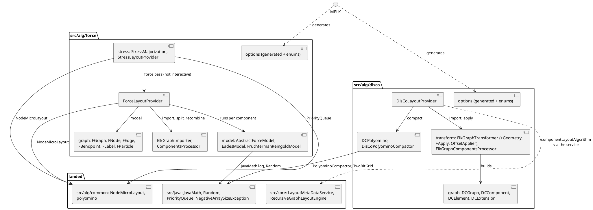
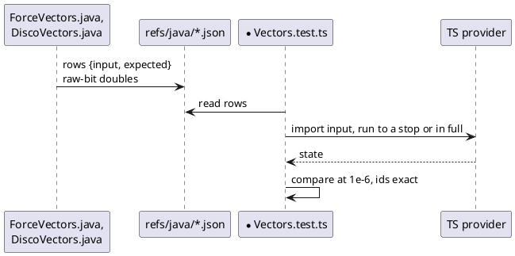

<!-- SPDX-License-Identifier: EPL-2.0 -->

# alg.force, alg.disco: force, stress and disco (mission 8b)

What mission 8b (`alg-force-disco`, roadmap row 8b, issue #38) ported: the bundles `org.eclipse.elk.alg.force` (the force
layout `elk.force` and the stress layout `elk.stress`, which live in the one bundle) and `org.eclipse.elk.alg.disco`
(`elk.disco`), with their generated option classes and providers. From here `LayoutMetaDataService` can register
`ForceMetaDataProvider`, `StressMetaDataProvider` and `DisCoMetaDataProvider` (with `PolyominoOptions` beside it), and
`RecursiveGraphLayoutEngine` lays out a graph with each. This page covers the structure, the evidence, the hashed-container
verdicts, `JavaMath.log`, the recursion probe, the base-class import cycle, the known divergences and a runbook. Decisions cited
are `plans/alg-force-disco/decisions.md` (FD1-FD10); task ids T1-T13 are in that mission's `decision-journal.md`; AD-n are
`plans/elk-engine-skeleton/decisions.md`. Counts live in [conformance.md](../conformance.md#alg-force-disco). The mission's
diagrams are [data-flow](../../plans/alg-force-disco/diagrams/data-flow.md) and
[component-map](../../plans/alg-force-disco/diagrams/component-map.md); the versions below are corrected to what was built.

| Section                                                            | Answers                                                                  |
| ------------------------------------------------------------------ | ------------------------------------------------------------------------ |
| [1. Structure](#alg-force-disco-structure)                         | The two bundles, their files, the transformer sections, the registration |
| [2. Evidence](#alg-force-disco-evidence)                           | Recorders and refs, replays, goldens, sweep, JUnit, coverage             |
| [3. Hashed containers](#alg-force-disco-containers)                | The FD4 table with the twin result                                       |
| [4. `JavaMath.log`](#alg-force-disco-log)                          | FD3: why, the proof, the platform limit                                  |
| [5. Recursion](#alg-force-disco-recursion)                         | The FD7 probe and the finding beyond it (issue #70)                      |
| [6. The `AbstractForceModel` import cycle](#alg-force-disco-cycle) | The one module that cannot be loaded first                               |
| [7. Known divergences and open issues](#alg-force-disco-open)      | Issues #69, #70, #71; #58 (resolved)                                     |
| [8. Runbook](#alg-force-disco-runbook)                             | Re-recording, goldens, sweeps, the Java baseline                         |

## 1. Structure {#alg-force-disco-structure}

TS paths are under `src/alg/` (AD-7): one class per file, named as the Java class, `@see` per symbol. The option classes
(`force/options/{ForceOptions,ForceMetaDataProvider,StressOptions,StressMetaDataProvider}.ts`,
`disco/options/{DisCoOptions,DisCoMetaDataProvider}.ts`) are generated unedited by `tools/melk` from
`tools/melk/sources/{Force,Stress,Disco}.melk`; the hand-ported leaf enums are `ForceModelStrategy`, `CompactionStrategy` and
`stress/Dimension` (the `PackingMode` shape). The Stress bundle's Java package is `alg.force`, so its files are under `force/`.

| Bundle | Pipeline                                                                                                                                                                                | Provider                      |
| ------ | --------------------------------------------------------------------------------------------------------------------------------------------------------------------------------------- | ----------------------------- |
| force  | `ElkGraphImporter.importGraph`, `ComponentsProcessor.split`; per component `AbstractForceModel.layout` (`EadesModel` or `FruchtermanReingoldModel`); `recombine`; `applyLayout`         | `ForceLayoutProvider`         |
| stress | `NodeMicroLayout`, a force pass when not `interactive`, import, split; per component `StressMajorization.initialize` and `execute`; label refresh; `recombine`; `applyLayout`           | `stress/StressLayoutProvider` |
| disco  | optional `componentLayoutAlgorithm` through the service; `ElkGraphTransformer.importGraph` (with `ElkGraphComponentsProcessor.split`); `DisCoPolyominoCompactor.compact`; `applyLayout` | `DisCoLayoutProvider`         |

force has its own graph model (`force/graph/{FGraph,FNode,FEdge,FBendpoint,FLabel,FParticle}`); disco has `disco/graph/{DCGraph,
DCComponent,DCElement,DCExtension,DCDirection}` and `structures/DCPolyomino`, and reuses `PolyominoCompactor`, `Polyominoes` and
`TwoBitGrid` of `alg.common`.



**The transformer behind a facade.** `ElkGraphTransformer` (766 Java lines) is split by the 500-line and 30-NLOC limits into
`ElkGraphTransformer.ts` (the facade: `importGraph`, `applyLayout`, the extension maps), `ElkGraphTransformerGeometry.ts` (contour
and orthogonal-point computation: `getContour`, `getOrthogonalPoints`), `ElkGraphTransformerApply.ts` (the write-back helpers) and
`OffsetApplier.ts` (the Java inner class, in its own file). Other splits at Java block boundaries, statement order unchanged
(journal rows `T6 note`, `T9 note`, `T10 note`): `ElkGraphImporter.applyLayout` into `calculateBounds`, `applyNodePositions`,
`applyEdges`, `applyLabels`; `ComponentsProcessor.recombine` into four helpers; `FLabel.refreshPosition`; `DCPolyomino.
addExtensionsToPoly`; `DCComponent.update`; `ElkGraphTransformer.importGraph`, `importExtension`, `getContour` (the Java writes the
merge block twice) and `computeIncidences`; `StressMajorization.getDesiredLength` and `newPositionOf`. Java package-private
members are public; the constructors that the Java overloads are one constructor with defaults.

**Registration (FD5).** Every option class imports its provider and the providers need the whole bundle, so neither side could
land first. T4 generated the options and added three staged providers (`// @staged 8b`, `staged-classes.json` rows); T8, T9 and
T10 replaced the bodies, and T10 removed the last marker, so `test/architecture/staged-classes.json` is `[]` and `PENDING_TYPES`
is `[]`. The fitness test's `MARKER` was widened by one token (`8b`; pre-approved, no expected value changed). No
`NON_LEAF_DEFAULT_TYPES` entry was needed (an import smoke over the 36 non-test modules: 35 load alone, the exception is
section 6). `LayoutMetaDataService.getInstance()` is unchanged: a test, replay or tool registers a provider explicitly.
`tools/corpus/ts-layout-compare.ts` registers `ForceMetaDataProvider`, `StressMetaDataProvider`, `DisCoMetaDataProvider` and
`PolyominoOptions` (as `ElkOracle.java:218-221` does), and **layered**, one registration beyond the task's wording: without it
the exporter picks different option suffixes and nested default-algorithm nodes throw (a probe on the 286-row sweep: force and
stress 117 options-only mismatches and 5 `ts-only-throw` each, 0 and 0 with it). It also moves the 8a tree comparisons toward
the oracle.

**Planned write-set deviations.** Helper files beside the planned ones, so as not to edit landed helpers: `test/helpers/
force-replay-{elk,stops,stress}.ts`, `force-replay-dump.test.ts`, `disco-replay-{elk,stops}.ts`, `DisCoLayoutProvider.test.ts`.

## 2. Evidence {#alg-force-disco-evidence}

Every row below was recorded from the oracle (ELK built from source with patches 0001 and 0002) under `-XX:hashCode=2` (FD1).
A row is `{ id, group, input, expected }`; `input` is the graph as ELK JSON, re-imported by the recorder before the run
(round-trip self-check); doubles are 16-hex raw bits. Groups: `full` (the result of `RecursiveGraphLayoutEngine`), `stops` (the
state after each step), `throws` (class, message, first ELK frame).



| Ref (under `test/golden/refs/java/`) | Recorder                          |   Rows | full | stops | throws | log    |
| ------------------------------------ | --------------------------------- | -----: | ---: | ----: | -----: | ------ |
| `force.json` (12,570,900 B)          | `tools/vectors/ForceVectors.java` | 20,804 |  594 |   194 |      2 | 20,014 |
| `stress.json` (5,284,738 B)          | the same launcher, second output  |    431 |  320 |   108 |      3 |        |
| `disco.json` (3,393,594 B)           | `tools/vectors/DiscoVectors.java` |    185 |   92 |    88 |      5 |        |

`ForceVectors.java` is 1,809 lines, `DiscoVectors.java` 1,867; the PostToolUse complexity hook flags both as over 500 lines. They
are single-file JVM launchers (FD1's cap for them is 5,000) and `npm run complexity` does not measure `tools/vectors/*.java`.
Three cold runs by the recording agent and one by the orchestrator (`ELK_VECTORS_CACHE=off`) are `cmp`-identical to each
committed ref. Each force and stress row runs from the re-imported input, from the original graph and (flat graphs) through the
reflective drive, and the recorder fails on any disagreement; each disco `stops` row must equal a plain `DisCoLayoutProvider.
layout` on a fresh import.

Stops. force: `import, split, initialize, iteration1, iteration2, iteration10, iterationLast, recombine, applyLayout`; stress:
`forcePass` or `microLayout`, then `import, split, initialize, execute, labelRefresh, recombine, applyLayout`; disco: `split,
import, cellSizes, polys, pack, applyToDCGraph, applyLayout`. `split` carries `model` and `randomPeek` (`nextLong()` of a
serialised copy of the graph's `Random`). The `log` group of `force.json` is 20,000 seeded `Math.log` input/output pairs plus 14
edge rows (section 4). Rows holding a NaN (71 force rows) or an Infinity (6) are deliberate (`spacing.nodeNode=0`,
Fruchterman-Reingold with `iterations=0`); NaN is written as `7ff8000000000000` and compares equal to any NaN. Branch reach and
the full option-value coverage are in the journal rows `T1 note` and `T2 regen`.

**Replays (FD1 exit).**

| Test                                         | Rows replayed                                                            | Numeric fields compared                                               |
| -------------------------------------------- | ------------------------------------------------------------------------ | --------------------------------------------------------------------- |
| `src/alg/force/ForceVectors.test.ts`         | 594 full, 194 stops (every stop in order), 2 throws                      | 259,243 hex doubles: 259,243 raw-bit identical, 0 differing           |
| `src/alg/force/stress/StressVectors.test.ts` | 320 full, 108 stops (with `apsp` and `w` at each `initialize`), 3 throws | 135,229 hex doubles: all raw-bit identical, 0 differing               |
| `src/alg/disco/DiscoVectors.test.ts`         | 92 full, 88 stops (all seven stops), 5 throws, 2 twin tests              | 75,002 raw-bit identical, 32 within 1e-6 only (max 8.5e-14), 0 beyond |

The force replay includes the Eades `iterations=1000` rows, the proof of `JavaMath.log` (section 4). Stops are observed by
test-side prototype wrappers (`importGraph`, `applyLayout`, `split`, `recombine`, `updateModel`, the models' `moreIterations`),
restored in `finally`; production code has no hook. `randomPeek` matches in every state: the wrapper counts `nextDouble` draws
(any other draw throws, so force draws only `nextDouble`) and a same-seed test generator replays them. Stress stops use an
`inForce` flag that keeps the force pass's own importer, split and apply calls out of the stress stops. The 32 disco fields that
are not bit-identical are the known divergence of section 7. T6's isolated replays of the graph classes: force `import`, `split`,
`recombine` 194 each and stress 108 each (906 stops, raw-bit identical); disco `import` 88 stops round-trip and 518
polyominoes over the 88 `polys` stops are raw-bit identical. The replay dump must not call `getProperty` on a cloneable-default
option: `ElkGraphElement.getProperty` stores a copy on first read, which changed what a later `getProperty` returned (the
recorder reads `getAllProperties()`).

**Goldens (FD2).** `tools/oracle/regen-goldens.sh --set force-disco` writes `test/golden/refs/elk-force-disco/`: 45 refs
(manifest `test/golden/force-disco.json`, inputs under `test/golden/force-disco-inputs/`, `_meta.json` naming the oracle and
`jvmFlags -XX:hashCode=2`): force 15, stress 10, disco 20, twice byte-identically. One golden per non-default option value, one
factor at a time; Fruchterman-Reingold has none because it is the default. An entry without `elk.algorithm` or `retarget`
records layered, so `resolvedAlgorithm` equals the entry's algorithm in 45 of 45 (the ref value is `Layout Algorithm: <id>`).
`test/golden/force-disco-goldens.test.ts` (51 tests) compares every entry with its ref at AD-4, asserts each `resolvedAlgorithm`
and the counts, and pins the 12 no-op disco goldens equal in `children` and `edges` to `disco--default` (issue #69). The refs of
the `default` (4), `algorithms` (9), `layered` (24) and `trees` (40) sets regenerate byte-identically.

**Sweep (FD6).** Oracle `tools/oracle/sweep.sh --filter /<alg>/`, sequential, under `-XX:hashCode=2`; TS through
`tools/corpus/ts-layout-compare.ts --algorithms <alg>`, tool as committed (layered registered). Nothing from the sweep is
committed (AD-5). The oracle throw counts equal `docs/parity-report.md` (89, 89, 87); no timeout, no oracle error, no
nondeterministic verdict.

| Algorithm | planned | oracle ok | oracle throws |  ok |                mismatch | both-throw | ts-only-throw | oracle-only-throw |
| --------- | ------: | --------: | ------------: | --: | ----------------------: | ---------: | ------------: | ----------------: |
| force     |     906 |       817 |            89 | 815 |                       2 |         89 |             0 |                 0 |
| stress    |     898 |       809 |            89 | 807 |                       2 |         89 |             0 |                 0 |
| disco     |     906 |       819 |            87 |   0 | 819 (all `optionsOnly`) |         87 |             0 |                 0 |

The 2 + 2 force and stress mismatches are `interactiveRectpacking_{hierarchy,oneBigNode}`: `layoutOptions.desiredPosition` is an
option of the unported rectpacking provider (issue #68's family; issue #71 item 2). The disco mismatches are options-only:
`layoutOptions.debug.discoGraph` is JVM identity text in the oracle (issue #71 item 1); a scratch classifier that neutralises
that key (1,503 occurrences) finds 817 of the 819 equal in full, and the other 2 are the same two rectpacking models. Every
oracle throw is matched by class. Zero mismatches are without a stated mechanism.

**JUnit (FD8).** `ForceImportTest` 3 of 3 (`src/alg/force/ForceImportTest.test.ts`) and `TwoBitGridTest` 3 of 3
(`src/alg/disco/TwoBitGridTest.test.ts`) with the Java's assertions; the oracle runs at mission start are 3 / 0 and 3 / 0
(`plans/alg-force-disco/java-baseline.md`); at mission end: 3 / 0 and 3 / 0 again.

**Coverage.** The two bundles from their own tests plus `test/melk/force-disco-options.test.ts`: statements 99.93 % (1,480 of
1,481), branches 98.67 % (298 of 302), functions 100 % (295 of 295), lines 99.93 %; `alg/disco` 100 / 98.5 / 100 / 100,
`alg/force` 99.9 / 98.8 / 100 / 99.9 (statements / branches / functions / lines). The four branches not reached are `U` rows 7,
8, 12 and 16 of `plans/alg-force-disco/unreached.md`, which lists all 16 `U` rows of the mission; "neither reached nor proven
dead" is empty. Row 16's argument is a reading of the Java, not a vector. At the batch 5 gate the whole project was 1,084 files
and 47,912 tests passed, 98.9 / 96.94 / 98.86 / 98.91; at mission end: 1,084 files and 47,913
tests passed, 98.9 / 96.95 / 98.86 / 98.91.

## 3. Hashed containers {#alg-force-disco-containers}

FD4 named the sites; identity-hashed containers are ported in insertion order (AD-10) and parallel streams become sequential in
encounter order. `DCElement`, `ElkNode`, `ElkEdge`, `ElkPort` have identity hashes (`MapPropertyHolder` defines neither
`hashCode` nor `equals`). `F` and `D` are the force and disco package paths.

| Site (Java)                                                                         | Keys                 | Iterated                                | Port                                                                          | Finding                                                                                                            |
| ----------------------------------------------------------------------------------- | -------------------- | --------------------------------------- | ----------------------------------------------------------------------------- | ------------------------------------------------------------------------------------------------------------------ |
| `F/ElkGraphImporter.java:61` `elemMap`                                              | `ElkNode`            | lookup only                             | `Map`                                                                         | unobservable                                                                                                       |
| `F/stress/StressMajorization.java:60` `connectedEdges`                              | `FNode`              | `get` in insertion order                | landed `LinkedListMultimap`, identity strategies                              | a self-loop is put twice under one key, as Guava keeps duplicates; `apsp` bit-identical at every `initialize` stop |
| `D/graph/DCGraph.java:40` `components`                                              | `DCComponent`        | linked set, order observable            | `Set`, insertion order                                                        | preserved                                                                                                          |
| `D/graph/DCComponent.java:55` `shapes`                                              | `DCElement`          | `update`, `intersects`, the cell fill   | `Set`                                                                         | order-free; extension order shows only as a length and a direction set; unobservable in all 88 rows                |
| `D/transform/ElkGraphTransformer.java:68` `elementMapping`                          | `ElkGraphElement`    | `forEach(OffsetApplier)`                | `Map`                                                                         | each entry independent                                                                                             |
| `D/transform/ElkGraphTransformer.java:70-71` `incoming/outgoingExtensionsMapping`   | `ElkEdge`            | **order-observable** at `adjustedPorts` | `Map`, insertion order, reversed-order twin                                   | see below                                                                                                          |
| `D/transform/ElkGraphTransformer.java:113,159` `edgeSet`                            | `ElkEdge`            | feeds the two maps above                | `Set`                                                                         | insertion order                                                                                                    |
| `D/transform/ElkGraphComponentsProcessor.java:47,74,102,104`                        | `ElkNode`, `ElkPort` | `dfs` over the adjacency set            | `visited` array, `incidenceMap` `Map`, adjacency `Set`s                       | insertion order                                                                                                    |
| `D/transform/ElkGraphComponentsProcessor.java:110,115,137,142,180` parallel streams | `ElkEdge`            | collected                               | sequential, encounter order; `partitioningBy` is a private static `partition` | predicates are pure                                                                                                |

**The twin.** A test-only helper replaces both extension maps with reversed copies before `applyLayout`. The extension-map
order the oracle used under `-XX:hashCode=2` is insertion order: base `ext` in=[xinw, xinn], out=[xoute, xouts]; `extShared`
(xin1 and xin2 share port `pw`) in=[xin1, xin2, xinn], so xin1 sets the port position; `extSharedInOut` in=[xin], out=[xout,
xout1, xout2]; `extAllDirs` has 4 + 4 = 8 entries, the largest row (the recorder fails above 8, so no row treeifies). All 41
`stops` rows with extension entries reach `adjustedPorts`. Reversing the order changes the result in 2
(`stops/extShared/default`, `stops/extSharedInOut/default`, the shared-port rows) and there differs from the oracle beyond 1e-6,
so the oracle used insertion order; the other 39 are bit-identical either way; no row matches neither order. Hash-derived lists
in rows are sorted (elements by kind, bounds, ref; extensions by direction, offset, width); `dfsOrder` is separate; components
are in `DCGraph` (linked-set) order. The force bundle has no order-observable hashed container; its `ArrayList`s are arrays, the
`LinkedList<FGraph>` of components is an array (`Collections.sort` is a stable in-place sort and the `recombine` rows with tied
priorities match), and per-node incidence lists stay `LinkedList` shims.

## 4. `JavaMath.log` {#alg-force-disco-log}

`EadesModel.attractive` (`EadesModel.java:100`) calls `Math.log` once per connected pair per iteration. FD3 decided to use a
bit-exact `log`, not V8's.

**Why.** On 200,000 seeded inputs (half in 0.01-20, half in 10^-3-10^3) on the oracle's JVM (21.0.1, arm64), V8's `Math.log`
differs from the JVM's in 858 inputs (0.43 %), by one unit in the last place; the same 858 differ from `StrictMath.log`.
HotSpot's `Math.log` and `StrictMath.log` gave bit-identical Eades layouts in 18 of 18 runs. The iteration is chaotic:
perturbing 1 call in 256 by one ulp changes the final coordinates by at most 1.2e-12 at 300 iterations and by 390 at 1,000
iterations (n = 20, seed 1), so the ulp matters for any row above the default iterations. Native `Math.log` with a
known-divergences entry would break the 1e-6 goldens for iterated rows.

**What.** `src/java/lang/JavaMath.ts` gains `log`, the netlib fdlibm `e_log` over the whole domain (zero, negative, NaN,
infinity, subnormal and `x >= 1`: `spacing.nodeNode` of 0 gives an infinite `d / s`), written from the public algorithm and not
from OpenJDK (AD-9). It is split into `highWord`, `withHighWord`, `screenLog`, `logNearOne` and `logPolynomial` for the
complexity limits; a module-private `const` `DataView` is scratch, written and read within one call. `EadesModel.attractive`
calls it; `src/java/util/Random.ts` now imports it too and its private `strictLog` is deleted (`Random.test.ts` unchanged and
green, as is all of `src/java`: 589 tests). The `k === 0` sub-branch of the sqrt2 band, unreachable in the old `0 < x < 1` copy,
is ported. No other site in `alg.force` calls a transcendental `Math` function; `Math.sqrt` is correctly rounded.

**Proof.** All 20,014 `log` rows of `force.json` (20,000 seeded plus 14 edge rows) are raw-bit equal; native V8 `Math.log`
differs on 101 of them (0.50 %). `Math.log` and `StrictMath.log` agree on all 20,014 in the oracle. The Eades `iterations=1000`
replay rows are bit-identical through the whole layout.

**Platform limit.** The equality is proven on the oracle's arm64 JVM 21.0.1. It is not verified on x86_64 (LOW confidence that it
holds, FD3). The journal records the platform as issue #52 does for the label metrics.

## 5. Recursion {#alg-force-disco-recursion}

Recursion is ported verbatim (FD7). The input-depth recursions at the pin are `ComponentsProcessor.dfs` of force (also run by
stress) and `ElkGraphComponentsProcessor.dfs` of disco.

**Probe (T12).** 2,000-node paths (preset x = 20·i; force `iterations=1`; stress `interactive` with `iterationLimit=1`; disco
defaults): the oracle (`tools/oracle/run.sh`, default `-Xss`), TS (`npx tsx`) and TS under `node --jitless --import tsx` all
complete. No conversion (FD7: convert only a site that overflows in TS where the oracle completes at that depth). Beyond the
probed depth (single machine, Node 26.3.1, JDK 21.0.1 arm64):

| Path length | Oracle                        | TS                                | TS `--jitless`                      |
| ----------- | ----------------------------- | --------------------------------- | ----------------------------------- |
| 3,000       | not run                       | not run                           | force, disco complete               |
| 4,000       | not run                       | force, stress, disco complete     | force `RangeError`; disco completes |
| 8,000       | not run                       | not run                           | force, disco `RangeError`           |
| 16,000      | force, stress, disco complete | force, stress, disco `RangeError` | force, disco `RangeError`           |
| 100,000     | `StackOverflowError`          | not run                           | not run                             |

The port's limit is below the oracle's. Issue #70 (`follow-up`) asks whether to convert the two `dfs` sites to explicit stacks
proven against a verbatim recursive reference (the AC6 recipe of `plans/alg-common/decisions.md`); it is the maintainer's call.

## 6. The `AbstractForceModel` import cycle {#alg-force-disco-cycle}

The import smoke over `src/alg/force` loads every module alone except the abstract base `model/AbstractForceModel.ts`: loading
it first fails with `Cannot access 'AbstractForceModel' before initialization` at `EadesModel.ts:15`.

**Mechanism.** An ESM cycle through a class `extends`: `AbstractForceModel` imports `ForceOptions`, which imports
`ForceLayoutProvider` (the generated factory), which imports `EadesModel`, whose `extends` reads the base binding before it is
initialised. The Java has the same cycle; the JVM resolves it lazily. Ruled out: `NON_LEAF_DEFAULT_TYPES` (it only makes option
defaults lazy, and no force default names a model) and a section split (the dependency is the class binding itself).

**Resolution (T8 `ruling`).** Under the locked precedent, not stop 12: layered-cycles-layers E1 part 3 and the 7g T15 `fix` row
say a base class reached from the options through the provider is not an entry point, and its test enters through another
module (`AbstractForceModel.test.ts` imports `FGraph` first). Eight landed base classes behave the same
(`AbstractBarycenterPortDistributor` re-checked by the orchestrator at that commit). No entry-order import in `src/`. Flagged
for the maintainer in the roadmap revision.

## 7. Known divergences and open issues {#alg-force-disco-open}

| Item                                                                                                                                               | State                                                                                                                                                                                                                                                                                                                                                                                                                                                                                                                                                                                               |
| -------------------------------------------------------------------------------------------------------------------------------------------------- | --------------------------------------------------------------------------------------------------------------------------------------------------------------------------------------------------------------------------------------------------------------------------------------------------------------------------------------------------------------------------------------------------------------------------------------------------------------------------------------------------------------------------------------------------------------------------------------------------- |
| last-ulp `Math.sin`/`Math.cos` in `ElkGraphTransformer.getOrthogonalPoints` (`ElkGraphTransformer.java:627-642`), known divergence, inside the bar | 32 numeric fields in `import` stops of `multi6/spacing60`, `multi6/combo2`, `bends/{default,thickness3,thickMixed,junctions}` (edge contours), max 8.5e-14; every later stop is bit-exact. Controlled experiment on the 491 distinct call inputs of the 88 disco runs, replayed in the oracle JVM: `atan2` (171) is bit-identical in V8, `Math` and `StrictMath`; V8 equals `StrictMath` on all 160 `cos` and 160 `sin` inputs; HotSpot's `Math.cos` differs from it on 9 and `Math.sin` on 5, by one ulp. No tolerance loosened; no contour cell flips in any row                                  |
| upstream defects the ports copy (issue #69, `needs-ruling`)                                                                                        | the `avoidSamePosition` hang (`AbstractForceModel.java:187-208`: `triedForBendPoints` is declared inside the loop, so two coincident `FBendpoint`s of antiparallel edges with `repulsivePower` > 0 never separate and the loop never ends; no row can hold it, the recorder skips `repulsivePower` on any graph with an antiparallel pair, and the port hangs on the same input) and DisCo's no-op polyomino options (`DisCoPolyominoCompactor.java:224` builds a fresh `Polyominoes` holder, so `lowLevelSort`, `highLevelSort` and `traversalStrategy` never reach the packer; 12 goldens pin it) |
| two classified option-text differences (issue #71, `needs-ruling`)                                                                                 | `layoutOptions.debug.discoGraph` is the JVM's `Object.toString()` of the `DCGraph` (`DisCoLayoutProvider.java:86`; `...DCGraph@1` under `-XX:hashCode=2`, `[object Object]` in the port); option keys that depend on the unported rectpacking provider (golden `force--iterations-50`: `force.iterations` against `iterations`, a `SUFFIX_DIFFERENCES` row with a tripwire that fails once rectpacking is registered; 6 sweep cases)                                                                                                                                                                |
| recursion depth below the oracle's beyond 2,000 (issue #70, `follow-up`)                                                                           | section 5                                                                                                                                                                                                                                                                                                                                                                                                                                                                                                                                                                                           |
| the three held-back stress cases (issue #58), resolved after 8b                                                                                    | 8b's evidence, a comment on the issue: the three cases pass with the Java's assertions from temporary copies (`Issue665Test` 1 of 1, `Issue700Test` 4 of 4), with two further blockers (`layered-label-metrics.json` lacked four label texts and the two models were not vendored). Mission layered-stress-cases carried out the ruling of 2026-11-13: `STRESS_PENDING` is deleted, the layout-test runner registers `elk.force` and `elk.stress`, the four texts are appended and the two models vendored; both suites run every case                                                              |

**Landed-code defects found and fixed at the origin.** `src/alg/common/polyomino/structures/TwoBitGrid.ts` `newWords` built
its rows with `Array.from({ length })`, which yields `[]` for a negative length where Java's `new long[h][...]` throws
`NegativeArraySizeException`; it now checks the height, then the row length, and throws the new shim
`src/java/lang/NegativeArraySizeException.ts` (parent `RuntimeException`, one added row in
`test/architecture/exception-hierarchy.fitness.test.ts`). `src/graph/json/JsonExporter.ts` wrote a list-valued option with
`Array.prototype.toString` (`p1,p2`) where the Java writes `AbstractCollection.toString` (`[p1, p2]`); array values now go
through `collectionText`. No landed expected value changed. See [translation-rules.md](../translation-rules.md).

## 8. Runbook {#alg-force-disco-runbook}

Check `uptime` first (a one-minute load above 12: wait) and run JVM work under `nice -n 10`. `$ELK_ORACLE_DIR` must hold the
oracle built by `tools/oracle/build.sh` at the stamp in `oracle-build.json`.

```bash
# re-record each ref; ELK_VECTORS_CACHE=off forces a cold run; the output must be cmp-identical to the committed ref
ELK_VECTORS_CACHE=off bash tools/vectors/force-vectors.sh "$TMPDIR/force"   # force.json and stress.json
ELK_VECTORS_CACHE=off bash tools/vectors/disco-vectors.sh "$TMPDIR/disco"   # disco.json

# regenerate the goldens; the refs must not change
for s in default algorithms layered trees force-disco; do tools/oracle/regen-goldens.sh --set "$s"; done
git diff --exit-code test/golden/refs/

# regenerate the options; src/ must not change
npm run melk:generate Core Labels Polyomino Layered Tree Radial VertiFlex Force Stress Disco && git diff --exit-code src/

# replays, goldens and the JUnit ports
npx vitest run src/alg/force src/alg/disco test/golden/force-disco-goldens.test.ts test/melk/force-disco-options.test.ts
```

**Re-run the sweeps.** Per algorithm, the oracle then the TS side, one after another (the second and third sweep started at
one-minute loads of 35 and 47, caused by the sweep before):

```bash
JAVA_TOOL_OPTIONS="-XX:+UnlockExperimentalVMOptions -XX:hashCode=2" \
  nice -n 10 tools/oracle/sweep.sh --filter /force/ --out "$TMPDIR/sweep-force"
npx tsx tools/corpus/ts-layout-compare.ts --algorithms force --sweep-dir "$TMPDIR/sweep-force" --out "$TMPDIR/force.json"
```

Repeat with `stress` and `disco`. Expect the numbers of section 2; a long run is started detached,
`nohup nice -n 10 bash -c '<command>; echo "exit $?"' >"$TMPDIR/<name>.log" 2>&1 &`, and polled.

**The Java baseline.** `tools/oracle/java-tests.sh` carries the `alg.force.test` and `alg.disco.test` bundles (issue #97), so the
landed script runs both classes; the scratch-copy recipe of the mission is in
[java-baseline.md](../../plans/alg-force-disco/java-baseline.md) as history:

```bash
MODELS_REPO=$ELK_MODELS_DIR nice -n 10 bash tools/oracle/java-tests.sh \
  org.eclipse.elk.alg.force.test.ForceImportTest org.eclipse.elk.alg.disco.test.TwoBitGridTest
```

Expect `ForceImportTest` runs 3 failures 0 and `TwoBitGridTest` runs 3 failures 0; any difference is a stop.

**Failures.** A row that differs: instrument the oracle and dump actual values before changing the port (the `JsonExporter` and
`TwoBitGrid` defects were each found by a row and journal a mechanism). A replay that throws `Cannot access ... before
initialization` on a lone module: compare with section 6 before suspecting the port. A disco `import` stop that differs in the
last bits of an edge contour: section 7. A sweep case that reports `missing layoutOptions.<x>`: a provider the tool does not
register (rectpacking, until 8c). A stress row with `epsilon` 1e-8 runs for minutes: the recorder's factor is 1e-5.
