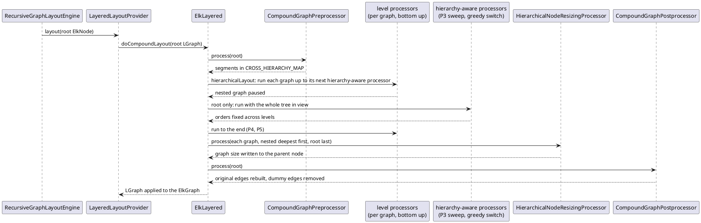

<!-- SPDX-License-Identifier: EPL-2.0 -->

# alg.layered, part i: compound graphs (mission 7h)

What mission 7h (`layered-compound`, roadmap row 7h, issue #36) ported of `org.eclipse.elk.alg.layered`: the `compound`
package (`CrossHierarchyEdge`, `CrossHierarchyEdgeComparator`, `CompoundGraphPreprocessor`, `CompoundGraphPostprocessor`) and
`HierarchicalNodeResizingProcessor`, the last pending arm of `IntermediateProcessorStrategy`. From here
`LayeredLayoutProvider.layout` runs every hierarchy-handling mode, `hierarchyHandling: INCLUDE_CHILDREN` included. The
hierarchical driver (`ElkLayered.doCompoundLayout`, `hierarchicalLayout`, `ElkLayeredHierarchy.ts`) was ported in 7f and
throws no longer: 7h proved it against the oracle and fixed no defect in it. This page covers the package map, how the pieces
run, how they are proven, the hashed-container verdicts, the evidence and a runbook. Decisions cited are
`plans/layered-compound/decisions.md` (H1-H14); task ids T1-T16 are in that mission's `decision-journal.md`; W-rows are 7g's
(`plans/layered-loops-wrapping-compaction/decisions.md`), G-rows 7f2's, F/FX-rows 7f's, AD-n
`plans/elk-engine-skeleton/decisions.md`. Parts a-c are [alg-layered.md](alg-layered.md) §§ 1-9, part d
[alg-layered-placement.md](alg-layered-placement.md), part e [alg-layered-routing.md](alg-layered-routing.md), part f
[alg-layered-pipeline.md](alg-layered-pipeline.md), part g [alg-layered-labels.md](alg-layered-labels.md), part h
[alg-layered-loops.md](alg-layered-loops.md). Counts live in [conformance.md](../conformance.md#alg-layered-compound). The
mission's diagrams are [data-flow](../../plans/layered-compound/diagrams/data-flow.md) and
[component-map](../../plans/layered-compound/diagrams/component-map.md); § 2 adapts the data flow.

| Section                                                   | Answers                                                                               |
| --------------------------------------------------------- | ------------------------------------------------------------------------------------- |
| [1. Package map](#part-i-package-map)                     | What 7h ported, where it lives, the facade and sections split, the last arm           |
| [2. The hierarchical driver](#part-i-driver)              | `doCompoundLayout`, `hierarchicalLayout`, the hierarchy-aware processors, the resizer |
| [3. The recorder and its rows](#part-i-rows)              | The four groups, the tree dump, the stops, the `sites` rows                           |
| [4. Goldens and the breadth sweep](#part-i-goldens)       | The 24 layered goldens, the flag evidence, the sweep                                  |
| [5. Hashed containers and their twins](#part-i-twins)     | The six sites, the one observable order, container sizes, the treeification caution   |
| [6. Replay helpers and test files](#part-i-replay)        | Helpers, the files that replay the rows, the anchored cases                           |
| [7. The ported suites](#part-i-suites)                    | The nine issue suites, the graph.json methods, H13                                    |
| [8. Evidence](#part-i-evidence)                           | Rows, goldens, sweep, twins, coverage, mutation checks                                |
| [9. Unreached, unobserved, copied oddities](#part-i-gaps) | `unreached.md`, issues #59 and #60, the oracle throws the port reproduces (issue #61) |
| [10. Runbook and failures](#part-i-runbook)               | Re-recording, goldens, the sweep, the suites, the site-arm check, troubleshooting     |

## 1. Package map {#part-i-package-map}

H1 scoped one brief of about 1,735 Java lines. `J` is `org.eclipse.elk.alg.layered`, TS paths are under `src/alg/layered/`
(AD-7); one class per file, named as the Java class, with nested types and section modules in prefixed files.

| Java (`J`)                                                                   | TS                                                                                                               | Task |
| ---------------------------------------------------------------------------- | ---------------------------------------------------------------------------------------------------------------- | ---- |
| `compound/CrossHierarchyEdge` (115 lines)                                    | `compound/CrossHierarchyEdge.ts`; the staged file of 7a became a real class                                      | T4   |
| `compound/CrossHierarchyEdgeComparator` (84)                                 | `compound/CrossHierarchyEdgeComparator.ts` (a class with `compare(a, b)`)                                        | T4   |
| `compound/CompoundGraphPreprocessor` (1,048, with the nested `ExternalPort`) | facade `compound/CompoundGraphPreprocessor.ts` (56 lines) over four section files, see below                     | T6   |
| `compound/CompoundGraphPostprocessor` (259)                                  | facade `compound/CompoundGraphPostprocessor.ts` (23) over `compound/CompoundGraphPostprocessorSections.ts` (292) | T7   |
| `intermediate/HierarchicalNodeResizingProcessor` (229)                       | `intermediate/HierarchicalNodeResizingProcessor.ts`                                                              | T5   |
| `IntermediateProcessorStrategy` arm `HIERARCHICAL_NODE_RESIZER`              | `intermediate/IntermediateProcessorStrategyCreate.ts` returns `new HierarchicalNodeResizingProcessor()`          | T8   |

**Facade and sections (H11).** The Java `CompoundGraphPreprocessor` is 1,048 lines, over the 500-line file and 30-NLOC
function limits of the complexity gate, so its logic lives in section modules and the class stays a thin facade:

| File                                       | Lines | Holds                                                                                                          |
| ------------------------------------------ | ----: | -------------------------------------------------------------------------------------------------------------- |
| `CompoundGraphPreprocessor.ts`             |    56 | the Java fields `crossHierarchyMap`, `dummyNodeMap`; `process` delegates to `processCompoundGraphPreprocessor` |
| `CompoundGraphPreprocessorSections.ts`     |   235 | the entry `processCompoundGraphPreprocessor(self, graph, monitor, order)` and its top-level steps              |
| `CompoundGraphPreprocessorSegments.ts`     |   476 | the segment building (`processInner…`, `processOuter…`, label moves)                                           |
| `CompoundGraphPreprocessorDummies.ts`      |   479 | external port dummies, net flow, inside self loops                                                             |
| `CompoundGraphPreprocessorExternalPort.ts` |    62 | the nested `ExternalPort` class                                                                                |

The split stays after the mission. Its history, staging, is over: H11 kept each facade's `process` throwing and its
`// @staged 7h` marker until T8, so `ElkLayered`, which constructs the two compound processors directly with no enum in
between, did not change in the middle of batch 2. T8 flipped each `process` to its section entry, removed the markers and
emptied `test/architecture/staged-classes.json` (`[]`). The facades now delegate, the sections import the facade as a type
only, and the facade imports its section module as a value, so no E1 entry-order recipe was needed. The split stays for the
complexity limits, not for staging. Every split names the Java lines it covers in a comment, and statement order is the
Java's. `order: 'java' | 'reversed'` (or a per-site object) on the entries exists for the twins of § 5; no production caller
passes it.

**The last arm, and the tally.** `HIERARCHICAL_NODE_RESIZER` was the one pending arm. The enum tally is 7b 10, 7c 10, 7d 5,
7e 6, 7f 6, 7f2 12, 7g 9, 7h 1: **59 arms ported, 0 pending**. `IntermediateProcessorStrategy.test.ts` says so (H7: `PORTED`
59, `PENDING` empty). `ElkLayered` constructs `CompoundGraphPreprocessor` and `CompoundGraphPostprocessor` directly, so they
have no arm.

`HierarchicalNodeResizingProcessor` keeps its own copy of `resizeGraph` and `resizeGraphNoReallyIMeanIt`, as the Java does,
without importing `ElkLayeredResize.ts`. The two copies are textually identical except the `NODE_SIZE_FIXED_GRAPH_SIZE`
guard (`ElkLayered.java:702`, absent at `HierarchicalNodeResizingProcessor.java:163`). The only structural deviation is the
Java `for` loop of `resizeGraphNoReallyIMeanIt` (`:207-220`), which is the private `moveExternalPorts` for the NLOC limit.

## 2. The hierarchical driver {#part-i-driver}

`ElkLayered.doCompoundLayout(lgraph, monitor)` (`ElkLayered.ts:114`) runs the `CompoundGraphPreprocessor` on the root, calls
`hierarchicalLayout` (`:146`), and runs the `CompoundGraphPostprocessor`. `hierarchicalLayout` collects every graph of the
tree bottom up (`ElkLayeredHierarchy.ts`; `collectAllGraphsBottomUp` is iterative), gives each graph its own plan, and
interleaves the levels: each graph runs until it meets a hierarchy-aware processor (`IHierarchyAwareLayoutProcessor`: the
P3 layer sweep, `LAYER_SWEEP` or `MEDIAN_LAYER_SWEEP`, and the hierarchical greedy switch). A nested graph pauses there; the
root runs them with the whole tree in view. A nested level's plan lacks the P3 sweep and the hierarchical greedy switch:
`hierarchicalLayout` skips them there without notifying. `HIERARCHICAL_NODE_RESIZER` runs after P5 on every graph, nested
deepest first and the root last, and writes a nested graph's size to its parent node.



How the compound classes meet the model: the preprocessor splits each edge that crosses hierarchy levels into one segment
per level, creates external port dummies, and records the segments in `CROSS_HIERARCHY_MAP` (a multimap from the original
`LEdge` to its `CrossHierarchyEdge` segments) on the root. The postprocessor reads that map, sorts each edge's segments with
`CrossHierarchyEdgeComparator` (an `OUTPUT` segment before an `INPUT` one; two outputs deeper first; two inputs shallower
first), rebuilds the original edge with the bend points and junction points of its segments, and removes the dummy edges.

The driver needed no change. Where a recorded row reached a driver arm, the arm matched; the driver arms that no row
reaches are in § 9.

## 3. The recorder and its rows (H2) {#part-i-rows}

One recorder, `tools/vectors/LayeredCompoundVectors.java` (a JDK 21 single-file launcher, 3,668 lines at T14, limit 5,000;
core copied from 7g's `LayeredLoopsVectors.java`, origin cited in its header; run by `tools/vectors/layered-compound-vectors.sh`
under `-XX:hashCode=2`), writes one ref, `test/golden/refs/java/layered-compound.json` (12,237,513 bytes, limit 16 MiB), with
four groups; the counts equal the header's `rowCounts`, 540 rows in all:

| Group       | Rows | What                                                                                                                                                                            |
| ----------- | ---: | ------------------------------------------------------------------------------------------------------------------------------------------------------------------------------- |
| `full`      |  355 | whole layouts through `RecursiveGraphLayoutEngine`: issues 17, include-children 253, ptolemy-include 48, hierarchy-aware 16, resizer 21                                         |
| `models`    |   73 | stops on the whole `LGraph` tree: `edge_label_placement-hierarchy01` 30, `ticket-455_longHierarchicalEdges` 27, `ptolemy-clockdrifthierarchy` 6, `ticket-160` 5, `ticket-552` 5 |
| `scenarios` |   88 | hand-built hierarchical graphs: `CompoundGraphPreprocessor` 48, `CompoundGraphPostprocessor` 28, `ElkLayered` 12                                                                |
| `sites`     |   24 | one row per arm scenario an oracle graph reaches: 19 run rows (one of them logged) and 5 throw rows                                                                             |

No refusal category remains: every plan member of every level is in the allowed set, and a member outside it exits the
recorder naming the row. A model whose hierarchy names an algorithm the recorder classpath does not register (`elk.stress`,
H13, issue #58) is out of scope: counted on stderr (20 `INCLUDE_CHILDREN` inputs vendored, 3 out of scope), never recorded.
Two of those three are vendored under `compound/` since issue #58's ruling, for the runner suites only (§ 7): the recorder's
`MODEL_TABLE` does not list them and it walks no vendored directory, so they stay out of scope here.
Rows where the oracle throws inside ELK are not recorded in `full`, `models` or `scenarios` (8 at T1, the candidates for
`sites`).

**The hierarchical `models` stop (H2).** `hierarchicalLayout` interleaves levels, so a stop is one `(graph, processor)`
notification of `ElkLayered`'s `TestController`, numbered in run order, and `expected.tree` dumps the **whole** `LGraph` tree
from the root at that moment. The stops are: after `CompoundGraphPreprocessor` (index 0), after each hierarchy-aware
processor on the root (P3 sweep, then the hierarchical greedy switch when planned), after `HIERARCHICAL_NODE_RESIZER` on every
graph (the root's stop is a superset of H2's "each nested graph"), and after `CompoundGraphPostprocessor`. The two compound
processors are notified by `doCompoundLayout`, so they are ordinary stops named by simple class name in `expected.plans` and
`expected.stop`. A flat engine run also produces "stops" under this rule (a flat default row has `P3_NODE_ORDERING/LAYER_SWEEP`
and `TWO_SIDED_GREEDY_SWITCH`); the recorder only rejects a run with zero stops, and the TS replay applies the same rule.

**The tree dump.** It is 7f's `Dump` plus a `levelPath` per graph; each node's `nested` field is the link H2 calls
`nestedGraph`. `crossHierarchyMap` is listed apart: keys in `Multimap.asMap()` order, the values of a key sorted by the
comparator, `origEdge` and `edge` falling back to `orig/<k>` and `seg/<k>/<i>` for an `LEdge` that left the graph.
`processors`, `random`, `spacings`, `splines.route.start`, the `SelfLoopHolder` and `org.eclipse.elk.resolvedAlgorithm` are
left out of `properties`. T2's alignment found a gap before any TS existed: the copied dump wrote node objects for layerless
nodes only, so after the layering a node in a layer was only a path in `layers`, and 185 of the 670 graphs of the 161
recorded trees had no node object. The dump now carries `layerNodes` per graph (the node objects of the layer-only nodes, in
path order); with it removed, all 516 rows of the first recording equal the second (738 node objects were added).

**The `sites` rows (T14).** `sites` follows `scenarios`, so no earlier row changed (the three older groups are
byte-identical to the first recording). The 19 run rows replay like `scenarios`. The one **logged** row,
`sites/JsonDebugUtil/loggedCompound`, runs under a monitor with logging on and holds 89 logged DOT and JSON pairs; the root
graph's `crossHierarchyMap` property prints as `HashMultimap.toString` of `CrossHierarchyEdge.toString` values. The 5 **throw**
rows record an exception where no landed recorder did; the shape is
`expected = { throws: { class: <fully qualified>, message: <getMessage() or null>, frame: <first org.eclipse.elk frame as File.java:line> } }`:

| Row                                                           | Class                       | Frame                        |
| ------------------------------------------------------------- | --------------------------- | ---------------------------- |
| `sites/ElkLayered/childStrategyThrow`                         | `UnsupportedGraphException` | `ElkLayered.java:344`        |
| `sites/SplineSegment/anchorYWithoutPortCoordinate/{DOWN,UP}`  | `NullPointerException`      | `SplineSegment.java:247`     |
| `sites/ElkGraphImporter/selfLoopInCompoundNode`               | `NullPointerException`      | `ElkGraphImporter.java:1205` |
| `sites/CompoundGraphPreprocessor/hierarchicalPortFIXED_RATIO` | `NullPointerException`      | `LGraphUtil.java:944`        |

A replay compares class and frame, because the NPE messages are JDK 21 helpful-NPE text. A throw row "corresponds" when the
ELK exception class equals the port's class of that name with the same message, or a Java NPE equals a `TypeError`, and in
both cases the top of the stack (the first `src/` frame, skipping `src/java/` shims and `new X` frames) lies in a file whose
base name starts with the Java class of the recorded frame and the first named such frame is the ported function. Stack
inspection was chosen over a spy because V8 records where the error was raised, while a spy would also pass for an error
from a callee. `FIXED_POS` on the same graph as `FIXED_RATIO` does not throw on the oracle and is an ordinary run row,
`hierarchicalPortFIXED_POS`.

**Inputs.** 23 `.elkt` (the 20 `INCLUDE_CHILDREN` inputs plus `455_shortHierarchicalEdges` and the two
`734_nodeEdgeSpacingFlat*`, needed by suites only) and 8 ptolemy hierarchical `.json` are vendored under
`test/golden/inputs/compound/` (31 manifest rows), outside `inputs/realworld/`.

## 4. Goldens and the breadth sweep (H4, H5) {#part-i-goldens}

**The layered goldens.** `tools/oracle/regen-goldens.sh --set layered` adds a set the way `--set algorithms` does: manifest
`test/golden/layered.json` (24 entries), refs `test/golden/refs/elk-layered/` with `_meta.json`, inputs from
`test/golden/inputs/pipeline`. The four models (`ptolemy-scrambler`, `ptolemy-afdx-multicast`, `ptolemy-clockdrift-hierarchy`,
`ptolemy-crossbar-switch`) are crossed with the variants `direction-right`, `direction-left`, `direction-down`,
`direction-up`, `hierarchy-include` and `hierarchy-separate`: 24 refs. The default (`INHERIT`) golden of each model is already
in `refs/elk`. `JAVA_TOOL_OPTIONS` gets `-XX:+UnlockExperimentalVMOptions -XX:hashCode=2` for this set only, and the flag is
named as `jvmFlags` in this set's `_meta.json` only. A second run is byte-identical; `refs/elk` (4) and `refs/elk-algorithms`
(9) regenerate unchanged. `test/golden/layered-hierarchy-goldens.test.ts` (27 tests) checks the manifest (4 models × 6
variants once each, `jvmFlags`, `elkCommit`) and compares each ref at AD-4.

**The no-flag evidence (T3).** The 24 cases run without `-XX:hashCode` are byte-equal to the committed refs on all 24 ids.
Identity-hash order does not reach these exports, so the flagged refs stand. This is evidence about these four models, not
about the engine: the one observable order (§ 5) is in the intermediate tree only, and is invisible in any export.

**The breadth sweep (H5, T13).** `tools/oracle/compound-sweep.sh [--force]` runs the oracle's recursive engine on three
families, one line per case in `test/corpus/.compound-sweep/results.jsonl` (gitignored), the SHA-256 of the canonical
laid-out graph (7g's canonical form: raw IEEE hex, NaN canonical, issue #53) or a throws status:

| Part | Cases                                                                                                                                        | Swept | Result          |
| ---- | -------------------------------------------------------------------------------------------------------------------------------------------- | ----: | --------------- |
| a    | the label sweep's enumeration kept where `INCLUDE_CHILDREN` is set: 50 candidates (10 label-bearing `.elkt` × 5); 45 after the stress filter |    45 | 45 ok           |
| b    | 23 `INCLUDE_CHILDREN` `.elkt` × (`default`, `RIGHT`, `LEFT`, `DOWN`, `UP`) = 115 candidates; 100 after the stress filter                     |   100 | 95 ok, 5 throws |
| c    | every `realworld/ptolemy/hierarchical/*.json` (256) with `INCLUDE_CHILDREN` applied at the root × 4 directions                               | 1,024 | 1,024 ok        |

1,169 cases: 1,164 ok, 5 throws, 0 timeouts, 0 refusals (oracle run 8 s). The 5 throws are all
`tickets/layered/425_selfLoopInCompoundNode.elkt` (`NullPointerException`, `ElkGraphImporter.java:1205`), and the port throws a
`TypeError` at the same import step. The label-sweep count of 50 holds before the stress filter. Part a's 9 swept models
are a subset of part b's 20, so 45 cases repeat under another id (H5 lists both parts). Part c needed a reading: H5 selects
ptolemy files that set `hierarchyHandling=INCLUDE_CHILDREN` at the root, and none of the 256 sets it (0 hold the text), so the
sweep applies it to every file, as the `ptolemy-include` rows do. Direction is set on the root only, in all parts.
`test/corpus/compound-sweep.test.ts` at stride 1 compares 1,164 ok cases hash-equal and 5 throws equal, 0 mismatches
(47.8 s alone; 974 distinct hashes). The default gate skips it (`COMPOUND_SWEEP_DIR=/nonexistent`).

## 5. Hashed containers and their twins (H3) {#part-i-twins}

Every `HashMap`/`HashSet`/`HashMultimap` of the H1 classes has a journal `ad10` row. Identity-keyed iterated sites read as
insertion order under `-XX:hashCode=2` (`LinkedHashMultimap.create(identity<LEdge>(), identity<CrossHierarchyEdge>())`,
`Map`, `Set`; precedent `NetworkSimplexCompaction.ts:189-191`). `CrossHierarchyEdge` has no `equals` or `hashCode` at the pin,
so its pairs are identity pairs. Each site has a twin that reverses the iteration (key order, and value order before the
sort) on every row that reaches it. `createExternalPortProperties` builds a value-hashed `HashMap<IProperty, Object>`
(`JavaHashMap`) that is only looked up, never iterated. Reach counts come from an instrumented Java-order run of all 516
rows of `full`, `models` and `scenarios`:

| Site                                                                     | Rows reached | Rows that differ reversed | Verdict                                                                                   |
| ------------------------------------------------------------------------ | -----------: | ------------------------: | ----------------------------------------------------------------------------------------- |
| pre `dummyNodeMap.entrySet()` (`CompoundGraphPreprocessor.java:129`)     |          369 |                         0 | order-independent: each entry writes its own port and dummy, shared writes are idempotent |
| pre `crossHierarchyMap.keySet()` (`:252`)                                |          297 |                         0 | observed, not proved (see below)                                                          |
| pre values before sort (`:258-259`)                                      |           67 |                         0 | order-independent: stable sort, no comparator tie                                         |
| post `crossHierarchyMap.keySet()` (`CompoundGraphPostprocessor.java:89`) |          238 |                         7 | **observable in the intermediate tree only**                                              |
| post values (`:93`)                                                      |          197 |                         0 | order-independent: stable sort, no comparator tie                                         |
| post `dummyEdges` (`:86`, `:191`)                                        |          321 |                         0 | order-independent: each edge is detached on its own                                       |

**The one observable site.** At `CompoundGraphPostprocessor.java:89` the key order shows. `origEdge.setSource(sourcePort);
origEdge.setTarget(targetPort)` (`:186-187`) re-attach the original edges in key order, appending each to the port's
outgoing or incoming list, so a port shared by two original edges lists them in key order. It is visible in a shared port's
edge list in the intermediate tree (for example `models/edge_label_placement-hierarchy01/14--CompoundGraphPostprocessor/default`,
`graphs[9].layerlessNodes[1].ports[0].incoming`: expected `["g3/e3","g5/e0"]`, reversed `["g5/e0","g3/e3"]`), and the dump
numbers edges by first meeting, so the two edges swap paths and every later difference is that swap. It is not visible in the
export: the exported layout of the Java-order and the reversed run is string-identical on every such row, which a test
asserts. Seven rows of the 516 differ reversed (`models/edge_label_placement-hierarchy01/14--…/default` and `14-n0-…/DOWN`,
`models/ptolemy-clockdrifthierarchy/5-G1-…/default`, `scenarios/CompoundGraphPostprocessor/junctions-{out,in}/{RIGHT,DOWN}`),
and six `sites` run rows added by T14 join them (13 ids in all). The test asserts that the Java order matches the oracle on
each and the reversed order does not. Insertion order is the oracle's order (G3a).

**Preprocessor `keySet()` (`:252`).** Removals commute (`:301-302`). The only order-dependent write is the label append onto
a segment edge shared by two original edges that both have labels. That is not proved impossible in general and not
observed (297 rows reach, 0 differ), so the twin is an asserted observation, not a proof.

**Container sizes and the treeification caution.** Over all rows the largest containers are `dummyNodeMap` 23 (47 rows above
10), preprocessor `crossHierarchyMap` keys 16 (4 rows), `dummyEdges` 29 (62 rows), postprocessor keys 16 (4 rows); the
largest sorted value list and the largest per-key value set are 6. Insertion order is the faithful reading of a Java hash
container only below the size at which the JVM treeifies a bucket (10 entries here). The observable site (`:89`) has at most
6 keys on its rows (a test asserts at most 10). The containers above 10 sit on sites with no observable effect: the Java
order and its reverse both match the oracle on every such row, so whatever order a treeified bucket iterates in does not
show on these rows. The order a treeified bucket would use is not established and not read from OpenJDK (AD-9). A new row
that makes a container above 10 observable is stop 17.

## 6. Replay helpers and test files {#part-i-replay}

| File                                             | Role                                                                                                                                                                                                                     |
| ------------------------------------------------ | ------------------------------------------------------------------------------------------------------------------------------------------------------------------------------------------------------------------------ |
| `test/helpers/layered-compound-replay-rows.ts`   | `loadCompoundRows`, the row groups and families                                                                                                                                                                          |
| `test/helpers/layered-compound-replay-run.ts`    | every row runs through `RecursiveGraphLayoutEngine.layout` with a `TestController` on the layered provider; options go on the root                                                                                       |
| `test/helpers/layered-compound-replay-stops.ts`  | `runToStop`, `replayFull`, `replayScenario`; stop numbering mirrors `StopRecorder.stopProcessor`; `env.around` wraps the engine call                                                                                     |
| `test/helpers/layered-compound-replay-dump.ts`   | `dumpTree` (7f's dump plus `levelPath`, `crossHierarchyMap`, `layerNodes`), `compareTree` with value-form maps between the recorder's encoding and the TS dump                                                           |
| `test/helpers/layered-compound-replay-sites.ts`  | `replaySiteRow` and the throw-row rule of § 3 (`PORTED_SITES`)                                                                                                                                                           |
| `test/helpers/layered-compound-sweep.ts`         | sweep canonical form and hash (7g's, NaN canonical)                                                                                                                                                                      |
| `test/helpers/layered-compound-anchored.ts`      | row loading and projections for the anchored files                                                                                                                                                                       |
| `test/helpers/layered-compound-site-arms.json`   | arms named per site row, read by `tools/vectors/compound-site-arms.mjs`                                                                                                                                                  |
| `src/alg/layered/LayeredCompoundVectors.test.ts` | every row of the four groups through the real provider and enum, no injection (542 tests, 5.3 s alone at batch 7)                                                                                                        |
| `src/alg/layered/LayeredCompoundSites.test.ts`   | the 24 `sites` rows under their scenario titles and the table checks (27 tests)                                                                                                                                          |
| `src/alg/layered/LayeredCompoundTwins.test.ts`   | the H3 reversal twins and the reach counts (14 s alone)                                                                                                                                                                  |
| `test/golden/layered-hierarchy-goldens.test.ts`  | the 24 layered goldens                                                                                                                                                                                                   |
| `test/corpus/compound-sweep.test.ts`             | the breadth sweep at stride 1                                                                                                                                                                                            |
| class tests (T4-T8)                              | `compound/*.test.ts`, `HierarchicalNodeResizingProcessor.test.ts`: each class proven by its own stops and by Java-structure cases                                                                                        |
| anchored tests (T15)                             | `compound/{CompoundGraphPreprocessorAnchored,CompoundGraphPostprocessorAnchored,CrossHierarchyEdgeAnchored}`, `intermediate/HierarchicalNodeResizingProcessorAnchored`, `ElkLayeredHierarchyAnchored` (each `*.test.ts`) |

Each anchored case cites its row and Java line and compares one projection of the replayed tree with the same projection of
the row's `expected.tree` at AD-4. Three comparison choices matter for anyone extending the helpers. The tree comparison
needs value-form maps: the recorder writes every property value in its own encoding (`{t:'int',v}`, `{t:'double',v:'12.0'}`,
a bare array for a list of elements, an enum class as `Outer.Inner`, an element outside the dump as `{class:<fqcn>}`), the
TS dump writes another, and the landed comparator reads an expected `int` or `double` only against `{t:'number'}`. The maps
(`actualInRecorderForm`, `expectedInTsForm`) are mutation-checked in `layered-compound-replay-mutation.test.ts`: node
position, port side, bend point, property number and enum, reference target, edge endpoint, `crossHierarchyMap` segment and
key, `layerNodes` entry and level path are all named. The maps once hid the class of an outside element (an outside edge
compared equal to an outside node); T9 narrowed them. A TS `Map` property value reads as the recorder's `java.util.HashMap`
(the AD-10 twin `JAVA_CLASS_TWINS` of 7c); only `Map` is mapped. And the TS dump reaches layer-only nodes by appending them
to the layerless list for one landed call and removing them in a `finally`, because no exported route dumps a layer node.

## 7. The ported suites (H6, H13) {#part-i-suites}

The nine `JT/issues` suites are ported under `src/alg/layered/issues/` through the F7 runner with the Java's own assertions:
`Issue316Test` 4 oracle runs, `Issue455Test` 2, `Issue552Test` 1, `Issue596Test` 1, `Issue628Test` 4 (its four
`@Configurator`s in the Java order), `Issue665Test` 1, `Issue700Test` 4, `Issue701Test` 6, `Issue734Test` 3. The three
graph.json methods deferred to 7h are ported into the existing files: `EdgeCoordsTest` (whole file, 1 run),
`LayoutOptionsTest.exportLayoutOptions` (4 runs in the file) and `IndividualSpacingsTest.importIndividualSpacingsTest` (3
runs in the file); their "Deferred" header lines are "Ported" lines. All 97 `alg.layered.test` Java files now have a port
(96 `<Name>.test.ts`, and `intermediate/loops/SelfLoopTestGraphCreator.java`, which has no `@Test`, as
`test/helpers/SelfLoopTestGraphCreator.ts`).

**H13, resolved (issue #58).** `tickets/layered/665_includeChildrenDoesntStop.elkt:21` and
`examples/hierarchy/hierarchicalLayoutMixing.elkt:49` lay out a child with `elk.stress`. That affects `Issue665Test` (its 1
case) and `Issue700Test` (2 of 4). 7h ported both suites whole and held these three cases back behind one named filter,
`STRESS_PENDING`, because stress was roadmap row 8b and unported. Stress is ported now, and mission layered-stress-cases
carried out the maintainer's ruling on issue #58:

- `test/helpers/stress-pending.ts` and its pin test are deleted; both suites list their sources inline.
- The layout-test runner registers `elk.force` and `elk.stress` next to layered (`registerTestAlgorithms` in
  `test/helpers/layout-test-runner.ts`), as `PlainJavaInitialization` does for every runner suite. Each provider is
  registered once, guarded by a probe (issue #120).
- The two models are vendored under `test/golden/inputs/compound/` with manifest rows, and `layered-label-metrics.json`
  holds the four label texts they need.

Both suites run every case with the Java's assertions, 1 and 4, as the oracle does (`runs=1 failures=0`, `runs=4
failures=0`), and the port's layout of each model is byte-equal to the oracle's JSON export. The recorders still register no
stress provider, so the two models are suite inputs only. A third `elk.stress` input,
`tickets/layered/588_hierarchicalLayoutNPE.elkt`, is read by no suite and is never vendored or recorded.

The Java statements that assign never-read locals stay as bare calls (`Issue701Test`: the lookups throw on a missing node or
port). 16 unknown label texts were appended to `tools/vectors/layered-label-metrics-texts.txt` and `layered-label-metrics.json`
was re-recorded by its script (16 added keys, nothing else changed).

## 8. Evidence {#part-i-evidence}

| Layer                      | What                                                                                                                                                                                                                                                                    |
| -------------------------- | ----------------------------------------------------------------------------------------------------------------------------------------------------------------------------------------------------------------------------------------------------------------------- |
| Rows (T1, T9, T14)         | `layered-compound.json`: `full` 355, `models` 73, `scenarios` 88, `sites` 24; `LayeredCompoundVectors.test.ts` (542 tests) replays every row through the real driver at the AD-4 bar with 0 mismatches                                                                  |
| Goldens (T3, T10)          | 24 layered refs, byte-stable, equal to the TS layout at AD-4 (27 tests); no-flag run byte-equal on all 24                                                                                                                                                               |
| Breadth sweep (T13)        | 1,169 oracle cases, 1,164 ok, 5 throws, 0 timeouts, 0 refusals; TS at stride 1: 1,164 hash-equal, 5 throws equal, 0 mismatches                                                                                                                                          |
| Twins (T6, T7, T9)         | § 5: five sites order-independent on every row that reaches them, one (`:89`) observable in the intermediate tree only                                                                                                                                                  |
| Coverage of the 7h classes | From the whole compound evidence: statements 99.6, branches 98.0, functions 100, lines 99.6; the untaken arms are five items proved dead in `unreached.md` (`CompoundGraphPostprocessorSections.ts` :239, :245, :259; `CompoundGraphPreprocessorSegments.ts` :95, :122) |
| Coverage map (T12)         | Replay-alone: in-scope untaken items S 43, J 31, U 187, open 26 (E 721 not listed); 16 scenarios `Sc1`-`Sc16`; 17 H8 closure rows (reached 7, S 4, U 2, open 1, mixed 2, keep 1)                                                                                        |
| Anchored cases (T15)       | 42 cases in five files (10, 12, 8, 7, 5), 0.59 s of test time                                                                                                                                                                                                           |
| Mutation checks (T15)      | 206 mutants in four scratch copies: the replay stage killed 168, class tests and twins 17 more, 21 survived; the anchored files alone kill 129 of the 206                                                                                                               |
| C7 (T9, T12)               | The kept recursion of `countCurrentNumberOfCrossings`: the deepest recorded hierarchy has 4 levels; depth reached 3 (58 rows), 2 (114), 1 (all 516). Kept, as ported                                                                                                    |
| Whole suite (batch 8)      | Coverage 98.82 / 96.83 / 98.78 / 98.82 (lines / branches / functions / statements), 956 files, 45,206 tests                                                                                                                                                             |

The mutation survivors are of two kinds. Equivalent mutants (G1, G21, G22, D23, D41, D42, Q15, R19, R20, H1 and the class-test
only C6, Q5, Q20) change nothing observable; for example the importer orders edges by container depth, outside edge first, so
a non-exported inner port never precedes another edge of its loop (G21, G22). The rest are reached but not observed by any
row (G18, D10, D14, D15, D32 D33 D36 D39 D40 D44, the resizer group, K9, R1 R4 R5 R8 R10-R12), each with a
probe-verified oracle graph in follow-up issue #60. `moveExternalPorts` (R29, R30, R34-R38; Java `:207-220`) is the largest
group and is diagnosed: it shifts the one coordinate of each EAST (x) and SOUTH (y) external port dummy that
`LGraphUtil.getExternalPortPosition` then overwrites. For a nested graph, `graphLayoutToNode` runs in the same `process` call
over the same layerless list, so the dummy ends at the same place with and without the shift (49 variants, trees and export
equal). It is observable only when the layered top-level graph has an ElkNode parent (`isNested` false): the tree at the
resizer stop differs (EAST (288,18) against (132,18)), the export does not. The redundancy is ELK's and the port keeps it.

## 9. Unreached, unobserved, copied oddities {#part-i-gaps}

**Unreached.** `plans/layered-compound/unreached.md` partitions the untaken items of the 7h classes, the driver files and the
C3 files (S, J, U, open, E; the classes are defined at its head). At the end of 7h, 25 handed-over arms were neither reached
nor proven dead (issue #59): six arms of `NorthToSouthRoutingStrategy`/`SouthToNorthRoutingStrategy` (`:38 if[0]`,
`:58 if[1]`, `:78 if[0]`; H8 (3)) and 19 arms of 7c's list (H8 (4)). Mission layered-arm-search settled them
(`unreached.md` § "Search outcomes"): 8 are reached through layout (the six routing arms among them), 9 by a site scenario
only, 8 are proven dead, none stays open. The inputs are under `tools/arm-search/`; their ten oracle rows are recorded but
withheld until issue #156 is ruled, because three tests pin lists of row ids ([conformance.md](../conformance.md#alg-layered-compound)).
The arms stay ported verbatim. `CrossHierarchyEdge.toString`, the 26th open item, is closed: the logged site row calls it
216 times and the text equals the oracle's.

**Oracle throws the port reproduces (issue #61).** The port throws where the oracle throws, in the same method:
(U1) `edgeRouting=SPLINES` in direction `DOWN` or `UP` under `INCLUDE_CHILDREN` throws `NullPointerException` at
`SplineSegment.java:247` (inputs `040`, `160`, `701`; the port: `TypeError` from `SplineSegment.anchorY`, `SplineSegment.ts:294`);
(U2) `425_selfLoopInCompoundNode.elkt` throws `NullPointerException` at `ElkGraphImporter.java:1205` (`lgraph` is null; the
recorder's inline export of the same model completes); (U3) `FIXED_RATIO` with a hierarchical port throws
`NullPointerException` at `LGraphUtil.java:944` because `CompoundGraphPreprocessor.java:182-185` passes `null` for
`portNodeSize`. Also drafted: (U4) `LayerSweepCrossingMinimizer.java:193-194` tests the node influence twice (the port,
landed in 7c, collapses the operand under the CodeQL rule; behaviour equal; fixed upstream by
[#1210](https://github.com/eclipse-elk/elk/pull/1210) and ported with the `e7eaea57` pin, #99) and (U5) the `moveExternalPorts` redundancy above.
The drafts are issue #61; nothing is filed upstream. The oracle's throw for `child-strategy-median` (`UnsupportedGraphException`,
`ElkLayered.java:344`) is pinned by `sites/ElkLayered/childStrategyThrow`.

## 10. Runbook and failures {#part-i-runbook}

```bash
bash tools/vectors/layered-compound-vectors.sh test/golden/refs/java       # the ref; byte-stable, cached by salted input hash
tools/oracle/regen-goldens.sh --set layered                                # the 24 refs, JAVA_TOOL_OPTIONS with -XX:hashCode=2
bash tools/oracle/compound-sweep.sh --force                                # test/corpus/.compound-sweep/ (gitignored)
npx vitest run test/corpus/compound-sweep.test.ts                          # stride 1 (the default gate skips it)
tools/oracle/compound-sweep.sh --dump <case id> <outDir>                   # the canonical form one case's hash is taken over
npx vitest run src/alg/layered/LayeredCompoundVectors.test.ts src/alg/layered/LayeredCompoundSites.test.ts \
  src/alg/layered/LayeredCompoundTwins.test.ts test/golden/layered-hierarchy-goldens.test.ts   # rows, sites, twins, goldens
npx vitest run test/helpers/layered-compound-replay                        # after any change to a shared replay helper
node tools/vectors/compound-site-arms.mjs                                  # the site-arm check: one v8 coverage run per site row
MODELS_REPO=$ELK_MODELS_DIR bash tools/oracle/java-tests.sh <the suites of plans/layered-compound/java-baseline.md>
```

The site-arm check reads the arms named per row in `test/helpers/layered-compound-site-arms.json` and reports any not taken
(19 rows with named arms, 0 not taken, 49 s). It is run by hand: a coverage run inside a test that may itself run under
coverage would reset v8's counters. The graph.json suites of the baseline run with the landed `java-tests.sh`, which
carries `org.eclipse.elk.graph.json.test` (issue #97). Check `uptime` before a JVM run
(load above 12: wait) and start long runs in the background with `nice`. `--force` is needed after any run that set
`COMPOUND_SWEEP_ONLY` or `COMPOUND_SWEEP_DUMP_DIR`, because the stamp does not cover them.

| Failure                                          | Detection                                                                                   | Fix                                                                                                                                                 |
| ------------------------------------------------ | ------------------------------------------------------------------------------------------- | --------------------------------------------------------------------------------------------------------------------------------------------------- |
| A coordinate differs by more than 1e-6           | a row, sweep or anchored-case diff                                                          | a port defect: `--dump` the case and trace the first departure to its Java line; check the four dump rules (`.agent-notes/layered-labels.md`) first |
| Every diff is a value encoding, no number        | `{t:'int',v:0}` against `{t:'int',v:0}`, a list as `[{"ref":…}]` against `{"t":"list",…}`   | a helper form map (§ 6), not the port: both sides are the same value in two encodings                                                               |
| A tree differs only in a shared port's edge list | `ports[…].incoming` or `.outgoing` in another order, export equal                           | the `:89` key order (§ 5): the port must iterate the multimap in insertion order                                                                    |
| A tree has no node object after the layering     | `layerlessNodes` empty on a laid-out graph                                                  | read `layerNodes`, the recorder's field for nodes that sit in layers                                                                                |
| A hash-order difference on a new row             | a mismatch the flagged oracle does not reproduce, or a container above 10 entries           | never silent: add a reversal twin, measure, take a decision (stop 17); the sites are in § 5                                                         |
| A logged row prints `LinkedHashMultimap@…`       | a `crossHierarchyMap` line with an object hash                                              | the multimap `toString` of `src/guava/Multimap.ts` (T14 `fix`) is missing                                                                           |
| A refusal                                        | the recorder or the sweep exits 1 naming the row                                            | a later mission's processor reached the plan; it belongs to that mission                                                                            |
| An `elk.stress` input appears                    | a recorder audit line `out of scope (algorithm)`, or a runner suite that reads such a model | recorders: never a row. A runner suite: vendor it under `compound/` with a manifest row and its label texts in the metrics table (issue #58)        |
| A site row passes but a mutation survives        | `unreached.md`, issue #60                                                                   | the row reaches the arm without observing it; a discriminating oracle graph is needed                                                               |
| A cap exceeded                                   | the recorder's size or line check                                                           | 16 MiB per ref, 5,000 lines per launcher: a decision                                                                                                |

## What still throws

Nothing in the layered hierarchy modes: every arm is ported (59 ported, 0 pending), `test/architecture/staged-classes.json` is
`[]`, and no `// @staged` marker remains. The three `elk.stress` cases of issue #58 run since its ruling was carried out
(mission layered-stress-cases), and the layouts that need another algorithm bundle (mrtree, radial, force, disco,
rectpacking, spore, topdownpacking, vertiflex) still fail to resolve it.
