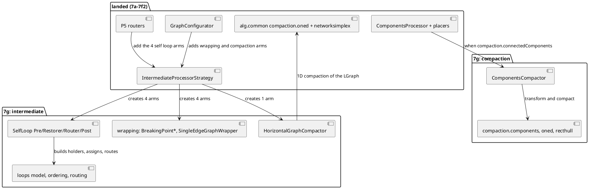
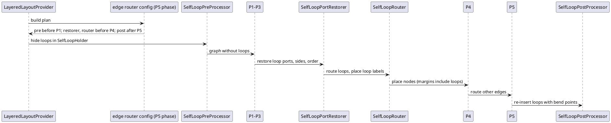
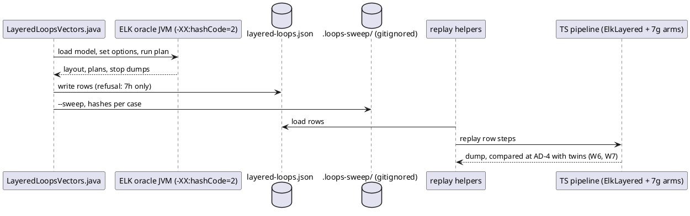

<!-- SPDX-License-Identifier: EPL-2.0 -->

# alg.layered, part h: self loops, wrapping and compaction (mission 7g)

What mission 7g (`layered-loops-wrapping-compaction`, roadmap row 7g, issue #35) ported of `org.eclipse.elk.alg.layered`:
the self loop package and its four processors, `DummySelfLoopProcessor`, graph wrapping, horizontal compaction, the
layered `compaction` package and `ComponentsCompactor`. From here `LayeredLayoutProvider.layout` runs graphs with self
loops, `SINGLE_EDGE` and `MULTI_EDGE` wrapping, `compaction.postCompaction.strategy` and
`compaction.connectedComponents`. This page covers the package map, how the pieces run, how they are proven, the
decisions that shaped the replay, the evidence and a runbook. Decisions cited are `plans/layered-loops-wrapping-compaction/decisions.md`
(W1-W14); task ids T1-T22 are in that mission's `decision-journal.md`; G-rows are 7f2's (`plans/layered-labels/decisions.md`),
F/FX-rows 7f's (`plans/layered-pipeline/decisions.md`), AD-n `plans/elk-engine-skeleton/decisions.md`. Parts a-c are
[alg-layered.md](alg-layered.md) §§ 1-9, part d [alg-layered-placement.md](alg-layered-placement.md), part e
[alg-layered-routing.md](alg-layered-routing.md), part f [alg-layered-pipeline.md](alg-layered-pipeline.md), part g
[alg-layered-labels.md](alg-layered-labels.md). Counts live in [conformance.md](../conformance.md#alg-layered-loops). The
mission's diagrams are [data-flow](../../plans/layered-loops-wrapping-compaction/diagrams/data-flow.md) and
[component-map](../../plans/layered-loops-wrapping-compaction/diagrams/component-map.md); § 2 adapts them.

| Section                                                   | Answers                                                                              |
| --------------------------------------------------------- | ------------------------------------------------------------------------------------ |
| [1. Package map](#part-h-package-map)                     | What 7g ported, where it lives, the 9 arms and where the plan adds them              |
| [2. How the pieces run](#part-h-run)                      | Component map, the self loop run, the evidence flow                                  |
| [3. The recorder and its rows](#part-h-rows)              | The four groups, refusal, the dump change, size                                      |
| [4. Replay helpers and test files](#part-h-replay)        | Helpers, twins, the files that replay the rows                                       |
| [5. Decisions that shape the replay](#part-h-decisions)   | Two compaction ports, hashed containers, R9, entry points, label-manager twin, sweep |
| [6. The ported suites](#part-h-suites)                    | The Java suites against the baseline, corpus-wide runs                               |
| [7. Evidence](#part-h-evidence)                           | Rows, sweep, twins, coverage, mutation checks                                        |
| [8. Unreached, unobserved, copied oddities](#part-h-gaps) | `unreached.md`, issue #55, the ELK oddities the port copies (issue #56)              |
| [9. Runbook and failures](#part-h-runbook)                | Re-recording, the sweep, the suites, troubleshooting                                 |

## 1. Package map {#part-h-package-map}

W1 scoped one brief of about 12,190 Java lines. `J` is `org.eclipse.elk.alg.layered`, TS paths are under
`src/alg/layered/` (AD-7); section modules behind a facade and nested types in prefixed files follow the earlier parts.

| Java (`J`)                                                                                                                                                                  | TS                                                                                                                                                    | Task |
| --------------------------------------------------------------------------------------------------------------------------------------------------------------------------- | ----------------------------------------------------------------------------------------------------------------------------------------------------- | ---- |
| `intermediate/loops` model: `SelfLoopHolder`, `SelfHyperLoop`, `SelfLoopEdge`, `SelfLoopPort`, `SelfLoopType`                                                               | `intermediate/loops/*.ts` (+ `SelfHyperLoopLabels`, `…LabelsAlignment`); the three staged files of 7a became real classes                             | T5   |
| `intermediate/loops/ordering`: `PortSideAssigner`, `PortRestorer`                                                                                                           | `intermediate/loops/ordering/*.ts` (+ `PortRestorerPortList`, `…AddMode`, `…PortSideArea`, `PortSideAssignerTarget`)                                  | T9   |
| `intermediate/loops/routing`: `RoutingDirector`, `RoutingSlotAssigner`, `LabelPlacer`                                                                                       | `intermediate/loops/routing/*.ts`                                                                                                                     | T10  |
| `intermediate/loops/routing`: `AbstractSelfLoopRouter`, `OrthogonalSelfLoopRouter`, `PolylineSelfLoopRouter`, `SplineSelfLoopRouter`                                        | `intermediate/loops/routing/*.ts` (+ `OrthogonalSelfLoopRouterEdgeRoutingDirection`, `…SlotPositions`)                                                | T13  |
| `SelfLoopPreProcessor`                                                                                                                                                      | `intermediate/SelfLoopPreProcessor.ts`                                                                                                                | T5   |
| `SelfLoopPortRestorer`                                                                                                                                                      | `intermediate/SelfLoopPortRestorer.ts`                                                                                                                | T9   |
| `SelfLoopRouter`, `SelfLoopPostProcessor`                                                                                                                                   | `intermediate/SelfLoopRouter.ts`, `intermediate/SelfLoopPostProcessor.ts`                                                                             | T13  |
| `DummySelfLoopProcessor` (no enum arm or class calls it at the pin)                                                                                                         | `intermediate/DummySelfLoopProcessor.ts`                                                                                                              | T14  |
| `intermediate/wrapping`: cut heuristics, `GraphStats`, `CuttingUtils`                                                                                                       | `intermediate/wrapping/{ARDCutIndexHeuristic,MSDCutIndexHeuristic,ICutIndexCalculator,GraphStats,CuttingUtils}.ts`                                    | T6   |
| `intermediate/wrapping`: `BreakingPointInserter`, `BreakingPointProcessor`, `BreakingPointRemover`, `SingleEdgeGraphWrapper`                                                | `intermediate/wrapping/*.ts` (+ `BreakingPointInserterBPInfo`, `…Cut`)                                                                                | T11  |
| `intermediate/compaction`: `HorizontalGraphCompactor`, `LGraphToCGraphTransformer`, `NetworkSimplexCompaction`, `EdgeAwareScanlineConstraintCalculation`, `VerticalSegment` | `intermediate/compaction/*.ts` (+ `…Orthogonal`, `…Splines`, `CNodeOrigins`)                                                                          | T7   |
| `compaction/oned` (+ `algs`): `OneDimensionalCompactor`, `CNode`, `CGroup`, `CGraph`                                                                                        | `compaction/oned/**` (the compactor is a facade over `…Directions`, `…Constraints`, `…Transforms`, `…Debug`)                                          | T3   |
| `compaction/recthull`                                                                                                                                                       | `compaction/recthull/*.ts`                                                                                                                            | T4   |
| `compaction/components`                                                                                                                                                     | `compaction/components/*.ts` (+ `ComponentsToCGraphTransformerCRectNode`)                                                                             | T8   |
| `components/ComponentsCompactor` (+ nested classes)                                                                                                                         | `components/ComponentsCompactor*.ts` (`…EdgeTransformer`, `…Hullpoints`, `…Segments`, `…OuterSegments`, `…PortSides`, nested types in prefixed files) | T12  |
| `IntermediateProcessorStrategy` (9 arms)                                                                                                                                    | `intermediate/IntermediateProcessorStrategy.ts`; the six `// @staged 7g` markers and registry rows left together                                      | T15  |

Task boundaries moved at batch 2 (journal): T5 also ported `SelfLoopPreProcessor`, T9 `SelfLoopPortRestorer`, T13
`SelfLoopRouter` and `SelfLoopPostProcessor`, so each self loop package met its oracle rows in the batch that ported it. The
enum arms kept throwing until T15 (W13).

**The 9 arms (W1, T15), and where the plan adds them.** Each arm is constructed as the Java does. The enum tally is 7b 10,
7c 10, 7d 5, 7e 6, 7f 6, 7f2 12, 7g 9, 7h 1: **58 arms ported at the end of 7g; mission 7h wired the last, `HIERARCHICAL_NODE_RESIZER`, so
now 59 are ported and 0 are pending**.

| Arm                                                                             | Added by                                                                                                                                                      |
| ------------------------------------------------------------------------------- | ------------------------------------------------------------------------------------------------------------------------------------------------------------- |
| `SELF_LOOP_PREPROCESSOR`                                                        | the edge routers' self loop configuration (`PolylineEdgeRouter.ts` `SELF_LOOP_PROCESSING_ADDITIONS`, and the orthogonal and spline routers' twins): before P1 |
| `SELF_LOOP_PORT_RESTORER`, `SELF_LOOP_ROUTER`                                   | the same configuration: before P4                                                                                                                             |
| `SELF_LOOP_POSTPROCESSOR`                                                       | the same configuration: after P5                                                                                                                              |
| `SINGLE_EDGE_GRAPH_WRAPPER`                                                     | `GraphConfigurator.ts` (wrapping, `SINGLE_EDGE`): before P4                                                                                                   |
| `BREAKING_POINT_INSERTER`, `BREAKING_POINT_PROCESSOR`, `BREAKING_POINT_REMOVER` | `GraphConfigurator.ts` (wrapping, `MULTI_EDGE`): before P3, before P4, after P5                                                                               |
| `HORIZONTAL_COMPACTOR`                                                          | `GraphConfigurator.ts` (post compaction with orthogonal edge routing): after P5                                                                               |

`DummySelfLoopProcessor` has no arm: it is ported whole (like `NubsSelfLoop`, R1) and proven by `processor` step rows
(W1, W3). `ComponentsCompactor` is created by the component placers when `compaction.connectedComponents` is on; the
placers do not need the enum.

## 2. How the pieces run {#part-h-run}

The component map after the mission: the 7g packages and the landed pieces they plug into.



How a layout with self loops runs through the plan:



Evidence flow: an expectation travels from the oracle to a green TS test, recorded before the port exists (AD-13).



## 3. The recorder and its rows (W3, W5) {#part-h-rows}

One recorder, `tools/vectors/LayeredLoopsVectors.java` (a JDK 21 single-file launcher of 4,561 lines at T20, limit
5,000; since issue #50 a multi-file program, the entry file plus ten helper sources in
`tools/vectors/LayeredLoopsVectors/`, built by `tools/vectors/java-program.sh`; core copied from 7f2's, origin cited in
its header), writes one ref, `test/golden/refs/java/layered-loops.json`
(16,358,809 bytes at T20, 16,511,138 with the evidence rows of issue #55, limit 16,777,216), with four groups; the
counts equal the header's `rowCounts`:

| Group       | Rows | What                                                                                                                                                                                                                |
| ----------- | ---: | ------------------------------------------------------------------------------------------------------------------------------------------------------------------------------------------------------------------- |
| `full`      |  731 | whole layouts through `RecursiveGraphLayoutEngine`, with the plan of every level: self-loops 227, wrapping 156, compaction 184, compaction-splines 80, components-compaction 79, converted 1, issues 4              |
| `models`    |  307 | stops at the nine arms (and the pinned row's model at every plan member) through `ElkLayered`'s test API                                                                                                            |
| `scenarios` |  525 | step rows on hand-built graphs; the new step op `processor <SimpleClassName>` runs `DummySelfLoopProcessor` outside the enum                                                                                        |
| `sites`     |   79 | 64 rows from T20, one per scenario of `plans/layered-loops-wrapping-compaction/unreached.md` which an oracle graph reaches (31 of 34), and 15 evidence rows of issue #55 (§ 8); appended, so no earlier row changed |

**Refusal (W3).** Decided on the whole plan of every level: only 7h's categories (`INCLUDE_CHILDREN`,
`HIERARCHICAL_NODE_RESIZER`) are accepted, and no row of this ref needs one (accepted refusals: 0). `full/converted/labels/ticket-213_componentsCompaction`
is the row `layered-labels.json` refused (W4). Rows where the oracle throws inside ELK (51 at T1) are not recorded and
are printed on stderr; the sites are in the journal's T1 `upstream` row and in § 8.

**Dump change (T1).** The reflected `selfLoopHolder` property cost about 1 MB per node, so its id is ignored in
`changed` and `dump` and a row carries `expected.selfLoops` instead (a per-node summary: `portsHidden`, `slotCounts`,
ports in `getSLPortMap()` order, loops with type, ports, edges in `getSLEdges()` order, occupied sides, slots and labels).

**Size (T1).** The untrimmed grid was about 70 MB. Trims are of variants only, never of models: direction variants of the
self loop stops on three models, the wrapping grid on five models plus `chain12` and `ladder16`, `QUADRATIC` only with `LEFT`
and `EDGE_LENGTH`-class strategies, `POLYLINE` compaction only with `EDGE_LENGTH`. 40 inputs are vendored under
`test/golden/inputs/loops/` (sha256 checked, 40 manifest rows). No row sets a seed (default 1).

## 4. Replay helpers and test files {#part-h-replay}

| File                                             | Role                                                                                                                                                                                                                                                                         |
| ------------------------------------------------ | ---------------------------------------------------------------------------------------------------------------------------------------------------------------------------------------------------------------------------------------------------------------------------- |
| `test/helpers/layered-loops-replay-rows.ts`      | `loadLoopsRows`, `describeLoops`, `rowsByFamily`, `replayLoopsRow(row, { twins, factories })` returning `Mismatch[]`; rows from the loops ref are tagged at load                                                                                                             |
| `test/helpers/layered-loops-replay-ops.ts`       | `registerStepProcessor`, `factoriesWith`, `runLoopsRow`, `runLoopsPrefix`, `registerTwinHook`, `withTwins`, `reversedCopy`; the `processor` op is a rewrite to a reserved `runProcessor` name                                                                                |
| `test/helpers/layered-loops-replay-selfloops.ts` | TS twin of `expected.selfLoops`                                                                                                                                                                                                                                              |
| `test/helpers/layered-loops-replay-wrapping.ts`  | encodes `BPInfo` and `IndividualSpacings` as the recorder does and decodes list-valued options                                                                                                                                                                               |
| `test/helpers/layered-loops-replay-manager.ts`   | the label-manager twin named after the loops recorder                                                                                                                                                                                                                        |
| `test/helpers/layered-loops-sweep.ts`            | sweep canonical form and `loopsHash` (NaN-canonical)                                                                                                                                                                                                                         |
| `src/alg/layered/LayeredLoopsVectors.test.ts`    | every row through the real provider and enum, no injection (T16)                                                                                                                                                                                                             |
| `src/alg/layered/LayeredLoopsSites.test.ts`      | the 79 `sites` rows (T20, issue #55)                                                                                                                                                                                                                                         |
| `src/alg/layered/LayeredLoopsTwins.test.ts`      | the W6 reversal twins and the W7 R9 check (T16)                                                                                                                                                                                                                              |
| `test/corpus/loops-sweep.test.ts`                | the breadth sweep at stride 1 (T19)                                                                                                                                                                                                                                          |
| anchored tests (T21)                             | `intermediate/loops/{LoopsAnchored,ordering/OrderingAnchored,routing/RoutingAnchored}`, `intermediate/wrapping/WrappingAnchored`, `intermediate/compaction/CompactionAnchored`, `components/ComponentsCompactorAnchored`, `compaction/CompactionAnchored` (each `*.test.ts`) |

Each anchored case cites `// oracle: <row id>; <Java file:line>` and reads its expectation from the row at run time.
Helpers shared by several test files sit in `test/helpers/` (`wrapping-graphs.ts`, `components-compaction.ts`,
`SelfLoopTestGraphCreator.ts`); shared replay support under `src/` must be a `.test.ts`.

## 5. Decisions that shape the replay {#part-h-decisions}

| Topic                             | Decision                                                                                                                                                                                                                                                                                                                                                                                                                                                                                                                                                                                                                                                                                                                                              |
| --------------------------------- | ----------------------------------------------------------------------------------------------------------------------------------------------------------------------------------------------------------------------------------------------------------------------------------------------------------------------------------------------------------------------------------------------------------------------------------------------------------------------------------------------------------------------------------------------------------------------------------------------------------------------------------------------------------------------------------------------------------------------------------------------------- |
| Two compaction ports (W2)         | `J/compaction/{oned,oned/algs,components,recthull}` are their own files under `src/alg/layered/compaction/**`, not mapped onto `src/alg/common/compaction/**`. At the pin `diff` gives 258 lines for `CNode`, 269 for `OneDimensionalCompactor`, 176 for `CGroup`, 17 for `RectilinearConvexHull`. `intermediate/compaction` imports the common `oned` and `networksimplex`, as the Java does; the layered `oned` is reached only through `ComponentsCompactor`. T4 found the two `recthull` copies equal in behaviour and kept them separate files                                                                                                                                                                                                   |
| Hashed containers (W6)            | Every `HashMap`/`HashSet`/`HashMultimap` of the W1 classes has a journal `ad10` row. Membership-only sites became `Map`/`Set`; identity-keyed iterated sites became insertion-ordered containers, with a reversal twin on every row that reaches the site. The oracle runs under `-XX:hashCode=2`, so identity-hashed containers read as insertion order. Verdicts below                                                                                                                                                                                                                                                                                                                                                                              |
| R9 (W7, issue #54)                | `SplineEdgeRouter.getSplinePath`: 254 rows reach it, 63 with a multi-edge segment at a chain end (214 reversals), all equal the oracle reversed: R9 holds for the router. `collectVerticalSegmentsSplines` (`LGraphToCGraphTransformerSplines.ts:33`): 203 rows, 56 with a multi-edge segment (91 reversals); 49 equal reversed, 7 match only in insertion order (`models/splines-hyperedges-hyperedges_1/root/HORIZONTAL_COMPACTOR/*`, seven variants). The segment's representative edge carries the `JUNCTION_POINTS` that `VerticalSegment` moves. The port keeps insertion order, as the flagged oracle shows                                                                                                                                    |
| Entry points (T15 `fix`)          | A class `extends` on the enum's import chain makes the base class unusable as an entry point: `OrthogonalSelfLoopRouter` (and `PolylineSelfLoopRouter`, which extends it) fail with `ReferenceError`/`Class extends value undefined` because the enum's `create` chain imports `SelfLoopRouter` → `SplineSelfLoopRouter`, whose `extends` needs the base at module evaluation. The Java has the same cycle, resolved lazily by the JVM. The rule (7b decision E1, part 3): a base class is entered through the enum, so the two classes are not entry points of `layered-entry-points.fitness.test.ts`, and `PolylineSelfLoopRouterTest.test.ts` imports the enum before the router. No `src/` change; eight earlier base classes fail the same probe |
| Label-manager twin (T20 `fix`)    | A dump encodes an opaque option value by its Java class name, and the label manager is a nested class of the recorder that wrote the row. `replayLoopsRow` tags rows loaded from the loops ref and applies the loops twin only to them; rows of another ref keep 7f2's twin. Choose the twin by the row's recorder, never by the helper                                                                                                                                                                                                                                                                                                                                                                                                               |
| Sweep hash (T19 `fix`, issue #53) | The sweep's canonical form hashes NaN as the one canonical NaN (`Double.doubleToLongBits`) in the recorder and in `canonicalNaN`/`loopsHash`; every other value keeps its raw IEEE bits. The JVM's NaN sign bit differs between interpreted and compiled code, so a raw-bits hash flaked on layouts with NaN (23 of 3,073 cases at the first stride-1 run). The landed sweeps are untouched; issue #53 asks the maintainer to confirm                                                                                                                                                                                                                                                                                                                 |
| Task-boundary move (batch 2)      | See § 1. Reason: a defect in the model would otherwise surface three batches later                                                                                                                                                                                                                                                                                                                                                                                                                                                                                                                                                                                                                                                                    |
| Ptolemy filter (T17 `fix`)        | `test/helpers/ptolemy-suite-sources.ts` no longer filters out `gt_sinewaveoptimization_*`; the five suites that read `PTOLEMY_GRAPHS` gained that model and their counts equal the oracle's                                                                                                                                                                                                                                                                                                                                                                                                                                                                                                                                                           |

**Twin verdicts (W6).** Each twin replays the rows that reach the site with the iteration reversed; none shows an order
the port lacks.

| Site                                                                            | Rows (rows with 2+ entries)                                | Verdict           |
| ------------------------------------------------------------------------------- | ---------------------------------------------------------- | ----------------- |
| `ComponentsToCGraphTransformer.externalExtensions`                              | 86 (66)                                                    | order-independent |
| `ComponentsToCGraphTransformer.externalPlaceholder.get(d)`                      | 86 (51)                                                    | order-independent |
| `ComponentsToCGraphTransformer` `LEFT_RIGHT`/`UP_DOWN`                          | 86 (both directions non-empty on 43 and 50)                | order-independent |
| `ComponentsCompactor.externalExtensions.get(direction)`                         | 86 (9)                                                     | order-independent |
| `ComponentsCompactor` union extensions                                          | 110 (66 reach one; 9 hold 12 sets with more than one edge) | order-independent |
| `SelfHyperLoop.slPortsBySide.keySet()`                                          | 331 (331)                                                  | order-independent |
| `SelfHyperLoop.getSLEdges()` (router and post-processor)                        | 125 + 125 (237 reads, 40 on loops with 2 or 3 edges)       | order-independent |
| `LGraphToCGraphTransformer` `nodesMap`, `verticalSegmentsMap`, `commentOffsets` | 93 rows; 35 self loop compaction rows                      | order-independent |
| `NetworkSimplexCompaction.lEdgeMap.get(lEdge)`                                  | 4 (`DOWN` with more than one element)                      | order-independent |

`NetworkSimplexCompaction.lEdgeMap` is reached after all: T7's "no replayed row reaches the iteration" was true only of
the 93 rows T7 could replay; T16's row corrects it. `CGroup.incomingConstraints` and the `OneDimensionalCompactor` `incMap`
are never iterated (`Set`/`Map`).

## 6. The ported suites (W8) {#part-h-suites}

The 10 suites of [java-baseline.md](../../plans/layered-loops-wrapping-compaction/java-baseline.md) run in TS with the
Java's own assertions: `CompactionTest` 16, `RectlinearConvexHullTest` 2, `SelfLoopPreprocessorTest` 5, `SelfLoopHolderTest`
3, `PolylineSelfLoopRouterTest` 2, `RoutingDirectorTest` 1 and `Issue433Test`, `Issue444Test`, `Issue463Test`,
`Issue870Test` 1 each oracle runs, all `failures=0`. At mission start the oracle runs equal the baseline (stop 18). The
mission-end run is equal to the start run, all 10 suites `failures=0`. `SelfLoopHolderTest`'s `testNonSelfLoopGraph`
catches its own `fail()`, so it is vacuous in both languages and kept verbatim.

`NodeMarginCalculatorTest` runs every vendored ptolemy model (13) with all four hooks (52 cases); the `SelfLoopRouter`
hook fires on 1 of 13 (`gt_sinewaveoptimization_SinewaveOptimization`). Corpus-wide
(`PIPELINE_SUITES_FULL=1`, `ELK_MODELS_DIR` set) the five suites end with 0 failures and counts equal to the oracle's:
`InLayerConstraintProcessorTest` 550, `LongEdgeJoinerTest` 550, `NodeMarginCalculatorTest` 2,200, `LabelDummyRemoverTest` 550
(+ 1 non-vacuity), `LabelSideSelectorTest` 551 (+ 1), plus `PortListSorterTest` 1,114. The 195 + 132 failures on
`SelfLoopPreProcessor` that 7f and 7f2 recorded are gone. The non-vacuity cases of the last two suites carry a 120 s
timeout (about 550 models in one test).

W9 pre-approved assertion changes, each journaled with old and new text: the staged-class tests of T5, T11 and T12, the
`IntermediateProcessorStrategy.test.ts` tally (`PORTED` 49 → 58, `PENDING` 10 → 1), the unpinned row (`models/ptolemy-sinewaveoptimization/N1/DIRECTION_PREPROCESSOR/DOWN`
now replays its recorded expectation from `layered-pipeline.json`, `PINNED_PIPELINE_ROWS` empty), `layout-test-runner.test.ts`
and the `NodeMarginCalculatorTest` header.

## 7. Evidence {#part-h-evidence}

| Layer                        | What                                                                                                                                                                                                                                                                                                                                                                                                                                      |
| ---------------------------- | ----------------------------------------------------------------------------------------------------------------------------------------------------------------------------------------------------------------------------------------------------------------------------------------------------------------------------------------------------------------------------------------------------------------------------------------- |
| Rows (T1, T16, T20)          | `layered-loops.json`: `full` 731, `models` 307, `scenarios` 525, `sites` 79; `LayeredLoopsVectors.test.ts` (1,652 tests, about 8 s alone) replays every row of the four groups at 1e-6 with 0 mismatches and no row skipped or pinned; `LayeredLoopsSites.test.ts` (80 tests) replays the 79 `sites` rows again under their scenario titles                                                                                               |
| Breadth sweep (T19)          | Part a 600 cases, part b 105, part c 2,368: 3,073 oracle cases (2,997 ok, 76 throws, 0 refusals, 0 timeouts, 44 s). TS at stride 1: 3,073 checked, 2,997 hash-equal, 0 mismatches, 76 throws on both sides, 99 s. Dropped as out of scope: 6,646 part a and 935 part b cases with no 7g arm in the plan, 50 part b cases refused by `INCLUDE_CHILDREN` (7h), 15 that throw `UnsupportedConfigurationException` before a plan holds an arm |
| Twins (T7, T12, T13, T16)    | § 5; R9 holds for the router, one site (`collectVerticalSegmentsSplines`) matches only in insertion order                                                                                                                                                                                                                                                                                                                                 |
| Coverage map (T18, T20)      | Replay-alone over the 7g classes (89 files, 67 with items): 1,433 branches, 284 untaken; 707 functions, 88 uncovered; 372 items partitioned S 97, J 43, U 211, X 21 (`plans/layered-loops-wrapping-compaction/unreached.md`)                                                                                                                                                                                                              |
| Anchored cases (T21)         | 174 tests in three parts (57, 61, 56). Mutation checks in scratch copies: 137 mutants, 121 killed, 5 equivalent or dead, 11 survivors; 16 mutants first killed only by a replay row or not at all were closed with new anchored cases                                                                                                                                                                                                     |
| Router mutation checks (T13) | `CORNER_DISTANCE` 10 → 11 fails 4 tests, spline `HALF` 0.5 → 0.4 fails 76, a `NORTH` label offset + 1 fails 32                                                                                                                                                                                                                                                                                                                            |
| Whole suite (batch 10)       | Coverage 98.78 / 96.75 / 98.77 / 98.79 (lines / branches / functions / statements); `npm test` 923 files, 44,185 tests, 77.0 s at load 16 (the start baseline was 69.2 s at load 7.9, 879 files); `npm test` wall time is bound by the landed `test/corpus/elkt-sweep.test.ts` and tracks machine load                                                                                                                                    |
| Label metrics (T17)          | `layered-label-metrics.json` grew append-only from 2,258 to 2,301 keys (43 texts) with 0 existing values changed                                                                                                                                                                                                                                                                                                                          |
| Refs diff (batch 8)          | Against the base: `M inputs/manifest.json`, `M refs/java/layered-label-metrics.json` (added keys only), `A refs/java/layered-loops.json`, `A inputs/loops/**`, `A corpus/loops-sweep.test.ts`                                                                                                                                                                                                                                             |

## 8. Unreached, unobserved, copied oddities {#part-h-gaps}

**Unreached.** `plans/layered-loops-wrapping-compaction/unreached.md` partitions the untaken items and lists the 34
scenarios (`Sc1`-`Sc34`). After T20, three scenarios have no row: `Sc25` (U: a same-side loop dummy with an `LEdge`
origin exists only after `DummySelfLoopProcessor`, which no plan runs), `Sc28` (four hull arms need hulls of 32+ points) and
`Sc34` (`NetworkSimplexCompaction.ts:83` needs a predefined constraint inside one group). The three W10 items are
settled: `EndLabelPreprocessor.ts:145` is reached by `sites/EndLabelPreprocessor/sameSideLoopDummy`; `DotDebugUtil.ts:211` and
`JsonDebugUtilGraph.ts:191` are U with their Java lines (`DotDebugUtil.java:191`, `JsonDebugUtil.java:643`). 7e's list is
settled too: `NorthSouthPortPostprocessor.processSelfLoop` is reached by `scenarios/DummySelfLoopProcessor/NORTH-NORTH/RIGHT/end`,
the orthogonal router's self loop arm by `…/EAST-EAST/RIGHT/end`, and the far arms of `segmentAllowsSloppyRouting` are
reached. The `NorthToSouth`/`SouthToNorth` routing strategy arms run only from the hierarchical port router; mission 7h's rows do not
reach `:38 if[0]`, `:58 if[1]` and `:78 if[0]` either, and they are open in issue #59.
`NubsSelfLoop` has no caller in ELK: U.
Mission layered-loops-evidence (issue #55) reclassified `Sc28` and `SplineEdgeRouterSegments.ts:137 if[1]`: the hull arms
are unreachable for the hulls `RectilinearConvexHull.of` builds (proofs and a measured comparator call order; one of them
only for finite coordinates), and the spline arm is reached by a graph on which the Java throws (X), pinned in
`SplineEdgeRouter.sites.test.ts`; see `plans/layered-loops-evidence/unreached.md`.

**Unobserved.** A site row can reach an arm without observing it: the `invertedPorts/*` rows reach `NetworkSimplexCompaction`'s
inverted-port arms without discriminating them. Survivors of the mutation checks, each needing a new oracle graph, are
named in follow-up issue #55 (`PortSideAssigner.ts:141`, the `BreakingPointInserter` `improveCuts` tie, `NetworkSimplexCompaction`
`Math.max(0, delta)` and the inverted-port mutants, the `LGraphToCGraphTransformer` south external-port margin,
`ComponentsCompactor.ts:95,96,169`, `ComponentsToCGraphTransformer.ts:263`, `SplineEdgeRouterSegments.ts:137 if[1]`, `Sc28`, and
the root-level `distribution`/`ordering` options of 27 `full/self-loops` rows, which the loop nodes do not read).
Mission layered-loops-evidence closed them with 15 `sites` rows: each of the ten mutants is killed by a new row
(`sites/PortSideAssigner/oddCornerSplit/*`, `sites/BreakingPointInserter/improveCutsTie`, `sites/NetworkSimplexCompaction/*`,
`sites/LGraphToCGraphTransformer/southExternalPortMargin/*`, `sites/ComponentsCompactor/externalEdgeOffset/*`,
`sites/ComponentsToCGraphTransformer/southPlaceholderExtent/*`; verdicts in `plans/layered-loops-evidence/mutants.md`), and
`sites/PortRestorer/freeDistribution/*` records the four distribution and ordering combinations on a FREE node that no row held.

**Copied ELK oddities (issue #56, journal T22 `upstream`).** The port copied each verbatim. Items 1 to 4 were fixed
upstream ([#1223](https://github.com/eclipse-elk/elk/pull/1223), [#1225](https://github.com/eclipse-elk/elk/pull/1225),
[#1227](https://github.com/eclipse-elk/elk/pull/1227), [#1229](https://github.com/eclipse-elk/elk/pull/1229)) and the port
follows the fixes since the `e7eaea57` pin (#99):
(1) `GraphStats.java:295-302` forbids every cut when `wrapping.validify.forbiddenIndices` is set; (2) `LabelPlacer.java:296`
reads `getLeftmostPort()` for `rightmostPortSide`; (3) `PortRestorer.java:180-188` can never return `nonNegativeNetFlowIndex`;
(4) `SplineSegment.java:82` `edges` is a `HashSet` whose first element is a segment's representative edge (issue #54);
(5) layouts with NaN coordinates (issue #53); (6) exceptions the oracle throws on corpus inputs under 7g options (for
example `ScanlineConstraintCalculator.java:177`, `LongEdgeJoiner.java:125`, `NetworkSimplexCompaction.java:250`), which the port
throws in the same method. Also ported verbatim: the locking strategy that runs twice per node
(`OneDimensionalCompactor.java:373`); `JUNCTION_POINTS` is never null.

## 9. Runbook and failures {#part-h-runbook}

```bash
bash tools/vectors/layered-loops-vectors.sh test/golden/refs/java            # the ref; byte-stable, cached by salted input hash
bash tools/oracle/loops-sweep.sh --force                                      # test/corpus/.loops-sweep/ (gitignored)
LOOPS_SWEEP_STRIDE=1 npx vitest run test/corpus/loops-sweep.test.ts           # every ok case (the default stride is 2)
tools/oracle/loops-sweep.sh --dump <case id> <outDir>                         # the canonical form one case's hash is taken over
npx vitest run src/alg/layered/LayeredLoopsVectors.test.ts src/alg/layered/LayeredLoopsSites.test.ts \
  src/alg/layered/LayeredLoopsTwins.test.ts                                   # the rows and the twins
npx vitest run test/helpers/layered-loops-replay-rows.test.ts                 # run after any change to a shared replay helper
PIPELINE_SUITES_FULL=1 ELK_MODELS_DIR=$ELK_MODELS_DIR npx vitest run <the five suites of § 6>   # corpus-wide, 0 failures
MODELS_REPO=$ELK_MODELS_DIR bash tools/oracle/java-tests.sh <the suites of java-baseline.md>
```

The sweep test's default stride is 2; the mission-end proof is stride 1. `--force` is needed after any run that set a diagnosis
variable (`LOOPS_FILTER`, ...), because the stamp does not cover them. Run the JVM recorders and the sweep after checking
`uptime` (load above 12: wait), in the background with `nice`.

| Failure                                             | Detection                                                                                                            | Fix                                                                                                                                                                                             |
| --------------------------------------------------- | -------------------------------------------------------------------------------------------------------------------- | ----------------------------------------------------------------------------------------------------------------------------------------------------------------------------------------------- |
| A coordinate differs by more than 1e-6              | a row, sweep or anchored-case diff                                                                                   | a port defect: `--dump` the case and trace the first departure to its Java line; check the four dump rules (`.agent-notes/layered-labels.md`) first                                             |
| A naming-only dump mismatch                         | every mismatch is a property or class name (`properties[…labelManager]`), no number                                  | a dump rule or a twin, not the port: detached baseline ports, removed elements as `{class}`, dropped `.elkt` option proxies, registered providers, the label-manager twin of the row's recorder |
| A hash-order difference                             | a mismatch the flagged oracle does not reproduce, or a hashed container                                              | never silent: add a reversal twin, measure, and take a decision (stop 17); the sites are in § 5                                                                                                 |
| The entry-point dead zone                           | `ReferenceError … before initialization` or `Class extends value undefined` on a base class of the self loop routers | enter through the enum (§ 5); never an entry-order import                                                                                                                                       |
| A sweep hash differs on a layout with NaN           | oracle and port equal once NaN is canonical; two `--dump` runs of one case differ                                    | the NaN-canonical hash is in place (issue #53); a new case with NaN needs no excuse list                                                                                                        |
| A refusal outside 7h's categories                   | the recorder or the sweep exits 1 naming the row                                                                     | a later mission's processor reached the plan; it belongs to that mission                                                                                                                        |
| A site row passes but a mutation survives           | `unreached.md`, issue #55                                                                                            | the row reaches the arm without observing it; a discriminating oracle graph is needed                                                                                                           |
| A cap exceeded                                      | the recorder's size or line check                                                                                    | 16 MiB per ref, 5,000 lines per launcher: a decision                                                                                                                                            |
| A replay of another ref reports label-manager names | `layered-labels.json` rows mismatching on `properties[…labelManager]`                                                | rows of another ref keep 7f2's twin; only rows tagged from the loops ref take the loops twin                                                                                                    |
| `layout` throws `… ported in mission 7h`            | `INCLUDE_CHILDREN`, the compound stages                                                                              | not expected since 7h: a throw of this text is a regression (see [alg-layered-compound.md](alg-layered-compound.md))                                                                            |

## What still throws

Nothing of this part. After mission 7h, `INCLUDE_CHILDREN` runs: the last pending arm (`HIERARCHICAL_NODE_RESIZER`, in
`HierarchicalNodeResizingProcessor`) is wired, the compound classes are ported, and `test/architecture/staged-classes.json`
is `[]`. Self loops, wrapping, compaction and `compaction.connectedComponents` run. See
[alg-layered-compound.md](alg-layered-compound.md).
