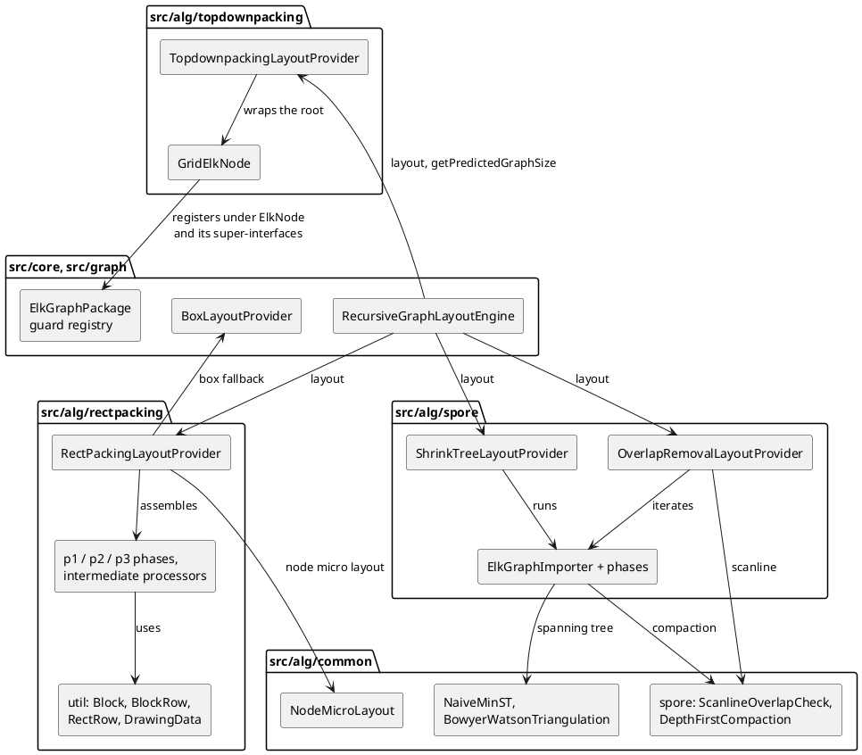
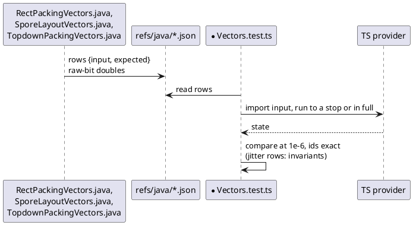

<!-- SPDX-License-Identifier: EPL-2.0 -->

# alg.rectpacking, alg.spore, alg.topdownpacking: the packing algorithms (mission 8c)

What mission 8c (`alg-packing`, roadmap row 8c, issue #39) ported: the bundles `org.eclipse.elk.alg.rectpacking`
(`elk.rectpacking`), `org.eclipse.elk.alg.spore` (the two algorithms `elk.sporeOverlap` and `elk.sporeCompaction`) and
`org.eclipse.elk.alg.topdownpacking` (`elk.topdownpacking`), with their generated option classes and providers. From here
`RecursiveGraphLayoutEngine` lays out a graph with each, once a test, replay or tool registers `RectPackingMetaDataProvider`,
`SporeMetaDataProvider` or `TopdownpackingMetaDataProvider`. This page covers the structure, the evidence, the decisions as built
(`GridElkNode` and the guard registry, the jitter of coincident centres, hashed containers, recursion, the desired-position
comparator, staging), the hazards for the next person, the open issues and a runbook. Decisions cited are
`plans/alg-packing/decisions.md` (PK1-PK12); task ids T1-T15 are in that mission's `decision-journal.md`; AD-n are
`plans/elk-engine-skeleton/decisions.md`. Counts live in [conformance.md](../conformance.md#alg-packing). The mission's diagrams are
[data-flow](../../plans/alg-packing/diagrams/data-flow.md) and [component-map](../../plans/alg-packing/diagrams/component-map.md);
the versions below describe what was built.

| Section                                                   | Answers                                                                        |
| --------------------------------------------------------- | ------------------------------------------------------------------------------ |
| [1. Structure](#alg-packing-structure)                    | The three bundles, their files, the pipelines, the registration                |
| [2. Evidence](#alg-packing-evidence)                      | Recorders and refs, replays, goldens, sweep, JUnit, coverage                   |
| [3. Decisions as built](#alg-packing-decisions)           | PK3 to PK8: `GridElkNode`, jitter, hashed containers, recursion, sort, TDZ     |
| [4. Hazards](#alg-packing-hazards)                        | Non-terminating inputs, cubic compaction, `getProperty`, the entry-module case |
| [5. Known divergences and open issues](#alg-packing-open) | Issues #73, #75, #76, #78, #79, #80, #81, #105 to #108                         |
| [6. Runbook](#alg-packing-runbook)                        | Re-recording, goldens, sweeps, the Java baseline                               |

## 1. Structure {#alg-packing-structure}

TS paths are under `src/alg/` (AD-7): one class per file, named as the Java class, `@see` per symbol. The option classes
(`rectpacking/options/{RectPackingOptions,RectPackingMetaDataProvider}.ts`,
`spore/options/{SporeOverlapRemovalOptions,SporeCompactionOptions,SporeMetaDataProvider}.ts`,
`topdownpacking/options/{TopdownpackingOptions,TopdownpackingMetaDataProvider}.ts`) are generated by `tools/melk` from
`tools/melk/sources/{RectPacking,SPOrE,Topdownpacking}.melk` (13, 10 and 2 option declarations, equal to the oracle's `src-gen`).
The hand-ported option enums are `OptimizationGoal`, `RootSelection` and `SpanningTreeCostFunction` (whole), and the strategy enums
whose `create()` builds phase classes: `WidthApproximationStrategy`, `PackingStrategy`, `WhiteSpaceEliminationStrategy`,
`CompactionStrategy`, `OverlapRemovalStrategy`, `StructureExtractionStrategy`, `TreeConstructionStrategy`,
`NodeArrangementStrategy`, `WhitespaceEliminationStrategy`.

| Bundle             | Pipeline                                                                                                                                                                                                                                                                                                                                                                   | Provider                                                      |
| ------------------ | -------------------------------------------------------------------------------------------------------------------------------------------------------------------------------------------------------------------------------------------------------------------------------------------------------------------------------------------------------------------------- | ------------------------------------------------------------- |
| rectpacking        | intermediate processors (`NodeSizeReorderer`, `InteractiveNodeReorderer`, `MinSizePreProcessor`; `MinSizePostProcessor` before P2); P1 width approximation (`GreedyWidthApproximator` or `TargetWidthWidthApproximator`); P2 packing (`Compactor`, `SimplePlacement`, `NoPlacement`); P3 whitespace elimination (`EqualWhitespaceEliminator`, `ToAspectratioNodeExpander`) | `RectPackingLayoutProvider`                                   |
| spore (overlap)    | underlying layout, then per iteration `ScanlineOverlapCheck`, `DelaunayTriangulationPhase`, `MinSTPhase` or `MaxSTPhase`, `GrowTreePhase`, until no overlap or `maxIterations`                                                                                                                                                                                             | `OverlapRemovalLayoutProvider`                                |
| spore (compaction) | underlying layout, `DelaunayTriangulationPhase`, `MinSTPhase` or `MaxSTPhase`, `ShrinkTreeCompactionPhase`                                                                                                                                                                                                                                                                 | `ShrinkTreeLayoutProvider` (with `ShrinkTree`)                |
| topdownpacking     | P1 `LeftRightTopDownNodePlacer` builds a `GridElkNode` grid; P2 `BottomRowEqualWhitespaceEliminator`                                                                                                                                                                                                                                                                       | `TopdownpackingLayoutProvider` (also `getPredictedGraphSize`) |

File map. rectpacking mirrors the Java packages: `util/` (`Block`, `BlockRow`, `BlockStack`, `RectRow`, `DrawingData`,
`DrawingDataDescriptor`, `DrawingUtil`), `options/InternalProperties`, `intermediate/`, `p1widthapproximation/`, `p2packing/`,
`p3whitespaceelimination/`, `RectPackingLayoutPhases`, `InteractiveRectPackingGraphVisitor`. spore: `graph/Graph`,
`ElkGraphImporter` (an `IGraphImporter`), `SPOrEPhases`, `p1structure/`, `p2processingorder/`, `p3execution/`, `ShrinkTree`. The
spore bundle reuses `alg.common`: `NaiveMinST`, `BowyerWatsonTriangulation`, `ScanlineOverlapCheck`, `DepthFirstCompaction`.
topdownpacking is one directory: `Grid`, `GridElkNode`, `INodeArranger`, `TopdownPackingPhases`, the placer, the eliminator, the two
enums and the provider.



**Splits forced by the limits** (no logic change, side-effect order kept; journal rows `T6`, `T9`, `T10`, `T11`, `T12`):
`Compaction.compact` (one 140-line Java body) is behind the class in `CompactionContext.ts` and `CompactionPlacement.ts`, which
are not Java classes; `Block.placeRectsIn`'s private overloads are `placeRectsInBounds`/`placeRectsInFits`;
`DrawingUtil.calculateDimensions` has two Java overloads over lists of different element types and is `calculateDimensions` and
`calculateDimensionsOfRectangles`; `AreaApproximation.calcValuesForOpt` takes `(option, PlacementContext)`;
`RectPackingLayoutProvider.layout` is `isStackable`, `boxLayout`, `invokeProcessors`, `finish`;
`OverlapRemovalLayoutProvider.layout` is `applyUnderlyingLayout`, `setAlgorithmProperties`, `removeOverlaps`. Java package-private
members are public. `System.err.println` (`Compaction.java:74`) is `console.error`; `float monitorProgress = 1.0f / n`
(`RectPackingLayoutProvider.java:107`) is `Math.fround`; `ElkUtil.debugFolderPath('spore')` returns `null` in the port, so the
five concatenations that the Java writes as `"null10bw"` call `String(...)` (`DelaunayTriangulationPhase.java:46`,
`MinSTPhase.java:62`, `MaxSTPhase.java:48`, `GrowTreePhase.java:52`, `ShrinkTreeCompactionPhase.java:46`).

**Registration (PK8).** Every option class imports its provider and the providers need the whole bundle, so neither side could
land first. T5 generated the options and staged 13 classes (`// @staged 8c`, rows in `test/architecture/staged-classes.json`): the
four providers and nine strategy enums whose `create()` threw. Each wiring task (T7 to T12) removed its own rows; the file is
`[]` and `PENDING_TYPES` is `[]`. The fitness test's `MARKER` was widened by one token (`8c`; pre-approved, no expected value
changed). `LayoutMetaDataService.getInstance()` is unchanged: a test, replay or tool registers a provider explicitly (the spore
provider registers both algorithms). `tools/corpus/ts-layout-compare.ts` and `test/golden/force-disco-goldens.test.ts` register the
three metadata providers; `test/golden/packing-goldens.test.ts` registers every provider the oracle registers
(`ElkOracle.java:218-221`).

## 2. Evidence {#alg-packing-evidence}

Every row was recorded from the oracle (ELK built from source with patches 0001 and 0002, `oracle-build.json`) under
`-XX:+UnlockExperimentalVMOptions -XX:hashCode=2` (PK1). A row is `{ id, group, input, expected }`; `input` is the graph as ELK
JSON, re-imported by the recorder before the run (round-trip self-check); doubles are 16-hex raw bits. Groups: `full` (the
result of `RecursiveGraphLayoutEngine`), `stops` (the state after each step), `throws` (class, message, first ELK frame), and per
bundle `sort` (PK7), `minst` (PK5), `jitter` (PK4), `objects` (the `JavaObjects.equals` vector) and `predicted`
(`getPredictedGraphSize`).



| Ref (under `test/golden/refs/java/`) | Recorder (`tools/vectors/`)                               |  Rows | full | stops | throws | other                          |
| ------------------------------------ | --------------------------------------------------------- | ----: | ---: | ----: | -----: | ------------------------------ |
| `rectpacking.json` (8,716,438 B)     | `RectPackingVectors.java`, `rectpacking-vectors.sh`       | 1,356 |  558 |   151 |      7 | sort 640                       |
| `spore-layout.json` (3,147,042 B)    | `SporeLayoutVectors.java`, `spore-layout-vectors.sh`      |   339 |  113 |    60 |      4 | minst 95, jitter 4, objects 63 |
| `topdownpacking.json` (2,798,698 B)  | `TopdownPackingVectors.java`, `topdownpacking-vectors.sh` |   898 |  296 |   288 |     18 | predicted 296                  |

The launchers are single-file JVM programs copied from `tools/vectors/DiscoVectors.java` (the row format, scenarios, seeds and
stop contract are in each program header). A cold rerun (`ELK_VECTORS_CACHE=off`) of each recorder by the orchestrator is
`cmp`-identical to its committed ref, and so is the rerun after each additive extension below.

**Stop names.** rectpacking: `begin`, `after:NodeSizeReorderer`, `after:InteractiveNodeReorderer` (with `CURRENT_POSITION`),
`after:MinSizePreProcessor`, `after:GreedyWidthApproximator` (with `state.drawing`, recomputed by
`AreaApproximation.approxBoundingBox` because the approximator discards its `DrawingData`), `after:TargetWidthWidthApproximator`,
`after:MinSizePostProcessor`, `after:Compactor` / `after:SimplePlacement` / `after:NoPlacement` (with `state.rows`: the rows,
blocks and stacks tables), `after:EqualWhitespaceEliminator` / `after:ToAspectratioNodeExpander`, `end`, taken at the provider's
own `logGraph` points through a logging `BasicProgressMonitor`. spore: `underlying`, `import`, `scanline` (per iteration),
`triangulation` (per iteration: `delaunay`, `edges`, `hash {capacity, maxBin, maxEqualHash, treeified}`), `tree`, `grow`,
`update`, `compaction`, `end`. topdownpacking: `p1` (grid: rows, cols, the real row-list sizes, cell ids), `p2`, `end`.

**Throw rows.** rectpacking: `targetWidthMissing` (`TargetWidthWidthApproximator.java:47`), `equalWithoutRows` and
`toAspectWithoutRows` (`EqualWhitespaceEliminator.java:50`), `emptyGreedy` (`AreaApproximation.java:70`), `desiredMinus1` and
`desiredMinus5` (`InteractiveNodeReorderer.java:75`). Until the `e7eaea57` pin (#99) a sixth, `throws/arm/noBestCandidate`
(`AreaApproximation.java:157`, `:98`: a `NullPointerException`), recorded the null best option; since
[eclipse-elk/elk#1215](https://github.com/eclipse-elk/elk/pull/1215) the graph lays out and is the rows
`full/arm/noBestCandidate/default` and `stops/arm/noBestCandidate/default`. spore:
`hyperedge` (2, `ElkGraphUtil.java:633`), `minRootDistanceNoRoot` (`ElkGraphImporter.java:72`). Until the `8bca22f4` pin
(#104) a fourth, `throws/overlap/scanlineHitboxes` (`ScanlineOverlapCheck.java:166`), recorded the scanline's rejection of two
nodes on one centre; since [eclipse-elk/elk#1244](https://github.com/eclipse-elk/elk/pull/1244) the input lays out and is the
rows `full/overlap/scanlineHitboxes/default` and `stops/overlap/scanlineHitboxes/default`. topdownpacking: 16 direct-call rows at the grid bounds (`GridElkNode.java:69-113`) and the walk-back
loop (`BottomRowEqualWhitespaceEliminator.java:58`), 2 engine rows with frames in `RecursiveGraphLayoutEngine`. A JDK-text
message (`ArrayList`, the helpful-NPE text) is compared by class and frame, not by message.

**The additive-extension rule.** A recorder is extended only by appending scenarios at the end of its scenario lists, never by
editing or reordering existing ones, so the committed rows stay valid evidence and the new rows are the only diff. T14b did this
twice: `rectpacking.json` 1,343 to 1,356 rows (seven arms no row reached, found by a seeded search of the port) and
`spore-layout.json` 274 to 276; T13 then appended the 63-row `objects` group after every other spore row (276 to 339). The proof
that an extension is additive, run against the revision before it:

```bash
git show <revision-before>:test/golden/refs/java/rectpacking.json > "$TMPDIR/before.json"
node --input-type=module - "$TMPDIR/before.json" test/golden/refs/java/rectpacking.json <<'EOF'
import { readFileSync } from 'node:fs';
const [oldPath, newPath] = process.argv.slice(2);
const rows = (p) => JSON.parse(readFileSync(p, 'utf8')).rows;
const before = rows(oldPath);
const after = rows(newPath);
const kept = new Set(before.map((r) => r.id));
const survivors = after.filter((r) => kept.has(r.id));
const same = survivors.length === before.length && survivors.every((r, i) => JSON.stringify(r) === JSON.stringify(before[i]));
console.log(same ? `additive: ${after.length - before.length} rows added` : 'NOT additive');
EOF
```

It prints `additive: 13 rows added` against the first rectpacking commit (`6b62b5c`) and `additive: 65 rows added` for
`spore-layout.json` against its first commit (`9966090`; 2 from T14b and 63 from T13). A cold re-record must `cmp`-equal the
new ref. Count pins in the replay tests follow the refs (`RectPackingVectors.test.ts` 558/151/7, the spore tests 113/60/4), so
an extension changes those constants and nothing else.

**Replays.** Stops are observed by test-side wrappers (a `BasicProgressMonitor` subclass for rectpacking, prototype wrappers
restored in `finally` for spore); production code has no hook.

| Test                                                   | Rows replayed                                                                                                                                     | Numeric fields compared                                                         |
| ------------------------------------------------------ | ------------------------------------------------------------------------------------------------------------------------------------------------- | ------------------------------------------------------------------------------- |
| `src/alg/rectpacking/RectPackingVectors.test.ts`       | 552 full (before T14b; now 558), 145 stops rows with 1,069 stops plus `final` (now 151), 6 throws (now 7), 640 sort rows                          | 66,304 doubles in full rows and 132,339 in stops, all bit-exact (counts at T12) |
| `src/alg/spore/SporeLayoutVectors.test.ts`             | full 111 of 112 (the 2,000-node compaction chain is behind `SPORE_CHAIN_FULL=1`), stops 59, minst 95, throws 4, jitter 4 (invariants over 3 runs) | 67,980 doubles, all raw-bit identical (counts at T11)                           |
| `src/alg/topdownpacking/TopdownPackingVectors.test.ts` | 296 full through `RecursiveGraphLayoutEngine`, 288 stops, 296 predicted, 18 throws                                                                | class, message (class and frame for JDK text) and numbers at 1e-6               |
| `src/java/util/JavaObjects.test.ts`                    | the 63 `objects` rows through the port's `KVector`, `TTriangle`, `TEdge` and `JavaObjects.equals`                                                 | every recorded boolean equals the port's                                        |

Isolated replays of the classes: rectpacking `p1` 165 stops (149 greedy with the recomputed `drawing`, 16 target-width), `p3` 34
stops (2,960 hex values bit-exact), `p2` 165 stops over 143 rows (before T14b), 641 blocks and 381 rows rebuilt and dumped back at
raw bits; spore `stops` 34,992 hex doubles and 13,636 for the `minst` rows. A replay-alone coverage run (the whole-ref replay files
without unit tests) is the measure of which arms an oracle row ran: rectpacking 373 of 426 branches, spore 64 of 85
(`plans/alg-packing/unreached.md`).

**Goldens (PK2).** `tools/oracle/regen-goldens.sh --set packing` writes `test/golden/refs/elk-packing/`: 44 refs (manifest
`test/golden/packing.json`, inputs under `test/golden/packing-inputs/`, `_meta.json` naming the oracle and `jvmFlags
-XX:hashCode=2`): rectpacking 17, sporeCompaction 13, sporeOverlap 7, topdownpacking 7. Entry ids are `<algorithm>--<option>-<value>`;
one golden per non-default value of each algorithm-specific option the algorithm reads, and the four `--minst-ties-<n>` entries
(`minst-ties-1` a 4 by 4 equally spaced grid, `minst-ties-2` the same lattice rotated 45 degrees, for each spore algorithm) that
meet equal-cost edges in `NaiveMinST`; the order sensitivity of the tie inputs is proven by a `minst` twin, not by the golden
(journal `T4 note`). No golden exists for options with one constant (`structure.structureExtractionStrategy`,
`compaction.compactionStrategy`, topdownpacking's two strategy options), for `currentPosition` (an output), or for
sporeOverlap's `processingOrder.*` (`OverlapRemovalLayoutProvider.java:67-72` overwrites them). Every input names
`elk.algorithm`, and `test/golden/packing-goldens.test.ts` (49 tests) asserts each ref's `resolvedAlgorithm` equals the entry's
algorithm (44 of 44), compares every entry at AD-4, and registers every provider the oracle registers. Inputs have distinct node
centres (PK4). The landed sets (`default`, `algorithms`, `layered`, `trees`, `force-disco`) regenerate byte-identically.

**Sweep (PK9).** Oracle `tools/oracle/sweep.sh --filter /<alg>/`, sequential, under `-XX:hashCode=2`; TS through
`tools/corpus/ts-layout-compare.ts --algorithms <alg>`. Nothing from the sweep is committed (AD-5). The categories: `ok` (oracle
and TS layouts equal at AD-4), `mismatch` (both finished, outputs differ), `both-throw` (both threw the same class),
`ts-only-throw` and `oracle-only-throw` (one-sided: always a finding), `nondeterministic` (the oracle's two runs disagreed; counted,
not compared, PK4).

| Algorithm       | planned |    ok | mismatch | both-throw | ts-only-throw | oracle-only-throw | nondeterministic (excluded) |
| --------------- | ------: | ----: | -------: | ---------: | ------------: | ----------------: | --------------------------: |
| rectpacking     |     919 |   830 |        0 |         89 |             0 |                 0 |                           0 |
| sporeOverlap    |     906 | 94-97 |      0-3 |      20-21 |             0 |               0-1 |                         788 |
| sporeCompaction |     906 |    99 |        0 |          0 |             0 |                 0 |                         807 |
| topdownpacking  |     906 |   906 |        0 |          0 |             0 |                 0 |                           0 |

The sporeOverlap ranges are four cases (section 5, issue #79). The table is the sweep of mission 8c; since the `8bca22f4` pin
(#104) the spore rows are sporeOverlap 879 `ok` and 27 `both-throw`, sporeCompaction 906 `ok`, with no excluded case
(section 3.2). No timeout and no hang (no corpus case reaches issue #73). The
8b residuals closed by registering rectpacking: the 6 force, stress and disco cases over
`interactiveRectpacking_{hierarchy,oneBigNode}` are `ok` and so are the 7 tree residuals of issue #68 item A.

**JUnit (PK10).** Eight suites, 30 runs, with the Java's assertions: `PaddingTest` 4, `CompactionTest` 10, `Issue583Test` 1
(`src/alg/rectpacking/`), `UtilsTest` 3, `ScanlineOverlapRemovalTest` 1 (`src/alg/spore/`; `EcoreUtil.Copier` is `copyGraph`),
`TopdownPackingTest` 4, `TopdownLayoutTest` 5, `PortPlacementCalculationTest` 2 (`src/alg/topdownpacking/`; the last two run fixed
and layered through `RecursiveGraphLayoutEngine`). The oracle runs at mission start are the same 30 runs with 0 failures
(`plans/alg-packing/java-baseline.md`). `InteractiveRectPackingGraphVisitor` has no oracle row because no code under `plugins/`
applies it; its evidence is a unit test of the Java's logic. `NodeMicroLayoutTest`, `PlainJavaInitializationTest` and
`ElkReflectTest` stay with mission 8x and are now unblocked.

**Coverage.** Each bundle from its own tests (`plans/alg-packing/unreached.md`): rectpacking statements 99.38 %, branches 98.12 %
(418 of 426), functions 98.46 %; spore 99.21 %, branches 100 % (85 of 85); topdownpacking statements 98.61 %, branches 96.42 %
(54 of 56); `alg.common/spore` 99.44 %, branches 97.56 %. `unreached.md` lists 18 `U` rows (branches proven dead from the Java,
each with its Java line and whether a unit test forces the arm) and one arm neither reached nor proven dead
(`Compaction.java:364`, issue #81). At the batch 5 gate the whole project was 49,156 tests passed, 98.92 / 96.99 / 98.84 / 98.92
(statements / branches / functions / lines).

## 3. Decisions as built {#alg-packing-decisions}

### 3.1 PK3: `GridElkNode` and the guard registry {#alg-packing-gridelknode}

`GridElkNode.java:44` is `implements ElkNode, Grid<ElkNode>`. Seven members hold logic (`put` at `:67-76` **inserts** with
`add(col, item)`, `:73`; `get`, `getRow`, `getColumn`, `getColumns`, `getRows`, `setGridSize`); every other member delegates to the
wrapped node, which stays in the tree (the wrapper is never stored in it). The one construction site is
`TopdownpackingLayoutProvider.java:43`. The wrapper reaches an `ElkNode`-typed consumer at `progressMonitor.logGraph`
(`BottomRowEqualWhitespaceEliminator.java:102`), which copies through accessors.

`src/alg/topdownpacking/GridElkNode.ts` (349 lines) is `class GridElkNode implements ElkNode, Grid<ElkNode>` over the TS
`ElkNode` interface, delegating every member the TS interface chain declares, including the 12 members TS adds from
`InternalEObject`; the 13 Java EMF members with no TS counterpart (`eClass`, `eGet`, `eSet`, ...; AD-11) are listed with their
lines in one comment. `put` keeps insert semantics: each row list is `cols` plus its node count long (every one of the 848 grid
stops of the ref has rows longer than `cols`), and `BottomRowEqualWhitespaceEliminator` walks back over the nulls. A mutation
check (set semantics for `put`) fails the replay with `$.cells[0]: length 2 expected, got 1`.

The registry change is in `src/graph/ElkGraphPackage.ts`: it maps an interface name to a list of classes; `registerImpl` appends a
class once; `isInstance` is true for any registered class; signatures are unchanged. `GridElkNode.ts` registers itself at module
end under `ElkNode`, `ElkConnectableShape`, `ElkShape`, `ElkGraphElement` and `EMapPropertyHolder`, so `isElkNode(grid)` is true
as Java's `instanceof` is. No landed guard result changed: `npx vitest run src/graph` passes with the new file, and with the old
`ElkGraphPackage.ts` swapped in only the one added case fails (journal `T8 note`). This is the landed-code change that PK3 marks
as an audit point. Rejected: an adapter exposing `.node` (rewrites every phase call site and the `logGraph` call),
`extends ElkNodeImpl` (a second node with its own containment and properties), and a narrower interface without the guard.

### 3.2 PK4: the jitter of coincident centres {#alg-packing-jitter}

`spore/ElkGraphImporter.java:178` shifts a node centre by `(random.nextDouble() - 0.5) * 0.001` while the centre equals one
already in the value-hashed `nodeMap` (`shiftUntilUnique`, `:263-268`). Since the `8bca22f4` pin (#104) `random` is a
`java.util.Random` seeded by `randomSeed` ([eclipse-elk/elk#1242](https://github.com/eclipse-elk/elk/pull/1242);
`:131-136`): the default seed is 1 for both spore algorithms, and a seed of 0 selects the unseeded `new Random()`. The port
uses the vector-proven `Random` shim and draws x before y, as Java evaluates the two arguments. `updateGraph` (`:233-253`)
calls the same method when overlap removal has moved a node onto another node's centre, and translates that node by the shift
([eclipse-elk/elk#1244](https://github.com/eclipse-elk/elk/pull/1244)).

Until `e7eaea57` the shift was an unseeded `Math.random()` (`:167-169` there), so two oracle runs on a graph with coincident
centres differed, and "nondeterministic" was a property of the input. What that left behind, and where it stands now:

- **Rows.** The recorder runs a real `ElkGraphImporter` on every planned row first and counts the vertices whose
  `originalVertex` differs from the centre; a row that reached the loop becomes a `jitter` row. The 4 `jitter` rows (corpus
  inputs x2 with 11 shifted vertices, `dup5` x2) record invariants only: node count, no remaining overlap, and an input-derived
  displacement bound (a bound derived from a run differed between two builds, so none is). The TS test checks the same
  invariants over three runs. The group keeps that form: `runsAgree` is recorded `true` now and the three runs give one dump;
  exact `jitter` rows are issue #106.
- **Exact evidence.** `full/overlap/scanlineHitboxes/default` and its stops row reach the `updateGraph` shift and replay at raw
  bits; `RandomSeedTest` is ported (default seed, explicit seed, seed selects the shift).
- **Goldens.** Every `packing` input has distinct centres, so goldens compare in full.
- **Sweep.** The oracle sweep runs each case twice; a case whose runs disagree is `nondeterministic` and is counted, not
  compared. That was 788 sporeOverlap and 807 sporeCompaction cases, plus four that flickered (issue #79). Now no spore case
  is `nondeterministic`: sporeCompaction is 906 `ok`, sporeOverlap 879 `ok` and 27 `throws`, and the port agrees on all 1,812.
- A seeded source in the port alone had been rejected (an API the Java lacked); the Java has it now.
- **One replaced test.** The hand-written unit test of `updateGraph`'s old collapse of equal centres contradicted #1244; under
  the ruling of issue #105 (2026-11-19) it asserts the shift instead: both nodes stay mapped and both are placed.

### 3.3 PK5: hashed containers {#alg-packing-containers}

| Site (Java, under `alg/spore`)                                                 | Keys                 | Iterated                                        | Port                                                                         |
| ------------------------------------------------------------------------------ | -------------------- | ----------------------------------------------- | ---------------------------------------------------------------------------- |
| `OverlapRemovalLayoutProvider.java:86` `overlapEdges`, `clear()` per iteration | `TEdge` (value hash) | yes, via `NaiveMinST`                           | `JavaHashSet` with the `TEdge` strategy; `clear` keeps capacity              |
| `p1structure/DelaunayTriangulationPhase.java` `addAll(triangulate(...))`       | `TEdge`              | yes                                             | the same set object; the insertion history is replayed                       |
| `ElkGraphImporter.java:113,234` `nodeMap`, `MinSTPhase.java:39`                | `KVector` (value)    | lookup only; `updateGraph` keeps centres unique | `JavaHashMap` with the `KVector` strategy of `NaiveMinST.ts`                 |
| landed `NaiveMinST`, `BowyerWatsonTriangulation`                               | `TEdge`, `TTriangle` | tie order = input set order                     | unchanged, proven for triangulation inputs by `TriangulationVectors.test.ts` |

The `minst` group records, per row, the edge sequence entering `NaiveMinST`, the tree with child order and `orderSensitive`
(the recorder re-runs with the edge list reversed): 95 rows, 76 `orderSensitive` (overlap 24 of 35, 7 of them on the scanline
path at iteration 1 or later; compaction 52 of 60); largest bin 6, no `minst` row treeified. The 76 rows replay in the recorded
order. A negative control (a fresh set per overlap iteration) iterates differently from the recorded sequence, so the
`clear`-keeps-capacity history is observable and is replayed. One row is treeified (`full/overlap/chain2000`,
`orderSensitive: false`): classified as the 8a rule says (a treeified bin is classified, not re-recorded), and it matches anyway.
The scanline `capacity` and `hash` fields are compared against a port of the recorder's list-bin model, since `JavaHashMap`
exposes no capacity. rectpacking and topdownpacking have no hashed container; `List.remove(Object)` and `contains` are identity
(`indexOf` on the array): `Compaction.java:101` `.equals(row)` is `!==`, `:132` `rows.remove(rows.get(i))` is `indexOf` plus
`splice`, `RectRow.removeBlock` is identity.

### 3.4 PK6: recursion {#alg-packing-recursion}

The probe ran both spore algorithms on 2,000-node paths in the oracle (default `-Xss`) and in TS, default and
`node --jitless`; both oracle runs complete. Largest path depth that completes before any conversion (TS default and `--jitless`
coincide except where noted; oracle default `-Xss`):

| Site                                                            | TS                          | Oracle                    | Action    |
| --------------------------------------------------------------- | --------------------------- | ------------------------- | --------- |
| `DepthFirstCompaction.compactTree`, real stack                  | ~1,250                      | 2,000 ok, 4,000 overflows | converted |
| `GrowTreePhase.growAt` with its `debugOut`                      | ~2,187 (`--jitless` ~1,437) | 2,000 ok                  | converted |
| `DepthFirstCompaction.getMinUnderlap`, `minUnderlapWithSubtree` | ~3,437                      | 8,000 ok                  | verbatim  |
| `DepthFirstCompaction.translateSubtree`                         | ~2,468                      | 4,000 ok                  | verbatim  |
| `MinSTPhase.addNode`                                            | ~4,406                      | 8,000 ok                  | verbatim  |
| both `drawTree`s (called unconditionally by the `debugOut`s)    | ~2,125, ~2,187              | 2,000 ok                  | verbatim  |

What was converted. `DepthFirstCompaction.compactTree` (landed code of mission 6a, handed to 8c by its journal) recursed once
per tree level through a `forEach` callback; it is an explicit-stack loop with the loop body split out as `removeUnderlap`.
`GrowTreePhase.growAt` is an explicit-stack loop with the body split out as `growChild`. Visit order is the Java's (children
lists are not mutated during the walk). Proof: `DepthFirstCompaction.explicit-stack.test.ts` and
`GrowTreePhase.explicit-stack.test.ts` compare against a verbatim recursive copy on 1,000 seeded trees per mode (five shapes,
`orthogonal` false and true for compaction) at raw bits of every node's vertex, original vertex and rectangle, plus call-order
tests of `translateSubtree` and `debugOut` and a 50,000-node path; reversing the child order fails the tests (negative control).
After the conversion `compactTree`'s own limit is ~3,437 and a real run is bounded by `translateSubtree` at ~2,468; `growAt` is
bounded by `drawTree` at ~2,187.

The flag-gated chain row. `full/compaction/chain2000/default` (a 2,000-node path of touching 200 by 20 rectangles, 0.0625
apart) runs only with `SPORE_CHAIN_FULL=1` because `DepthFirstCompaction` is cubic (section 4). With the flag it equals the oracle row
(8,004 doubles); the mission measured 321 s under vitest with the replay's wrappers. Before the conversion the same row failed with
`RangeError: Maximum call stack size exceeded`, and with `node --stack-size=30000` it completed with the same doubles, so the
overflow was a stack limit, not a semantic difference. `full/overlap/chain2000/default` is in the default suite, also green under
`--jitless`. The compaction chain row also passes under `--jitless` (one detached run with `SPORE_CHAIN_FULL=1` and
`SPORE_CHAIN_TIMEOUT` raised: 2,394 s). Beyond 2,000 nodes: issue #76. `Compactor.copyPosition`'s hierarchy
recursion stays verbatim (it is dead: `clone()` copies only direct children).

### 3.5 PK7: the desired-position comparator {#alg-packing-sort}

`InteractiveNodeReorderer.java:63-71` compares equal `desiredPosition`s by model order, the later node first (the re-insertion
below reverses them again), so it is a total order
([eclipse-elk/elk#1237](https://github.com/eclipse-elk/elk/pull/1237), followed since the `8bca22f4` pin, #104). The port
exports it as `compareDesiredPositions(modelOrder)`, a function of the model order map the Java lambda captures (`:50`, an
identity-keyed lookup map, so a plain `Map`), and sorts with `Array.prototype.sort`. The recorder's `sort` group runs
`Collections.sort` with a verbatim copy of that comparator on 640 tie-heavy position lists (lengths 1-64 times 10 shapes
`v0`-`v9`, seeded; ids `sort/L<length>/v<shape>`), and `Array.prototype.sort` reproduces all 640.

Until `e7eaea57` the comparator returned `-1` for a tie in both directions, a contract violation. The JVM sort threw
`IllegalArgumentException` "Comparison method violates its general contract!" on 34 rows and gave another order on 179, all of
length 32 or more; those 213 rows were classified in `test/helpers/rectpacking-sort-classified.ts` (issue #75). The re-record
changed exactly those 213 rows. The port's order did not change: `Array.prototype.sort` with the old comparator reproduces the
640 new rows too, so the classified rows had recorded the JVM sort, not a port difference. The helper is deleted. No TimSort
was written and no OpenJDK source was read (AD-9).

A recorder that copies Java code instead of calling it must follow the Java on a pin move: this group did not change until
its copy was updated (the upgrade runbook, section 11).

### 3.6 PK8: staging and TDZ {#alg-packing-tdz}

A strategy enum whose `create()` names phase classes that read the options is non-leaf: the generated provider reads the enum for a
default while the enum is uninitialised. Entries added to `NON_LEAF_DEFAULT_TYPES` in `tools/melk/config.ts`, each followed by
`npm run melk:generate <Bundle>` (only the provider file changed, its enum-typed defaults becoming lazy getters):

| Entry                                                               | Journal | Mechanism                                                                                                                                          |
| ------------------------------------------------------------------- | ------- | -------------------------------------------------------------------------------------------------------------------------------------------------- |
| `rectpacking.p1widthapproximation.WidthApproximationStrategy`       | T9      | the enum now imports phase classes that read `RectPackingOptions`                                                                                  |
| `rectpacking.p3whitespaceelimination.WhiteSpaceEliminationStrategy` | T9      | the same                                                                                                                                           |
| `rectpacking.p2packing.PackingStrategy`                             | T10     | the same recipe, with regeneration                                                                                                                 |
| `topdownpacking.NodeArrangementStrategy`                            | T8      | entering through the enum loads `LeftRightTopDownNodePlacer`, then `TopdownpackingOptions`, then the provider, whose static default reads the enum |

The spore bundle needed no entry. **The `EqualWhitespaceEliminator` entry-module caveat.** Loaded alone as the first module,
`EqualWhitespaceEliminator.ts` throws `Cannot access 'EqualWhitespaceEliminator' before initialization`:
`ToAspectratioNodeExpander extends` it and is reached first through options -> provider -> enum. This is the documented
base-class case (8b T8; the same shape as `AbstractForceModel`, [alg-force-disco.md section 6](alg-force-disco.md#alg-force-disco-cycle)):
tests enter through `RectPackingOptions`, and no entry-order import exists in `src/`. A per-module import smoke over the new
modules passes except for that one.

## 4. Hazards {#alg-packing-hazards}

- **Issue #73: non-terminating inputs (fixed upstream, in the port since the `8bca22f4` pin, #104).**
  `Compaction.absorbBlocks` looped forever when a block was listed twice in its row; the oracle and the port hung on the same
  input (11 children with `widthApproximation.strategy = TARGET_WIDTH`, `widthApproximation.targetWidth = 288`,
  `packing.compaction.rowHeightReevaluation = true`; the sizes are in the issue). The mechanism was `Compaction.java:412`
  (`row.addBlock(nextBlock)` without `nextBlock.setParentRow(row)`), then `:101`, `:117` and `:266-269`.
  [eclipse-elk/elk#1239](https://github.com/eclipse-elk/elk/pull/1239) adds the missing call (`:413`); the input of the issue and
  the input of the upstream test now terminate on both sides. A port fuzz over small graphs had hit the loop in about 1 of 1,200
  inputs with `rowHeightReevaluation`. The rule it taught stays: **a search for hanging inputs must never run in a vitest
  worker**. vitest cannot stop a synchronous loop, and one such worker spun at 99 % CPU for over an hour during mission 8c. Run
  each candidate in a child process under `timeout`, or with a step counter in the loop (T14b used both, about 900,000 inputs).
  `rowHeightReevaluation` is off by default.
- **Cubic `DepthFirstCompaction`.** Measured at the oracle on a path: 500 non-touching nodes 10.5 s, 1,000 nodes 80.8 s, 2,000
  touching 26.8 s. A 2,000-node non-touching chain is therefore not recorded, and tests of it use touching rectangles. Under
  coverage or machine load the cost multiplies (the T14 explicit-stack test timed out at 30-node trees under load and runs on trees
  of at most 16 nodes). Whole-ref loops carry `{ timeout: 60_000 }`.
- **`getProperty` on cloneable defaults.** `ElkGraphElement.getProperty` stores a copy of a cloneable default (`ElkPadding`,
  `ElkMargin`) on first read and changes the run. A dump or replay helper reads `getAllProperties()`, as the recorders do. A test
  that calls `getProperty(CoreOptions.PADDING)` on a fresh node must call `LayoutMetaDataService.getInstance()` first (the
  `ElkReflect` cloners register in its constructor).
- **Registered provider set.** Exported option keys (`layoutOptions.<suffix>`) depend on the providers registered; the golden test
  and the compare tool register every provider the oracle does.
- **Treeified hash bins.** A spore row whose order depends on a treeified bin is classified, not re-recorded; check the row's
  `hash.treeified` field before suspecting the port.
- **Delaunay set order.** The `TTriangle` set order inside `BowyerWatsonTriangulation` is not observable; a `delaunay` mismatch is
  checked against `TriangulationVectors` first.
- **NaN centres.** Some ptolemy models have a NaN centre component; `KVector.equals` is false against itself, so the shim
  `JavaObjects.equals` needs the identity test (section 5, landed shim). The same models are the 27 sporeOverlap cases that throw
  "Invalid hitboxes for scanline overlap calculation." on both sides: the scanline `TreeSet` compares two `NaN` rectangles as
  equal (`ScanlineOverlapCheck.java:131-141`), and `shiftUntilUnique` cannot see a `NaN` centre as taken (issue #108).

## 5. Known divergences and open issues {#alg-packing-open}

| Item                                        | State                                                                                                      |
| ------------------------------------------- | ---------------------------------------------------------------------------------------------------------- |
| 213 sort rows (PK7)                         | resolved by the `8bca22f4` pin: all 640 rows reproduce, the classified lists are deleted (section 3.5)     |
| 4 `RectRow.test.ts` rows                    | `CHILDREN_NOT_X_GROUPED_ROWS` is empty since the `8bca22f4` pin: every re-recorded row rebuilds its stacks |
| 4 nondeterministic sporeOverlap sweep cases | settled by the `8bca22f4` pin: the shift is seeded, no spore case is `nondeterministic` (section 3.2)      |
| `updateGraph` collapse unit test            | replaced by a test of the shift (eclipse-elk/elk#1244), ruling of issue #105                               |
| jitter rows, flag-gated chain row           | invariants only (exact rows: issue #106); `SPORE_CHAIN_FULL=1`                                             |
| landed shim `JavaObjects.equals`            | now true for one and the same object before calling `a.equals(b)`; 63 JVM rows (group `objects`) prove it  |

| Issue | Label          | Asks                                                                                                                                                                                                                                                                                                                                                                                         |
| ----: | -------------- | -------------------------------------------------------------------------------------------------------------------------------------------------------------------------------------------------------------------------------------------------------------------------------------------------------------------------------------------------------------------------------------------- |
|   #73 | `follow-up`    | the `absorbBlocks` hang: fixed upstream by eclipse-elk/elk#1239 and ported with the `8bca22f4` pin (#104); the issue's input terminates on the oracle and in the port                                                                                                                                                                                                                        |
|   #75 | `needs-ruling` | the 213 sort rows: resolved by eclipse-elk/elk#1237 and the `8bca22f4` pin (#104); all 640 rows reproduce                                                                                                                                                                                                                                                                                    |
|   #76 | `follow-up`    | spore recursion beyond 2,000 nodes: the port's limit at the remaining sites is below the oracle's (section 3.4); whether to convert them                                                                                                                                                                                                                                                     |
|   #78 | ruled          | the four rows that falsify the `calculateBlockStacks` premise of `RectRow.test.ts`: ruled 2026-11-14, the classified list `CHILDREN_NOT_X_GROUPED_ROWS` is the final form                                                                                                                                                                                                                    |
|   #79 | `follow-up`    | the nondeterministic sporeOverlap sweep cases: ruled 2026-11-14, fix the cause upstream; done by eclipse-elk/elk#1242 and the `8bca22f4` pin (#104), every spore sweep case has one verdict and the port agrees on all 1,812                                                                                                                                                                 |
|   #80 | `needs-ruling` | seven upstream defects the ports copy (`AreaApproximation.java:98` NPE, the unused visitor and its reversed `endsWith` at `InteractiveRectPackingGraphVisitor.java:47`, `RectRow.removeBlock`, the stale parent row, dead `calculateBlockStacks` and `copyPosition`, spore's overwritten margins, `ScanlineOverlapCheck.java:166`): which to file upstream, which to carry as oracle patches |
|   #81 | `follow-up`    | `Compaction.java:364`, the one arm neither reached nor proven dead: a constructive input (then an additive recorder row) or a proof from the Java (then a `U` row); a search must guard against #73                                                                                                                                                                                          |
|  #105 | ruled          | the `updateGraph` collapse unit test of `ElkGraphImporter.test.ts`, which eclipse-elk/elk#1244 contradicts: ruled 2026-11-19, replaced by the test of the shift                                                                                                                                                                                                                              |
|  #106 | `follow-up`    | exact `jitter` rows for the seeded shift (a recorder redesign)                                                                                                                                                                                                                                                                                                                               |
|  #107 | `follow-up`    | the `rows.size() > nextRowIndex` false arm of `placeBelow` and `placeBeside` (`Compaction.java:325`, `:416`), unreached since eclipse-elk/elk#1239: an input or a proof                                                                                                                                                                                                                      |
|  #108 | `follow-up`    | 27 sporeOverlap corpus cases throw "Invalid hitboxes" through `NaN` rectangles (a zero-size compound node, `ElkUtil.resizeNode`): whether to draft an upstream issue                                                                                                                                                                                                                         |

Issues #58 and #68 stay with the maintainer (evidence comments only); #71 was closed with its ruling.

## 6. Runbook {#alg-packing-runbook}

Check `uptime` first (a one-minute load above 12: wait) and run JVM work under `nice -n 10`. `$ELK_ORACLE_DIR` must hold the oracle
built by `tools/oracle/build.sh` at the stamp in `oracle-build.json`. The rectpacking recorder reads one corpus model from
`$ELK_MODELS_DIR` (SHA-checked; read only).

```bash
# re-record each ref; ELK_VECTORS_CACHE=off forces a cold run; the output must be cmp-identical to the committed ref
ELK_VECTORS_CACHE=off bash tools/vectors/rectpacking-vectors.sh "$TMPDIR/rp"
ELK_VECTORS_CACHE=off bash tools/vectors/spore-layout-vectors.sh "$TMPDIR/sp"
ELK_VECTORS_CACHE=off bash tools/vectors/topdownpacking-vectors.sh "$TMPDIR/tp"
cmp "$TMPDIR/rp/rectpacking.json" test/golden/refs/java/rectpacking.json
cmp "$TMPDIR/sp/spore-layout.json" test/golden/refs/java/spore-layout.json
cmp "$TMPDIR/tp/topdownpacking.json" test/golden/refs/java/topdownpacking.json

# regenerate the goldens; the refs must not change
for s in default algorithms layered trees force-disco packing; do tools/oracle/regen-goldens.sh --set "$s"; done
git diff --exit-code test/golden/refs/

# regenerate the options; src/ must not change
npm run melk:generate Core Labels Polyomino Layered Tree Radial VertiFlex Force Stress Disco RectPacking SPOrE Topdownpacking \
  && git diff --exit-code src/

# replays, goldens and the JUnit ports
npx vitest run src/alg/rectpacking src/alg/spore src/alg/topdownpacking src/alg/common/spore test/golden/packing-goldens.test.ts
SPORE_CHAIN_FULL=1 npx vitest run src/alg/spore/SporeLayoutVectors.test.ts   # adds the cubic chain row; minutes
```

`RECTPACKING_UNPINNED=1`, `SPORE_UNPINNED=1` and `TOPDOWNPACKING_UNPINNED=1` drop `-XX:hashCode=2` for an evidence run with
`ELK_VECTORS_CACHE=off`; never for a committed ref.

**Re-run the sweeps.** Per algorithm (`rectpacking`, `sporeOverlap`, `sporeCompaction`, `topdownpacking`), the oracle then the TS side:

```bash
JAVA_TOOL_OPTIONS="-XX:+UnlockExperimentalVMOptions -XX:hashCode=2" \
  nice -n 10 tools/oracle/sweep.sh --filter /rectpacking/ --out "$TMPDIR/sweep-rectpacking"
npx tsx tools/corpus/ts-layout-compare.ts --algorithms rectpacking --sweep-dir "$TMPDIR/sweep-rectpacking" --out "$TMPDIR/rectpacking.json"
```

Expect the numbers of section 2, and since the `8bca22f4` pin the spore numbers of section 3.2 (the seeded shift gives every
spore case one verdict, so a repeated comparison gives the same counts).
A long run is started detached, `nohup nice -n 10 bash -c '<command>; echo "exit $?"' >"$TMPDIR/<name>.log" 2>&1 &`, and polled.

**Extend a recorder.** Append the new scenarios at the end of the scenario list, re-record cold, then run the additive proof of
section 2 against the previous revision, update the count pins of the replay tests, and journal the row ids with the Java arm they
reach. A new row that does not replay is a finding: instrument the oracle and dump actual values before changing the port.

**The Java baseline.** `tools/oracle/java-tests.sh` carries the `alg.rectpacking.test`, `alg.spore.test` and `alg.topdown.test`
bundles (issue #97): run `MODELS_REPO=$ELK_MODELS_DIR nice -n 10 bash tools/oracle/java-tests.sh <classes>` with the landed
script. The class list and the scratch-copy recipe of the mission are in
[java-baseline.md](../../plans/alg-packing/java-baseline.md) as history. Expect 0 failures. At the
`8bca22f4` pin (#104) the rectpacking and spore classes run 34 times (`CompactionTest` 11, `PaddingTest` 4, `Issue583Test` 1,
`Issue1214Test` 4, `InteractiveNodeReordererTest` 3, `UtilsTest` 3, `ScanlineOverlapRemovalTest` 2, `RandomSeedTest` 6); the
topdownpacking classes run 11 times (`TopdownPackingTest` 4, `TopdownLayoutTest` 5, `PortPlacementCalculationTest` 2: the
counts of mission 8c, run again at the pin for #97). Any difference is a stop.

**Failures.** A row that differs: instrument the oracle and dump actual values before changing the port; trace the divergence to
the first stop where the port departs. A lone module that throws `Cannot access ... before initialization`: section 3.6. A sweep
case that flickers between runs: section 3.2. A test that hangs: section 4, issue #73.
