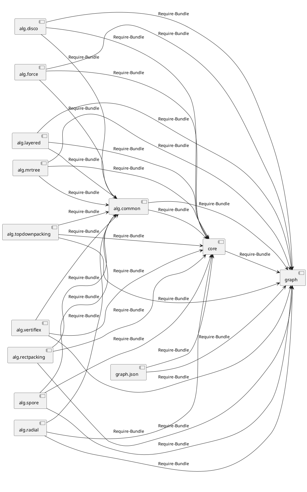
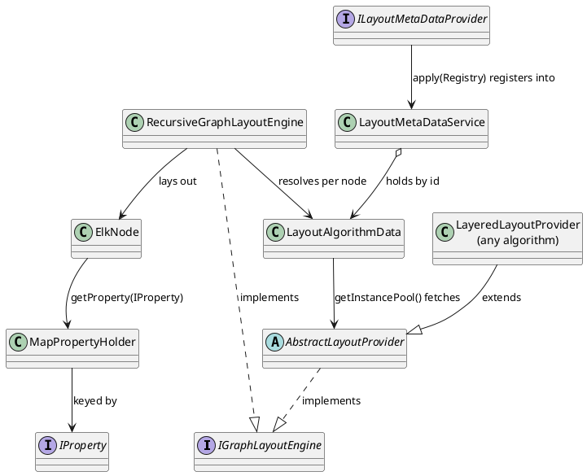

<!-- SPDX-License-Identifier: EPL-2.0 -->

# Component map

| Diagram                | Shows                                                    |
| ---------------------- | -------------------------------------------------------- |
| 1. Bundle dependencies | The 13 in-scope bundles and their `Require-Bundle` edges |
| 2. Core runtime        | How a layout algorithm plugs into the engine             |

Names omit the `org.eclipse.elk.` prefix. Scope: [inventory](inventory.md).

## 1. In-scope bundle dependencies

Source of truth: `test/architecture/bundle-deps.json`, derived from each bundle's
`META-INF/MANIFEST.MF` by `tools/bundle-deps.ts` and enforced by the fitness test (AD-8).
The diagram has **32 edges**, equal to the 32 `requires` entries in the JSON (graph.json x 2,
core x 1, alg.common x 2, nine algorithms x 3). Third-party requirements (Guava, EMF, Gson, Xtend
libraries) and out-of-scope bundles are omitted. An arrow `A --> B` means A requires B, so B's
directory may be imported by A's directory. `src/java` is importable everywhere and is not shown.

No algorithm requires another algorithm: the only shared dependency among algorithms is
`alg.common`. A new import between algorithm directories fails the fitness test unless the
Java manifest has the same edge.

## 2. Core runtime pieces

Class locations are under `$ELK_SOURCE_DIR/plugins/org.eclipse.elk.core/src/org/eclipse/elk/core`
unless noted; verified at the pinned commit.

| Class                             | Path                                | Role                                                                 |
| --------------------------------- | ----------------------------------- | -------------------------------------------------------------------- |
| `IGraphLayoutEngine`              | `IGraphLayoutEngine.java`           | `layout(ElkNode, IElkProgressMonitor)`                               |
| `RecursiveGraphLayoutEngine`      | `RecursiveGraphLayoutEngine.java`   | Walks hierarchy, runs the provider per level                         |
| `AbstractLayoutProvider`          | `AbstractLayoutProvider.java`       | Base class of every algorithm; implements `IGraphLayoutEngine`       |
| `LayoutMetaDataService`           | `data/LayoutMetaDataService.java`   | Singleton registry of algorithm, option, category data               |
| `ILayoutMetaDataProvider`         | `data/ILayoutMetaDataProvider.java` | `apply(Registry)`; one generated per algorithm bundle (from `.melk`) |
| `LayoutAlgorithmData`             | `data/LayoutAlgorithmData.java`     | Algorithm id plus `getInstancePool()` of providers                   |
| `IProperty` / `MapPropertyHolder` | `graph/.../graph/properties/`       | Typed option keys and the map holder behind `getProperty`            |
| `ElkNode` (ElkGraph)              | `graph/.../graph/ElkNode.java`      | Graph model; elements are `EMapPropertyHolder`                       |

Ported by mission 5a ([core-engine.md](core-engine.md)): `RecursiveGraphLayoutEngine` (split with
`RecursiveGraphLayoutEngineTopdown`, M17), `LayoutAlgorithmResolver`, and the `AbstractLayoutProvider` subclasses
`FixedLayoutProvider`, `BoxLayoutProvider` and `RandomLayoutProvider`. `LayoutMetaDataService`, `LayoutAlgorithmData`
and the property types came earlier (missions 2 and 3). Mission 5b ([core-engine.md](core-engine.md#mission-5b)) completed the bundle: `AlgorithmAssembler` and
`LayoutProcessorConfiguration` (the pipeline every algorithm bundle uses), `LayoutConfigurator`, `ElkSpacings`, the
`ElkMath` sections, `ElkGraphAdapters`, `util/selection/*` and `comments/*`. Its JDK shims are `src/java/awt/geom`
(`Rectangle2D`) and `src/java/util/regex` (`Pattern`, `WordBoundary`), next to `JavaCharacter` in `src/java/lang`;
they are proven by `awt.json`, `regex.json`, `character.json` and `regex-boundary.json`. Missions 6a and 6b ([alg-common.md](alg-common.md)) ported all of `alg.common`; 6b added `nodespacing` and `NodeMicroLayout`, proven by a 326-row `NodeMicroLayout` oracle replay.

How an algorithm plugs in:

1. The algorithm bundle supplies an `AbstractLayoutProvider` subclass (for example
   `alg.layered`'s `LayeredLayoutProvider`) and a `.melk` file declaring its id, options, and
   supported features.
2. The `.melk` compiler generates an `ILayoutMetaDataProvider` and an options class. Its
   `apply(Registry)` registers a `LayoutAlgorithmData` whose instance pool creates the provider.
3. `LayoutMetaDataService` collects the providers. `LayoutAlgorithmResolver` sets the algorithm id
   on each node from the `algorithm` option.
4. `RecursiveGraphLayoutEngine.executeAlgorithm` fetches a provider from the node's
   `LayoutAlgorithmData.getInstancePool()` and calls `layout(layoutNode, progressMonitor)`, then
   releases it (or calls `dispose()` after a failure).

In elk-engine the `.melk` step is replaced by a generator (AD-12, [melk-codegen.md](melk-codegen.md)) and ElkGraph
becomes plain TS classes (AD-11). Mapping to TS files: [port-map](port-map.md); rules:
[translation rules](../translation-rules.md).
