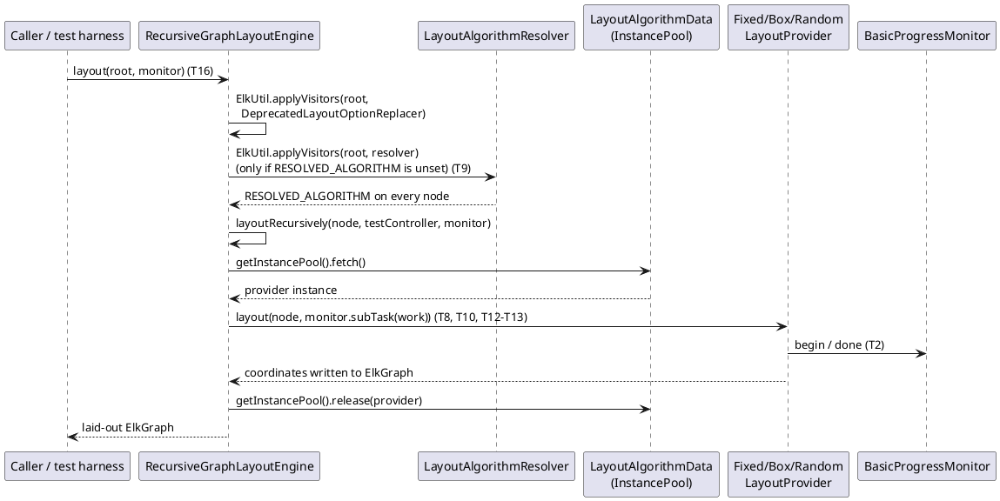
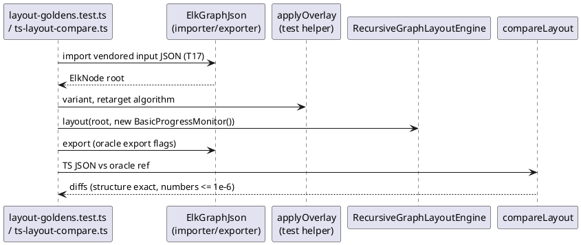

<!-- SPDX-License-Identifier: EPL-2.0 -->

# Core engine and the simple providers (mission 5a)

What mission 5a (`core-engine`, roadmap row 5, first half) ported, how a layout runs, and how to regenerate and
check the evidence. Decisions cited are `plans/core-engine/decisions.md` (M1-M17); task ids (T1-T20) are in
`plans/core-engine/decision-journal.md`. AD-n are `plans/elk-engine-skeleton/decisions.md`, C-n are
`plans/core-metadata/decisions.md`. Nothing here is exported from `src/index.ts` (AD-14). Corpus counts live in
[conformance.md](../conformance.md#core-layouts-fixed-box-random), not here.

| Section                                        | Answers                                                         |
| ---------------------------------------------- | --------------------------------------------------------------- |
| [1. What 5a ported](#what-5a-ported)           | Classes and where they live, by task                            |
| [2. Engine flow](#engine-flow)                 | What `layout(root, monitor)` does, per hierarchy level          |
| [3. Decisions](#decisions)                     | M1-M17, one line each                                           |
| [4. Codegen un-hold](#codegen-un-hold)         | How `PENDING_TYPES` was emptied and what broke on the way       |
| [5. Evidence](#evidence)                       | Golden sets, regeneration, ported tests, corpus comparison      |
| [6. Deferrals and upstream quirks](#deferrals) | What waits for 5b, 7a and 7h; behaviour kept verbatim from Java |

## 1. What 5a ported {#what-5a-ported}

| Area                   | TS files (under `src/core/`)                                                                                                                                                                                    | Task              |
| ---------------------- | --------------------------------------------------------------------------------------------------------------------------------------------------------------------------------------------------------------- | ----------------- |
| Exceptions, factory    | `util/AlgorithmFactory`, `UnsupportedConfigurationException`, `UnsupportedGraphException`, `validation/GraphValidationException`, `ITopdownLayoutProvider`, `testing/IWhiteBoxTestable`, `alg/ILayoutProcessor` | T1                |
| Test hooks             | `testing/TestController`                                                                                                                                                                                        | T7                |
| Progress monitors      | `util/BasicProgressMonitor`, `util/NullElkProgressMonitor`                                                                                                                                                      | T2                |
| `ElkUtil` (sections)   | `util/ElkUtil` composing `ElkUtil{Ports,Sizing,Junctions,Labels}` (T3) and `ElkUtil{Coordinates,Defaults,Visitors}` (T6)                                                                                        | T3, T6            |
| `ElkRectangle`         | `math/ElkRectangle` (pulled in from 5b)                                                                                                                                                                         | T3                |
| Fixed provider         | `util/FixedLayoutProvider`                                                                                                                                                                                      | T8                |
| Algorithm resolver     | `data/LayoutAlgorithmResolver`                                                                                                                                                                                  | T9                |
| Random provider        | `util/RandomLayoutProvider`                                                                                                                                                                                     | T10               |
| Validator              | `validation/GraphValidator`                                                                                                                                                                                     | T11               |
| Box provider           | `util/BoxLayoutProvider`, `BoxLayoutProviderGroup`, `BoxLayoutProviderGrouping`                                                                                                                                 | T12, T13          |
| Topdown size           | `options/TopdownSizeApproximator`, `options/TopdownSizeApproximatorUtil`                                                                                                                                        | T14               |
| Engine                 | `RecursiveGraphLayoutEngine`, `RecursiveGraphLayoutEngineTopdown`                                                                                                                                               | T16               |
| Generated option files | `options/{Fixed,Box,Random}LayouterOptions`, regenerated `options/CoreOptions`                                                                                                                                  | T8, T10, T12, T14 |

Other task outcomes:

- T4 vendored the golden inputs and produced the nine algorithm goldens (section 5).
- T5 changed `Property.test.ts` to start from `LayoutMetaDataService.getInstance()` as Java's `@BeforeClass` does (M8).
- T15 retired the graph.text stand-ins: the eleven `@deferred mission5` validate rows replay against the real
  registry, and `test/helpers/mission5-stand-ins.ts` is gone (M7, M9).
- T17 compared the nine goldens and ported `Issue457Test` and `Issue489Test` (M6).
- T18 ported the JSON and content-assist tests that waited for mission 5 (section 5).
- T19 produced the corpus comparison (section 5); T20 is this document.

`src/core/util/ElkUtil.ts` stays the only import point for callers; sections import sections only (M10, T6).
`BoxLayoutProvider` and the engine are split at Java method boundaries for the 500-line cap (M15, M17).

## 2. Engine flow {#engine-flow}

`RecursiveGraphLayoutEngine.layout` (T16) first normalises options, then resolves one algorithm per node, then
recurses; each level fetches a provider from the algorithm's `InstancePool`, runs it, and releases it. The Java
method `layoutRecursively` is split into `layoutContent`, `layoutIncludedChildren`, `layoutSeparateChildren`,
`layoutOwnContent` and a `layoutTopdown` delegate into `RecursiveGraphLayoutEngineTopdown.ts` (T16, M17).



Facts a harness must know (T16, journal):

- A pre-set `RESOLVED_ALGORITHM` on the root skips the resolver for the whole graph; unresolved descendants then
  throw "Resolved algorithm is not set". Resolve every level or none.
- The topdown size pre-computation fetches pool instances it never releases (`RecursiveGraphLayoutEngine.java:245`,
  `:253`); both kept.
- `BasicProgressMonitor.isCanceled()` is always `false`; cancellation tests need a subclass (T2, T16).
- `instanceof ITopdownLayoutProvider` becomes a structural `getPredictedGraphSize` check (T16).
- Null `Double` unboxing (`CHILD_AREA_WIDTH/HEIGHT`) throws `TypeError` where Java throws `NullPointerException` (T16).

Registry view: `CoreOptions.apply` ends with `new {Fixed,Box,Random}LayouterOptions().apply(registry)` exactly as
Java does, so a plain `LayoutMetaDataService.getInstance()` lists `fixed`, `box` and `random` (M7, T8, T10, T12). The
three have no category, so the service also creates the backup category `''` (T8, M13).

## 3. Decisions {#decisions}

| ID  | Decision                                                                                                                               |
| --- | -------------------------------------------------------------------------------------------------------------------------------------- |
| M1  | Roadmap row 5 splits: 5a `core-engine` (this document) and 5b `core-remainder`                                                         |
| M2  | `elkjs-exclude` blocks are dropped (C8 precedent); logs stay in memory; `getDebugFolder()` is `null`; `debugFolderPath` returns `null` |
| M3  | `BasicProgressMonitor` timing uses `performance.now()`; `getExecutionTime()` returns seconds as Java computes them; no clock API       |
| M4  | Curated fixed/box/random goldens (nine) in `test/golden/algorithms.json`, inputs vendored to `test/golden/inputs/`                     |
| M5  | A local, uncommitted comparison of 898 retarget cases per algorithm; counts go to `docs/conformance.md`                                |
| M6  | `testEmptyAlgorithmId` waits for 7a; Issue 457/489 ported with a vitest harness; spacing/alg/spline tests go to 5b                     |
| M7  | Registry growth: replay vectors first; regenerate only by script when traced to registry state; else AD-13 STOP                        |
| M8  | `Property.test.ts` mirrors become `LayoutMetaDataService.getInstance()` (as Java `@BeforeClass`)                                       |
| M9  | Tripwire tests built to fail at mission 5 are flipped by the task that registers each algorithm                                        |
| M10 | `ElkUtil` is split into section modules (C3-amendment precedent)                                                                       |
| M11 | `math/ElkRectangle` moves from 5b into 5a with the two `PortAdapter` overloads of `ElkUtil`                                            |
| M12 | Algorithm `*Options` classes expose option constants as cached static getters (breaks the `CoreOptions` ESM cycle)                     |
| M13 | Stub-registry tests in `src/core/data` become registry-independent                                                                     |
| M14 | Stub algorithm ids must not share a suffix with a core algorithm (`fixed`, `box`, `random`)                                            |
| M15 | `BoxLayoutProvider` splits into provider, `BoxLayoutProviderGroup.ts` and `BoxLayoutProviderGrouping.ts`                               |
| M16 | Generated `*_DEP_*` constants become cached private static getters in every option file                                                |
| M17 | The engine's topdown section moves to `RecursiveGraphLayoutEngineTopdown.ts`; tests split likewise                                     |

The M9 edits: each task that registered an algorithm edited the tripwires for that type only (T8 fixed, T10
random, T12 box, T14 the topdown dependency); the journal rows list every edited assertion.

## 4. Codegen un-hold {#codegen-un-hold}

`PENDING_TYPES` in `tools/melk/config.ts` is now `[]` (T14); nothing is held back. The procedure that was followed,
once per type, in the task that ported the type (M9):

1. Port the class; remove its entry from `PENDING_TYPES`.
2. `npm run melk:generate`; a new `*LayouterOptions.ts` appears and the comment in `CoreOptions.apply` becomes the call.
3. Run `npx vitest run test/melk src/core/data src/graph/json`; edit only the M9 tripwires, for that type.
4. Replay the vectors (M7): no row differed in T8, T10, T12 or T14, so nothing was regenerated.
5. Confirm `npm run melk:generate` is idempotent.

Two ESM cycles surfaced and were closed in the emitter: M12 (T8, entering through `CoreOptions` read an algorithm
class constant in its TDZ) and M16 (T14, entering through `TopdownSizeApproximator` evaluated a `*_DEP_*` constant
eagerly). Details, with the retired scaffolding, are in [melk-codegen.md](melk-codegen.md#lazy-constants).

## 5. Evidence {#evidence}

**Golden sets (M4, T4).** Two sets exist and are separate: the default set (`test/corpus/manifest.json` to
`test/golden/refs/elk`, frozen at 3-5 entries by `corpus.test.ts`) and the algorithms set
(`test/golden/algorithms.json` to `test/golden/refs/elk-algorithms`, with its own `_meta.json`). The algorithms set
holds nine goldens, three each for `fixed`, `box` and `random` (`random` uses the variant `random-seed-1` in
`test/corpus/variants.json`). Inputs are vendored under `test/golden/inputs/` with a sha check against the pinned
corpus. Both sets are byte-stable across regeneration (T4).

Regenerate by script only, never by hand (AD-5, AD-13); journal the regeneration with the patch ids from `_meta.json`:

```bash
tools/oracle/regen-goldens.sh                    # default set
tools/oracle/regen-goldens.sh --set algorithms   # fixed, box, random
git diff --exit-code test/golden/refs/           # empty when nothing meant to change
```

**Layout check (T17).** `test/golden/layout-goldens.test.ts` imports each vendored input, applies the overlay
(`test/helpers/graph-overlay.ts`, the port of `GraphOverlay.java`), lays it out with the engine and compares with
`compareLayout` (structure exact, numbers within 1e-6, AD-4). All nine equal the oracle on the first run, with no
engine or provider change (T17).



**Ported JUnit tests.**

| Java test                                                                                       | TS file                                                | Task   |
| ----------------------------------------------------------------------------------------------- | ------------------------------------------------------ | ------ |
| `RecursiveGraphLayoutEngineTest` (3 of 4 cases)                                                 | `src/core/RecursiveGraphLayoutEngine.test.ts`          | T16    |
| `GraphValidatorTest`                                                                            | `src/core/validation/GraphValidator.test.ts`           | T11    |
| `ElkUtilTest` cases for the ported sections                                                     | `src/core/util/ElkUtil*.test.ts`                       | T3, T6 |
| `Issue457Test`, `Issue489Test` (small, large)                                                   | `src/core/issues/Issue{457,489}Test.test.ts`           | T17    |
| `SectionsTest.preserveSectionIdsTest`, `TransferLayoutTest.transferLayoutEdgeSectionExistsTest` | `src/graph/json/{Sections,TransferLayout}Test.test.ts` | T18    |
| `LayoutDataContentAssistTest.testAlgorithmSpecificKnown/Unknown` (closes C10)                   | `src/core/data/LayoutDataContentAssist.test.ts`        | T18    |

**Corpus comparison (M5, T19).** `tools/corpus/ts-layout-compare.ts` lays out the 898 retarget inputs per algorithm
and compares them with a local oracle sweep. The sweep outputs are not committed (AD-5). The runbook, the counts and
the known divergences are in the conformance section
[Core layouts (fixed, box, random)](../conformance.md#core-layouts-fixed-box-random); see the conformance section for
counts. A mismatch with a named mechanism goes to the known-divergences list; an unnamed one is a stop (M5).

## 6. Deferrals and upstream quirks {#deferrals}

**Deferred, with owner.**

- `RecursiveGraphLayoutEngineTest.testEmptyAlgorithmId` (default resolves to layered): mission 7a, unchanged (M6; T16
  header).
- Four `ElkMathTest` rectangle cases: they call `ElkMath.contains/intersects`, so they wait for 5b's `ElkMath`
  (M11, T3).
- 5b (`core-remainder`, M1, minus `ElkRectangle` per M11): `alg/*` (rest), `comments/*`,
  `math/{BezierSpline,CubicSplineInterpolator,ISplineInterpolator}`, the rest of `ElkMath`,
  `util/adapters/ElkGraphAdapters`, `util/selection/*`, `ElkSpacings`, `LayoutConfigurator`,
  `PropertyConstantsDelegator`, `AbstractRandomListAccessor`, `DefaultFactory`, `Triple`, `Quadruple`,
  `WrappedException`, a `java.awt.geom.Rectangle2D` shim, and `LayoutConfiguratorTest`, `SpacingConfigurationTest`,
  `AlgorithmAssemblerTest`, `LayoutProcessorConfigurationTest`, `BezierSplineTest`, `CubicSplineInterpolatorTest`, the
  rest of `ElkMathTest`. The issue tests apply the configurator body by hand until `LayoutConfigurator` lands (T17).
- Mission 7h: `EdgeCoordsTest`, `exportLayoutOptions`, `importIndividualSpacingsTest` (T18).
- Showcase entries for the algorithm goldens are later docs work (M4).

**Dropped `elkjs-exclude` blocks (M2).** `BasicProgressMonitor` (22 markers), `ElkUtil` (4: the `debugFolderPath`
body, `toSafePathName`), `NullElkProgressMonitor` (2). Code inside the markers is dropped with a one-line comment
naming the Java lines; `toSafePathName` is not ported (T2, T6).

**Java behaviour kept verbatim (do not fix).**

- `TestController.removeLayoutExecutionListener` calls `listeners.add` (`TestController.java:180-182`, T7).
- `NullElkProgressMonitor.begin` returns `false` (`:37-39`, T2).
- `ElkUtil.determineJunctionPoints` re-checks the main edge inside the other-edge loop (`ElkUtil.java:537-541`, T3).
- `RandomLayoutProvider` treats every edge as a self-edge: target read from `getSources().get(0)` (`:167`), port parent
  x added twice (`:159-160`, `:175-176`), y offset uses `padding.getLeft()` (`:113`); the border branches `:198-237`
  are unreachable (T10).
- `FixedLayoutProvider.applyBendPoints` keeps the latent `remove()` bug (T8, M4); `RandomLayoutProvider` calls
  `remove()` without `next()` (`:189-191`) and throws `IllegalStateException` for edges with more than one
  section (T10).
- `BoxLayoutProvider` with one child: `areaStdDev` is `0/0`, NaN max row width, never wraps (T12); the default aspect
  ratio is the float `1.3` (T12).
- Oracle outputs bare `NaN` for most hierarchical fixed layouts of the ptolemy models (57 of 60 probed, T4); the
  comparison reads them (T19, see the conformance section).
