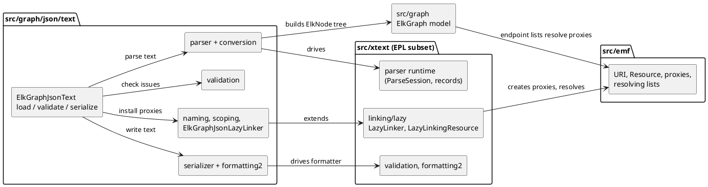
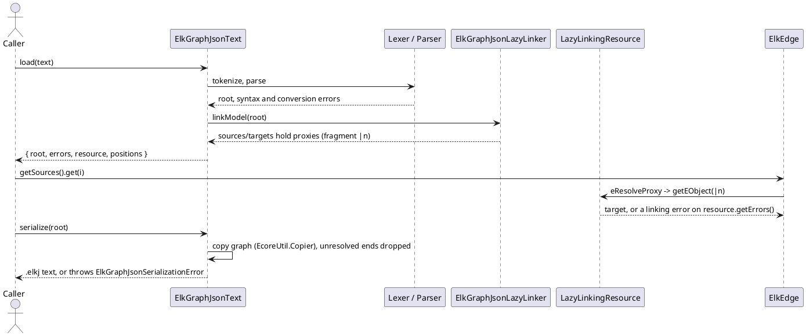

<!-- SPDX-License-Identifier: EPL-2.0 -->

# ELK Textual JSON (`.elkj`) and lazy linking

How `org.eclipse.elk.graph.json.text` became `src/graph/json/text/` on the Xtext subset of mission 4b
(`src/xtext/`), and which EMF and Xtext pieces mission 4c added for it. Decisions D1-D13 and the D2 amendment
are `plans/graph-json-text/decisions.md`; every deviation below is journaled in
`plans/graph-json-text/decision-journal.md`. Package status is in the [port map](port-map.md); measured
conformance and the accepted differences are in [conformance.md](../conformance.md#elk-textual-json-elkj). The
sibling port is [elk-text.md](elk-text.md); this page only describes where `.elkj` differs.

| Section                               | Answers                                                                 |
| ------------------------------------- | ----------------------------------------------------------------------- |
| [1. What `.elkj` is](#what-it-is)     | The language, its grammar facts and where ELK produces it               |
| [2. File map](#file-map)              | Which TS file stands for which Xtend/Xtext file; what 4c added to `src` |
| [3. Diagrams](#diagrams)              | Component structure and the lazy `load`/`serialize` flow                |
| [4. Decisions](#decisions)            | D1-D13 in one table                                                     |
| [5. Lazy linking](#lazy-linking)      | D13: proxies, resources, the resolving lists, and the evidence          |
| [6. Entry point and writer](#entry)   | `ElkGraphJsonText.load`/`validate`/`serialize` and the formatter        |
| [7. Evidence](#evidence)              | Which vectors, refs and sweeps prove the port                           |
| [8. Runbook](#runbook)                | Regenerating evidence, with the expected outcome of each step           |
| [9. Deferrals and quirks](#deferrals) | What is intentionally not matched, and why                              |
| [10. Maintenance](#maintenance)       | Failure modes and the response to each                                  |

## 1. What `.elkj` is {#what-it-is}

`.elkj` is ELK's textual JSON format: JSON-shaped, with Xtext-style leniency. The grammar
`ElkGraphJson.xtext` accepts plain ELK JSON, because members it does not know fall to a generic `JsonMember`
rule. Facts the port depends on (all recorded on the JVM):

- Keys may be bare, `"double-quoted"` or `'single-quoted'`; the three spellings of a known key lex as the same
  keyword token. A string value or reference that equals a quoted keyword (`"id"`, `"x"`, `"text"`) is therefore
  a syntax error, so real ELK JSON with `sections` (which holds `"id"` and `"x"`) is rejected.
- Property keys that are unknown keep their quotes in the `Property` id; known keys resolve by suffix.
- Each list entry is written under its own keyword (`"children": [..], "children": [..]`).
- `sources`/`targets` are cross-references by flat name (`DefaultQualifiedNameConverter`); a dotted name never
  resolves.

ELK itself produces `.elkj` only through `ConvertGraphHandler` (`graph.json.text.ui`): `EcoreUtil.copy`,
`GraphIdentifierGenerator.forGraph(g).assertValid.assertExists.assertUnique.execute()`, then
`resource.save(Collections.EMPTY_MAP)`, which is the serializer without the formatter. The pinned elk-models
holds no `.elkj` file (D2), so the oracle's `convert` mode applies those steps to the corpus.

## 2. File map {#file-map}

The Java is canonical (CLAUDE.md, "The Java Is Sacred"). The grammar (D7) is ported as a hand-written lexer and
recursive-descent parser, one method per rule; the generated `src-gen` ANTLR code is the edge-case
specification and is never ported. `ElkGraphJsonRuntimeModule.xtend` and the standalone setup become plain
construction in `ElkGraphJsonText.ts` and `ElkGraphJsonTextServices.ts` (no DI framework).

`src/graph/json/text/` (13 Xtend files and 1 Java file upstream, 908 hand-written lines; tests colocated):

| Directory / file                            | Upstream                                              | Notes                                                                                                                          |
| ------------------------------------------- | ----------------------------------------------------- | ------------------------------------------------------------------------------------------------------------------------------ |
| `ElkGraphJsonText.ts`, `...TextServices.ts` | `ElkGraphJsonRuntimeModule`, `...StandaloneSetup`     | port-local entry point (section 6) and the scoping/linking wiring `load` and `serialize` share                                 |
| `parser/`                                   | `ElkGraphJson.xtext`, `src-gen/.../InternalElkGraph*` | `ElkGraphJsonLexer`, `ElkGraphJsonParser` (+ `Elements`), `ElkGraphJsonRecords`, `ElkGraphJsonTokenType`                       |
| `conversion/`                               | `conversion/*.xtend`                                  | service, `NumberValueConverter`, `PropertyKeyValueConverter`, `PropertyValueValueConverter`                                    |
| `naming/`, `scoping/`                       | `naming/*.xtend`, `scoping/*.xtend`                   | flat names (D4 registry), `ElkGraphJsonScopeProvider`                                                                          |
| `linking/`                                  | `ElkGraphJsonRuntimeModule` bindings (`LazyLinker`)   | `ElkGraphJsonLazyLinker`, `ElkGraphJsonReferences` (both metamodels), `createElkGraphJsonLinking`, `createScoping` (C1, below) |
| `validation/`                               | `validation/ElkGraphJsonValidator.xtend`              | empty validator; `ElkGraphJsonMapEntryFeatures` is a local copy of the `.elkt` provider (AD-8)                                 |
| `serializer/`                               | `serializer/*` and the generated sequencer            | grammar-specific writer (D3); `ElkGraphJsonGrammarAccess`/`RuleIds` carry port-local grammar ids                               |
| `formatting2/`                              | `formatting2/ElkGraphJsonFormatter.xtend`             | line by line over `src/xtext/formatting2`; `src/graph/util/ElkGraphCopy` is the `EcoreUtil.copy` before writing                |

What mission 4c added outside `src/graph/json/text/`:

| Where                                                                  | What                                                                                                                                                                                                                                                                                                                                              |
| ---------------------------------------------------------------------- | ------------------------------------------------------------------------------------------------------------------------------------------------------------------------------------------------------------------------------------------------------------------------------------------------------------------------------------------------- |
| `src/xtext/parser/`                                                    | The grammar-agnostic parse runtime moved here from `src/graph/text/parser/ParseRecords.ts` (D1): `ParseSession`, `TokenCursor`, `ParseRecords`, `SessionVocabulary`, `LineSource`, ...                                                                                                                                                            |
| `src/xtext/linking/lazy/`                                              | `LazyLinker`, `LazyLinkingResource` (6 files split at method boundaries), `LazyURIEncoder`, `ILazyLinkingResource`, `LazyLinkingMetamodel`                                                                                                                                                                                                        |
| `src/xtext/{util,service,diagnostics}/`, `src/equinox/core/runtime/`   | text-follow-ups T5 (C3) moved the stand-ins to their Java packages: `util/CancelIndicator`, `service/{OperationCanceledError,OperationCanceledManager}`, `diagnostics/ExceptionDiagnostic`, and Equinox's `OperationCanceledException` to `src/equinox/core/runtime/` (the `src/equinox` boundary rule is in [elk-text.md](elk-text.md#file-map)) |
| `src/xtext/nodemodel/impl/`                                            | `InternalNodeModelUtils` (`computeLineBreaks`, `getLine`): the node-model line numbers diagnostics use                                                                                                                                                                                                                                            |
| `src/xtext/validation/`                                                | `EValidatorRegistrar` gained the `validator == null` branch `.elkj` takes (section 9)                                                                                                                                                                                                                                                             |
| `src/emf/common/util/URI.ts`                                           | `URI`, string operations only                                                                                                                                                                                                                                                                                                                     |
| `src/emf/ecore/resource/`                                              | `Resource`, `ResourceSet` and `Resource.Internal`/`ResourceImpl` subsets (`getURI`, `getContents`, `getErrors`, `getWarnings`, `getEObject`)                                                                                                                                                                                                      |
| `src/emf/ecore/` (`InternalEObject`, `impl/BasicEObjectImpl`, `util/`) | `eProxyURI`/`eIsProxy`/`eResolveProxy`/`eResource`, `EcoreUtil.resolve`, `InternalEList`, `EObjectResolvingEList`, `EObjectWithInverseResolvingEList` + `ManyInverse`                                                                                                                                                                             |
| `src/graph/impl/`                                                      | `ElkEdge.sources/targets` and `ElkConnectableShape.outgoingEdges/incomingEdges` use the resolving lists                                                                                                                                                                                                                                           |

The split rule is the one in [elk-text.md section 1](elk-text.md#file-map), enforced by
`test/architecture/module-boundaries.fitness.test.ts`: `src/graph/json/text` is in `XTEXT_CLIENT_BUNDLES` and may
import only `src/core`, `src/graph` and `src/xtext`; `src/xtext` still imports no ELK code. The proxy class is
created by a `graph.json.text` subclass so `src/xtext` never imports `src/graph`.

## 3. Diagrams {#diagrams}

## 4. Decisions D1-D13 {#decisions}

| ID  | Decision                                                                                                             |
| --- | -------------------------------------------------------------------------------------------------------------------- |
| D1  | Generic parse runtime moves to `src/xtext/parser/`; `src/graph/text` keeps its grammar tables (amended by T7, below) |
| D2  | Three parse tiers (ELK-native, ELK JSON as `.elkj`, lenient scenarios) plus a writer tier; size-capped sweep (A')    |
| D3  | Writer is a grammar-specific sequencer plus `ElkGraphJsonFormatter` line by line; no generic NFA (stop 10)           |
| D4  | Refs and vectors use the CoreOptions-only registry (`ORACLE_REGISTRY=core`)                                          |
| D5  | Internal entry point `ElkGraphJsonText`: `load`, `validate`, `serialize`; not exported (AD-14)                       |
| D6  | Syntax errors match by presence only; linking, conversion and validator issues match exactly                         |
| D7  | The hand-written lexer reproduces the generated ANTLR lexer, including quoted keywords vs `STRING`                   |
| D8  | Committed: JVM vectors plus curated refs with vendored inputs (CI); the sweep is local only                          |
| D9  | One mission, 18 tasks, 9 batches; unsigned task commits; the user signs by rebase; merge commit                      |
| D10 | AD-16: Java error conditions and exception chains, no new Java-named shims for uncaught JVM errors                   |
| D11 | Eager resolution with lazy-equivalent results (option B); superseded by D13                                          |
| D12 | Oracle patch `0002` makes `GraphIdentifierGenerator`'s id-collision `Random` seedable (user, 2026-10-15)             |
| D13 | D11 amended to option A (user, 2026-10-16): lazy linking with real EMF proxies; amends mission-2 D4                  |

D1 was amended during T7 (user, stop 5): `ParseSession.identifier()/number()` named `.elkt` token types and rule
names, so the shared session takes a `SessionVocabulary`; `src/graph/text` gained `ELK_GRAPH_VOCABULARY` and one
constructor argument, with all 3,487 4b tests unchanged.

## 5. Lazy linking (D13) {#lazy-linking}

`ElkGraphJsonRuntimeModule.xtend` binds no `ILinker`, so Xtext's `DefaultRuntimeModule` binding `LazyLinker`
applies: after `load`, `ElkEdge.sources`/`targets` hold EMF proxies, and a reference resolves when it is read (the
exporter, validation's lazy cross-reference resolution, or an explicit `resolveLazyCrossReferences`). `.elkt`
binds the eager `ElkGraphLinker`, and the port keeps that eager linker for `.elkt` unchanged.

The mission first chose D11 option B (resolve eagerly, surface diagnostics where the oracle does). The T3 vectors
showed that an unresolved reference stays in `sources`/`targets` as a proxy and that the JSON export throws at the
first one, so the user chose option A (2026-10-16): port the lazy machinery rather than imitate it. The plan
record is `plans/graph-json-text/batch-5/d13-plan.md`; tasks T12a-T12f and T12h replace the original T12.

What was ported (Xtext 2.36.0 and EMF EPL sources; every branch except `OPTION_RESOLVE_ALL` and the eager-linking
flag, which no caller passes):

- `LazyURIEncoder`, `LazyLinker`, `LazyLinkingResource` into `src/xtext/linking/lazy/`; the fragment of a proxy
  is `|n` (index mode), `n` counting in model traversal order (nested children's edges first, sources before
  targets), not text order.
- `URI` (string operations only), `Resource`/`ResourceSet`, `eProxyURI`, `eIsProxy`, `eResolveProxy`,
  `eResource()` and `EcoreUtil.resolve`. Multi-segment fragment paths throw `UnsupportedOperationException`
  (the reflective segment lookup is unported; `.elkj` uses `|n` only).
- The resolving lists `EObjectResolvingEList` and `EObjectWithInverseResolvingEList.ManyInverse` back the four
  endpoint/inverse lists. `indexOf` scans for proxies only when the list `hasProxies()`. Notifications,
  `lastIndexOf`/`removeAll` hooks and the `Unsettable` variants are not ported. `ElkEdgeSectionImpl` stays
  non-resolving (no proxies reach sections). Cost of the accessor change: about +10% on a 10k-edge
  microbenchmark; no layout test slowed.
- The `.elkj` proxy class is `ElkNode`, the first instantiable `ElkConnectableShape` subtype in `elkgraph.ecore`.

Evidence for the observable behaviour (all replayed in CI):

| Evidence                                                                   | Shows                                                                                                                                                                                |
| -------------------------------------------------------------------------- | ------------------------------------------------------------------------------------------------------------------------------------------------------------------------------------ |
| T3 parse rows: `proxiesAtLoad`, `links`, four diagnostic lists             | no linking diagnostic at load; diagnostics after links, after resolve-only and after export; export stops at the first unresolved proxy                                              |
| T12h `graph-json-text-inverse.json`: 69 cases x load/access/resolve/export | inverse state: at load the proxy holds the edge in its inverse list; access-only replaces the slot without an inverse add; `resolveLazyCrossReferences` moves the edge to the target |
| Parse replay: 282/282 exact rows                                           | proxies, links and the three linking-diagnostic lists equal the JVM's                                                                                                                |
| Inverse replay: 69/69 rows                                                 | 276/276 state replays through `load`                                                                                                                                                 |

Export of an unresolved reference follows the 2026-10-14 unknown-endpoint mapping: the oracle's message-less
`NullPointerException` becomes the port's message-less `IllegalArgumentException`, with the single recorded
diagnostic left on the resource ([conformance.md](../conformance.md#elkj-divergences)).

## 6. Entry point and writer {#entry}

`src/graph/json/text/ElkGraphJsonText.ts` is internal (D5, AD-14): nothing is exported from `src/index.ts`.

| Function                                            | Mirrors                                                      | Failure mode                                                                         |
| --------------------------------------------------- | ------------------------------------------------------------ | ------------------------------------------------------------------------------------ |
| `load(text): { root, errors, resource, positions }` | reading an `.elkj` through `ResourceSetImpl` + `getErrors()` | never throws on bad input; `errors` is the snapshot right after load (never linking) |
| `validate(root): ElkJsonTextIssue[]`                | `IResourceValidator.validate`                                | issues in emission order; a repeat call returns equal issues                         |
| `serialize(root): string`                           | `ISerializer.serialize` with `SaveOptions.format()`          | throws `ElkGraphJsonSerializationError`                                              |

`validate` keeps a root-keyed `WeakMap` of what `load` produced (falling back to `root.eResource()`) and builds a
fresh `ResourceValidatorImpl` per call. `serialize` first copies the graph (`src/graph/util/ElkGraphCopy.ts`, shared with the `.elkt` writer; `EcoreUtil.Copier`
semantics, one EMap entry at a time so repeated `.elkj` keys are not merged); a loaded graph with an unresolved
endpoint serializes without that endpoint.

Scope wiring (text-follow-ups T6, C1): the linking bundle exposes `createScoping()` (also `ElkGraphJsonLinking.createScoping`)
and `ElkGraphJsonSerializer` calls it for its cross-reference scope, instead of building its own copy of the
provider chain. Java binds `IScopeProvider` and its `NAMED_DELEGATE` once in `AbstractElkGraphJsonRuntimeModule`
(`:166-173`), neither `@Singleton`, so the linker and the serializer get separate, stateless providers over the
`@Singleton` `OnChangeEvictingCache`, which evicts on change. The TS `ResourceScopeCache` is a `WeakMap` per
resource and never evicts, so the port uses a factory per call, not a shared instance: a shared cache would serve a
later `serialize` of an edited graph the pre-edit scope. Each load and each serialize keeps its own cache; the test
"keep the cache lifetime of a load" pins it.

`ElkGraphCopy` ports the bidirectional many-valued arm of EMF `EcoreUtil.Copier.copyReference` (`indexOf`, then `addUnique` or `move`) for `sources`, `targets` and `outgoingSections`. A repeated reference such as `sources: ["a","a"]` therefore throws `IndexOutOfBoundsException: targetIndex=1, size=1` in the copy, as the JVM does (the second `a` is found at position 0 while `index` is 1, so `move(1, a)` hits a one-element list). A referenced object the copy does not copy (an endpoint that stays a proxy) is skipped, which is the "unresolved endpoint dropped" behaviour the oracle recorded.

Writer (D3): one sequencer method per grammar rule, following the generated semantic sequencer's constraint
comments; element order is the order of `FollowerSorter`, which is fragment declaration order (node: id,
children, ports, **edges, labels**, layoutOptions, x, y, width, height). `ElkGraphJsonTransientValueService`
and `ElkGraphJsonFormatter` follow the Java. No `src/xtext/formatting2` addition was needed. An empty port,
label or edge is written `{ "" : }`. Proxies serialize through `handleProxy`; an unresolvable proxy throws "not
visible in the scope".

## 7. Evidence {#evidence}

All expected values come from the JVM oracle before the implementation was written (AD-13), with the
CoreOptions-only registry (D4).

| Evidence                                                                         | Records                                                                                                                                                                                                                                                                                                                                                                                                                                                                                    | How to run                                                                         |
| -------------------------------------------------------------------------------- | ------------------------------------------------------------------------------------------------------------------------------------------------------------------------------------------------------------------------------------------------------------------------------------------------------------------------------------------------------------------------------------------------------------------------------------------------------------------------------------------ | ---------------------------------------------------------------------------------- |
| `test/golden/refs/java/graph-json-text-lexer.json`                               | 554 token rows (101 `lexError` rows)                                                                                                                                                                                                                                                                                                                                                                                                                                                       | `npx vitest run src/graph/json/text/parser`                                        |
| `test/golden/refs/java/graph-json-text-parse.json`                               | 439 parse rows: 282 exact (graph, properties, conversion and linking diagnostics, per-edge reference counts) + 157 syntax rows by presence; Document converter rows 490 (366 exact, 124 presence)                                                                                                                                                                                                                                                                                          | `npx vitest run src/graph/json/text`                                               |
| `test/golden/refs/java/graph-json-text-validate.json`                            | 28 validator rows (21 exact, 7 syntax rows by presence), each issue with a `stage`                                                                                                                                                                                                                                                                                                                                                                                                         | `npx vitest run src/graph/json/text/ElkGraphJsonText.validate.test.ts`             |
| `test/golden/refs/java/graph-json-text-write.json`                               | 126 write cases: 115 formatted texts and 11 serializer errors                                                                                                                                                                                                                                                                                                                                                                                                                              | `npx vitest run src/graph/json/text/serializer src/graph/json/text/formatting2`    |
| `test/golden/refs/java/graph-json-text-inverse.json`                             | 69 inverse-state cases x load/access/resolve/export (T12h)                                                                                                                                                                                                                                                                                                                                                                                                                                 | `npx vitest run src/graph/json/text/linking`                                       |
| Converter rows                                                                   | 519 of the 524 non-Document rows replayed: the 476 earlier rows (3 type-erasure skips) plus 43 of the 45 `DefaultTerminalConverter` rows (2 unrepresentable, text-follow-ups T8), so 5 rows are skipped in all                                                                                                                                                                                                                                                                             | `npx vitest run src/graph/json/text/conversion`                                    |
| `test/golden/refs/elkj-parse/` (34 curated entries, 15 parse refs, `_meta.json`) | oracle parse-only JSON export of `test/corpus/elkj-curated.json` (15 tier 1 converted, 19 tier 2)                                                                                                                                                                                                                                                                                                                                                                                          | `npx vitest run src/graph/json/text/ElkGraphJsonText.curated.test.ts`              |
| `test/golden/refs/java/graph-json-text-roundtrip.json`                           | 281 rows (16 curated + 265 T3 scenarios): load errors, per-edge raw endpoint counts, `serialize(EcoreUtil.copy(root), format())` text or error, reparse `{errors, json}`. Replay: 244 written texts byte-equal (226 reparse exact + export equal, 18 presence), 37 error rows (36 serializer `RuntimeException` matched by class to `ElkGraphJsonSerializationError`; 1 copy failure `IndexOutOfBoundsException: targetIndex=1, size=1`, message byte-equal), 27 unresolved-endpoint drops | `npx vitest run test/golden/elkj-roundtrip.test.ts` (hours; see the runbook)       |
| `test/golden/elkj-roundtrip.test.ts`                                             | `load` -> `serialize` -> `load` over the curated models and the loadable parse scenarios                                                                                                                                                                                                                                                                                                                                                                                                   | `npx vitest run test/golden/elkj-roundtrip.test.ts`                                |
| Local sweep (size-capped, D2 amendment)                                          | tier 1, tier 2, writer and reparse verdicts                                                                                                                                                                                                                                                                                                                                                                                                                                                | `tools/oracle/elkj-sweep.sh`, then `npx vitest run test/corpus/elkj-sweep.test.ts` |

The curated inputs (34 entries) are vendored byte-for-byte in `test/corpus/elkj-curated/` and checked against
the `inputSha256` in `_meta.json`, so the refs run in CI without elk-models or the oracle. Of the 34, 14 parse
clean, 19 end in syntax or conversion errors (every converted file with a dotted option key; every ELK JSON with
`sections`) and 1 in a linking failure (export NPE, mapped to the IAE). The sweep output lives under
`$ELK_ORACLE_DIR/sweep/` (AD-5), never in the repo. Counts and accepted differences are in
[conformance.md](../conformance.md#elk-textual-json-elkj).

## 8. Runbook {#runbook}

Prerequisites: a built oracle (`tools/oracle/build.sh`, JDK 21, Maven 3.9; set `ELK_MVN` when PATH holds 3.10),
`P2_BUNDLES` holding Xtext 2.36.0, `ELK_MODELS_DIR` at the pinned commit for the sweep. Each script checks the
pinned ELK commit and the Xtext version.

1. **Vectors**: `tools/vectors/elkj-vectors.sh <outDir>` runs every `tools/vectors/Elkj*Vectors.java` in sorted
   order and writes `graph-json-text-{lexer,parse,validate,write,inverse,roundtrip}.json`. Before the round-trip
   recorder it took about 30 minutes (the write recorder runs Xtext's slow stack-pruning serializer); the full run now takes hours. Batch gates rerun it only when `tools/vectors/Elkj*`,
   `tools/vectors/elkj-*`, `tools/oracle/patches/` or the oracle build changed; the mission-end gate runs it in
   full. `ELKJ_VECTORS_LIST=1` lists the programs.
   `tools/vectors/ElkjRoundTripVectors.java` (T16b1) records all 281 loadable inputs, costs about 2.8 CPU-hours
   (mostly the 712 KB `ptolemy_Trilateration_largest`, 3.7 hours wall alone) and runs with serial GC. Optional
   arguments `[cacheDir [idsFile]]` cache per-row results and restrict the run to listed ids; the stage-1 double run
   (49 cases) was byte-identical. The replay in `test/golden/elkj-roundtrip.test.ts` also takes hours (open follow-up C4).
2. **Curated refs**: `tools/oracle/regen-elkj-refs.sh` (no arguments, about 6-12 minutes): `convert` for tier 1,
   `parse`/`parse-elkj` for the refs, vendoring of the inputs, `_meta.json` with the patch ids.
3. **Sweep**: `tools/oracle/elkj-sweep.sh [--force] [--cap BYTES] [--sample N] [--sample-max BYTES]
[--determinism N] [--jobs N]`. Kinds in order: `convert`, `parse`, `validate`, `parse-elkj`, `write`. The
   oracle's serializer needs 30 to 1,100 CPU-seconds per graph, so the selection is every graph up to `--cap`
   (default 5,000 bytes) plus a stratified sample of larger ones; every JVM runs with `-XX:+UseSerialGC -Xmn3g
-Xmx8g` (G1 costs about 3.5 times more CPU on a shared machine). It is resumable (finished stages and chunks
   are skipped under the same stamp), writes `selection.tsv`, `results.jsonl`, `summary.json`, `wall.tsv`, and
   skips when the stamp is fresh. Run it detached: `nohup tools/oracle/elkj-sweep.sh >$ELK_ORACLE_DIR/sweep/elkj.log
2>&1 &`. A full run is `--cap 100000000 --determinism 100000000`: days of CPU. Then
   `npx vitest run test/corpus/elkj-sweep.test.ts` logs `elkj sweep: <indicator>=<n>/<total> ...`.
4. **D12 seed and patch `0002`**: `tools/oracle/patches/0002-graph-seedable-GraphIdentifierGenerator-random.patch`
   makes `GraphIdentifierGenerator`'s id-collision `Random` (used by `assertUnique`) seedable through the system
   property `org.eclipse.elk.graph.util.identifierSeed`. `tools/oracle/run.sh` sets it (seed 1) for every JVM;
   only the `convert` mode reaches the generator. The TS side never consumes the sequence, so there is no shim.
   48 of the 898 `.elkt` models carry duplicate identifiers, which the unseeded generator would rename
   differently on each run.
5. **Rebuilding the oracle after a new patch**: `git am` the patch into the existing worktree `../elk-oracle`
   (it holds `sweep/` and `census/` outputs, so it is not removed), using the identity `build.sh` uses, then
   `ELK_MVN=<maven 3.9>/bin/mvn tools/oracle/build.sh`. `verify_worktree` matches the patch subjects. Adding a
   patch changes only the `patches` array of the existing `_meta.json` files; regenerate those by script and
   journal the patch id.
6. **`ElkGraphPackage.eINSTANCE`**: `ElkGraphJsonStandaloneSetup.doSetup()` does not initialise the ElkGraph
   package, and `createResource(*.elkj)` returns null before `doSetup()`. Any `.elkj` JVM harness or recorder
   must touch `ElkGraphPackage.eINSTANCE` first, or the first load fails with `Unresolved proxy
http://www.eclipse.org/elk/ElkGraph#//ElkNode`.
7. **Byte-identical rerun rule**: as [elk-text.md section 6](elk-text.md#runbook): a generator rerun that
   differs is a finding, never a ref to accept (AD-13). `convert` needs `ELK_SWEEP_TIMEOUT_MS=0` or a large value.

## 9. Deferrals and quirks {#deferrals}

| Item                                     | State                                                                                                                                                                                                                                                                                                                                                                                                                      |
| ---------------------------------------- | -------------------------------------------------------------------------------------------------------------------------------------------------------------------------------------------------------------------------------------------------------------------------------------------------------------------------------------------------------------------------------------------------------------------------- |
| D6 syntax errors                         | Presence only. The port stops at the first syntax error; ANTLR recovers. The JVM keeps recovered edges in 16 syntax rows, and recovered null-valued entries cause its NPE rows (5 null-property-value rows), which the port never builds                                                                                                                                                                                   |
| Unresolved-reference export              | Oracle NPE, port message-less `IllegalArgumentException` (extends the 2026-10-14 entry): 30 parse rows and 1 curated entry                                                                                                                                                                                                                                                                                                 |
| Converter rows not replayed              | 5 rows skipped as unrepresentable (`UNREPRESENTABLE_ROWS`): `Number.toString(int:1)`, `StringValue.toString(float:2.0)`, `INT.toString(double:1.5)`, `FLOAT.toString(float:1.5)`, `FLOAT.toString(int:1)`; each needs a Java box type a `number` cannot carry. The other 43 of the 45 SIGNED_INT/FLOAT rows replay through `DefaultTerminalConverter` (`registerEFactoryConverters`, text-follow-ups T4 and T8; F1 closed) |
| Diagnostic lines                         | Follow Xtext's node model (LF, lone CR and CRLF, `InternalNodeModelUtils.computeLineBreaks`); token lines follow ANTLR (LF only). The parse runtime takes an injectable `LineSource`: both languages pass `nodeModelLineSource(text)` (`.elkt` since text-follow-ups T2, F2)                                                                                                                                               |
| `EObjectValidator` registered once       | `.elkj` has no registry default, so `EValidatorRegistrar.register` takes its `validator == null` branch (fresh composite whose `initDefaults` adds one `EObjectValidator`): each EMF constraint is reported once. `.elkt` reports twice. No `LayoutOptionValidator` runs for `.elkj`                                                                                                                                       |
| Writer, lossy round trips                | 281 loadable inputs: 193 equal, 88 in asserted lossy classes (34 quoted unknown keys unwritable, 1 keyword string, 1 list value, 14 bare dotted keys, 4 `{ "" : }`, 28 unresolved endpoints dropped by the copy, 5 int32 saturation/-0.0, 1 bare key gains quotes), 0 divergences                                                                                                                                          |
| Oracle conversions mostly do not reparse | The serializer writes known option keys as bare dotted suffixes, `null` values, NaN/`4.9E-324` and unescaped quotes, and fails on edge sections and KVectorChain/List values. Tier 1 therefore compares syntax errors by presence                                                                                                                                                                                          |
| Proxy `toString`                         | Ported (text-follow-ups T3, F4): every generated arm prints ` (eProxyURI: <uri>)` after the hashless class name (elkgraph-model D10 amended by D5), `ElkNodeImpl` included                                                                                                                                                                                                                                                 |
| Not ported                               | Xtext's generic NFA sequencer, content assist, index, builder and workspace services, the `.ide`/`.ui` bundles                                                                                                                                                                                                                                                                                                             |

## 10. Maintenance failure modes {#maintenance}

| Trigger                               | Response                                                                                                                                                                  |
| ------------------------------------- | ------------------------------------------------------------------------------------------------------------------------------------------------------------------------- |
| elk-models pin moves                  | The curated and sweep tests fail on a changed model. Diagnose against the oracle first; then `regen-elkj-refs.sh` and a sweep, journaled. Never loosen a tolerance        |
| TS registry grows (missions 5 and 7)  | Core-only refs and vectors go stale: rerun `elkj-vectors.sh` and `regen-elkj-refs.sh` with the `.elkt` ones, journal the regeneration                                     |
| ELK or Xtext pin changes              | Regenerate vectors by script (AD-13), diff, port the Java diff; rebuild the oracle with patches `0001` and `0002`                                                         |
| Sweep rerun differs                   | `nondeterministic` is a generator defect. Xtext error messages embed the output URI, so `ElkjSweep.java` normalises the directory; look for the same class of leak        |
| Boundary test fails on `src/xtext`    | `src/xtext` imported ELK code, or a bundle outside `XTEXT_CLIENT_BUNDLES` imported `src/xtext`; fix the import                                                            |
| Full test run fails once under load   | `src/xtext/scoping/impl/ImportedNamespaceAwareLocalScopeProvider.test.ts` has a 300 ms budget (4b); it passes in isolation. Timing-budget tests are the known flake class |
| Round trip of a large model times out | `elkj-roundtrip` cases carry an explicit 60 s timeout (the 712 KB curated model took 5.4 s at load 26)                                                                    |
