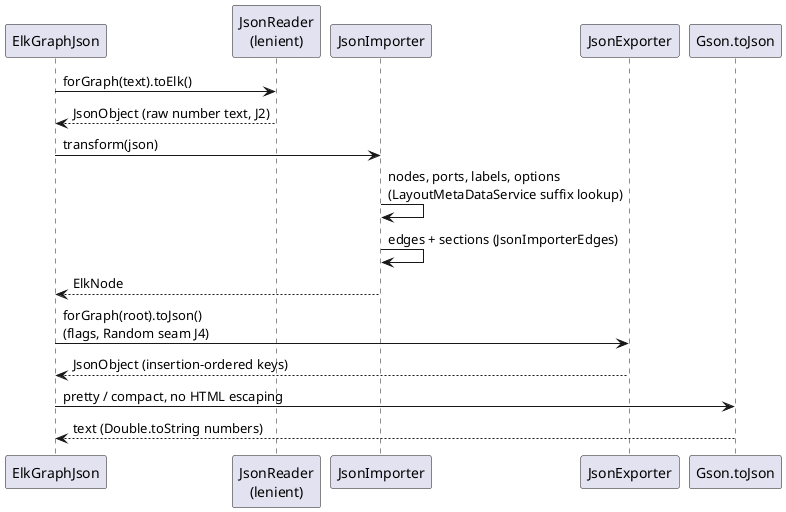
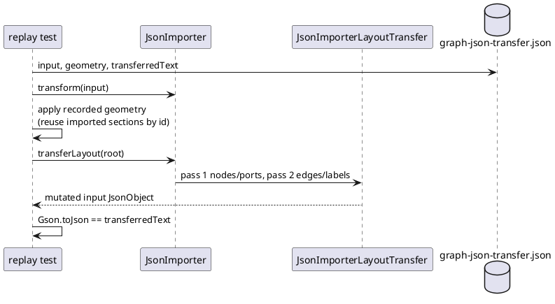

<!-- SPDX-License-Identifier: EPL-2.0 -->

# ELK JSON adapter and the Gson subset

How `org.eclipse.elk.graph.json` became `src/graph/json/` and which part of Gson it needed
(`src/gson/`). Decisions J1-J10 are `plans/elk-json-adapter/decisions.md`; every deviation below is
journaled in `plans/elk-json-adapter/decision-journal.md`. Package status is in the
[port map](port-map.md); what still differs from the Java is in
[conformance.md](../conformance.md#temporary-gaps).

| Section                                       | Answers                                                   |
| --------------------------------------------- | --------------------------------------------------------- |
| [1. File map](#file-map)                      | Which TS file stands for which Xtend/Java file            |
| [2. Gson subset](#gson-subset)                | What of Gson is ported, and the rules that fix its output |
| [3. Exporter Random seam](#exporter-random)   | How the id-collision suffix becomes reproducible          |
| [4. Runtime flow](#runtime-flow)              | Import, export and `transferLayout` as sequences          |
| [5. Evidence](#evidence)                      | Which vectors, refs and sweeps prove the port             |
| [6. Fixes outside graph.json](#fixes-outside) | Shared code corrected while proving the adapter           |
| [7. Regenerating](#regenerating)              | Commands, with the outcome each is expected to produce    |

## 1. File map {#file-map}

`src/graph/json/` (J3: a class over 500 lines splits at Java section boundaries into
`<Class><Section>.ts` siblings holding functions over a non-exported state interface; the class
keeps its fields and public API and delegates).

| TS file                         | Upstream                                          | Notes                                                                         |
| ------------------------------- | ------------------------------------------------- | ----------------------------------------------------------------------------- |
| `ElkGraphJson.ts`               | `ElkGraphJson.java`                               | `forGraph` overloads; `ImportBuilder`, `ExportBuilder` are file-level classes |
| `JsonAdapter.ts`                | `JsonAdapter.xtend`                               | stateless class, full Xtend surface (J9)                                      |
| `JsonImporter.ts`               | `JsonImporter.xtend`: class, nodes, ports, labels | split (J3)                                                                    |
| `JsonImporterEdges.ts`          | `JsonImporter.xtend` 148-425                      | edges and sections                                                            |
| `JsonImporterLayoutTransfer.ts` | `JsonImporter.xtend` 549-741, 797-864             | `transferLayout` and coordinate-mode helpers                                  |
| `JsonExporter.ts`               | `JsonExporter.xtend`                              | takes the `Random` (section 3)                                                |
| `JsonExporterSections.ts`       | `JsonExporter.xtend` 157-291                      | split because `JsonExporter.ts` would pass 500                                |
| `JsonMetaDataConverter.ts`      | `JsonMetaDataConverter.xtend`                     | layout option metadata as JSON                                                |
| `JsonImportException.ts`        | `JsonImportException.xtend`                       |                                                                               |

Tests are colocated (`<Name>.test.ts`); 31 of the 36 upstream `graph.json.test` methods are
ported. The other five are deferred, each with its closing mission, in
[conformance.md](../conformance.md#temporary-gaps). The ported tests reset the service per test
(`unload()` + `getInstance()` in `beforeEach`, J10).

## 2. Gson subset {#gson-subset}

The oracle runs Gson 2.11.0 (the bundle manifest says 2.8.2; the p2 cache decides). The port
implements only what `graph.json` and its tests call (J1): `JsonElement`, `JsonNull`,
`JsonPrimitive`, `LazilyParsedNumber`, `JsonObject`, `JsonArray`, `JsonParser`,
`stream/JsonReader` (strict and lenient), `stream/JsonWriter`, `Gson`/`GsonBuilder`
(`disableHtmlEscaping`, `setPrettyPrinting`, `create`, `toJson(JsonElement)`,
`getAdapter(JsonElement).read`), `TypeAdapter` and the exception types. It is written from the
Gson Javadoc and JVM vectors only; Gson source is never read (AD-9 applies by analogy). A fitness
rule keeps `src/gson` importing only `src/gson` and `src/java`. A behaviour without a vector is a
stop condition, not a guess.

Rules that fix the output:

- **Raw number text (J2).** A parsed number keeps its literal: `10.0` stays `"10.0"`.
  `getAsString` returns it; `getAsDouble` runs `JavaDouble.parseDouble`. Layout-option values and
  element identifiers take the raw text; `asId` turns integral numbers into `intValue()`, saturating
  at 2^31-1. Written numbers use `Double.toString` text, as on the JVM.
- **Lenient reader.** `Gson.getAdapter(JsonElement).read` is lenient even when the caller asked
  for strict parsing, which is why `ElkGraphJson` carries the upstream workaround
  (`GSON_ELEMENT_ADAPTER`). A trailing comma in an array therefore yields a null element
  (conformance.md, "kept: upstream behaviour").
- **Key order.** `JsonObject` keeps insertion order; the exporter's key order is the output order.
- **Writer settings.** ELK builds its `Gson` with HTML escaping disabled. A default `new Gson()`
  is HTML-safe (`< > & = '` written as `<` and so on); tests and the transfer vectors use the
  default, the exporter path uses ELK's builder.
- **Not modelled.** Writer rows with `Long`/`Float`/`Short`/`Byte`/`BigDecimal`/`BigInteger`
  number types (`UNMODELLED_NUMBER_TYPES` in `Gson.test.ts`; `graph.json` never builds them);
  `JsonWriter` writes parsed-number text without the validation `JsonPrimitive.toString` applies;
  the message texts of `JsonReader` misuse errors are not recorded.

## 3. Exporter Random seam {#exporter-random}

`JsonExporter.xtend:489` declares `val RANDOM = new Random()` and uses it for the
`_g<six digits>` suffix that resolves id collisions. The port takes it as an optional constructor
parameter, `constructor(random?: Random)`, unseeded by default as upstream (J4). Oracle patch
`0001-graph.json-seedable-JsonExporter-id-collision-random.patch` seeds the Java `Random` from the
system property `org.eclipse.elk.graph.json.exportSeed`; the oracle `run.sh` passes
`EXPORT_SEED=1`. Vector comparisons, the round trip and the sweep pass `new Random(1)`, so the
suffixes agree (the `Random` shim yields 548985, 764588 for seed 1). `ElkGraphJson` builders are
unchanged.

## 4. Runtime flow {#runtime-flow}

`transferLayout` writes the layout of an `ElkNode` back into the input `JsonObject` (pass 1
nodes and ports, pass 2 edges and labels). It is replayed against JVM recordings in
`test/graph-json/transfer-replay.test.ts` because the layout-dependent upstream tests are deferred.

## 5. Evidence {#evidence}

Expected values come from JVM recordings made before the TS code (AD-13); comparison is
byte-exact for vectors and `elk-parse` refs, and within 1e-6 structurally for the sweep (J8).

| Evidence                                         | Content                                                                                                                                                                                                 |
| ------------------------------------------------ | ------------------------------------------------------------------------------------------------------------------------------------------------------------------------------------------------------- |
| `test/golden/refs/java/gson.json`                | parse 303, primitive 1,619, write 206 (68 HTML-safe), objectOps 15, arrayOps 5, equality 19                                                                                                             |
| `test/golden/refs/java/graph-json.json`          | import 105 (28 graphs, 77 throws), export 880, optionText 106, converter 107                                                                                                                            |
| `test/golden/refs/java/graph-json-transfer.json` | 13 `transferLayout` cases: six `EdgeCoordsTest` modes, individual spacings, preserved section ids, edge-section exists, mixed modes, junction points, imported sections (layered), two sections (fixed) |
| `test/golden/refs/elk-parse/`                    | the oracle's import-then-export text (`parse` mode, seed 1) of the 4 committed goldens; the TS round trip is byte-identical (`test/golden/json-roundtrip.test.ts`)                                      |
| `test/corpus/json-sweep.test.ts`                 | every `.json` model under `ELK_MODELS_DIR`: port `parse` vs oracle, 550 of 550 within 1e-6; local only (the models are not vendored)                                                                    |

Judgement calls the vectors force:

- **Identity-hash order (AD-10).** `ok-sections-linked`, section 44, `outgoingSections`: the JVM
  fills it from a `HashMultimap` keyed by identity-hashed `ElkEdgeSection`
  (`JsonImporter.xtend:313-314`), so its order varies between JVM runs. The port uses insertion
  order; the vectors record section-link id lists sorted. This is why the graph-json vectors are
  rerun-checked (section 7).
- **NullPointerException rows.** JDK helpful NPE messages embed compiled local names, so those rows
  compare by class only (`TypeError`, D10).
- **Parse inputs (J7 amendments).** ELK cannot re-import its own layout export
  (`resolvedAlgorithm` raises `IDataType class expected for layout option
org.eclipse.elk.resolvedAlgorithm`), so parse inputs strip it; until mission 7h they also strip
  the layered-only `layering.layerId` and `crossingMinimization.positionId`. The list is
  `STRIP_KEYS` in `tools/oracle/regen-parse-refs.sh` and `test/golden/json-roundtrip.test.ts`.

## 6. Fixes outside graph.json {#fixes-outside}

Proving the adapter exposed three defects in shared code, fixed here:

- `EcoreEMap.map()` iterates EMF `BasicEMap` hash buckets (lazy capacity 1, growth `2 * old + 4`,
  index `(hash & 0x7FFFFFFF) % length`), including null keys (hash 0). This fixes the
  `getAllProperties()` order of ElkGraph elements, which decides the exported `layoutOptions`
  order (see [elkgraph-model.md](elkgraph-model.md)).
- `EnumSet.toString` uses the `AbstractCollection` format.
- `core.util.Maybe` was ported: `ImportBuilder.rememberImporter(maybe)` hands the importer back so a later `transferLayout` can use it.

## 7. Regenerating {#regenerating}

All commands run from the repository root. They need the built oracle (`tools/oracle/build.sh`),
a JDK 21 and, for Gson/Guava/EMF, the p2 cache (`P2_BUNDLES`). Each vector or ref command rewrites
its files; afterwards `git diff --exit-code test/golden/refs/` must print nothing. A diff means the
oracle, a script or the recorded JVM behaviour changed: stop and journal it (AD-13), do not commit
the new refs to get green.

| Command                                                                                     | Expected outcome                                                                                                                                                                              |
| ------------------------------------------------------------------------------------------- | --------------------------------------------------------------------------------------------------------------------------------------------------------------------------------------------- |
| `tools/vectors/gson-vectors.sh test/golden/refs/java`                                       | exit 0; rewrites `gson.json`, byte-identical; prints one `-Xlint` deprecation warning for `JsonReader.setLenient`                                                                             |
| `tools/vectors/graph-json-vectors.sh test/golden/refs/java`                                 | exit 0; rewrites `graph-json.json`, byte-identical                                                                                                                                            |
| `tools/vectors/transfer-vectors.sh test/golden/refs/java`                                   | exit 0; rewrites `graph-json-transfer.json`, byte-identical                                                                                                                                   |
| `tools/oracle/regen-parse-refs.sh`                                                          | exit 0; `ElkOracle: 4 input(s), 0 failed`; writes 4 refs and `_meta.json` to `test/golden/refs/elk-parse`, unchanged                                                                          |
| `tools/oracle/json-sweep.sh`                                                                | exit 0; prints `json sweep fresh` and does nothing when the stamp matches (oracle, harness, models commit, input hashes); `--force` reruns. Output is `test/corpus/.json-sweep/` (gitignored) |
| `ELK_MODELS_DIR=../../eclipse-elk/elk-models npx vitest run test/corpus/json-sweep.test.ts` | 1 test passes (550 models within 1e-6); skips with a message when the models or sweep dir is absent                                                                                           |
| `npx vitest run test/golden/json-roundtrip.test.ts test/graph-json`                         | 2 files, 27 tests pass                                                                                                                                                                        |

Notes:

- The graph-json vectors are rerun-checked: the recording is run more than once and the outputs
  compared, because the JVM orders some collections by identity hash (section 5) and a single run
  would hide it. Any such list is sorted in the recording.
- `STRIP_KEYS` shrinks in mission 7h, when layered's `layerId` and `positionId` options are
  registered; then regenerate the parse refs and remove the keys from both places.
- Regenerating a ref is journaled with the patch id (`CLAUDE.md`, Verification); never regenerate
  to make a failing test pass.
