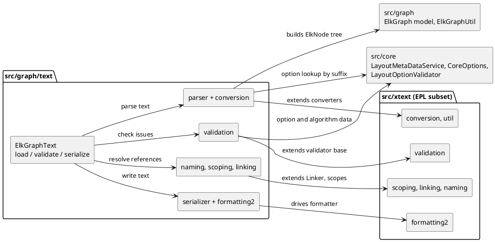
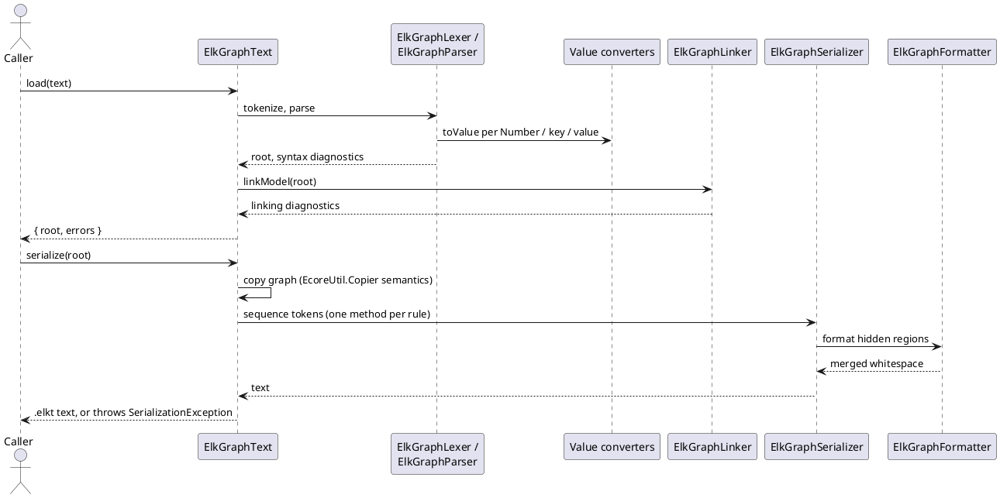

<!-- SPDX-License-Identifier: EPL-2.0 -->

# ELK Text (`.elkt`) and the Xtext subset

How `org.eclipse.elk.graph.text` became `src/graph/text/` and which part of Xtext it needed
(`src/xtext/`). Decisions G1-G8 and the Phase 4 readiness bars are `plans/graph-text/decisions.md`;
every deviation below is journaled in `plans/graph-text/decision-journal.md`. Package status is in
the [port map](port-map.md); measured conformance and the known differences are in
[conformance.md](../conformance.md#elk-text-elkt).

| Section                               | Answers                                                         |
| ------------------------------------- | --------------------------------------------------------------- |
| [1. File map](#file-map)              | Which TS file stands for which Xtend/Xtext file                 |
| [2. Diagrams](#diagrams)              | Component structure and the `load`/`serialize` runtime flow     |
| [3. Decisions](#decisions)            | G1-G8 in one table                                              |
| [4. Entry point](#entry-point)        | `ElkGraphText.load`/`validate`/`serialize` and what they mirror |
| [5. Evidence](#evidence)              | Which vectors, refs and sweeps prove the port, and how to run   |
| [6. Runbook](#runbook)                | Regenerating evidence, with the expected outcome of each step   |
| [7. Deferrals and quirks](#deferrals) | What is intentionally not matched, and why                      |
| [8. Maintenance](#maintenance)        | Failure modes and the response to each                          |

## 1. File map {#file-map}

The Java is canonical (CLAUDE.md, "The Java Is Sacred"). The grammar `ElkGraph.xtext` (120 lines) is
ported as a hand-written lexer and recursive-descent parser, one method per rule (D8); the generated
`src-gen` ANTLR code is read as the edge-case specification for token decisions and never ported
(G6). `ElkGraphRuntimeModule.xtend` and `ElkGraphStandaloneSetup.xtend` (Guice wiring) become plain
construction in `ElkGraphText.ts` and `ElkGraphTextServices.ts`; there is no DI framework.

`src/graph/text/` (17 Xtend files upstream, 1,232 LOC; tests colocated as `<Name>.test.ts`):

| Directory / file                             | Upstream                                              | Notes                                                                                       |
| -------------------------------------------- | ----------------------------------------------------- | ------------------------------------------------------------------------------------------- |
| `ElkGraphText.ts`, `ElkGraphTextServices.ts` | `ElkGraphRuntimeModule`, `ElkGraphStandaloneSetup`    | port-local entry point (section 4) and the scoping helper `load` and `serialize` share      |
| `ElkGraphTextUtil.ts`                        | `ElkGraphTextUtil.xtend`                              | helpers used by validation and naming                                                       |
| `parser/`                                    | `ElkGraph.xtext`, `src-gen/.../InternalElkGraphLexer` | `ElkGraphLexer`, `ElkGraphParser` (+ `ParserEdges`), `ElkGraphTokenType`, `ParseRecords`    |
| `conversion/`                                | `conversion/*.xtend`                                  | service, `NumberValueConverter`, `PropertyKeyValueConverter`, `PropertyValueValueConverter` |
| `naming/`                                    | `naming/*.xtend`                                      | qualified name converter and provider                                                       |
| `scoping/`                                   | `scoping/ElkGraphScopeProvider.xtend`                 |                                                                                             |
| `linking/`                                   | `linking/ElkGraphLinker.xtend`                        | `ElkGraphReferences.ts` is port-local (reflection facade, no Java counterpart)              |
| `validation/`                                | `validation/{ElkGraphValidator,IssueCodes}.xtend`     | `@Check` methods; `LayoutOptionValidator` is in `src/core/validation/`                      |
| `serializer/`                                | `serializer/*.xtend` and the generated sequencer      | grammar-specific writer (G1); `ElkGraphGrammarAccess` carries port-local grammar ids        |
| `formatting2/`                               | `formatting2/ElkGraphFormatter.xtend`                 | line by line over the `src/xtext/formatting2` subset                                        |

`src/xtext/` is the part of Xtext (EPL-2.0) that graph.text calls, written from the Xtext 2.36.0
source. Mapping rule (T7): `org.eclipse.xtext.<pkg>.<C>` becomes `src/xtext/<pkg>/<C>.ts` (either
Xtext bundle); a nested class is `Outer.Inner.ts`; a class with only statics exports functions.

| `src/xtext/` directory | Ported subset                                                                                          |
| ---------------------- | ------------------------------------------------------------------------------------------------------ |
| `util`                 | `Strings`, `Pair`/`Tuples`, `JavaStringConverter`, `ResourceScopeCache` (per-link-pass scope cache)    |
| `conversion`           | value converter service, ID/INT/STRING converters and the exception types; `common/services` terminals |
| `naming`               | `QualifiedName` (one class with a `variant` field), converter and provider bases                       |
| `scoping`, `resource`  | scope providers, import-namespace-aware local scope, single-resource global scope, object descriptions |
| `linking`              | `Linker`, `DefaultLinkingService`, `LinkingHelper`, diagnostics producer and message provider          |
| `diagnostics`          | `Diagnostic`, `Severity`, producers and the consumer interface                                         |
| `validation`           | `AbstractDeclarativeValidator`, `Check`, `Diagnostician`, composite `EValidator`, issue locator        |
| `formatting2`          | region access (string-based), `AbstractFormatter2`, hidden-region formatters, replacers, preferences   |
| `nodemodel`, `parser`  | `INode`/`ICrossReferenceNode` interfaces and `TokenTool`; no node model is built                       |

The split rule is enforced by `test/architecture/module-boundaries.fitness.test.ts`: `src/xtext`
imports only `src/xtext`, `src/java`, `src/emf` and `src/guava`; only the bundles in
`XTEXT_CLIENT_BUNDLES` (currently `src/graph/text`) may import `src/xtext`; graph.text requires
`src/core` and `src/graph` as `test/architecture/bundle-deps.json` (derived from the manifests) lists.

## 2. Diagrams {#diagrams}

## 3. Decisions G1-G8 {#decisions}

| ID  | Decision                                                                                                        |
| --- | --------------------------------------------------------------------------------------------------------------- |
| G1  | Writer is a grammar-specific sequencer plus the `formatting2` subset `ElkGraphFormatter` uses; no generic NFA   |
| G2  | Writer input is any ElkGraph without a node model; oracle is `EcoreUtil.copy` + `serialize(format())`           |
| G3  | Parse, validate and write refs use the CoreOptions-only registry (`ORACLE_REGISTRY=core`, no ELK patch)         |
| G4  | Port-local `ElkGraphText` with `load`, `validate`, `serialize`; not exported from `src/index.ts` (AD-14)        |
| G5  | Syntax errors match by presence only (D8 #1); linking, conversion and validator issues match exactly            |
| G6  | The hand-written lexer reproduces the generated ANTLR lexer's token decisions, with a vector per ambiguous case |
| G7  | Committed: JVM vectors plus 31 curated refs (CI). The full 898 + 550 sweep is local only                        |
| G8  | One mission, 24 tasks, 9 batches; unsigned task commits that the user signs by rebase at the end                |

## 4. Entry point {#entry-point}

`src/graph/text/ElkGraphText.ts` is internal (G4, AD-14): nothing is exported from `src/index.ts`.
The three functions mirror the Xtext services the oracle harness calls.

| Function                                                             | Mirrors                                                              | Failure mode                                              |
| -------------------------------------------------------------------- | -------------------------------------------------------------------- | --------------------------------------------------------- |
| `load(text): { root: ElkNode \| null; errors: ElkTextDiagnostic[] }` | `XtextResource.load` + `getErrors()`: parser, converters, linker     | never throws on bad input; `errors` is parser then linker |
| `validate(root): ElkTextIssue[]`                                     | `IResourceValidator.validate`: `ElkGraphValidator` + EMF constraints | issues in emission order; non-loaded graphs get line 0    |
| `serialize(root): string`                                            | `ISerializer.serialize` with `SaveOptions.format()`                  | throws `SerializationException` like Xtext                |

`ElkTextDiagnostic` is `{ kind: 'syntax' | 'linking' | 'conversion'; severity; message; line }`;
`ElkTextIssue` is `{ severity; message; line; code }`. `serialize` copies the graph first (Xtext
serialization resolves proxies in place; outside references are dropped as `EcoreUtil.Copier` does).
`load` records node positions in a module `WeakMap` that `validate` reads for line numbers; the
returned result is unchanged. The Xtend `dispatch`, `@Check` and `@Inject` rules the port follows
are in [translation-rules section 10](../translation-rules.md#xtend-xtext).

## 5. Evidence {#evidence}

All expected values come from the JVM oracle or the Java source before the implementation was written
(AD-13). Everything below runs the oracle with the CoreOptions-only registry (G3).

| Evidence                                                             | Records                                                                                       | How to run                                                                         |
| -------------------------------------------------------------------- | --------------------------------------------------------------------------------------------- | ---------------------------------------------------------------------------------- |
| `test/golden/refs/java/graph-text-{lexer,parse,validate,write}.json` | token streams, converter rows, parse/link diagnostics, `@Check` issues, writer output (T2-T5) | `npx vitest run src/graph/text src/xtext`                                          |
| `test/golden/refs/elkt-parse/` (31 curated models, `_meta.json`)     | oracle parse-only JSON export of the models in `test/corpus/elkt-curated.json`                | `npx vitest run src/graph/text/ElkGraphText.curated.test.ts`                       |
| `test/golden/elkt-roundtrip.test.ts`                                 | write/reparse round trip and the D3 `.json` vs `.elkt` comparison                             | `npx vitest run test/golden/elkt-roundtrip.test.ts`                                |
| Local sweep: 898 `.elkt` + 550 realworld `.json`                     | parse, validate, write, reparse and D3 verdicts per model (T23)                               | `tools/oracle/elkt-sweep.sh`, then `npx vitest run test/corpus/elkt-sweep.test.ts` |

The curated refs read their 31 inputs (about 49 KB, EPL-2.0) from `test/corpus/elkt-curated/`, copied
byte-for-byte from the pinned elk-models (`-text` in `.gitattributes`) and checked against the
`inputSha256` in `_meta.json`, so they run in CI. Only the Trilateration load-budget test needs
`$ELK_MODELS_DIR`. The sweep output lives under
`$ELK_ORACLE_DIR/sweep/` (AD-5), never in the repo. Counts and the accepted differences are in
[conformance.md](../conformance.md#elk-text-elkt).

## 6. Runbook {#runbook}

Prerequisites: a built oracle (`tools/oracle/build.sh`, JDK 21), `P2_BUNDLES` holding Xtext 2.36.0, and
`ELK_MODELS_DIR` at the commit pinned in `test/corpus/manifest.json` (`test/corpus/fetch.sh`). Each
script checks the pinned ELK commit and the Xtext version and exits non-zero on a mismatch.

1. **Vectors** (JVM behaviour of lexer, parser, validator, writer):
   `tools/vectors/elkt-vectors.sh <outDir>` runs `tools/vectors/Elkt{Lexer,Parse,Validate,Write}Vectors.java`
   in sorted order and writes `graph-text-<x>.json` into `<outDir>`. `ELKT_VECTORS_LIST=1` prints the
   programs without running them. Scenario inputs are in `tools/vectors/elkt-*-scenarios/` (byte-meaningful,
   `-text` in `.gitattributes`).
2. **Curated refs**: `tools/oracle/regen-elkt-refs.sh` (no arguments) runs the harness in `parse` mode
   with `ORACLE_REGISTRY=core` over `test/corpus/elkt-curated.json`, writes `test/golden/refs/elkt-parse/`
   and then vendors the inputs to `test/corpus/elkt-curated/` (`test/corpus/vendor-elkt-curated.sh`, which
   also runs on its own after a curated-list change).
3. **Registry modes**: `ORACLE_REGISTRY=core` (G3, used by every graph-text script) registers CoreOptions
   only; the default registers every algorithm and changes 182 of the 898 `.elkt` exports (layered keys).
   `tools/oracle/run.sh --list-options` prints the registry's option ids.
4. **Sweep**: `tools/oracle/elkt-sweep.sh [--force]` runs parse, validate and write twice (D5), compares the
   two runs byte-identically and skips when its stamp is fresh; `npx vitest run test/corpus/elkt-sweep.test.ts`
   logs `elkt sweep: <indicator>=<n>/<total>` per indicator.
5. **Byte-identical rerun rule.** Run a generator twice into scratch directories and `diff -r` the output
   against the committed refs. A difference is a finding (identity-hash order, an unsorted container, a
   timestamp), not a ref to accept. Never hand-edit a ref and never regenerate one to turn a test green
   (AD-13); a regeneration after a pin or registry change is a journaled step.

## 7. Deferrals and quirks {#deferrals}

| Item                                   | State                                                                                                                                                                                                                                                                                                                                  |
| -------------------------------------- | -------------------------------------------------------------------------------------------------------------------------------------------------------------------------------------------------------------------------------------------------------------------------------------------------------------------------------------- |
| G3 `MISSION5_ALGORITHMS`               | The core oracle registers `fixed`, `box`, `random`; the TS registry defers them to mission 5. 11 validator rows are tagged `deferred: "mission5"` and skipped by `ElkGraphValidator.test.ts`, which also replays them against stand-in algorithms. A test fails once mission 5 registers them                                          |
| D8 #1 syntax errors                    | Presence only. The parser stops at the first syntax error, so 15 recorded rows with extra ANTLR-recovery diagnostics, and partial-root recovery, are not reproduced                                                                                                                                                                    |
| G1 `isQuotingNecessary` always `false` | Xtend drops the unused `map` result (`xtend-gen` `ElkGraphSemanticSequencer.java:80-94`); strings that need quoting reach the writer unescaped and may not reparse. Kept, cited in a comment                                                                                                                                           |
| D3 `.json` vs `.elkt`                  | Equal except port positions (D3a, user 2026-10-14): all 550 realworld `.elkt` carry port `position` the `.json` lacks, and the oracle's parses differ in exactly those fields; compared with `canonGraphWithoutPortPositions`, guarded by `portsWithLayoutRelevantPosition` (side + index on every port, no `FIXED_POS`/`FIXED_RATIO`) |
| Lossy round trips                      | 8 write rows lose information in the oracle too (`intValue()` saturation, unescaped G1 strings, a key that is a keyword); `LOSSY_ROUND_TRIP` checks them against the recorded reparse                                                                                                                                                  |
| `T4` proxy-resolution mutation         | Under the core registry the key converter and validator resolve identical text identically; `mutations` is `[]` in all 75 validator cases                                                                                                                                                                                              |

Not ported: `ElkGraphSemanticSequencer`'s generic NFA backtracking path, Xtext's content assist, index,
builder and workspace services, and the `.ide`/`.ui` bundles (inventory).

## 8. Maintenance failure modes {#maintenance}

| Trigger                                            | Response                                                                                                                                                                                                                                                                      |
| -------------------------------------------------- | ----------------------------------------------------------------------------------------------------------------------------------------------------------------------------------------------------------------------------------------------------------------------------- |
| elk-models pin moves (`test/corpus/manifest.json`) | Curated-ref and sweep tests fail on a changed model. Diagnose against the oracle first (instrument, dump values); then `regen-elkt-refs.sh` and the sweep, journaled. Never loosen a tolerance                                                                                |
| TS registry grows (missions 5 and 7)               | Core-only refs and vectors go stale: rerun `tools/vectors/elkt-vectors.sh` and `tools/oracle/regen-elkt-refs.sh`, journal the regeneration, drop `MISSION5_ALGORITHMS` (its test fails) and the stand-in describe                                                             |
| ELK or Xtext pin changes                           | Regenerate the vectors by script (AD-13), diff, port the Java diff; no hand edits. The scripts stop on a commit or Xtext-version mismatch                                                                                                                                     |
| Sweep rerun differs                                | A `nondeterministic` verdict is a generator defect (hash order); sort or canonicalise before recording                                                                                                                                                                        |
| Scope-lookup performance                           | Lookups cache per link pass (`ResourceScopeCache`). Budget: parse + link of the largest model (`realworld/ptolemy/hierarchical/de_trilateration_Trilateration.elkt`, 253 KB) under 1 s; tests use a wider instrumented budget under coverage (`test/helpers/coverage-run.ts`) |
| Boundary test fails on `src/xtext`                 | `src/xtext` imported ELK code, or a non-client bundle imported `src/xtext`; fix the import, do not widen `XTEXT_CLIENT_BUNDLES`                                                                                                                                               |

Mission 4c (`graph.json.text`) reuses `src/xtext` (converters, scoping, linking, validation, the
formatter subset); it adds itself to `XTEXT_CLIENT_BUNDLES`.
