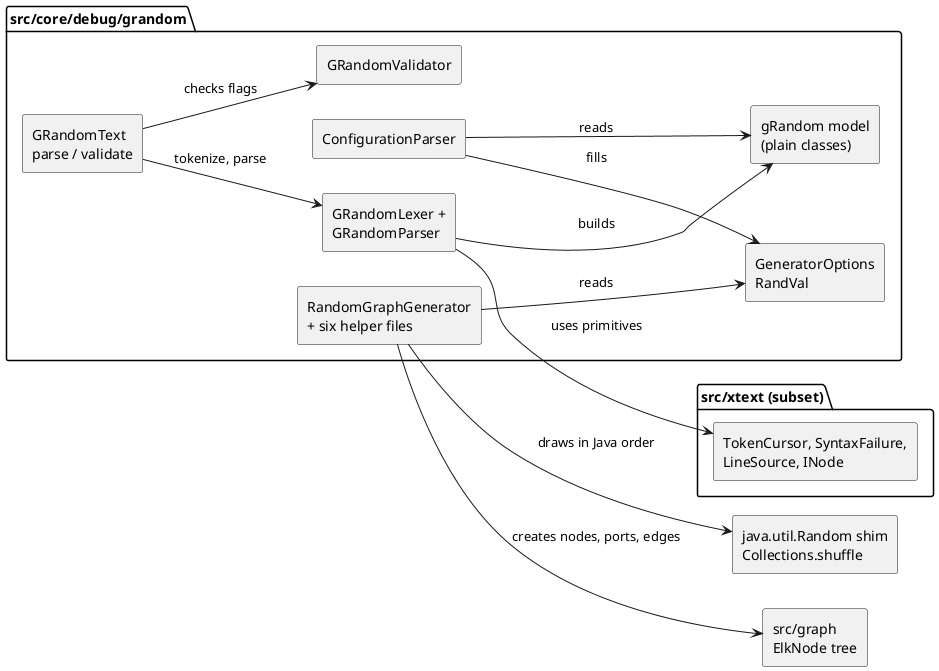

<!-- SPDX-License-Identifier: EPL-2.0 -->

# grandom (`.elkr`) random graph generator

How `org.eclipse.elk.core.debug.grandom` became `src/core/debug/grandom/` (mission 4f, roadmap row 4d). The
bundle is an Xtext language (`GRandom.xtext`, `.elkr` files) plus the generator that turns a parsed configuration
into ElkGraphs with the exact JVM `java.util.Random` sequence. Decisions D1-D9 are
`plans/grandom/decisions.md`; every deviation below is journaled in `plans/grandom/decision-journal.md`. Package
status is in the [port map](port-map.md); measured conformance is in
[conformance.md](../conformance.md#grandom-elkr). The sibling ports are [elk-text.md](elk-text.md) and
[elk-json-text.md](elk-json-text.md); this page only describes where grandom differs.

| Section                        | Answers                                                                    |
| ------------------------------ | -------------------------------------------------------------------------- |
| [1. Scope](#scope)             | What is ported and what is not                                             |
| [2. File map](#file-map)       | Which TS file stands for which Java or Xtend file                          |
| [3. Diagram](#diagram)         | Component structure and data flow                                          |
| [4. Decisions](#decisions)     | D1-D8 in brief, and the option-A amendment                                 |
| [5. Evidence](#evidence)       | Row counts per vector file, exact / presence / invariant split, the corpus |
| [6. Unseeded paths](#unseeded) | What is never compared exactly, and what is masked                         |
| [7. Runbook](#runbook)         | Regenerating vectors, the three failure modes, the `vector-cache.sh` rule  |
| [8. Kept Java quirks](#quirks) | Behaviour that looks wrong and is preserved on purpose                     |

## 1. Scope {#scope}

Ported (`src/core/debug/grandom/`, 36 non-test files, 5,122 lines, tests colocated; plus `src/core/math/ElkMath.ts`
and the one-argument `Collections.shuffle(list)` in `src/java/util/Collections.ts`):

- the `.elkr` lexer and recursive-descent parser, the `gRandom` model as plain classes, `GRandomValidator`;
- the facade `GRandomText` (`parse`, `validate`; D6), internal and not exported from `src/index.ts`;
- the generators: `GeneratorOptions` (with its nested `FileFormat`, `GraphType`, `EdgeDetermination`, `RandVal`),
  `ConfigurationParser`, `BlindTextGenerator` and `RandomGraphGenerator` (including the nested `HierarchyEdge` and
  the two comparators).

Not ported: the empty `GRandomScopeProvider`; `GRandomRuntimeModule` and `GRandomStandaloneSetup` (plain
construction instead); the `src-gen` serializer, factory, package, switch and adapter factory (AD-11, YAGNI);
`core.debug.grandom.ide` (deferred: content assist needs a browser-editor host decision); `core.debug.grandom.ui`
(out of scope: Eclipse editor). Upstream prose typos corrected: none.

## 2. File map {#file-map}

The Java is canonical (CLAUDE.md, "The Java Is Sacred"). The grammar is ported as a hand-written lexer and
recursive-descent parser; the generated ANTLR code in `src-gen` is the edge-case specification and is never
ported line by line. Roots below are relative to `src/core/debug/grandom/`; upstream paths are relative to
`org.eclipse.elk.core.debug.grandom/src/org/eclipse/elk/core/debug/grandom/`.

| TS file(s)                                                                                                                                                                                               | Upstream                                                        | Notes                                                                                                                                       |
| -------------------------------------------------------------------------------------------------------------------------------------------------------------------------------------------------------- | --------------------------------------------------------------- | ------------------------------------------------------------------------------------------------------------------------------------------- |
| `parser/GRandomLexer.ts`, `GRandomTokenType.ts`                                                                                                                                                          | `GRandom.xtext`, `src-gen/.../InternalGRandomLexer`             | token decisions of the ANTLR lexer, including multi-word keywords and `INT '.' INT` (D2)                                                    |
| `parser/GRandomParser.ts`, `GRandomParserElements.ts`                                                                                                                                                    | `GRandom.xtext`                                                 | one method per rule; local `unorderedGroup`, local `Integer`/`Double` conversion; records the three validator positions                     |
| `gRandom/*.ts` (`RandGraph`, `Configuration`, `Hierarchy`, `Edges`, `Nodes`, `Size`, `Ports`, `Flow`, `DoubleQuantity`, enums `Formats`, `Form`, `Side`, `FlowType`, `ConstraintType`, `GRandomPackage`) | `src-gen/.../gRandom/*.java`, `impl/*Impl.java`                 | plain classes with the generated accessor names (D3); `GRandomPackage` holds only the three feature literals the validator reports on       |
| `validation/GRandomValidator.ts`                                                                                                                                                                         | `validation/GRandomValidator.xtend`                             | the `ERRORS` list and the check on `maxWidth`, `maxDegree`, `partitionFraction`                                                             |
| `GRandomText.ts`                                                                                                                                                                                         | none (port-local)                                               | `parse(text)` and `validate(text)` (D6); reproduces `ResourceValidatorImpl` order without the EObject pipeline                              |
| `generators/GeneratorOptions.ts`, `FileFormat.ts`, `GraphType.ts`, `EdgeDetermination.ts`, `RandVal.ts`                                                                                                  | `generators/GeneratorOptions.java` (nested types)               | one class per file (AD-7); `Math.fround` at every `float` (D8)                                                                              |
| `generators/ConfigurationParser.ts`                                                                                                                                                                      | `generators/ConfigurationParser.xtend`                          | `const ConfigurationParser = { parse }`; private Xtend methods as module functions in Xtend order                                           |
| `generators/BlindTextGenerator.ts`                                                                                                                                                                       | `generators/BlindTextGenerator.java`                            | unseeded by contract (section 6)                                                                                                            |
| `generators/RandomGraphGenerator.ts`                                                                                                                                                                     | `generators/RandomGraphGenerator.java`                          | fields, constructor, both `generate`, `makeGraph`, `sample`, `generateCustomGraph` (D4)                                                     |
| `generators/RandomGraphGeneratorTypes.ts`, `RandomGraphGeneratorTypesStructured.ts`                                                                                                                      | same                                                            | `generateAnyGraph` x2, bipartite, tree, biconnected, triconnected; split at method boundaries to stay under 500 lines                       |
| `generators/RandomGraphGeneratorAnte.ts`, `HierarchyEdge.ts`                                                                                                                                             | same (`generateANTEGraph`, nested `HierarchyEdge`, comparators) | comparators file-local; `Collections.sort` is a stable `Array.prototype.sort` over the list                                                 |
| `generators/RandomGraphGeneratorElements.ts`, `...Connect.ts`, `...Rewire.ts`                                                                                                                            | same                                                            | independent sets, cliques, nodes, ports; `connect` family and labels; `moveSource`, `moveTarget`, `split`. Helpers take the generator first |
| `../../math/ElkMath.ts`                                                                                                                                                                                  | `core/.../math/ElkMath.java`                                    | `boundi` only (D5), "ported so far" header                                                                                                  |
| `../../../java/util/Collections.ts`                                                                                                                                                                      | JDK `Collections.shuffle(List)`                                 | one-argument overload over a lazily created unseeded `Random` (D7)                                                                          |

Complexity-only helper splits (the gate caps functions at 30 NLOC, CCN 10, 5 parameters) keep the Java statement
and draw order. `RandVal`'s constructor takes one init record instead of seven positional parameters.

`test/architecture/module-boundaries.fitness.test.ts` lists `src/core/debug/grandom` in `XTEXT_CLIENT_BUNDLES`: it
may import `src/core`, `src/graph` and `src/xtext`, and `src/xtext` still imports no ELK code. The bundle
dependency direction is in `test/architecture/bundle-deps.json`.

## 3. Diagram {#diagram}

Generation is not part of the facade: `new RandomGraphGenerator(null).generate(config)` returns `ElkNode[]` (D6).
The conformance test mirrors the oracle harness: an unnamed root is named `"root"`, the export uses
`CaseRunner.export` flags, and a trailing `"\n"` is appended.

## 4. Decisions {#decisions}

| ID  | Decision                                                                                                              |
| --- | --------------------------------------------------------------------------------------------------------------------- |
| D1  | Evidence: seeded JVM vectors byte-exact, unseeded invariants only, no oracle patch; exit = 9 corpus files + vectors   |
| D2  | Hand-written `GRandomLexer` (ANTLR token decisions) and recursive-descent `GRandomParser`; syntax errors by presence  |
| D3  | `gRandom` model as plain classes with EMF accessor names; no Factory, Package (beyond literals), Switch, Adapter      |
| D4  | `RandomGraphGenerator` split by Java section into helper files, helpers take the generator first                      |
| D5  | `ElkMath` partial port: `boundi` only                                                                                 |
| D6  | Internal facade `GRandomText` (`parse`, `validate`); generation via `new RandomGraphGenerator(null).generate(config)` |
| D7  | `Collections.shuffle(list)` default-randomness overload, backed by one lazily created unseeded `Random`               |
| D8  | `Math.fround` at every Java `float` operation; Java precedence oddities kept                                          |

D9 is process (branch `feature/grandom`, unsigned task commits, merge commit). Amendments recorded in the journal:

- **Option A (user, B4 stop).** D3 stays. D2 is amended: the parser and validator use `src/xtext` primitives
  (`TokenCursor`, `SyntaxFailure`, `LineSource`, `INode`) but not `ParseSession`, `Diagnostician` or
  `AbstractDeclarativeValidator`, because those need `EObject`s and the grandom classes are plain. The parser
  records `{line, offset, length}` for the three restricted flags (`GRandomPositions`), and `GRandomText.validate`
  reproduces `ResourceValidatorImpl` order (resource diagnostics, then checks per object in containment
  pre-order). A configuration whose body fails after `generate N form` is kept as a partial configuration so the
  validator still runs on it, as Xtext does.
- **`BlindTextGenerator` length.** The Java ends with `trim()`, so generated texts are 38 to 49 characters, not
  40 to 49; the Java is kept and the test asserts the real bound.
- **`float` sites** are listed in section 8.

## 5. Evidence {#evidence}

All expected values come from the JVM oracle before the implementation was written (AD-13); there is no JUnit
plugin for grandom. Vectors are recorded by `tools/vectors/elkr-vectors.sh` into
`test/golden/refs/java/grandom-{lexer,parse,validate,generate}.json` (scenario inputs in
`tools/vectors/elkr-*-scenarios/` and `elkr-lexer-cases.txt`).

| Evidence                                 | Rows                                                                                                                                    | How to run                                                                  |
| ---------------------------------------- | --------------------------------------------------------------------------------------------------------------------------------------- | --------------------------------------------------------------------------- |
| `grandom-lexer.json`                     | 433 token rows, all exact (26 with `lexError`)                                                                                          | `npx vitest run src/core/debug/grandom/parser/GRandomLexer.test.ts`         |
| `grandom-parse.json`                     | 142 rows: 77 error-free rows with exact model dumps, 65 syntax-error rows by presence; 9 rows carry conversion errors, compared exactly | `npx vitest run src/core/debug/grandom/parser/GRandomParser.replay.test.ts` |
| `grandom-validate.json`                  | 23 rows: 20 exact, 3 presence-only for the parser syntax issue (check issues in those 3 still exact)                                    | `npx vitest run src/core/debug/grandom/GRandomText.test.ts`                 |
| `grandom-generate.json`, seeded          | 58 rows holding 62 graphs (59 configurations replay through `ConfigurationParser`), each graph's JSON export byte-exact                 | `npx vitest run src/core/debug/grandom/generators`                          |
| `grandom-generate.json`, unseeded        | 6 rows holding 7 graphs, count invariants only                                                                                          | same                                                                        |
| `grandom-generate.json`, `RandVal`       | 12 rows (4 `exact`, 4 `minMax`, 4 `gaussian`), 20 draws each of `val`, `intVal`, `floatVal`, exact                                      | `npx vitest run src/core/debug/grandom/generators/RandVal.test.ts`          |
| `test/corpus/generated/*.elkr` (9 files) | 9/9 regenerate the sibling `.json` byte for byte                                                                                        | `npx vitest run src/core/debug/grandom/GRandomCorpus.test.ts`               |

Exit (D1): the TS regenerates all nine corpus `.json` files byte for byte and every `grandom-*.json` row replays.
The nine configs are also copied into the generate scenario dir (`corpus-*.elkr`), so the recorder proves that the
JVM export equals the frozen corpus file. The row split is: exact = lexer 433, parse 77 model dumps + 9 conversion
rows, validate 20, seeded generate 58, `RandVal` 12; presence = parse 65 syntax rows, validate 3 syntax issues;
invariant = unseeded generate 6 rows.

Syntax errors match by presence only (corpus D8 #1): the port stops at the first syntax error, ANTLR recovers.
Model, conversion and validator issues match exactly. Validator rows are compared after sorting both sides by
(line, offset, severity, code, message), because the recorder sorted them and Xtext's emission order is not
recorded.

## 6. Unseeded paths {#unseeded}

Three paths are unseeded by contract and never compared exactly:

| Path                                                                        | Why unseeded                                                    | What the vectors and tests do                                                                 |
| --------------------------------------------------------------------------- | --------------------------------------------------------------- | --------------------------------------------------------------------------------------------- |
| `BlindTextGenerator` edge labels                                            | `new Random()` per call                                         | label text masked; label counts and the 38 to 49 length bound asserted                        |
| `RandomGraphGenerator.sample()` -> one-argument `Collections.shuffle(list)` | default source of randomness; reached for cross-hierarchy edges | only for `cross-hierarchy edges` or `cross-hierarchy relative edges` above 0; counts asserted |
| a configuration without `seed`                                              | `new Random()`                                                  | the 6 unseeded generate rows: per-level node counts and edge, port and label counts only      |

`cross-hierarchy edges = 0` never reaches the shuffle, so such configurations are seeded. The corpus configs have
no edge labels and no cross-hierarchy edges, which is why they can be byte-exact. Algorithm goldens never depend
on the generator (conformance.md, "Generated corpus").

## 7. Runbook {#runbook}

Prerequisites: a built oracle (`tools/oracle/build.sh`, JDK 21, Maven 3.9; set `ELK_MVN` when PATH holds 3.10),
`P2_BUNDLES` holding Xtext 2.36.0. The scripts check the pinned ELK commit and the Xtext version.

1. **Regenerate vectors**: `tools/vectors/elkr-vectors.sh <outDir>` runs every `tools/vectors/Elkr*Vectors.java`
   in sorted order (`ElkrGenerateVectors`, `ElkrLexerVectors`, `ElkrParseVectors`, `ElkrValidateVectors`) and
   writes the four `grandom-*.json` files. `ELKR_VECTORS_LIST=1` lists the programs. Each program prints one
   `cache: <Program> hit` or `recorded` line. `ELK_VECTORS_CACHE=off` reads and writes no cache (a cold run).
   Evidence rule: a warm run proves the refs equal the cached outputs; a cold run proves they equal the oracle.
   Compare with `cmp` against `test/golden/refs/java/`; a differing rerun is a finding, never a ref to accept
   (AD-13).
2. **Corpus**: `tools/oracle/regen-generated.sh` regenerates `test/corpus/generated/` (a rerun with nothing
   changed is a git no-op). Never edit those files by hand.
3. **Replay**: `npx vitest run src/core/debug/grandom`.

Failure modes and how to localise each:

| Symptom                                                | Mechanism                                                                                                                            | Localise                                                                                                                                                                |
| ------------------------------------------------------ | ------------------------------------------------------------------------------------------------------------------------------------ | ----------------------------------------------------------------------------------------------------------------------------------------------------------------------- |
| a generate row or a corpus `.json` differs             | JVM `Random` draw drift: a draw added, dropped or reordered, or a changed `Random` shim                                              | take the first diverging vector row (smallest scenario that differs) or the first differing corpus byte; dump both draw sequences and find the first divergent draw     |
| sizes, counts or coordinates off by one (or by `1e-7`) | `float`/`double` rounding: a missing `Math.fround`, a missing `roundFloat`/`d2i`/`l2i`, or double arithmetic where Java used `float` | compare the numbers in the first diverging graph; check the `float` sites (section 8) and D8; `RandVal` rows pin `floatVal`                                             |
| lexer rows fail, or parse rows fail at the first token | lexer versus ANTLR: multi-word keywords (`cross-hierarchy relative edges`, `self loops`, `+/-`) or `INT '.' INT` token triples       | the lexer rows are the spec; run the lexer test and read the first failing `kwp-*`, `kwc-*`, `num-*` row; the failure boundary of each keyword is specific, not generic |

Two lexer inputs, `cross-hierarchy relativex` and `self loopsx`, are derived from the rule and not pinned by a
vector; widen the lexer vectors if either matters.

**Why `tools/vectors/vector-cache.sh` must not be edited casually.** Its bytes are part of the salt of every cache
entry (the salt is a sha256 over the program source, the calling script, `vector-cache.sh`, `oracle-build.json`,
the classpath and the `java -version` output). An edit therefore invalidates every cached program of every
`elk*-vectors.sh`: the next run re-records every `.elkt` and `.elkj` program, and the `.elkj` round-trip recorder
alone costs about 2.8 CPU-hours cold ([elk-json-text.md](elk-json-text.md#runbook)). The grandom recorders are
whole-program (no per-row cache) and are cheap by comparison. If the cache needs a change, make it deliberately,
in its own task, and budget the cold re-record.

## 8. Kept Java quirks {#quirks}

These look like defects and are preserved verbatim (the oracle is the specification). Do not fix them.

- **Ports-mode rewiring.** With ports enabled, `moveSource`/`moveTarget` bind the old shape and `split` always
  throws; no recorded scenario reaches these paths.
- **`generateAnyGraph` overload binding.** The hierarchy recursion passes four ints, so Java binds the
  `(parent, n, m, hierarchyLevel)` overload: each compound child gets one edge attempt and the recursion stops one
  level down.
- **Dead virtual-node machinery in `generateANTEGraph`.** `vrt[]` is only ever 0; the planar sorts are no-ops.
- **`(int) density * cn * cn`** casts `density` before multiplying, so `cm` is 0 for a density below 1.
- **`float` sites**: `HIERARCHY_CHANCE`, `HIERARCHY_NODES_FACTOR`, `HYPERNODE_CHANCE`, `PARTITION_FRAC`
  (`0.4000000059604645` widened), `PORT_SEPARATION`, `RandVal.floatVal`, `nextFloat`.
- **Exception types** at the edges of the recorded scenarios differ where the language forces it
  (`ArrayIndexOutOfBoundsException` versus a growing array, `ConcurrentModificationException` versus an index
  error); none is reachable from a recorded row.

Coverage gaps, journaled for later: the `generateANTEGraph` branches beyond `form-acyclic` (planar, single source,
hierarchy) are proven by source-derived unit tests only; a vector for them would pin those branches. Java `assert`
statements are omitted with a comment each (no shared `devAssert` helper exists yet).
