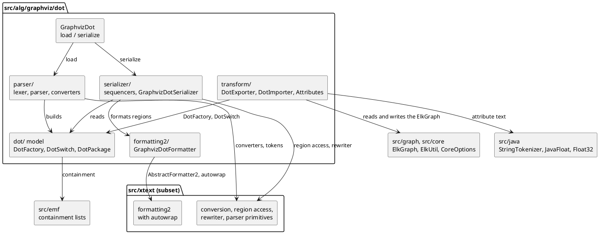

<!-- SPDX-License-Identifier: EPL-2.0 -->

# Graphviz DOT language (`alg.graphviz.dot`)

How `org.eclipse.elk.alg.graphviz.dot` ("ELK Graphviz Dot Language Parser") became `src/alg/graphviz/dot/` (mission
graphviz-dot, issue #95 step 2). The bundle is an Xtext language (`GraphvizDot.xtext`) with its EMF model, a writer
that wraps lines at 255 columns, and two transforms between ElkGraph and the DOT model: `DotExporter` and
`DotImporter`. It starts no process: running Graphviz is the job of `alg.graphviz.layouter`, which is not ported yet
(#95 step 3). Decisions D0-D11 are `plans/graphviz-dot/decisions.md`; every deviation below is journaled in
`plans/graphviz-dot/decision-journal.md`. Package status is in the [port map](port-map.md#alg-graphviz-dot); measured
conformance is in [conformance.md](../conformance.md#graphviz-dot). The sibling Xtext ports are
[elk-text.md](elk-text.md), [elk-json-text.md](elk-json-text.md) and [grandom.md](grandom.md); this page describes
where DOT differs.

| Section                            | Answers                                                              |
| ---------------------------------- | -------------------------------------------------------------------- |
| [1. Scope](#scope)                 | What is ported, what is omitted, what waits for step 3               |
| [2. File map](#file-map)           | Which TS file stands for which Java, Xtend or generated file         |
| [3. Diagram](#diagram)             | Components and what they import                                      |
| [4. Entry point](#entry-point)     | `GraphvizDot.load` and `serialize`                                   |
| [5. Language](#language)           | Lexer, parser and converter facts the vectors fixed                  |
| [6. Writer and autowrap](#writer)  | The sequencers, the formatter, and the Xtext autowrap path           |
| [7. Transforms](#transforms)       | `DotExporter`, `DotImporter`, the subclass seam, numeric and map use |
| [8. Evidence](#evidence)           | Six JVM refs and the local export sweep                              |
| [9. Runbook](#runbook)             | Regenerating the refs, running the sweep, failure modes              |
| [10. Kept Java quirks](#quirks)    | Behaviour that looks wrong and is preserved on purpose               |
| [11. What step 3 consumes](#step3) | The seams the layouter port will use                                 |

## 1. Scope {#scope}

Ported: the DOT model (11 classes, 3 enums, `DotFactory`, `DotSwitch`, the `DotPackage` feature literals), a
hand-written lexer and parser for the grammar, the writer (`GraphvizDotSemanticSequencer`,
`GraphvizDotSyntacticSequencer`, `GraphvizDotFormatter`, `GraphvizDotSerializer`), and the whole `transform` package
(`DotExporter`, `DotImporter`, `Attributes`, `Command`, `NeatoModel`, `OverlapMode`, `IDotTransformationData`,
`DotTransformationData`).

Omitted, each journaled (D1):

| Java                                                                                                                        | Why                                                                                                       |
| --------------------------------------------------------------------------------------------------------------------------- | --------------------------------------------------------------------------------------------------------- |
| `GraphvizDotActivator`, `GraphvizDotExecutableExtensionFactory`                                                             | OSGi activation and Eclipse extension glue                                                                |
| `GraphvizDotStandaloneSetup`(`Generated`), `GraphvizDotRuntimeModule`, `AbstractGraphvizDotRuntimeModule`                   | Guice wiring; the one binding (`ISerializer` → `GraphvizDotSerializer`) is plain construction in the TS   |
| `transform/DotResourceSetProvider`                                                                                          | an injector holder; `GraphvizDot.ts` stands in for it and for the `XtextResource`                         |
| `src-gen/.../parser/antlr/**`                                                                                               | the generated ANTLR lexer and parser are the edge-case spec for the hand-written ones, never ported (D4)  |
| `src-gen/.../serializer/Abstract*Sequencer`, Xtext's generic backtracking serializer                                        | replaced by grammar-specific sequencers (D2, as G1 for `.elkt`)                                           |
| `dot/util/DotAdapterFactory`, the reflective `EFactory`/`EPackage` members, `eSet`/`eUnset`, notifications                  | no caller in either Graphviz bundle                                                                       |
| `GenerateGraphvizDot.mwe2`, `GraphvizDot.properties`, `GraphvizDot.xtextbin`, `model/generated/*`, `services/*` (generated) | the generator and its artefacts; `GraphvizDotGrammarAccess.ts` keeps only the element ids the writer uses |

Not in this mission: `alg.graphviz.layouter` (`GraphvizLayoutProvider`, `LayoutDotExporter`, `GraphvizTool`,
`Graphviz.melk`), how the Graphviz runner is injected (#177), the dot-engine adapter and the end-to-end suite.

## 2. File map {#file-map}

All paths are below `src/alg/graphviz/dot/`. No file sits directly in `src/alg/graphviz/` (no bundle owns that
directory).

| TS                                                                                                                                                                           | Java source                                                                                                 |
| ---------------------------------------------------------------------------------------------------------------------------------------------------------------------------- | ----------------------------------------------------------------------------------------------------------- |
| `GraphvizDot.ts`                                                                                                                                                             | `transform/DotResourceSetProvider`, `GraphvizDotRuntimeModule` (port-local entry point, D5)                 |
| `dot/<Name>.ts` (11 classes, each with its interface)                                                                                                                        | `src-gen/.../dot/<Name>.java` and `dot/impl/<Name>Impl.java`                                                |
| `dot/EdgeOperator.ts`, `GraphType.ts`, `AttributeType.ts`                                                                                                                    | the EMF enums                                                                                               |
| `dot/DotFactory.ts`, `dot/DotPackage.ts`, `dot/util/DotSwitch.ts`                                                                                                            | `DotFactory`/`DotFactoryImpl`, `DotPackage` (ids and literals only), `DotSwitch`                            |
| `dot/DotEObjectSupport.ts`                                                                                                                                                   | port-local: three helpers the root classes share                                                            |
| `parser/GraphvizDotTokenType.ts`, `GraphvizDotLexer.ts`                                                                                                                      | the terminals of `GraphvizDot.xtext`; decisions of `InternalGraphvizDotLexer`                               |
| `parser/GraphvizDotParser.ts`                                                                                                                                                | one method per grammar rule; decisions of `InternalGraphvizDotParser`                                       |
| `parser/GraphvizDotRecognizer.ts`, `GraphvizDotParserTables.ts`, `GraphvizDotAssignment.ts`                                                                                  | port-local: ANTLR 3 recovery with Xtext's error reporting, the follow sets, `DefaultEcoreElementFactory`    |
| `parser/GraphvizDotValueConverters.ts`                                                                                                                                       | Xtext's `DefaultTerminalConverters` wiring (the bundle binds no converter service)                          |
| `services/GraphvizDotGrammarAccess.ts`                                                                                                                                       | `src-gen/.../services/GraphvizDotGrammarAccess` (element ids only)                                          |
| `serializer/GraphvizDotSemanticSequencer.ts`, `GraphvizDotSyntacticSequencer.ts`, `GraphvizDotSerializer.ts`                                                                 | `serializer/*.java` and the constraint comments of their generated parents                                  |
| `serializer/GraphvizDotTokenWriter.ts`, `GraphvizDotConstraint.ts`, `GraphvizDotSerializationDiagnostic.ts`                                                                  | port-local: what Xtext's `SequenceFeeder`, constraint checks and serializer diagnostics do for this grammar |
| `formatting2/GraphvizDotFormatter.ts`                                                                                                                                        | `formatting2/GraphvizDotFormatter.xtend`, line by line                                                      |
| `transform/Attributes.ts`, `Command.ts`, `NeatoModel.ts`, `OverlapMode.ts`, `IDotTransformationData.ts`, `DotTransformationData.ts`                                          | the classes of the same name                                                                                |
| `transform/DotExporter.ts` and `DotExporterProperties`, `DotExporterAttributes`, `DotExporterEdgeLabels`, `DotExporterEdges`, `DotExporterTransfer`, `DotExporterEdgeLayout` | `transform/DotExporter.java` (982 lines), split along method boundaries for the 500-line limit              |
| `transform/DotImporter.ts` and `DotImporterProperties`, `DotImporterAttributes`, `DotImporterElements`, `DotImporterTransform`, `DotImporterLayout`                          | `transform/DotImporter.java` (699 lines), split the same way                                                |

Shims added outside the bundle: `src/java/util/StringTokenizer.ts`, `src/java/lang/JavaFloat.ts` (`parseFloat`,
`toString`) and `src/java/lang/JavaBoolean.ts` (`valueOf`), each written from the Javadoc (AD-9) and proven by
`graphviz-dot-jdk.json` ([translation rules 1.6 and 7](../translation-rules.md)).

## 3. Diagram {#diagram}

Nothing outside the bundle imports it yet except its tests; the layouter port will import `GraphvizDot` and
`transform/`. The bundle may import `src/core`, `src/graph` and, as an Xtext client, `src/xtext`
(`XTEXT_CLIENT_BUNDLES` in `test/architecture/module-boundaries.fitness.test.ts`, from the bundle's `Require-Bundle`).

## 4. Entry point {#entry-point}

`src/alg/graphviz/dot/GraphvizDot.ts` is internal (D5, AD-14): nothing is exported from `src/index.ts`, whose surface
stays frozen. It mirrors what `DotResourceSetProvider` and an `XtextResource` give `GraphvizLayoutProvider`.

| Function                                                                            | Mirrors                                                       | Failure mode                                                                                       |
| ----------------------------------------------------------------------------------- | ------------------------------------------------------------- | -------------------------------------------------------------------------------------------------- |
| `GraphvizDot.load(text): { model: GraphvizModel \| null; errors: DotDiagnostic[] }` | `resource.load` + `getErrors()` + the parse result            | never throws on bad input; a recovered partial model comes back with its errors                    |
| `GraphvizDot.serialize(model, options?: { format: boolean }): string`               | `ISerializer.serialize(model, SaveOptions)`; default = `save` | throws `RuntimeException` or `IllegalStateException` with Xtext's serializer text, as the JVM does |

`DotDiagnostic` is `{ kind: 'syntax' | 'conversion'; message; line }`. An empty or comment-only text gives a null
model and no error, as Xtext does. The serializer's error text carries a `URI:` line only when the model is in a
resource; `serialize` does not attach the model, the caller does (the recorders use `output.graphviz_dot`).

## 5. Language {#language}

The lexer reproduces the token decisions of the generated lexer, and the parser the recovery of ANTLR 3 as Xtext
drives it, as far as the recorded rows show. The facts the vectors fixed:

- Keywords are case sensitive (`Graph`, `NODE` are `ID`). `^` is not part of `ID` here: it is `ANY_OTHER`, as are
  single quotes, `<`, `>` and every non-ASCII UTF-16 unit.
- Numbers: `1.`, `-1.`, `10.` and `-.` are one error token each; there are no exponents (`1e5` is `INT` `1` and `ID`
  `e5`); `1-2` is `INT` `1`, `INT` `-2`.
- `STRING` is `'"' ('\\' '"' | !'"')* '"'` with ANTLR's greedy choice: `\"` closes the string only at the end of
  input. Raw line breaks are allowed inside.
- `#` starts a `PREC_LINE` anywhere, not only at the start of a line. A `#` line or `//` comment that ends at a lone CR
  is an error token through one character after the CR.
- `DotID` has no value converter: the model stores the text as written, quotes included, and the writer emits it raw.
  `ID` features (`Subgraph.name`, `Port.compass_pt`) go through Xtext's `ID` converter, which rejects keywords.
- No value-conversion diagnostic is reachable from text, so every diagnostic of `load` is a syntax error in practice.
- Recovery: a `NoViableAlt` of the `Statement` decision repeats on the next token, because Xtext's `recover` records an
  error whatever `errorRecovery` says; single-token deletion and Xtext's insertion variant (which conjures no token);
  `consumeUntil` over the combined follow sets; a pending error attaches to the next non-hidden leaf.

Syntax errors are held to presence and line (D4, known divergence #1 as for `.elkt`). In practice the parser also
reproduces message, offset and length on every recorded diagnostic, and the replay test asserts them.

## 6. Writer and autowrap {#writer}

`GraphvizDotSerializer.serialize` builds a region access through the two sequencers, formats it with
`GraphvizDotFormatter` under `maxLineWidth = 255` and `formatUndefinedHiddenRegionsOnly = !format`, and renders it.
For a model without a node model every hidden region is undefined, so formatted, unformatted and `save` give the same
text. The port has no node-model region access: text parsed and written again loses its comments and line breaks,
where Xtext would keep them (the `attached` fields of the write ref record that, and are not asserted).

What the output looks like: one leading space before `graph` or `digraph` unless the graph is `strict`; every
statement ends in `;`; attributes print as `k = v` joined by `, `; one tab per nesting level; `subgraph {` for an
unnamed subgraph.

**Autowrap (D3).** `GraphvizDotFormatter` calls `autowrap` on every hidden region. `src/xtext/formatting2` was ported
for `.elkt` without that path; this mission ported it from Xtext 2.36: `IHiddenRegionFormatter.autowrap()`,
`IHiddenRegionFormatting.getAutowrap/setAutowrap` and its merge, `FormattableDocument.createReplacements` (the
wrappable candidate and the rewind) and `needsAutowrap`, the autowrap state and `getLeadingCharsInLineCount` of
`TextReplacerContext`, `TextSegmentSet.iteratorAfter`/`reverseIterable`, and the autowrap arm of `WhitespaceReplacer`.
Not ported, because `autowrap()` with no argument never reaches them: `autowrap(int)`, `noAutowrap`,
`setOnAutowrap`/`IAutowrapFormatter`.

How a wrap is decided: the width of a line is measured on the replacements made so far (the hidden regions of a
string-built region access are empty); a tab counts `tabWidth` 4, except on the first line of the text, where the raw
offset is added; when the line before the next replacer is longer than 255 columns, the document rewinds to the last
autowrap candidate and replaces that region with a newline plus the indentation in effect. A token is never split,
so one token longer than the limit stays on an over-long line. The `.elkt`, `.elkj` and grandom writers use the same
code and never autowrap; their refs did not move.

## 7. Transforms {#transforms}

`DotExporter.transform` turns an `ElkNode` into a `GraphvizModel` under seven public properties (`COMMAND`,
`USE_EDGE_IDS`, `HIERARCHY`, `TRANSFORM_NODE_LAYOUT`, `TRANSFORM_EDGE_LAYOUT`, `TRANSFORM_NODE_LABELS`,
`ADAPT_PORT_POSITIONS`) and the protected `USE_SPLINES`; `transferLayout` reads a laid-out DOT model back into the
graph. `DotImporter` is the reverse pair. Both run on `DotTransformationData`.

- **Subclass seam.** `setGraphAttributes`, `setGeneralNodeAttributes`, `setGeneralEdgeAttributes` and `setEdgeLabels`
  are protected and overridable, and `USE_SPLINES` is a protected static, as the Java has them for
  `LayoutDotExporter`. The parts split off `DotExporter.ts` call no overridable method. A test-only twin of the
  recorder's `LayoutDotExporter` mimic (`test/helpers/dot-layout-mimic.ts`) subclasses the port and replays the
  layouter rows.
- **Numbers.** `DPI` is a Java `float` (`72.0f`); float text goes through `JavaFloat` and float arithmetic through
  `Float32` (a `width` of `0.3` imports as `21.600000381469727`). `fontSize *= 1.4` on an `int` truncates. With
  `ADAPT_PORT_POSITIONS` only the source port's coordinates pass a `(float)` cast.
- **Maps (AD-10).** `GRAPH_ELEMS` is a `HashBiMap`; the attribute map, `NODE_ID_MAP` and `PORT_ID_MAP` (keyed by a
  value-equal `Pair`, a `JavaHashMap`) are only read with `get` and written with `put`. No hash iteration order is
  visible in any output.
- **Registry.** Both transforms read `CoreOptions` defaults that are cloned on read, so `LayoutMetaDataService` must be
  initialised before a transform runs (the replay tests call `LayoutMetaDataService.getInstance()` first).

## 8. Evidence {#evidence}

There is no JUnit plugin for either Graphviz bundle, and elk-models holds no DOT file. All expected values were
recorded on the JVM before the code that reproduces them (AD-13), by `tools/vectors/dot-vectors.sh` into
`test/golden/refs/java/graphviz-dot-*.json`.

| Ref                        | Rows                                                                                                                                                      | Replayed by                                                                                                             |
| -------------------------- | --------------------------------------------------------------------------------------------------------------------------------------------------------- | ----------------------------------------------------------------------------------------------------------------------- |
| `graphviz-dot-jdk.json`    | 701: tokenizer 187, parseFloat 167, floatToString 304, trim 24, booleanValueOf 19                                                                         | `src/java/util/StringTokenizer.test.ts`, `src/java/lang/JavaFloat.test.ts`, `JavaBoolean.test.ts`, `JavaString.test.ts` |
| `graphviz-dot-lexer.json`  | 284 token rows in 12 families, 106 converter rows                                                                                                         | `parser/GraphvizDotLexer.test.ts`, `parser/GraphvizDotValueConverters.test.ts`                                          |
| `graphviz-dot-parse.json`  | 75 cases: 61 scenarios (31 with syntax errors), 14 real Graphviz outputs                                                                                  | `parser/GraphvizDotParser.replay.test.ts`, `GraphvizDot.test.ts`                                                        |
| `graphviz-dot-write.json`  | 443: 27 scenarios, 14 fixtures, 402 built models (18 autowrap, 115 width sweeps, 28 serializer exceptions)                                                | `serializer/GraphvizDotSerializer.replay.test.ts`, `GraphvizDot.test.ts`                                                |
| `graphviz-dot-export.json` | 112: 82 `transform` rows (15 scenarios under 32 property sets) and 30 `transferLayout` rows (14 on real Graphviz output of dot, neato, fdp, twopi, circo) | `transform/DotExporter.replay.test.ts`                                                                                  |
| `graphviz-dot-import.json` | 14 rows, each with the imported graphs, the log messages, and the DOT model and text after `transferLayout`                                               | `transform/DotImporter.replay.test.ts`                                                                                  |

Every row of every ref is replayed, and each replay asserts its row count against the ref's `rowCounts`. Text is
compared byte for byte, model dumps exactly, coordinates and sizes within 1e-6, exceptions by class and message
(class only where the message is JDK wording). The real Graphviz outputs in `tools/vectors/dot-graphviz-output/` are
inputs: the JVM records what ELK does with them, so the Graphviz version enters no comparison.

The refs carry no `oracle` pin stamp (D7): the recorders do not call `elkCommit()` while issue #173 is open. The
script still refuses to run unless the oracle was built from `tools/oracle/ELK_COMMIT`.

**Local export sweep.** `tools/oracle/dot-export-sweep.sh` writes, for each of the 898 elk-models `.elkt`, the
oracle's unformatted exporter text under default properties and the oracle's parse of that text.
`test/corpus/dot-export-sweep.test.ts` compares the port: 898/898 agree. For 822 models the text is byte-identical and
the parse-back gives the oracle's model; for 76 the oracle throws a `NullPointerException` in `transform` (an edge
label without `font.size`) and the port fails at the same stage. The sweep is local: CI has neither the models nor
the oracle, and the test skips there.

## 9. Runbook {#runbook}

Prerequisites: a built oracle (`tools/oracle/build.sh`; `--record-only` if only the recorded jar list changed) and
`P2_BUNDLES` holding Xtext 2.36.0.

1. **Regenerate the refs**: `tools/vectors/dot-vectors.sh test/golden/refs/java` runs every
   `tools/vectors/Dot*Vectors.java` in sorted order. `DOT_VECTORS_LIST=1` lists them, `DOT_VECTORS_ONLY="<names>"`
   runs a subset for work on one recorder, `ELK_VECTORS_CACHE=off` makes a cold run. A differing rerun is a finding,
   never a ref to accept (AD-13).
2. **Sweep**: `nice -n 10 tools/oracle/dot-export-sweep.sh` (resumable; `--force` starts clean; `--list` prints the
   models), then `npx vitest run test/corpus/dot-export-sweep.test.ts --reporter=verbose --silent=false`. The oracle
   side takes under two minutes, the port side about seven seconds.
3. **Replay**: `npx vitest run src/alg/graphviz src/java src/xtext/formatting2`.

| Symptom                                                    | Mechanism to look for                                                              | Localise                                                                                                           |
| ---------------------------------------------------------- | ---------------------------------------------------------------------------------- | ------------------------------------------------------------------------------------------------------------------ |
| a `built/width/*` or `built/autowrap/*` row differs        | the autowrap bookkeeping: which region is the candidate, or how a line is measured | `src/xtext/formatting2/internal/FormattableDocument.autowrap.test.ts` replays the same rows without the DOT writer |
| an `.elkt` writer ref differs after a `formatting2` change | the autowrap path changed a non-autowrap run                                       | `npx vitest run src/graph/text src/graph/json/text src/core/debug/grandom`                                         |
| export text differs in a number                            | a float or int site: `DPI`, a `(float)` cast, an int truncation, `Double.toString` | the first differing attribute names the method; section 7 lists the sites                                          |
| a parse case differs only in its partial model             | error recovery: the follow set or the deletion/insertion choice                    | `parser/GraphvizDotParser.test.ts` and the generated parser's rule for the failing token                           |
| a transform test fails with "Couldn't clone property"      | `LayoutMetaDataService` was not initialised                                        | call `LayoutMetaDataService.getInstance()` before the transform                                                    |

## 10. Kept Java quirks {#quirks}

Each is recorded by a row and reproduced, not repaired:

- An edge label without `font.size` makes `DotExporter.transform` throw a `NullPointerException` (unboxing a null
  `Integer`); 76 elk-models hit it.
- `createString` replaces `"`, `\` and every char above 126 with `_`, and drops control characters other than `\n`.
- With `HIERARCHY`, an edge to the root graph leaves a `Node` with a null name, and serializing that model throws.
- `transferLayout` matches an edge by the raw `comment` value, so a quoted comment never matches; `pos="x,y!"` is
  ignored; a backslash-newline continuation inside `pos` drops that point.
- `DotImporter` creates edges that are contained in no node; a nested cluster reports its parent's
  `dotTransformer.name` and shares its padding object; an anonymous subgraph edge target creates one unnamed node.
- The writer emits `DotID` values raw, so a value such as `a b` or a keyword does not reparse to the same model.
- `needsAutowrap` in Xtext ends in `if (...) return false; return false;`; the port keeps both returns.

No typo in human-readable text was found in the bundle, so nothing is listed under "upstream typos".

## 11. What step 3 consumes {#step3}

- `GraphvizDot.load` and `serialize` in place of `DotResourceSetProvider` and the resource.
- `DotExporter` as the superclass of `LayoutDotExporter`, with its protected hooks and statics; the 39 export rows and
  16 transfer rows of the recorder's mimic become that class's evidence.
- `GraphvizLayoutProvider.readDotGraph` puts `diagnostic.getLine()` and `getMessage()` into its `GraphvizException`
  text. The port's syntax messages match the recorded ones today, but the stated bar is presence and line (D4); step 3
  decides how that text conforms.
- `XTEXT_CLIENT_BUNDLES` lists only `src/alg/graphviz/dot`. The layouter's manifest also requires `org.eclipse.xtext`
  (`MANIFEST.MF:11`), so its port adds `src/alg/graphviz/layouter` there.
