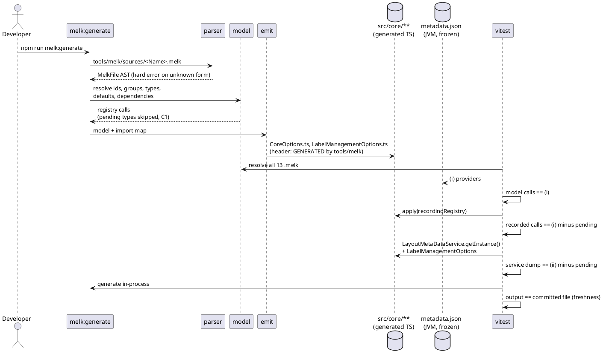

<!-- SPDX-License-Identifier: EPL-2.0 -->

# The `.melk` generator (AD-12)

How the 13 in-scope `.melk` metadata files become the committed `*Options` classes, and how to
regenerate and verify them. Written for missions 4, 5 and 13. Decisions cited (C1–C10) are
`plans/core-metadata/decisions.md`; every deviation is journaled in
`plans/core-metadata/decision-journal.md`. Per-class status is in the [port map](port-map.md);
open gaps are in [conformance.md](../conformance.md#temporary-gaps).

| Section                                          | Answers                                                    |
| ------------------------------------------------ | ---------------------------------------------------------- |
| [1. Pipeline](#pipeline)                         | Which file does what, from `.melk` text to committed TS    |
| [2. Vendored sources](#vendored-sources)         | Where the inputs live and how they are kept in sync (C9)   |
| [3. Pending types](#pending-types)               | What is held back, and how mission 5 empties the list (C1) |
| [4. Type and value rules](#type-and-value-rules) | Nested types, `Class<?>` tokens, bounds, floats (C3, C4)   |
| [5. Verification](#verification)                 | The checks against the JVM golden and against the file     |
| [6. Regenerating](#regenerating)                 | Commands, expected outcomes, what to do on a failure       |

## 1. Pipeline {#pipeline}

The Java build compiles `.melk` with an Xtext generator (`org.eclipse.elk.core.meta`, out of scope)
into `*Options` and `*MetaDataProvider` classes. `tools/melk/` is the TS counterpart; it runs only
on demand and its output is committed.

| Stage      | Files                                                                                               | Does                                                                                            |
| ---------- | --------------------------------------------------------------------------------------------------- | ----------------------------------------------------------------------------------------------- |
| parse (C5) | `lexer.ts`, `parser.ts`, `ast.ts`                                                                   | All `MetaData.xtext` rules; Xbase expressions only in the forms the 13 files use                |
| model      | `model.ts`, `model-{option,algorithms,types,value,names,index,ported,pending,errors}.ts`, `expr.ts` | Resolves ids, groups, types, defaults, bounds, dependencies and algorithm supports across files |
| emit (C6)  | `emit.ts`, `imports.ts`, `config.ts`                                                                | Writes TS with a `GENERATED by tools/melk` header; `config.ts` holds `PENDING_TYPES`            |
| driver     | `generate.ts`                                                                                       | `generate({bundles, write})`; `npm run melk:generate [Bundle...]` (default `Core`, `Labels`)    |

An expression form outside the C5 table is a hard `MelkSyntaxError` naming file, line and form.
Mission 13 extends the table when it emits the remaining bundles; do not add forms speculatively.
Generated files are written only by the script, never by Write or Edit, and skip the lizard
complexity gate (they carry the header); `tools/melk/**` itself obeys every limit (C6).

## 2. Vendored sources {#vendored-sources}

CI has no `../elk` checkout (C9). The 13 `.melk` files (3,647 lines, EPL-2.0) are copied to
`tools/melk/sources/<Name>.melk`; `tools/melk/sources/manifest.json` records each file's upstream
path (relative to `$ELK_SOURCE_DIR`) and git blob sha at the pinned commit
(`tools/oracle/ELK_COMMIT`). Excluded: `Libavoid.melk`, `Graphviz.melk`, `Gmf.melk` (deferred
bundles).

- `tools/melk/sync-sources.sh` refreshes the copies with `git show <sha>:<path>`, so working-tree
  edits and CRLF in `$ELK_SOURCE_DIR` do not leak in, and rewrites the manifest.
- `tools/melk/sync-sources.sh --check` writes nothing; it exits 1 on any difference, including a
  stray `*.melk` in `sources/`.
- `test/melk/sources.test.ts` hashes every copy against its manifest blob sha and checks
  `manifest.elkCommit == ELK_COMMIT`. Never edit a vendored copy by hand.

## 3. Pending types {#pending-types}

`PENDING_TYPES` in `tools/melk/config.ts` lists classes the generated code would import that are
not ported yet (C1). Mission 3: `FixedLayoutProvider`, `BoxLayoutProvider`, `RandomLayoutProvider`,
`TopdownSizeApproximator`. The nested `BoxLayoutProvider.PackingMode` is a different name and is
never pending (it has its own file, C3). The model skips every registration whose provider,
validator, support value, default, bound or dependency expression references a pending type:

- three algorithms (`fixed`, `box`, `random`): no `*LayouterOptions` file, the three trailing
  `new …Options().apply(registry)` lines of `CoreOptions.apply` become comments;
- one dependency: `topdown.sizeCategories` requires `sizeApproximator ==
TopdownSizeApproximator.FIXED_INTEGER_RATIO_BOXES` (`Core.melk:920`).

Derived service effects: none of the three algorithms has a category, so the JVM's
`Registry.applyDependencies` creates the backup category `""`/`"Other"` and lists them as its
layouters (`LayoutMetaDataService.java:481-535`). The TS service therefore differs from dump (ii)
by exactly: the held-back algorithms, their known options, their category-layouter entries, that
backup category, and the held-back dependency. `test/melk/held-back.ts`
(`withoutHeldBackCalls`, `withoutHeldBackService`) is the one helper that subtracts them.

The held-back registrations are still checked: at the model level against dump (i) (T12), and by
emitting them with stub providers (`test/melk/held-back-emit.test.ts`, stubs in
`test/melk/stub-provider.ts`; output goes to the gitignored `test/melk/.held-back/`).

**Mission 5 empties the list:**

1. Port the providers and `TopdownSizeApproximator` (plus `LayoutAlgorithmResolver`, `ElkUtil`
   methods, `NullElkProgressMonitor`, `UnsupportedConfigurationException`).
2. Remove their entries from `PENDING_TYPES`. If the model then reports an `UnportedClassError`,
   the class needs an entry in the behavioural tables of `model-ported.ts`.
3. `npm run melk:generate` — three new `*LayouterOptions.ts` files appear and `CoreOptions.ts`
   loses its comments.
4. Delete `test/melk/held-back.ts` subtractions (the tests then compare against the full dump),
   retire `held-back-emit.test.ts` and the stubs, and port the two C10 JUnit cases.
5. Update [conformance.md](../conformance.md#temporary-gaps) and the [port map](port-map.md).

## 4. Type and value rules {#type-and-value-rules}

**Nested types (C3).** A nested Java type lives in its outer class's file as a `static readonly`
member when the outer class is ported in the same mission. When the outer class is deferred, the
nested type gets its own file named after the nested class (`src/core/util/PackingMode.ts`,
`@see` the outer class); the generator maps `BoxLayoutProvider.PackingMode` there. Exception, by
the C3 amendment: `LayoutOptionData` is split for the complexity limits into
`LayoutOptionData{Type,Target,Visibility,Builder}.ts` (prefixed because `LayoutAlgorithmData` and
`LayoutCategoryData` also nest a `Builder`), re-exposed as `Type`/`Target`/`Visibility`/`Builder`.

**`Class<?>` and interface tokens (T8).** TS interfaces have no runtime value, so a Java
`X.class` for an interface (`ILabelManager`, `ITopdownSizeApproximator`, `List`) is emitted as an
exported same-named `javaInterface('X')` token next to the type. Classes and enums use their
constructor (`JavaClass`). The recorder encodes either as `{"t":"class","c":"<simple name>"}`.
Enum/class classification comes from the `ENUM_TYPES` (66) and `CLASS_TYPES` (11) tables in
`model-types.ts`, validated by dump (i).

**Value encoding (C4).** Dump (i) and the recorder encode every value as:

| Java value                   | JSON                                                                   |
| ---------------------------- | ---------------------------------------------------------------------- |
| `null`                       | `null`                                                                 |
| `Boolean`/`Integer`/`String` | `{"t":"bool"\|"int"\|"string","v":…}`                                  |
| `Double`/`Float` (boxed)     | `{"t":"double","v":"<Double.toString text>"}`; floats are widened      |
| enum constant                | `{"t":"enum","c":"<simple name, Outer.Inner if nested>","n":"<name>"}` |
| `EnumSet`                    | `{"t":"set","c":"<element class>","items":[…]}` in iteration order     |
| `KVectorChain`, other lists  | `{"t":"list","c":"<class>","items":[…]}`                               |
| other object                 | `{"t":"obj","c":"<class>","fields":{…}}` (declared fields, Java order) |
| `Class<?>`                   | `{"t":"class","c":"<simple name>"}`                                    |

A value with no row is a stop condition. Amendment: an unset bound (`getLowerBound()` or
`getUpperBound()` returning the `Property.NEGATIVE_INFINITY`/`POSITIVE_INFINITY` sentinel) encodes
as `null`; the getters never return `null`, so this is lossless. `Nf` literals go through
`Math.fround` then widen (`aspectRatio = 1.6f` is `1.600000023841858`); TS compares `double` text
with `src/java/lang/DoubleToString.ts`. Primitive bounds are emitted as `new BoxedComparable(v)`
because `Property` bounds are `Comparable<T>`.

## 5. Verification {#verification}

| Check                 | Where                                                         | Fails when                                                   |
| --------------------- | ------------------------------------------------------------- | ------------------------------------------------------------ |
| Model vs JVM (i)      | `test/melk/model-options.test.ts`, `model-algorithms.test.ts` | the model's calls differ from `metadata.json` providers      |
| Registry vs JVM (i)   | `test/melk/core-registry.test.ts`                             | `apply(recorder)` differs from (i) minus held-back           |
| Service vs JVM (ii)   | `test/melk/core-registry.test.ts`                             | the service state differs from (ii) minus held-back effects  |
| Freshness (C6)        | `test/melk/emit.test.ts`, `core-registry.test.ts`             | generator output differs from the committed file (hand edit) |
| Vendored sources (C9) | `test/melk/sources.test.ts`                                   | a copy differs from its manifest sha                         |
| Held-back emit (C1)   | `test/melk/held-back-emit.test.ts`                            | an emitted held-back class differs from (i)                  |

`test/golden/refs/java/metadata.json` is frozen JVM output (AD-5): the oracle of these tests.

## 6. Regenerating {#regenerating}

Run from the repository root. `$ELK_SOURCE_DIR` and `$ELK_ORACLE_DIR` default to `../elk` and
`../elk-oracle` (AD-15); the oracle must be built (`tools/oracle/build.sh`).

| Step | Command                                                   | Expected outcome                                                                                                            |
| ---- | --------------------------------------------------------- | --------------------------------------------------------------------------------------------------------------------------- |
| 1    | `tools/melk/sync-sources.sh --check`                      | exit 0, no output. Exit 1: run `tools/melk/sync-sources.sh` (needs `$ELK_SOURCE_DIR` at the pinned commit)                  |
| 2    | `tools/vectors/metadata-vectors.sh test/golden/refs/java` | rewrites `metadata.json`; `git diff --exit-code test/golden/refs/java/metadata.json` is empty                               |
| 3    | `npm run melk:generate`                                   | prints `wrote src/core/options/CoreOptions.ts` and `wrote src/core/labels/LabelManagementOptions.ts`; `git status` is clean |
| 4    | `npx vitest run test/melk`                                | all pass                                                                                                                    |

**Byte-identical rule.** Steps 2 and 3 must leave the working tree unchanged unless the change is
meant to move them. A JVM run is deterministic (three runs gave identical output); a diff in step 2
means the oracle, the classpath or `MetaDataVectors.java` changed, so journal the cause. A diff in
step 3 means a hand edit of a generated file, a changed `.melk` copy, or a generator change: commit
the regenerated TS only together with the generator change and a journal entry.

**On a freshness failure** (generator output differs from the committed file): do not edit the
generated file. Run `npm run melk:generate` and read `git diff`. If you did not change the
generator or sources, someone edited by hand: the regenerated file is correct. If you did, the
diff is the effect of your change; check it against the Java.

**On a JVM-comparison failure** (model, registry or service differs from `metadata.json`): the
golden is the specification (AD-13, tests are immutable). Never edit `metadata.json`, loosen a
comparison or delete a case. Diagnose the generator: find the first call where the recorded
sequence departs from the dump, read the `.melk` line and the Java `*Options` it should match
(the Xtext-generated `*Options.java` is under
`$ELK_ORACLE_DIR/plugins/org.eclipse.elk.<bundle>/src-gen/`), then fix `tools/melk/`. If the fix is only possible by changing an assertion, STOP and
journal the case for the user.

**On a pin bump** (new `ELK_COMMIT`): run step 1 without `--check`, then step 2, review the
`metadata.json` diff, then steps 3 and 4, and journal the sha change.
