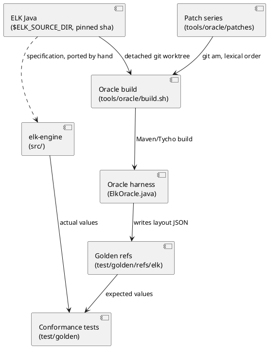
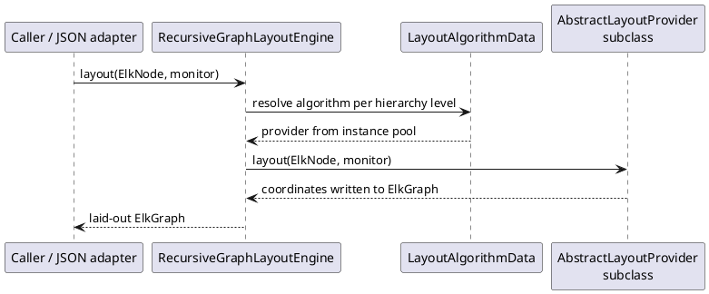

<!-- SPDX-License-Identifier: EPL-2.0 -->

# elk-engine architecture overview

| Document                                             | Content                                                                                                                                           |
| ---------------------------------------------------- | ------------------------------------------------------------------------------------------------------------------------------------------------- |
| [inventory.md](inventory.md)                         | Every ELK bundle: purpose, LOC, generated sources, scope                                                                                          |
| [port-map.md](port-map.md)                           | Java packages to `src/` modules mapping                                                                                                           |
| [component-map.md](component-map.md)                 | In-scope bundle dependencies; core runtime pieces                                                                                                 |
| [../translation-rules.md](../translation-rules.md)   | Java to TypeScript rules                                                                                                                          |
| [../conformance.md](../conformance.md)               | Oracle comparison bar and procedure (arrives later in this mission)                                                                               |
| [elk-text.md](elk-text.md)                           | ELK Text (`.elkt`) port, the Xtext subset, runbook and deferrals                                                                                  |
| [elk-json-text.md](elk-json-text.md)                 | ELK Textual JSON (`.elkj`) port, lazy linking, runbook and deferrals                                                                              |
| [grandom.md](grandom.md)                             | grandom (`.elkr`) random graph generator port, evidence and runbook                                                                               |
| [core-engine.md](core-engine.md)                     | Layout engine and the fixed, box and random providers (mission 5a)                                                                                |
| [melk-codegen.md](melk-codegen.md)                   | The `.melk` generator, pending types, lazy constants, regeneration                                                                                |
| [complexity.md](complexity.md)                       | The complexity gate that measures every function (`npm run complexity`)                                                                           |
| [alg-layered.md](alg-layered.md)                     | Layered framework (mission 7a): LGraph model, transform, staged classes, runbook                                                                  |
| [alg-layered-placement.md](alg-layered-placement.md) | Layered node placement (mission 7d): p4nodes, Brandes-Köpf, five processors, geometry rows, runbook                                               |
| [alg-layered-routing.md](alg-layered-routing.md)     | Layered edge routing (mission 7e): p5edges orthogonal, polyline, splines, six processors, routing rows, runbook                                   |
| [alg-layered-pipeline.md](alg-layered-pipeline.md)   | Layered pipeline (mission 7f): `ElkLayered`, `GraphConfigurator`, components, four processors, full-layout rows, runner subset, runbook           |
| [alg-layered-labels.md](alg-layered-labels.md)       | Layered labels (mission 7f2): label and comment processors, unzipping, debug output, visitor, label rows, sweep, runbook                          |
| [alg-layered-loops.md](alg-layered-loops.md)         | Layered self loops, wrapping, compaction (mission 7g): loops package, breaking points, 1D compaction, `ComponentsCompactor`, rows, sweep, runbook |
| [alg-layered-compound.md](alg-layered-compound.md)   | Layered compound graphs (mission 7h): `compound` package, hierarchical driver, whole-tree stops, goldens, sweep, hash-order twins, runbook        |
| [parity-dashboard.md](parity-dashboard.md)           | TS sweep against the oracle (row 9): sharded runner, summary contract, annotations, report, runbook                                               |
| [text-sizing-seam.md](text-sizing-seam.md)           | Pluggable label-text measurement (row 10): patch 0003, the TS twin, fixed mode, evidence, runbook                                                 |
| [elk-upgrade.md](elk-upgrade.md)                     | Moving the ELK pin (row 13): net-diff triage, patch series, rebuild, re-record, sweeps, ref-diff triage, rehearsal mode                           |

## What elk-engine is

`@knowvah/elk-engine` is a faithful TypeScript port of the Eclipse Layout Kernel (ELK). The Java at
the pinned commit `8bca22f4afa3371562d2f702d59929818f7f7b71` is the specification (AD-1, AD-2). It
is a library: browser-safe, zero runtime dependencies, no Java or WASM. Its public contract is the
ElkGraph object model plus `ElkGraphUtil` factories; ELK JSON is an I/O adapter (AD-14). Thirteen
bundles totalling about 134,600 hand-written lines are in scope (see the inventory). Current state:
the layout engine (`RecursiveGraphLayoutEngine`, `LayoutAlgorithmResolver`, `GraphValidator`) and the
three core providers `fixed`, `box` and `random` are ported and equal the oracle on the curated goldens
(mission 5a, [core-engine.md](core-engine.md)). The rest of `core` is ported too (mission 5b: processor pipeline, `LayoutConfigurator`, `ElkSpacings`, `ElkMath`, splines,
comment attachment; see [core-engine.md](core-engine.md#mission-5b)). The shared `alg.common` bundle is fully ported (mission 6a: geometry, network simplex, 1D compaction, overlaps, spore, polyomino; mission 6b: `nodespacing` and `NodeMicroLayout`, proven by a 326-row oracle replay; see [alg-common.md](alg-common.md)).
The layered framework is ported (mission 7a: the options package, the LGraph model, the ElkGraph ↔ LGraph transform and the provider shell, proven by two oracle vector files of 272 and 330 rows; the layout phases follow in 7b–7h; see [alg-layered.md](alg-layered.md)). Its first two phases are ported (mission 7b: the eleven cycle breakers, the nine layerers and the ten processors around them, proven by 651 oracle phase rows and a 32,652-case sweep; [alg-layered.md § 8](alg-layered.md#part-b)). Its third phase is ported (mission 7c: crossing minimization with its counters, the greedy switch, the model-order comparators and the eight processors between P2 and P3, proven by 808 oracle order rows and a 6,728-case sweep; [alg-layered.md § 9](alg-layered.md#part-c)). Its fourth phase is ported (mission 7d: the four node placers with Brandes-Köpf and the five processors a P4 stop needs, proven by 610 oracle placement rows with geometry and a 8,410-case sweep; [alg-layered-placement.md](alg-layered-placement.md)). Its fifth phase is ported (mission 7e: the orthogonal, polyline and spline routers with the six processors a routed result needs, proven by 950 oracle routing rows with edge geometry and a 6,728-case sweep; [alg-layered-routing.md](alg-layered-routing.md)). The layered pipeline runs (mission 7f: the driver, the connected-components package, the direction transformer, the hierarchical-port router and three processors, proven by 1,311 oracle rows of whole layouts and stops, a 2,351-row re-replay of the earlier rows through the real driver, 28 ported JUnit suites and a 6,646-case sweep; [alg-layered-pipeline.md](alg-layered-pipeline.md)). Labelled and commented layouts, layer unzipping and a logging monitor run as well (mission 7f2: the label family, the comment processors, `AlternatingLayerUnzipper`, `InteractiveLayeredGraphVisitor` and the debug utilities, proven by 1,305 oracle rows of stops and whole layouts, the 11 baseline JUnit suites and a 1,105-case sweep whose 935 ok cases match exactly; [alg-layered-labels.md](alg-layered-labels.md)). Self loops, graph wrapping and compaction run too (mission 7g: the loops package, the four self-loop processors, the breaking-point and single-edge wrappers, `HorizontalGraphCompactor`, the layered `compaction` package and `ComponentsCompactor`, proven by 1,627 oracle rows (`full` 731, `models` 307, `scenarios` 525, `sites` 64), the 10 baseline JUnit suites, a 3,073-case sweep whose 2,997 ok cases match exactly and 76 throws match on both sides, and the nine-arm wiring that leaves 58 arms ported; [alg-layered-loops.md](alg-layered-loops.md)). Compound graphs run too (mission 7h: the `compound` package, `HierarchicalNodeResizingProcessor` and the last arm, proven by 540 oracle rows (`full` 355, `models` 73 with whole-tree stops, `scenarios` 88, `sites` 24), 24 layered goldens, the nine issue suites and three graph.json methods, a 1,169-case sweep whose 1,164 ok cases match exactly and 5 throws match on both sides; [alg-layered-compound.md](alg-layered-compound.md)). The layered algorithm now runs every hierarchy-handling mode: 59 enum arms are ported, none is pending, and the staged list is empty. Only the three `elk.stress` cases of issue #58 wait (mission 8b). No other layout algorithm runs yet (mrtree, radial, force, disco, rectpacking, spore, topdownpacking, vertiflex). Since mission 8a, mrtree, radial and vertiflex run too (proven by 1,181 oracle rows in four refs of whole layouts and stops, a 2,656-row unit-vector ref, 40 `trees` goldens, `MrTreeGraphSizeTest` and `CenterOnRootTest` at 6/6 and 2/2, and a 906-case sweep per algorithm in which every case either matches or is diagnosed; two radial rows whose result depends on the order of a treeified hash bin are classified, not matched; [alg-trees.md](alg-trees.md)). Since mission 8b, force, stress and disco run too (proven by 21,420 oracle rows in three refs of whole layouts and stops, 45 `force-disco` goldens, `ForceImportTest` and `TwoBitGridTest` at 3/3 each, and a sweep per algorithm in which every case either matches or is diagnosed; the Eades `Math.log` is a bit-exact fdlibm port; [alg-force-disco.md](alg-force-disco.md)). Since mission 8c, rectpacking, spore (`sporeOverlap`, `sporeCompaction`) and topdownpacking run too (proven by 2,593 oracle rows in three refs, 44 `packing` goldens, the eight ported JUnit suites at 30 runs, and a sweep per algorithm in which every deterministic case matches or is diagnosed; [alg-packing.md](alg-packing.md)). Every in-scope algorithm is swept against the oracle, and the per-algorithm result is published in the parity report ([parity-dashboard.md](parity-dashboard.md)).

## Relation to ELK Java and the oracle

The patch series is empty in this mission (AD-3). Goldens are committed, so CI needs no JVM
(AD-5). Comparison: structure exact, coordinates within 1e-6 (AD-4).

## Key flows

Layout in ELK, which elk-engine reproduces for `fixed`, `box` and `random` today (details in
[component-map.md](component-map.md) and [core-engine.md](core-engine.md#engine-flow)):

JSON adapter (`graph.json`, `ElkGraphJson`): ELK JSON in becomes an ElkGraph via the importer
before layout; after layout, the computed coordinates and edge sections are transferred back into
JSON out. The oracle harness uses the Java adapter in the same two steps, so both sides share the
JSON contract.

Text adapter (`graph.text`, `ElkGraphText`): `.elkt` text loads into an ElkGraph through a hand-written
parser, linker and validator built on a small Xtext subset (`src/xtext`), and an ElkGraph serializes back
to `.elkt`. The entry point is internal; see [elk-text.md](elk-text.md).

Textual JSON adapter (`graph.json.text`, `ElkGraphJsonText`): `.elkj` text loads through the same Xtext subset
with a hand-written parser, and links lazily like Xtext's `LazyLinker`: edge endpoints are EMF proxies
(`src/emf`) that resolve when read. An ElkGraph serializes back to `.elkj` through a grammar-specific writer.
The entry point is internal; see [elk-json-text.md](elk-json-text.md).

Random graph generator (`core.debug.grandom`, `GRandomText`): `.elkr` text parses through a hand-written lexer
and parser on the same Xtext subset (`src/xtext`), and `RandomGraphGenerator` turns a configuration into
ElkGraphs with the exact JVM `Random` sequence. Seeded output is byte-exact against the oracle and reproduces
the nine `test/corpus/generated/*.json` files; unseeded paths (edge label text, cross-hierarchy shuffle, a
missing seed) are checked by invariants only. The entry point is internal; see [grandom.md](grandom.md).

## Tech stack

| Concern       | Choice                                                        |
| ------------- | ------------------------------------------------------------- |
| Language      | TypeScript 7.0.2 (native `tsc`), ES2022, NodeNext, `strict`   |
| Tests         | vitest 5.0.x with `@vitest/coverage-v8` (90% thresholds)      |
| Bundling      | esbuild 0.28.x                                                |
| Script runner | tsx                                                           |
| Runtime       | Node 22 or newer; `src/` itself is browser-safe               |
| Oracle only   | Maven 3.9+ and JDK 21 (JDK 17 fallback) for ELK's Tycho build |

## Fitness constraints (AD-8)

Bundle import direction follows `test/architecture/bundle-deps.json`; SPDX header on every code
file; no Node built-ins or `process.env` in `src/`; no module-level mutable `let` outside the
allowlist.

## Docs and release toolchain

Added by roadmap row 12; decisions DP1 to DP9 in
[`plans/docs-publish-prep/decisions.md`](../../plans/docs-publish-prep/decisions.md). `1.0.0` was published on 2026-11-23.

| Piece          | What it is                                                                                                                                                                          |
| -------------- | ----------------------------------------------------------------------------------------------------------------------------------------------------------------------------------- |
| Export surface | Accepted (2026-11-23), listed in [public-api.md](public-api.md) and held equal to `src/index.ts` by `src/index.test.ts`; frozen at `1.0.0`, the first npm publish (AD-14)           |
| API reference  | `npm run docs:api`: typedoc in the private package `tools/typedoc/` with TypeScript 6 of its own (typedoc has no TypeScript 7 release, AD-6), into the generated `/reference/`      |
| Examples       | `test/docs/examples/*.ts`, shown on the site's getting-started page as snippets and compared with oracle refs (`test/golden/refs/elk-examples/`, `regen-goldens.sh --set examples`) |
| Link check     | `npm run docs:linkcheck`: linkinator over the built site, internal links and fragments, in CI; external links weekly (`links.yml`)                                                  |
| Pack rehearsal | `npm run pack:smoke`: pack, check the file list, install offline into a clean project, import, lay out an example there and compare it with its oracle ref                          |
| Release        | semantic-release configuration and `release.yml`, run on every push to `main`; runbook in [`PUBLISHING.md`](../../PUBLISHING.md)                                                    |
