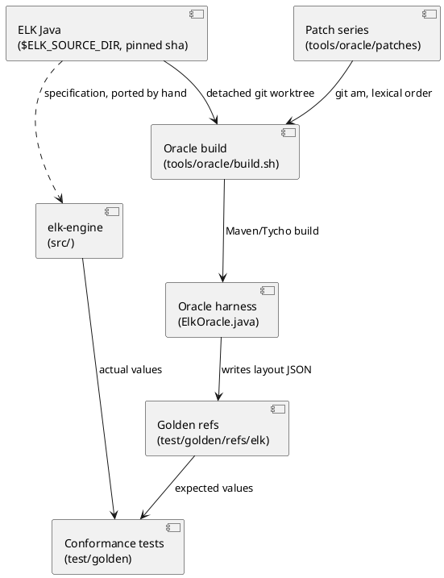
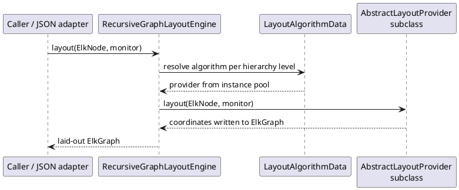

<!-- SPDX-License-Identifier: EPL-2.0 -->

# elk-engine architecture overview

| Document | Content |
|----------|---------|
| [inventory.md](inventory.md) | Every ELK bundle: purpose, LOC, generated sources, scope |
| [port-map.md](port-map.md) | Java packages to `src/` modules mapping |
| [component-map.md](component-map.md) | In-scope bundle dependencies; core runtime pieces |
| [../translation-rules.md](../translation-rules.md) | Java to TypeScript rules |
| [../conformance.md](../conformance.md) | Oracle comparison bar and procedure (arrives later in this mission) |

## What elk-engine is

`@knowvah/elk-engine` is a faithful TypeScript port of the Eclipse Layout Kernel (ELK). The Java at
the pinned commit `8aaa3c145c2a18a38aabbc725aa3791ddc517a76` is the specification (AD-1, AD-2). It
is a library: browser-safe, zero runtime dependencies, no Java or WASM. Its public contract is the
ElkGraph object model plus `ElkGraphUtil` factories; ELK JSON is an I/O adapter (AD-14). Thirteen
bundles totalling about 134,600 hand-written lines are in scope (see the inventory). This mission
delivers only the scaffolding: no layout algorithm is ported yet.

## Relation to ELK Java and the oracle

The patch series is empty in this mission (AD-3). Goldens are committed, so CI needs no JVM
(AD-5). Comparison: structure exact, coordinates within 1e-6 (AD-4).

## Key flows

Layout in ELK, which elk-engine reproduces (details in [component-map.md](component-map.md)):

JSON adapter (`graph.json`, `ElkGraphJson`): ELK JSON in becomes an ElkGraph via the importer
before layout; after layout, the computed coordinates and edge sections are transferred back into
JSON out. The oracle harness uses the Java adapter in the same two steps, so both sides share the
JSON contract.

## Tech stack

| Concern | Choice |
|---------|--------|
| Language | TypeScript 7.0.2 (native `tsc`), ES2022, NodeNext, `strict` |
| Tests | vitest 5.0.x with `@vitest/coverage-v8` (90% thresholds) |
| Bundling | esbuild 0.28.x |
| Script runner | tsx |
| Runtime | Node 22 or newer; `src/` itself is browser-safe |
| Oracle only | Maven 3.9+ and JDK 21 (JDK 17 fallback) for ELK's Tycho build |

## Fitness constraints (AD-8)

Bundle import direction follows `test/architecture/bundle-deps.json`; SPDX header on every code
file; no Node built-ins or `process.env` in `src/`; no module-level mutable `let` outside the
allowlist.
