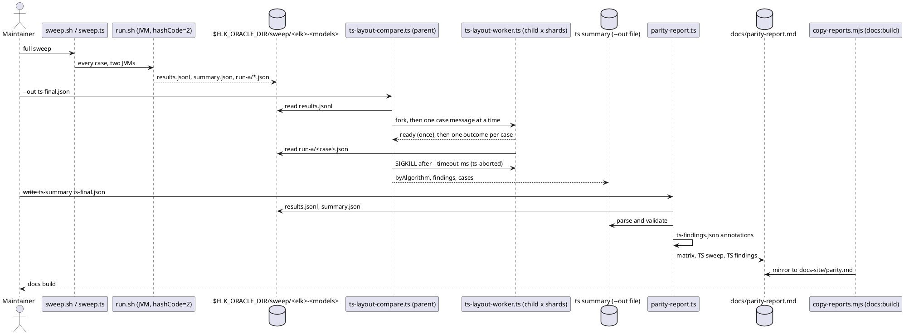

<!-- SPDX-License-Identifier: EPL-2.0 -->

# The parity dashboard: TS sweep against the oracle (roadmap row 9)

What roadmap row 9 (`ts-parity-dashboard`, issue #40) built: a runner that lays every case of the oracle sweep out with the TS
engine, a summary file that records one outcome per case, and an extension of the generated parity report that shows the
result per algorithm. The dashboard is `docs/parity-report.md`, mirrored to `docs-site/parity.md` at docs build time; the site
has no new component. Decisions are `plans/ts-parity-dashboard/decisions.md` (TP1-TP8). Counts and findings are in
[conformance.md](../conformance.md#ts-corpus-sweep); this page covers the mechanism and the runbook.

| Section                                      | Answers                                                 |
| -------------------------------------------- | ------------------------------------------------------- |
| [1. Data flow](#parity-dashboard-flow)       | From the oracle sweep to the site                       |
| [2. Runner](#parity-dashboard-runner)        | Shards, the child protocol, the per-case kill           |
| [3. Summary](#parity-dashboard-summary)      | `TsSweepSummary`, the contract between sweep and report |
| [4. Annotations](#parity-dashboard-findings) | `ts-findings.json`, display only                        |
| [5. The report](#parity-dashboard-report)    | The cells and sections the sweep adds                   |
| [6. Hazards](#parity-dashboard-hazards)      | Cache overwrite, flicker, orphans, formatting, gates    |
| [7. Runbook](#parity-dashboard-runbook)      | The commands and their exit codes                       |

## 1. Data flow {#parity-dashboard-flow}



The oracle sweep (`tools/oracle/sweep.sh`) is the input: the TS sweep reads `results.jsonl` and the `run-a/` outputs of the
default directory (or `--sweep-dir`). Nothing from a sweep is committed (AD-5); the committed record is the generated report.

## 2. Runner {#parity-dashboard-runner}

`tools/corpus/ts-layout-compare.ts` is the CLI and keeps the in-process path (`execute`, `runComparison`) that its landed tests
use. `main` calls `executeSharded`. The pieces:

| File                    | Role                                                                                                             |
| ----------------------- | ---------------------------------------------------------------------------------------------------------------- |
| `ts-layout-classify.ts` | Pure: row parsing, `classify`, `compareCase`, `abortedOutcome`, `summarizeSweep`, `buildSweepSummary`            |
| `ts-layout-pipeline.ts` | Provider registrations, `layoutToJson`, `liveDeps` (the live import, overlay, engine, export), `resolveSweepDir` |
| `ts-layout-shards.ts`   | Parent: `shardItems`, `runSharded`, the per-case timer, SIGKILL                                                  |
| `ts-layout-protocol.ts` | IPC messages `case`, `ready`, `outcome`; `handleCase`; `loadWorkerDeps`                                          |
| `ts-layout-worker.ts`   | Child entry                                                                                                      |

- **Shards.** The selected rows are dealt round-robin (`shardItems`: row `i` goes to shard `i % n`, never more shards than
  rows). `--shards` defaults to `min(availableParallelism(), 8)`. The shards run concurrently; each runs its rows in order.
- **One case at a time.** The parent forks the worker with `fork` (inheriting `process.execArgv`, so the tsx loader applies) and
  sends `{ type: 'case', row }`; the child answers `{ type: 'outcome', outcome }`. Rows that are `excluded` never reach a child.
- **`ready` handshake.** The child loads the engine, registers its handlers, then sends `{ type: 'ready' }`. The parent waits for
  it up to 60 s (`STARTUP_TIMEOUT_MS`), independent of the per-case limit. A child that does not announce `ready` is killed and
  the case that needed it gets `ts-aborted` with detail `startup timeout` (or `exit <code>` if it died).
- **Per-case timer and kill.** The parent, not the child, times each case (`--timeout-ms`, default 120,000). A synchronous endless
  loop in the child cannot be interrupted from inside it. Past the limit the parent sends `SIGKILL` and records the case as
  `ts-aborted` with detail `timeout`; a child that exits mid-case is recorded with `exit <code or signal>`.
- **Fresh child after an abort.** The shard goes on with a new child (and a new `ready` wait), so one hang or crash costs one case.
- **Why processes.** A hang (issue #73) or a cubic compaction input in an in-process loop stalls all 18k cases with no bound.
  `worker_threads` was not used: `terminate` would work, but loading tsx inside a worker was unverified, and `sweep.ts` already
  shards by process.
- Test-only hook: the env var `TS_LAYOUT_WORKER_DEPS_MODULE` replaces the live pipeline in the worker. The CLI never sets it.

## 3. Summary {#parity-dashboard-summary}

`--out <file>` writes this document (`TsSweepSummary` in `tools/corpus/ts-layout-classify.ts`, which extends `Summary<Category>`
with `byAlgorithm` and `findings`); `cases` holds every outcome sorted by case id.

```ts
export interface TsSweepSummary extends Summary<Category> {
  readonly elkCommit: string;
  readonly modelsCommit: string;
  readonly sweepDir: string;
  readonly node: string;
  readonly shards: number;
  readonly timeoutMs: number | null;
  readonly wallMs: number;
  readonly cases: readonly CaseOutcome[];
}
```

`parseTsSummary` (`parity-report-ts.ts`) validates it at the boundary: every field present and typed, every category known, and
each algorithm's counts summing to its `planned`. `parity-report.ts` also requires the summary's `elkCommit` and `modelsCommit`
to equal the oracle summary's, and every algorithm in it to exist in the oracle algorithm list; otherwise it exits 2.

## 4. Annotations {#parity-dashboard-findings}

`tools/corpus/ts-findings.json` is `[{ caseId, issue, note }]`. It labels known findings with their issue, for display only: it
changes no category, no count and no exit code. `parseFindings` rejects a document that is not an array, an `issue` that is not a
positive integer, a `note` that is empty, has a line break or exceeds 160 characters (`MAX_NOTE_LENGTH`), and a duplicate
`caseId`. A finding without an entry shows as `unannotated`. An entry whose case is not a finding is not shown. Issues #79, #82
and #84 are the maintainer's to decide; the annotations do not decide them.

## 5. What the report shows {#parity-dashboard-report}

`parity-report.ts` takes `--ts-summary <file>` (required; exit 2 without it) and adds:

- the `TS conformant` column of the matrix: `<ok + both-throw> / <planned - excluded> (<pct>%)`, `— (not in TS sweep)` for an
  algorithm the summary lacks, `— (no compared cases)` when everything is excluded;
- a header line `TS sweep: <node>, <shards> shards, <wall> min, timeout <s> s`;
- `## TS sweep`: one row per algorithm with planned, every category, options-only mismatches, TS ms and oracle ms;
- `## TS findings`: one line per reported case (`mismatch`, `ts-only-throw`, `oracle-only-throw`, `ts-aborted`), sorted by algorithm
  then case id: the id, the category, the first difference (at most 200 characters) and the annotation or `unannotated`.

`docs-site/copy-reports.mjs` mirrors the report into `docs-site/parity.md` during `npm run docs:build` and rewrites its links. The
copy is gitignored.

## 6. Hazards {#parity-dashboard-hazards}

- **A filtered oracle sweep overwrites the cache.** `sweep.sh --filter` or `--limit` without `--out <scratch dir>` writes over the
  default directory that the report and the TS sweep read. This is how the earlier full sweep was replaced by a 10,881-row partial.
- **Spore jitter flickers.** The `sporeOverlap` cases whose two oracle runs both threw by chance are `throws`, not `excluded`, and
  the TS side throws or lays out at random too: a sweep shows 0, 1 or 2 `oracle-only-throw` findings from them (issue #79).
  Re-run before treating one as a regression.
- **Orphaned workers.** Killing the parent mid-sweep can leave `ts-layout-worker` children. Check `ps` and kill them.
- **`docs/parity-report.md` is in `.prettierignore`.** The generator compares it byte for byte; never format it.
- **Gates do not scan `tools/corpus` by default.** `npm run complexity` scans `src` only (use
  `npx tsx tools/complexity/check.ts tools/corpus`), and the coverage gate includes `src` and `tools/melk` only (scope a run with
  `vitest run test/corpus/ts-layout-*.test.ts test/corpus/parity-report*.test.ts --coverage --coverage.include=...`).
- **The report needs a summary from the same oracle sweep.** A TS summary of another oracle or models commit is rejected.

## 7. Runbook {#parity-dashboard-runbook}

1. Check the machine is quiet (`uptime`, 1-minute load at most 12). Oracle built: `oracle-build.json` names the pinned commit.
2. Oracle sweep: `JAVA_TOOL_OPTIONS="-XX:+UnlockExperimentalVMOptions -XX:hashCode=2" nice -n 10 tools/oracle/sweep.sh`.
   About 2 minutes; exit 0 means no `oracle-error`. Filtered runs: add `--out <scratch dir>`.
3. TS sweep: `npx tsx tools/corpus/ts-layout-compare.ts --out "$TMPDIR/ts-final.json"`. Under a minute with 8 shards. Exit 0: no
   findings; 1: findings (read `## TS findings` after step 4); 2: tool error. Flags: `--algorithms`, `--filter`, `--sweep-dir`,
   `--shards`, `--timeout-ms`.
4. Report: `npx tsx tools/corpus/parity-report.ts --write --ts-summary "$TMPDIR/ts-final.json"`; exit 0.
5. Staleness check: the same command without `--write`; exit 0 current, 1 stale, 2 usage or tool error.
6. Annotate new findings in `tools/corpus/ts-findings.json`, then repeat step 4.
7. Site: `npm run docs:build`; `docs-site/parity.md` then holds `## TS sweep` and `## TS findings`.
8. Afterwards: `ps` shows no `ts-layout-worker`; journal the counts and the oracle and Node versions.
