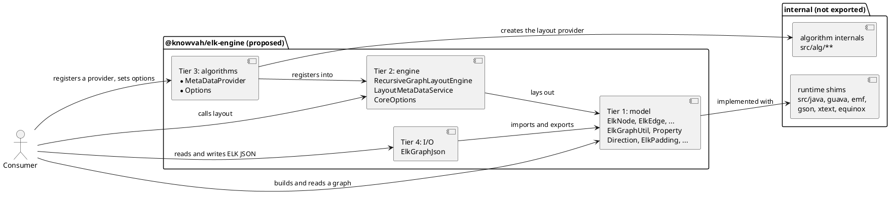

<!-- SPDX-License-Identifier: EPL-2.0 -->

# Proposal: the export surface of `@knowvah/elk-engine`

**Status:** Proposed (2026-11-14). Acceptance: [#90](https://github.com/knowvah/elk-engine/issues/90)

This document proposes what `src/index.ts` exports. It decides nothing: accepting, amending or rejecting the surface is
the maintainer's (roadmap row 12, issue #43). **The first npm publish freezes this surface (AD-14) and cannot be undone.**

The proposal is also code. [`test/public-api/candidate-index.ts`](../../test/public-api/candidate-index.ts) is the
proposed entry module, byte for byte what `src/index.ts` would hold apart from its import paths. `src/index.ts` itself is
unchanged and still exports nothing. `test/public-api/candidate-index.test.ts` fails when the table below and the
candidate differ, so the document under review is the code under test.

## Summary

69 exports: 56 values and 13 types, in four tiers.

| Tier | Holds                                                                                               | Exports |
| ---- | --------------------------------------------------------------------------------------------------- | ------- |
| 1    | The AD-14 contract: the ElkGraph model (AD-11), `ElkGraphUtil`, and the value types of core options | 37      |
| 2    | The engine: lay out, watch progress, register algorithms, core options                              | 6       |
| 3    | The algorithms: one metadata provider and one options class each                                    | 25      |
| 4    | The I/O adapter: ELK JSON                                                                           | 1       |

With these a consumer can build a graph, configure it, lay it out with any of the 14 ported algorithms and serialize it.
The examples in `test/docs/examples/` use nothing else, and CI compares their output with the oracle.



## Rules the candidate follows

- **Java names, no new API.** Every export is a ported Java class or interface under its Java name, with its `@see`.
  No wrapper, no convenience function, no "register every algorithm" helper (YAGNI; AD-14 puts idiomatic wrappers in a
  later layer; AD-16c puts idiomatic errors there too).
- **Named re-exports only.** One `export { X } from` or `export type { T } from` per symbol; no `export *`, so nothing
  joins the frozen surface by accident.
- **Only what a consumer needs** to build, configure, lay out and serialize a graph. A class a consumer never names stays
  internal even when it appears in an exported signature (see open question 6).
- **Value types of core options are in; value types of algorithm options are not** (open question 1). The line is
  mechanical: tier 1 holds every enum and data class that is the value or element type of a `CoreOptions` property.
  Three `CoreOptions` value types are extension points or outputs and stay out: `ITopdownSizeApproximator`,
  `ILabelManager` and `LayoutAlgorithmData`.

## The exports

Kind `type` is an interface (erased at run time); kind `value` exists at run time. "TS module" is the file the symbol
lives in; "Java" is its `@see`, relative to `plugins/` of the pinned ELK source.

| Export                           | Kind  | Tier | TS module                                                          | Java (`@see`)                                                                                                               | Why a consumer needs it                                                                 |
| -------------------------------- | ----- | ---- | ------------------------------------------------------------------ | --------------------------------------------------------------------------------------------------------------------------- | --------------------------------------------------------------------------------------- |
| `ElkGraphElement`                | type  | 1    | `src/graph/ElkGraphElement.ts`                                     | `org.eclipse.elk.graph/src/org/eclipse/elk/graph/ElkGraphElement.java`                                                      | Supertype of every graph element; parameter of `ElkGraphUtil.createLabel`               |
| `ElkShape`                       | type  | 1    | `src/graph/ElkShape.ts`                                            | `org.eclipse.elk.graph/src/org/eclipse/elk/graph/ElkShape.java`                                                             | Position and size accessors shared by nodes, ports and labels                           |
| `ElkConnectableShape`            | type  | 1    | `src/graph/ElkConnectableShape.ts`                                 | `org.eclipse.elk.graph/src/org/eclipse/elk/graph/ElkConnectableShape.java`                                                  | What an edge connects; parameter of `ElkGraphUtil.createSimpleEdge`                     |
| `ElkNode`                        | type  | 1    | `src/graph/ElkNode.ts`                                             | `org.eclipse.elk.graph/src/org/eclipse/elk/graph/ElkNode.java`                                                              | A node or the graph itself (AD-11)                                                      |
| `ElkPort`                        | type  | 1    | `src/graph/ElkPort.ts`                                             | `org.eclipse.elk.graph/src/org/eclipse/elk/graph/ElkPort.java`                                                              | A port of a node (AD-11)                                                                |
| `ElkLabel`                       | type  | 1    | `src/graph/ElkLabel.ts`                                            | `org.eclipse.elk.graph/src/org/eclipse/elk/graph/ElkLabel.java`                                                             | A label of a node, port or edge (AD-11)                                                 |
| `ElkEdge`                        | type  | 1    | `src/graph/ElkEdge.ts`                                             | `org.eclipse.elk.graph/src/org/eclipse/elk/graph/ElkEdge.java`                                                              | An edge (AD-11)                                                                         |
| `ElkEdgeSection`                 | type  | 1    | `src/graph/ElkEdgeSection.ts`                                      | `org.eclipse.elk.graph/src/org/eclipse/elk/graph/ElkEdgeSection.java`                                                       | The route of an edge after layout (AD-11)                                               |
| `ElkBendPoint`                   | type  | 1    | `src/graph/ElkBendPoint.ts`                                        | `org.eclipse.elk.graph/src/org/eclipse/elk/graph/ElkBendPoint.java`                                                         | A bend point of an edge section (AD-11)                                                 |
| `ElkGraphUtil`                   | value | 1    | `src/graph/util/ElkGraphUtil.ts`                                   | `org.eclipse.elk.graph/src/org/eclipse/elk/graph/util/ElkGraphUtil.java`                                                    | The factories and queries of the model (AD-14)                                          |
| `IProperty`                      | type  | 1    | `src/graph/properties/IProperty.ts`                                | `org.eclipse.elk.graph/src/org/eclipse/elk/graph/properties/IProperty.java`                                                 | The key type of `setProperty`/`getProperty`; the type of every option constant          |
| `IPropertyHolder`                | type  | 1    | `src/graph/properties/IPropertyHolder.ts`                          | `org.eclipse.elk.graph/src/org/eclipse/elk/graph/properties/IPropertyHolder.java`                                           | The `setProperty`/`getProperty` contract every element implements                       |
| `Property`                       | value | 1    | `src/graph/properties/Property.ts`                                 | `org.eclipse.elk.graph/src/org/eclipse/elk/graph/properties/Property.java`                                                  | Lets a caller define a property of its own on graph elements                            |
| `KVector`                        | value | 1    | `src/core/math/KVector.ts`                                         | `org.eclipse.elk.core/src/org/eclipse/elk/core/math/KVector.java`                                                           | Value of position options (`CoreOptions.POSITION`) and of bend points in `KVectorChain` |
| `KVectorChain`                   | value | 1    | `src/core/math/KVectorChain.ts`                                    | `org.eclipse.elk.core/src/org/eclipse/elk/core/math/KVectorChain.java`                                                      | Value of `CoreOptions.BEND_POINTS` and `JUNCTION_POINTS`                                |
| `ElkPadding`                     | value | 1    | `src/core/math/ElkPadding.ts`                                      | `org.eclipse.elk.core/src/org/eclipse/elk/core/math/ElkPadding.java`                                                        | Value of `CoreOptions.PADDING`                                                          |
| `ElkMargin`                      | value | 1    | `src/core/math/ElkMargin.ts`                                       | `org.eclipse.elk.core/src/org/eclipse/elk/core/math/ElkMargin.java`                                                         | Value of `CoreOptions.MARGINS`                                                          |
| `IndividualSpacings`             | value | 1    | `src/core/util/IndividualSpacings.ts`                              | `org.eclipse.elk.core/src/org/eclipse/elk/core/util/IndividualSpacings.java`                                                | Value of `CoreOptions.SPACING_INDIVIDUAL`                                               |
| `Alignment`                      | value | 1    | `src/core/options/Alignment.ts`                                    | `org.eclipse.elk.core/src/org/eclipse/elk/core/options/Alignment.java`                                                      | Value of `CoreOptions.ALIGNMENT`                                                        |
| `ContentAlignment`               | value | 1    | `src/core/options/ContentAlignment.ts`                             | `org.eclipse.elk.core/src/org/eclipse/elk/core/options/ContentAlignment.java`                                               | Element of `CoreOptions.CONTENT_ALIGNMENT`                                              |
| `Direction`                      | value | 1    | `src/core/options/Direction.ts`                                    | `org.eclipse.elk.core/src/org/eclipse/elk/core/options/Direction.java`                                                      | Value of `CoreOptions.DIRECTION`                                                        |
| `EdgeCoords`                     | value | 1    | `src/core/options/EdgeCoords.ts`                                   | `org.eclipse.elk.core/src/org/eclipse/elk/core/options/EdgeCoords.java`                                                     | Value of `CoreOptions.JSON_EDGE_COORDS`                                                 |
| `EdgeLabelPlacement`             | value | 1    | `src/core/options/EdgeLabelPlacement.ts`                           | `org.eclipse.elk.core/src/org/eclipse/elk/core/options/EdgeLabelPlacement.java`                                             | Value of `CoreOptions.EDGE_LABELS_PLACEMENT`                                            |
| `EdgeRouting`                    | value | 1    | `src/core/options/EdgeRouting.ts`                                  | `org.eclipse.elk.core/src/org/eclipse/elk/core/options/EdgeRouting.java`                                                    | Value of `CoreOptions.EDGE_ROUTING`                                                     |
| `EdgeType`                       | value | 1    | `src/core/options/EdgeType.ts`                                     | `org.eclipse.elk.core/src/org/eclipse/elk/core/options/EdgeType.java`                                                       | Value of `CoreOptions.EDGE_TYPE`                                                        |
| `HierarchyHandling`              | value | 1    | `src/core/options/HierarchyHandling.ts`                            | `org.eclipse.elk.core/src/org/eclipse/elk/core/options/HierarchyHandling.java`                                              | Value of `CoreOptions.HIERARCHY_HANDLING`                                               |
| `NodeLabelPlacement`             | value | 1    | `src/core/options/NodeLabelPlacement.ts`                           | `org.eclipse.elk.core/src/org/eclipse/elk/core/options/NodeLabelPlacement.java`                                             | Element of `CoreOptions.NODE_LABELS_PLACEMENT`                                          |
| `PortAlignment`                  | value | 1    | `src/core/options/PortAlignment.ts`                                | `org.eclipse.elk.core/src/org/eclipse/elk/core/options/PortAlignment.java`                                                  | Value of the `CoreOptions.PORT_ALIGNMENT_*` options                                     |
| `PortConstraints`                | value | 1    | `src/core/options/PortConstraints.ts`                              | `org.eclipse.elk.core/src/org/eclipse/elk/core/options/PortConstraints.java`                                                | Value of `CoreOptions.PORT_CONSTRAINTS`                                                 |
| `PortLabelPlacement`             | value | 1    | `src/core/options/PortLabelPlacement.ts`                           | `org.eclipse.elk.core/src/org/eclipse/elk/core/options/PortLabelPlacement.java`                                             | Element of `CoreOptions.PORT_LABELS_PLACEMENT`                                          |
| `PortSide`                       | value | 1    | `src/core/options/PortSide.ts`                                     | `org.eclipse.elk.core/src/org/eclipse/elk/core/options/PortSide.java`                                                       | Value of `CoreOptions.PORT_SIDE`                                                        |
| `ShapeCoords`                    | value | 1    | `src/core/options/ShapeCoords.ts`                                  | `org.eclipse.elk.core/src/org/eclipse/elk/core/options/ShapeCoords.java`                                                    | Value of `CoreOptions.JSON_SHAPE_COORDS`                                                |
| `SizeConstraint`                 | value | 1    | `src/core/options/SizeConstraint.ts`                               | `org.eclipse.elk.core/src/org/eclipse/elk/core/options/SizeConstraint.java`                                                 | Element of `CoreOptions.NODE_SIZE_CONSTRAINTS`                                          |
| `SizeOptions`                    | value | 1    | `src/core/options/SizeOptions.ts`                                  | `org.eclipse.elk.core/src/org/eclipse/elk/core/options/SizeOptions.java`                                                    | Element of `CoreOptions.NODE_SIZE_OPTIONS`                                              |
| `TopdownNodeTypes`               | value | 1    | `src/core/options/TopdownNodeTypes.ts`                             | `org.eclipse.elk.core/src/org/eclipse/elk/core/options/TopdownNodeTypes.java`                                               | Value of `CoreOptions.TOPDOWN_NODE_TYPE`                                                |
| `TopdownSizeApproximator`        | value | 1    | `src/core/options/TopdownSizeApproximator.ts`                      | `org.eclipse.elk.core/src/org/eclipse/elk/core/options/TopdownSizeApproximator.java`                                        | Value of `CoreOptions.TOPDOWN_SIZE_APPROXIMATOR`                                        |
| `PackingMode`                    | value | 1    | `src/core/util/PackingMode.ts`                                     | `org.eclipse.elk.core/src/org/eclipse/elk/core/util/BoxLayoutProvider.java`                                                 | Value of `CoreOptions.BOX_PACKING_MODE` (Java: nested `BoxLayoutProvider.PackingMode`)  |
| `RecursiveGraphLayoutEngine`     | value | 2    | `src/core/RecursiveGraphLayoutEngine.ts`                           | `org.eclipse.elk.core/src/org/eclipse/elk/core/RecursiveGraphLayoutEngine.java`                                             | Lays out a graph and its hierarchy                                                      |
| `IElkProgressMonitor`            | type  | 2    | `src/core/util/IElkProgressMonitor.ts`                             | `org.eclipse.elk.core/src/org/eclipse/elk/core/util/IElkProgressMonitor.java`                                               | The monitor parameter of `RecursiveGraphLayoutEngine.layout`                            |
| `BasicProgressMonitor`           | value | 2    | `src/core/util/BasicProgressMonitor.ts`                            | `org.eclipse.elk.core/src/org/eclipse/elk/core/util/BasicProgressMonitor.java`                                              | The monitor to pass to `layout`                                                         |
| `LayoutMetaDataService`          | value | 2    | `src/core/data/LayoutMetaDataService.ts`                           | `org.eclipse.elk.core/src/org/eclipse/elk/core/data/LayoutMetaDataService.java`                                             | Registers algorithm providers; looks up algorithms and options                          |
| `ILayoutMetaDataProvider`        | type  | 2    | `src/core/data/ILayoutMetaDataProvider.ts`                         | `org.eclipse.elk.core/src/org/eclipse/elk/core/data/ILayoutMetaDataProvider.java`                                           | The parameter type of `registerLayoutMetaDataProviders`                                 |
| `CoreOptions`                    | value | 2    | `src/core/options/CoreOptions.ts`                                  | `org.eclipse.elk.core/src-gen/org/eclipse/elk/core/options/CoreOptions.java`                                                | The options every algorithm shares, among them `ALGORITHM`                              |
| `FixedLayouterOptions`           | value | 3    | `src/core/options/FixedLayouterOptions.ts`                         | `org.eclipse.elk.core/src-gen/org/eclipse/elk/core/options/FixedLayouterOptions.java`                                       | Options and id of `org.eclipse.elk.fixed` (registered by `CoreOptions`)                 |
| `BoxLayouterOptions`             | value | 3    | `src/core/options/BoxLayouterOptions.ts`                           | `org.eclipse.elk.core/src-gen/org/eclipse/elk/core/options/BoxLayouterOptions.java`                                         | Options and id of `org.eclipse.elk.box` (registered by `CoreOptions`)                   |
| `RandomLayouterOptions`          | value | 3    | `src/core/options/RandomLayouterOptions.ts`                        | `org.eclipse.elk.core/src-gen/org/eclipse/elk/core/options/RandomLayouterOptions.java`                                      | Options and id of `org.eclipse.elk.random` (registered by `CoreOptions`)                |
| `LayeredMetaDataProvider`        | value | 3    | `src/alg/layered/options/LayeredMetaDataProvider.ts`               | `org.eclipse.elk.alg.layered/src-gen/org/eclipse/elk/alg/layered/options/LayeredMetaDataProvider.java`                      | Registers `org.eclipse.elk.layered`                                                     |
| `LayeredOptions`                 | value | 3    | `src/alg/layered/options/LayeredOptions.ts`                        | `org.eclipse.elk.alg.layered/src-gen/org/eclipse/elk/alg/layered/options/LayeredOptions.java`                               | Options and id of layered                                                               |
| `MrTreeMetaDataProvider`         | value | 3    | `src/alg/mrtree/options/MrTreeMetaDataProvider.ts`                 | `org.eclipse.elk.alg.mrtree/src-gen/org/eclipse/elk/alg/mrtree/options/MrTreeMetaDataProvider.java`                         | Registers `org.eclipse.elk.mrtree`                                                      |
| `MrTreeOptions`                  | value | 3    | `src/alg/mrtree/options/MrTreeOptions.ts`                          | `org.eclipse.elk.alg.mrtree/src-gen/org/eclipse/elk/alg/mrtree/options/MrTreeOptions.java`                                  | Options and id of mrtree                                                                |
| `RadialMetaDataProvider`         | value | 3    | `src/alg/radial/options/RadialMetaDataProvider.ts`                 | `org.eclipse.elk.alg.radial/src-gen/org/eclipse/elk/alg/radial/options/RadialMetaDataProvider.java`                         | Registers `org.eclipse.elk.radial`                                                      |
| `RadialOptions`                  | value | 3    | `src/alg/radial/options/RadialOptions.ts`                          | `org.eclipse.elk.alg.radial/src-gen/org/eclipse/elk/alg/radial/options/RadialOptions.java`                                  | Options and id of radial                                                                |
| `VertiFlexMetaDataProvider`      | value | 3    | `src/alg/vertiflex/options/VertiFlexMetaDataProvider.ts`           | `org.eclipse.elk.alg.vertiflex/src-gen/org/eclipse/elk/alg/vertiflex/options/VertiFlexMetaDataProvider.java`                | Registers `org.eclipse.elk.vertiflex`                                                   |
| `VertiFlexOptions`               | value | 3    | `src/alg/vertiflex/options/VertiFlexOptions.ts`                    | `org.eclipse.elk.alg.vertiflex/src-gen/org/eclipse/elk/alg/vertiflex/options/VertiFlexOptions.java`                         | Options and id of vertiflex                                                             |
| `ForceMetaDataProvider`          | value | 3    | `src/alg/force/options/ForceMetaDataProvider.ts`                   | `org.eclipse.elk.alg.force/src-gen/org/eclipse/elk/alg/force/options/ForceMetaDataProvider.java`                            | Registers `org.eclipse.elk.force`                                                       |
| `ForceOptions`                   | value | 3    | `src/alg/force/options/ForceOptions.ts`                            | `org.eclipse.elk.alg.force/src-gen/org/eclipse/elk/alg/force/options/ForceOptions.java`                                     | Options and id of force                                                                 |
| `StressMetaDataProvider`         | value | 3    | `src/alg/force/options/StressMetaDataProvider.ts`                  | `org.eclipse.elk.alg.force/src-gen/org/eclipse/elk/alg/force/options/StressMetaDataProvider.java`                           | Registers `org.eclipse.elk.stress`                                                      |
| `StressOptions`                  | value | 3    | `src/alg/force/options/StressOptions.ts`                           | `org.eclipse.elk.alg.force/src-gen/org/eclipse/elk/alg/force/options/StressOptions.java`                                    | Options and id of stress                                                                |
| `DisCoMetaDataProvider`          | value | 3    | `src/alg/disco/options/DisCoMetaDataProvider.ts`                   | `org.eclipse.elk.alg.disco/src-gen/org/eclipse/elk/alg/disco/options/DisCoMetaDataProvider.java`                            | Registers `org.eclipse.elk.disco`                                                       |
| `DisCoOptions`                   | value | 3    | `src/alg/disco/options/DisCoOptions.ts`                            | `org.eclipse.elk.alg.disco/src-gen/org/eclipse/elk/alg/disco/options/DisCoOptions.java`                                     | Options and id of disco                                                                 |
| `PolyominoOptions`               | value | 3    | `src/alg/common/compaction/options/PolyominoOptions.ts`            | `org.eclipse.elk.alg.common/src-gen/org/eclipse/elk/alg/common/compaction/options/PolyominoOptions.java`                    | Provider of the polyomino compaction options disco reads; registered beside disco       |
| `RectPackingMetaDataProvider`    | value | 3    | `src/alg/rectpacking/options/RectPackingMetaDataProvider.ts`       | `org.eclipse.elk.alg.rectpacking/src-gen/org/eclipse/elk/alg/rectpacking/options/RectPackingMetaDataProvider.java`          | Registers `org.eclipse.elk.rectpacking`                                                 |
| `RectPackingOptions`             | value | 3    | `src/alg/rectpacking/options/RectPackingOptions.ts`                | `org.eclipse.elk.alg.rectpacking/src-gen/org/eclipse/elk/alg/rectpacking/options/RectPackingOptions.java`                   | Options and id of rectpacking                                                           |
| `SporeMetaDataProvider`          | value | 3    | `src/alg/spore/options/SporeMetaDataProvider.ts`                   | `org.eclipse.elk.alg.spore/src-gen/org/eclipse/elk/alg/spore/options/SporeMetaDataProvider.java`                            | Registers `org.eclipse.elk.sporeOverlap` and `org.eclipse.elk.sporeCompaction`          |
| `SporeCompactionOptions`         | value | 3    | `src/alg/spore/options/SporeCompactionOptions.ts`                  | `org.eclipse.elk.alg.spore/src-gen/org/eclipse/elk/alg/spore/options/SporeCompactionOptions.java`                           | Options and id of sporeCompaction                                                       |
| `SporeOverlapRemovalOptions`     | value | 3    | `src/alg/spore/options/SporeOverlapRemovalOptions.ts`              | `org.eclipse.elk.alg.spore/src-gen/org/eclipse/elk/alg/spore/options/SporeOverlapRemovalOptions.java`                       | Options and id of sporeOverlap                                                          |
| `TopdownpackingMetaDataProvider` | value | 3    | `src/alg/topdownpacking/options/TopdownpackingMetaDataProvider.ts` | `org.eclipse.elk.alg.topdownpacking/src-gen/org/eclipse/elk/alg/topdownpacking/options/TopdownpackingMetaDataProvider.java` | Registers `org.eclipse.elk.topdownpacking`                                              |
| `TopdownpackingOptions`          | value | 3    | `src/alg/topdownpacking/options/TopdownpackingOptions.ts`          | `org.eclipse.elk.alg.topdownpacking/src-gen/org/eclipse/elk/alg/topdownpacking/options/TopdownpackingOptions.java`          | Options and id of topdownpacking                                                        |
| `ElkGraphJson`                   | value | 4    | `src/graph/json/ElkGraphJson.ts`                                   | `org.eclipse.elk.graph.json/src/org/eclipse/elk/graph/json/ElkGraphJson.java`                                               | Reads a graph from ELK JSON and writes one (`forGraph(...).toElk()` / `.toJson()`)      |

## What stays internal

| Family                                                                                                                     | Why it is not exported                                                                                       |
| -------------------------------------------------------------------------------------------------------------------------- | ------------------------------------------------------------------------------------------------------------ |
| `src/java`, `src/guava`, `src/emf`, `src/gson`, `src/xtext`, `src/equinox`                                                 | Runtime shims for the port, not ELK API; CLAUDE.md: "`src/java/*` is internal"                               |
| Algorithm internals (`src/alg/**` apart from the tier 3 classes)                                                           | Phases, processors and intermediate graphs; exporting them would freeze thousands of implementation details  |
| Layout providers (`LayeredLayoutProvider`, ...)                                                                            | Created by the metadata providers; ELK itself warns against calling them directly                            |
| `src/core` apart from tiers 1 and 2 (`ElkUtil`, `LayoutConfigurator`, `IGraphElementVisitor`, validation, testing support) | Not needed to build, configure, lay out or serialize; any of them can join later without breaking a consumer |
| `ElkGraphFactory`, `ElkGraphPackage`, `src/graph/impl`                                                                     | The EMF-shaped plumbing behind `ElkGraphUtil`; AD-14 names the factories of `ElkGraphUtil` as the contract   |
| `JsonImporter`, `JsonExporter`, `JsonAdapter`                                                                              | Reached through `ElkGraphJson`                                                                               |
| Text formats (`ElkGraphText`, `ElkGraphJsonText`) and the random graph generator                                           | Marked internal by their own missions (G4, D5); open question 3                                              |
| Exception classes                                                                                                          | AD-16c: the idiomatic error hierarchy belongs to the later wrapper layer; open question 5                    |
| Every test helper and tool                                                                                                 | Not part of the package                                                                                      |

Adding an export later is compatible; removing one is not. Where this proposal was unsure, it left the symbol out.

## Import order

`CoreOptions` and `TopdownSizeApproximator` import each other, and `CoreOptions` must be evaluated first
(`tools/corpus/ts-layout-pipeline.ts:6-7`). The candidate's first statement is therefore
`import '../../src/core/options/CoreOptions.js';`. The order survives bundling: `npm run pack:smoke -- --entry
test/public-api/candidate-index.ts` bundles the candidate with esbuild as `build:js` does, installs the result in a clean
project and lays out a graph there. Whoever moves the candidate into `src/index.ts` keeps that statement first.

## What using it looks like

The port has no `ServiceLoader`. `LayoutMetaDataService.getInstance()` registers `CoreOptions` (and with it the fixed, box
and random algorithms); a consumer registers the provider of every other algorithm it uses, once:

```ts
import { LayoutMetaDataService, LayeredMetaDataProvider } from '@knowvah/elk-engine';

LayoutMetaDataService.getInstance().registerLayoutMetaDataProviders(new LayeredMetaDataProvider());
```

Complete, tested programs are in `test/docs/examples/`; the docs site shows them on its getting-started page.

One entry module means one bundle: esbuild turns the candidate into 3.6 MB of JavaScript (1.5 MB minified,
355 KB minified and gzipped), all algorithms included (open question 2).

## Open questions for the maintainer

1. **Value types of algorithm options.** The nine algorithm option classes and `PolyominoOptions` use 51 value types of
   their own (31 of them reachable from `LayeredOptions`: `LayeringStrategy`, `NodePlacementStrategy`, ...). The
   candidate exports none of them. Such an option can still be set through ELK JSON (`"elk.layered.layering.strategy":
"LONGEST_PATH"`), but not through `setProperty` in code without naming the enum. Export them all, export them per
   algorithm (question 2), or leave JSON as the route?
2. **One entry or subpath exports.** `@knowvah/elk-engine/layered` and its siblings would let a bundler drop the
   algorithms a consumer does not use, and would give question 1 a natural home. They also multiply the frozen surface
   by the number of entries. The candidate has one entry.
3. **Text formats and the random generator.** Are the `.elkt` reader and writer (`ElkGraphText`), the `.elkj` reader and
   writer (`ElkGraphJsonText`) and grandom (`GRandomText`) public? Their missions kept them internal (G4, D5). The
   candidate leaves them out.
4. **`EnumSet`.** Five core options take a set of enum constants (`NODE_SIZE_CONSTRAINTS`, `NODE_SIZE_OPTIONS`,
   `NODE_LABELS_PLACEMENT`, `PORT_LABELS_PLACEMENT`, `CONTENT_ALIGNMENT`). Their value type is the port's `EnumSet`
   (`src/java/util/EnumSet.ts`), which is internal. A consumer can use the Java convenience sets
   (`SizeConstraint.minimumSize()`, `NodeLabelPlacement.insideCenter()`, ...) or ELK JSON, but cannot build an arbitrary
   set in code. Export `EnumSet` (one Java shim becomes public), or keep it internal?
5. **Errors.** The core throws Java-named errors (`UnsupportedConfigurationException`, `UnsupportedGraphException`,
   `JsonImportException`). None is exported, so a consumer cannot test one with `instanceof`. AD-16c gives idiomatic
   errors to the wrapper layer; should the Java-named ones be exported before that layer exists?
6. **Internal types in exported signatures.** Some exported signatures mention types that are not exported, for example
   `JsonObject` in `ElkGraphJson.forGraph`, `EList` in `ElkNode.getChildren()` and `LayoutAlgorithmData` in
   `CoreOptions.RESOLVED_ALGORITHM`. TypeScript consumers still get full types; the API reference lists them as "not
   included in the documentation". Is that acceptable for the first release, or should each such type be exported?
7. **No registration helper.** Registering providers one by one is the Java API without its `ServiceLoader`. A
   `registerAll` helper would be new API (AD-14). The candidate has none; confirm.
8. **The first version number** (`0.1.0`, `1.0.0`, ...). `package.json` holds `0.0.0-development`; `PUBLISHING.md`
   describes how the first version is chosen.

## On acceptance

The steps for whoever applies an accepted (or amended) surface. Steps 1 to 4 change files that this mission was not
allowed to change.

1. **Move the candidate into `src/index.ts`.** Copy the statements of `test/public-api/candidate-index.ts`, rewrite
   `../../src/` to `./`, keep the `CoreOptions` import first, and replace the header comment of `src/index.ts`. The landed
   assertion `src/index.test.ts` ("exports nothing public yet", `toEqual([])`) changes with it (AD-13: named here so the
   change is a ruling, not a quiet edit).
2. **Flip the three mappings** from the candidate to `src/index.ts`:
   - `tsconfig.json` → `compilerOptions.paths["@knowvah/elk-engine"]` (`./src/index.ts`);
   - `vitest.config.ts` → `resolve.alias["@knowvah/elk-engine"]`;
   - `tools/typedoc/typedoc.json` → `entryPoints` (`../../src/index.ts`).
     Then point `test/public-api/candidate-index.test.ts` at `src/index.ts`, delete the candidate, and drop the `--entry`
     run of `pack:smoke` from `.github/workflows/ci.yml` (the default mode then covers the real entry).
3. **Put the new pages into the navigation.** Add `/guide/getting-started` and `/reference/` to `navFor` and `sidebarFor`
   in `docs-site/.vitepress/i18n.ts`. This changes pinned expectations in `test/docs/locale-complete.test.ts` (AD-13): the
   English-only sidebar links (`:91-105`), the English nav (`:107-115`) and the English sidebar (`:117-119`, `EN_SIDEBAR`).
4. **Update CLAUDE.md** § Boundaries: "`src/index.ts` exports nothing yet".
5. **Remove the "proposed surface" notices** from `docs-site/guide/getting-started.md`, the API reference index
   (`tools/typedoc/`), `README.md` and this document's status line.
6. **Then** the release ruling, [#91](https://github.com/knowvah/elk-engine/issues/91): [`PUBLISHING.md`](../../PUBLISHING.md).

Rejecting the proposal costs nothing: delete `test/public-api/`, the three mappings, and the pages that import the
package name.
