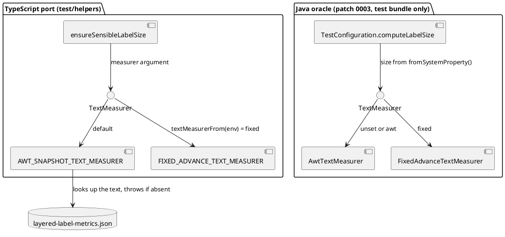

<!-- SPDX-License-Identifier: EPL-2.0 -->

# The text-sizing seam: one label measure for the oracle and the TS port (roadmap row 10)

What roadmap row 10 (issue #41, mission `text-sizing-seam`) built: oracle patch `0003`, which makes the JUnit test
framework's label-text measurement pluggable, its TS twin in `test/helpers/`, a recorder, and the tests that compare the two
sides. Decisions are `plans/text-sizing-seam/decisions.md` (TX1-TX8). Counts and findings are in
[conformance.md](../conformance.md#text-sizing-seam); this page covers the mechanism and the runbook.

| Section                                  | Answers                                                          |
| ---------------------------------------- | ---------------------------------------------------------------- |
| [1. Components](#text-sizing-components) | Which class or module measures on each side, and in which mode   |
| [2. Modes](#text-sizing-modes)           | The two measurers, their selectors and their defaults            |
| [3. Evidence](#text-sizing-evidence)     | The tests and refs that tie the two sides together               |
| [4. Runbook](#text-sizing-runbook)       | Fixed-mode runs on each side, re-recording, corpus, missing text |

## 1. Components {#text-sizing-components}

The Java site is test-framework code, so the TS twin sits beside the port of `TestConfiguration` (`layout-test-labels.ts`) and
not in `src/` (TX5): the published library never calls it and gains no public surface (AD-14).

## 2. Modes {#text-sizing-modes}

| Mode            | Java selector                                                    | TS selector                              | Measure                                                           |
| --------------- | ---------------------------------------------------------------- | ---------------------------------------- | ----------------------------------------------------------------- |
| default (`awt`) | property `org.eclipse.elk.alg.test.textMeasurer` unset, or `awt` | `ELK_TEST_TEXT_MEASURER` unset, or `awt` | Java: AWT font metrics, as before the patch. TS: the FX8 snapshot |
| `fixed`         | property set to `fixed`                                          | `ELK_TEST_TEXT_MEASURER=fixed`           | `[length × 6, 12]` (UTF-16 units; `6.0` and `12.0` literal)       |
| any other value | `IllegalArgumentException` naming the value                      | throws naming the value                  | none                                                              |

The TS unknown-value throw happens when the suite is built; the Java throw happens at the first unsized label, inside the test.
The default mode is unchanged on both sides, so the FX8 snapshot stays the reference and is never re-recorded, extended or
edited by this mechanism. Fixed mode is used only to compare label-bearing models between the oracle and the TS port.

Other pieces: `test/helpers/label-sizing-rows.ts` (`labelRows`) derives the label rows both comparison tests use, in the Java
`eAllContents` order; the runner passes the measurer through `LayoutTestDeps.measurer`. The recorder is
`tools/vectors/label-sizing-vectors.sh` running `tools/vectors/LabelSizingVectors.java`; it refuses to run off the reference
platform (macOS arm64, JDK 21.0.1, #52).

## 3. Evidence {#text-sizing-evidence}

| Test or ref                                      | What it ties                                                                                       |
| ------------------------------------------------ | -------------------------------------------------------------------------------------------------- |
| `test/golden/refs/java/label-sizing.json`        | Oracle sizes in fixed mode: 17 `texts` rows, 119 models, 1,052 label rows, and each model's layout |
| `test/golden/label-sizing.test.ts`               | 239 tests: the TS rows equal the ref exactly, the TS layout equals the oracle's at 1e-6            |
| `test/helpers/layout-test-text-measurer.test.ts` | The measurers, `textMeasurerFrom` and the runner cases (unset, `fixed`, unknown value)             |
| `test/corpus/label-sizing-sweep.test.ts`         | 759 corpus models and 21,753 label rows against the local oracle output; skipped without it        |

## 4. Runbook {#text-sizing-runbook}

Check the machine is quiet first (`uptime`, 1-minute load at most 12) and run the JVM under `nice -n 10`.

1. **A suite in fixed mode, Java.** Set `JAVA_TOOL_OPTIONS` to `-Dorg.eclipse.elk.alg.test.textMeasurer=fixed`, then run
   `tools/oracle/java-tests.sh <fully.qualified.TestClass>...`; the script keeps an existing `JAVA_TOOL_OPTIONS` and appends
   `-XX:hashCode=2` itself. The JVM prints a banner on stderr. The committed script carries every test bundle a TS test
   cites (issue #97), so it also runs the three `alg.common.nodespacing` suites, which live in
   `org.eclipse.elk.alg.common.test`.
2. **A suite in fixed mode, TS.** `PIPELINE_SUITES_FULL=1 ELK_MODELS_DIR=<pinned elk-models> ELK_TEST_TEXT_MEASURER=fixed
npx vitest run <suite files>`. Compare per class with step 1: `runs` and `failures`. `Issue665Test` and `Issue700Test`
   differ in every mode (issue #58).
3. **Re-record `label-sizing.json`.** `tools/vectors/label-sizing-vectors.sh test/golden/refs/java`, on the reference platform
   only, with the oracle built with patch `0003`. Never edit the ref by hand; journal the re-recording with the patch id. Two
   runs are byte-equal. The mode `--remeasure-awt <outDir>` runs with the property unset and re-measures every text of
   `layered-label-metrics-texts.txt`; its output must be byte-identical to `layered-label-metrics.json`.
4. **Corpus comparison.** `tools/vectors/label-sizing-vectors.sh --corpus <elk-models dir> "$ELK_ORACLE_DIR/sweep/label-sizing"`
   writes `label-sizing-corpus.json` (never committed, AD-5). The output goes under `sweep/` because a new untracked directory
   at the oracle root makes `build.sh` call the worktree stale (issue #85). Then
   `npx vitest run test/corpus/label-sizing-sweep.test.ts`; `LABEL_SIZING_SWEEP_DIR` overrides the directory.
5. **The snapshot lacks a text.** The runner throws naming the text (issue #58's four texts are the known case). The FX8
   procedure is unchanged and runs on the reference platform only: add the text to `tools/vectors/layered-label-metrics-texts.txt`
   and run `tools/vectors/layered-label-metrics-vectors.sh test/golden/refs/java`, which rewrites the file from the texts
   list; no existing value may change (the append-only test checks it, as in earlier missions). An added row is a ref change
   (AD-13), so it needs the maintainer's ruling first. Never record it on another OS, JDK or CPU.
6. **Afterwards.** `ps` shows no leftover `vitest`, `tsx` or `java`.
