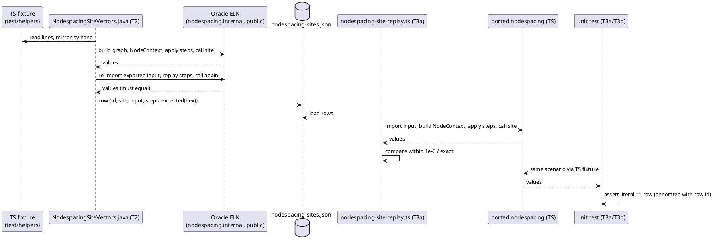

<!-- SPDX-License-Identifier: EPL-2.0 -->

# Data flow — mission 6c

How one flagged scenario becomes an oracle-anchored test. The same row drives the Java recorder (T2) and the TS
replay (T3a); the unit test (T3a/T3b) keeps a literal equal to the row.

A mismatch in `Rep` or `Unit` is a stop (4/5/7): diagnosed against the Java, never fixed by changing the row.
