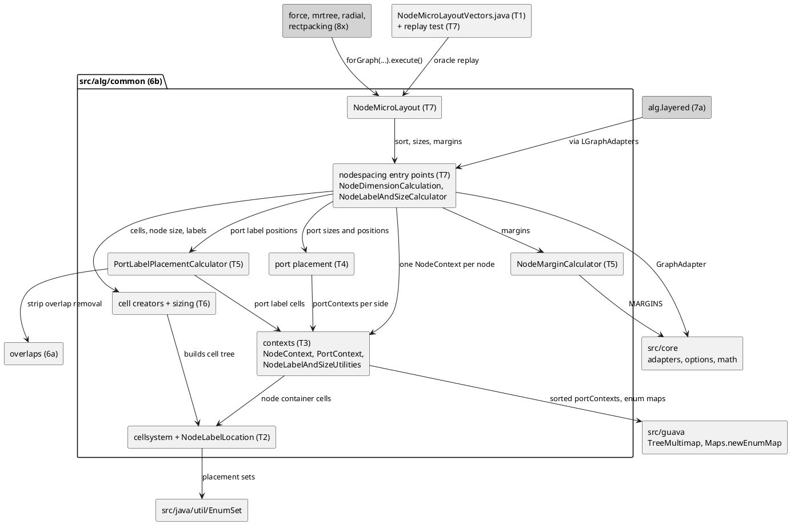

<!-- SPDX-License-Identifier: EPL-2.0 -->

# Component map — mission 6b

What 6b adds under `src/alg/common/`, what it builds on, and its later consumers. Grey components are not part of
6b. Each edge is labelled with what flows along it; the task that writes each component is in its name.

