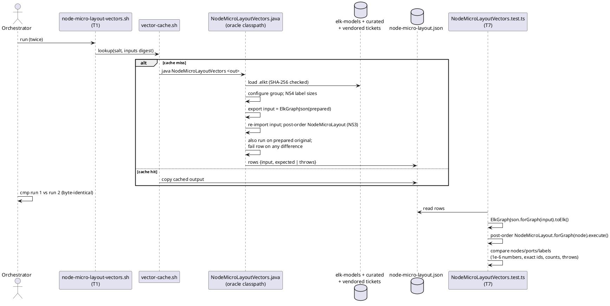
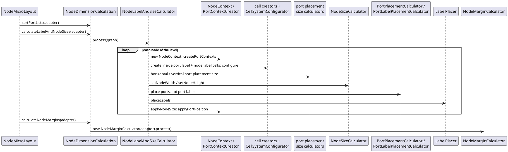

<!-- SPDX-License-Identifier: EPL-2.0 -->

# Data flow — mission 6b

## Evidence: record and replay (T1 → T7)

The recorder stores each prepared input graph as ELK JSON (NS1). The expectation comes from the re-imported graph, so
TS imports exactly the graph the oracle laid out.

## Runtime: one `NodeMicroLayout.execute()` (J/NodeMicroLayout.java:60-64)

The loop body is a summary. T7 keeps the exact Java phase order of `N/NodeLabelAndSizeCalculator.java:86-220`.
