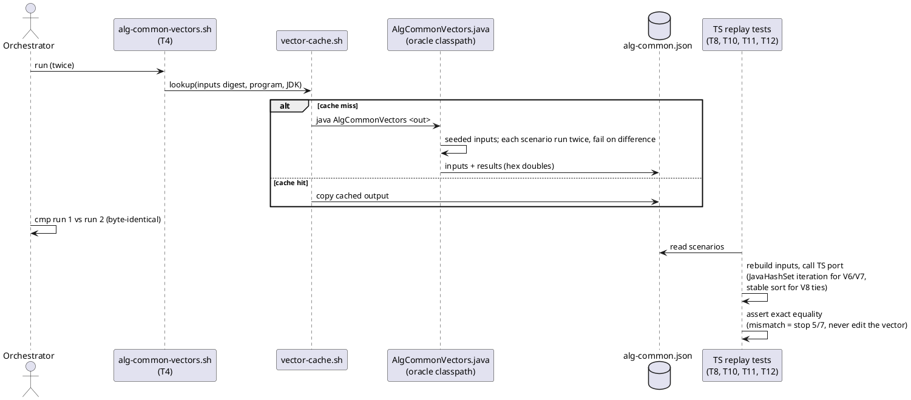

<!-- SPDX-License-Identifier: EPL-2.0 -->

# Data flow — evidence for mission 6a

How the oracle recorder (T4) and the TS replays (T8, T10–T12) prove the packages that have no Java tests. The `NaiveMinST`
replay is the roadmap exit.

