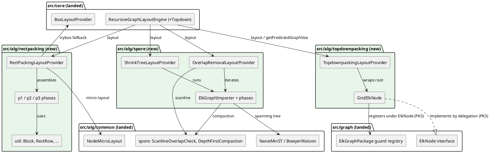

<!-- SPDX-License-Identifier: EPL-2.0 -->

# Component map — alg-packing (proposed)

New bundles (green) and the landed components they call. Edges are imports in the Java; no algorithm imports another.

