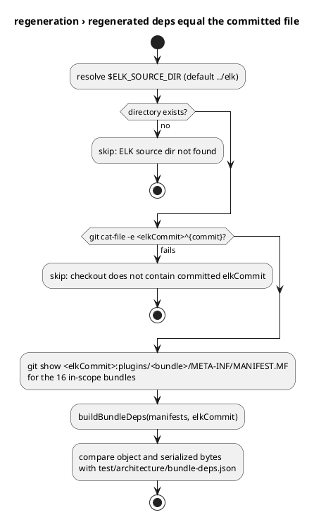

<!-- SPDX-License-Identifier: EPL-2.0 -->

# Data flow: the regeneration check after the mission

Before the mission the second test was `HEAD == elkCommit`, and the read was from the working tree.
