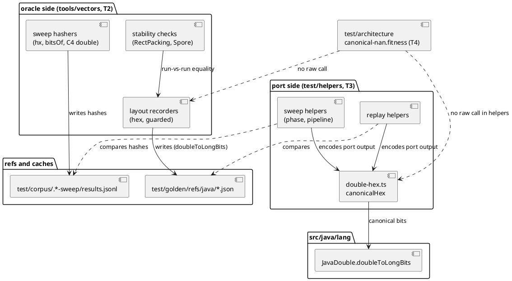

<!-- SPDX-License-Identifier: EPL-2.0 -->

# Component map: where a layout double becomes bits

T2 owns the oracle side and T3 the port side; they share no file. JDK shim recorders (`JavaVectors`, `CoreJdkVectors`) are
outside this map and stay raw.
