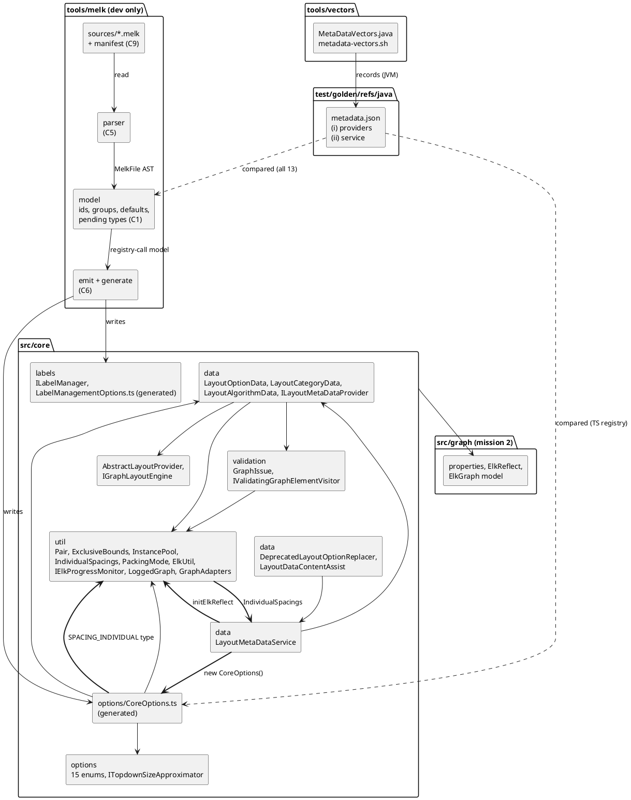

<!-- SPDX-License-Identifier: EPL-2.0 -->

# Component map — core-metadata

What this mission creates (bold edges are the `IndividualSpacings` / `LayoutMetaDataService` /
`CoreOptions` import cycle that T14 lands in one commit). `src/core` imports `src/graph`, `src/java`,
`src/guava` only (AD-8); `tools/melk` is dev-only and never imported by `src/`.

