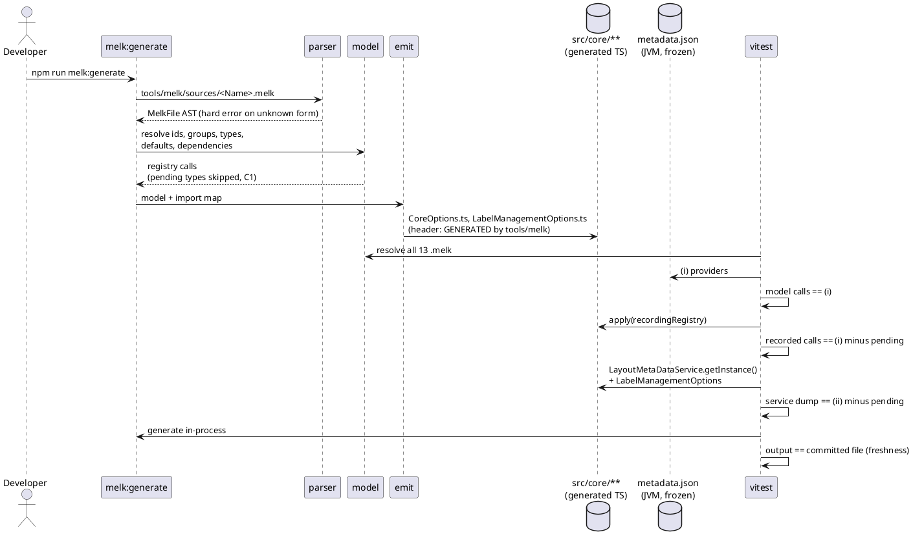
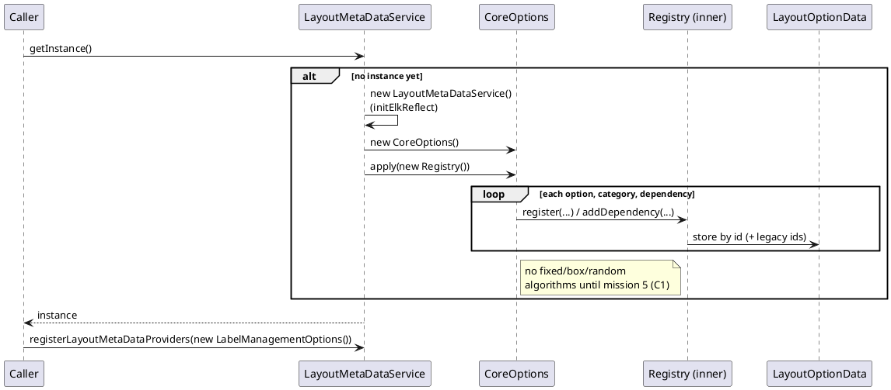

<!-- SPDX-License-Identifier: EPL-2.0 -->

# Data flow — core-metadata

## 1. Generation and verification

How a `.melk` file becomes committed TS, and the three checks against the JVM (C4, C6).

## 2. Service start-up at runtime

What happens on the first `LayoutMetaDataService.getInstance()` (C8).

