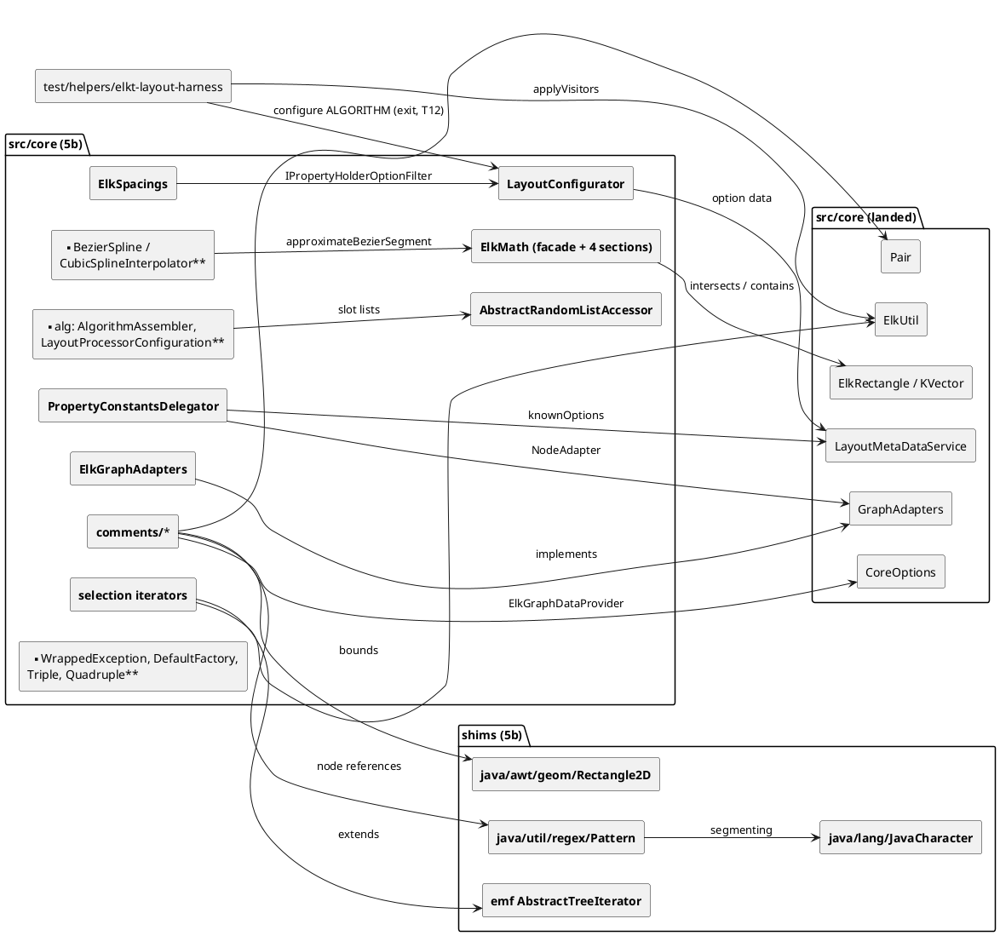

<!-- SPDX-License-Identifier: EPL-2.0 -->

# Component map — core-remainder

New components are in bold; everything else has already landed. Edges point from user to dependency.

The vector recorders (`tools/vectors/CoreJdkVectors.java`, `CommentVectors.java`) feed `R2D`, `PAT`, `CHR` and `COM`
through `test/golden/refs/java/{awt,regex,character,comments}.json`. They are test-time only.
