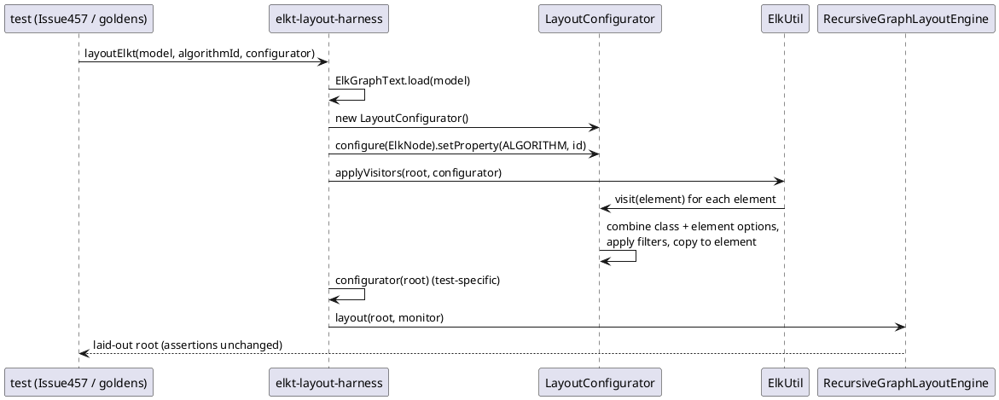
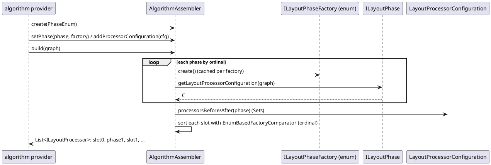
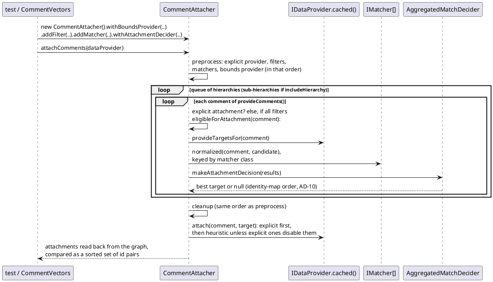

<!-- SPDX-License-Identifier: EPL-2.0 -->

# Data flow — core-remainder

## 1. Layout harness through `LayoutConfigurator` (exit, T12)

This mirrors `TestAlgorithm.java:44-49, :134-138`.

## 2. Algorithm assembly (consumed from mission 6 on)

## 3. Comment attachment (R6 scenarios)

