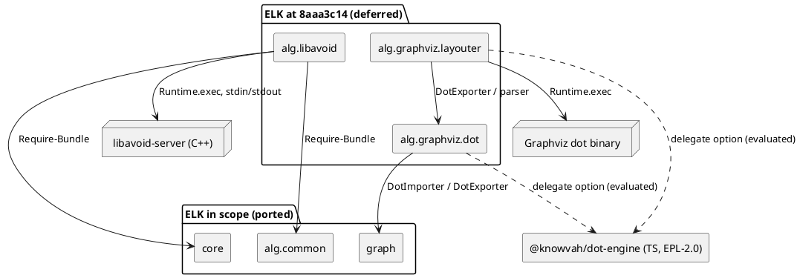

<!-- SPDX-License-Identifier: EPL-2.0 -->

# Component map: deferred-bundles-adr

The three deferred bundles at the pin and what they touch. Nothing here is ported; the diagram is the evidence frame.

