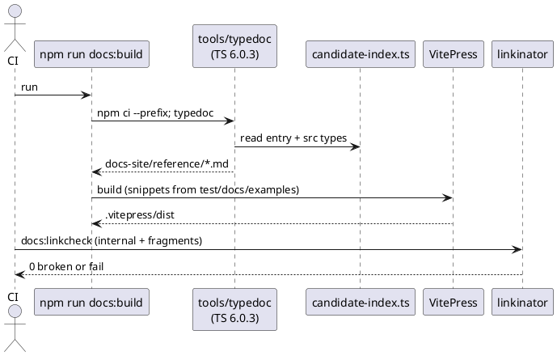
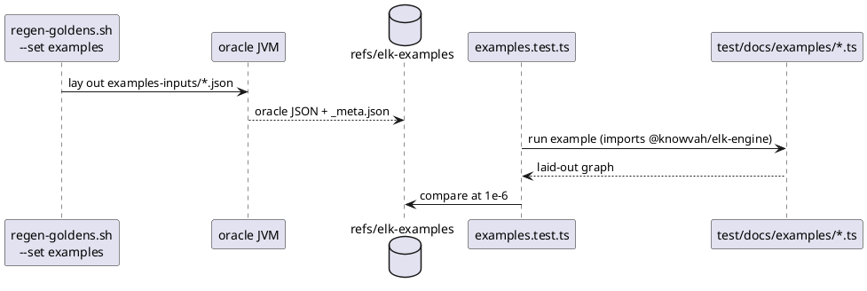
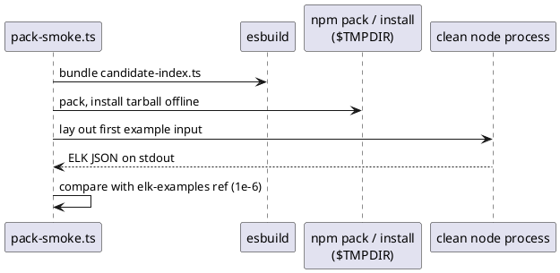

<!-- SPDX-License-Identifier: EPL-2.0 -->

# Data flow: docs build, example check and pack rehearsal (proposed)

## Docs build and link check (CI, every PR)

## Example check (inside `npm run coverage`)

## Pack rehearsal (`pack:smoke --entry`)

