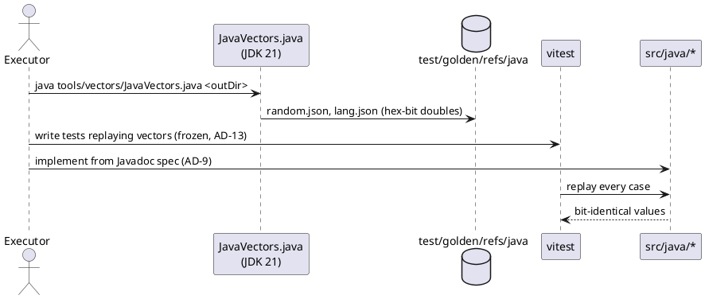
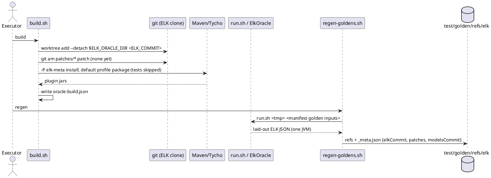
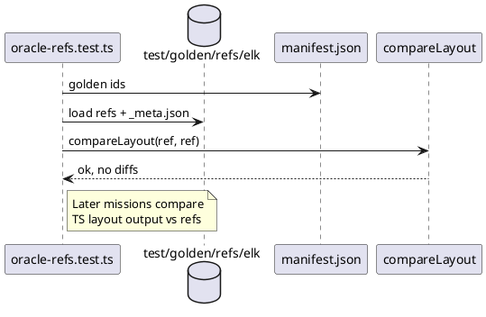

<!-- SPDX-License-Identifier: EPL-2.0 -->

# Data flows

## 1. JVM vectors → frozen tests → shim (proof loop, T6 → T9/T10)

## 2. Oracle build and golden generation (T8 → T11 → T16)

## 3. Golden check in CI (no JVM)

