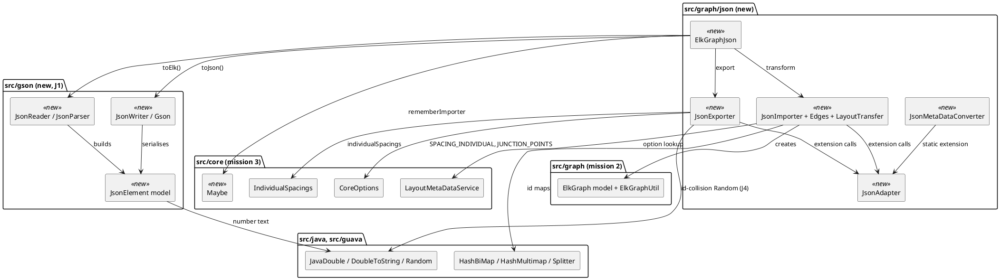

<!-- SPDX-License-Identifier: EPL-2.0 -->

# Component map — elk-json-adapter

New components (bold borders by stereotype `new`) and the existing ones they use. Arrows are import
direction; the fitness tests enforce `src/gson → src/java` only.

