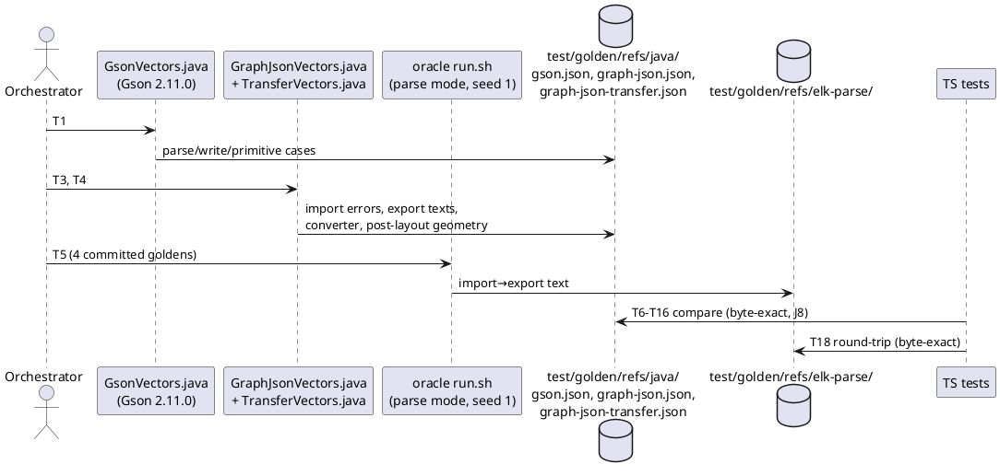
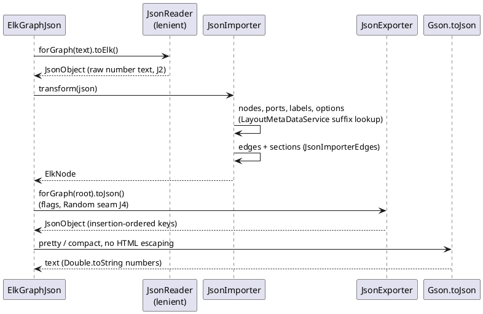
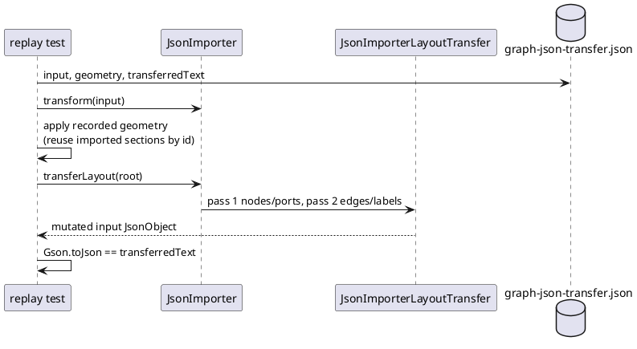

<!-- SPDX-License-Identifier: EPL-2.0 -->

# Data flow — elk-json-adapter

## 1. Evidence: JVM recordings before TS code (AD-13)

## 2. Import → export round trip (runtime)

## 3. `transferLayout` replay (J6)

