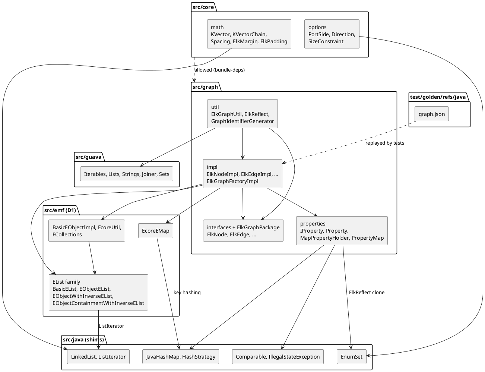

<!-- SPDX-License-Identifier: EPL-2.0 -->

# Component map — elkgraph-model

Directories this mission creates and the import direction the fitness test enforces (AD-8, D1).

Rules: `src/java` imports nothing else; `src/guava` imports `src/java`; `src/emf` imports
`src/java` and `src/guava`; `src/graph` requires nothing in `bundle-deps.json` but may import the
three shim directories; `src/core` requires `src/graph`.
