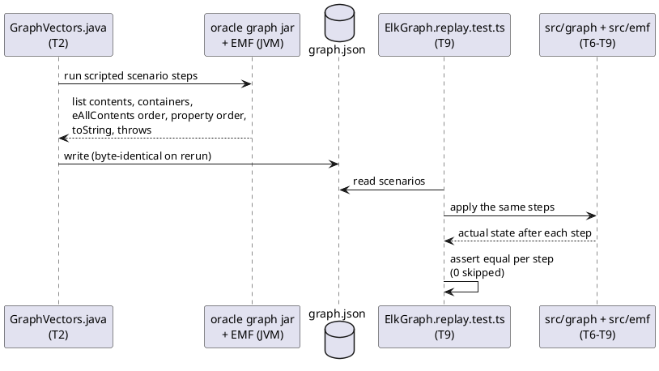
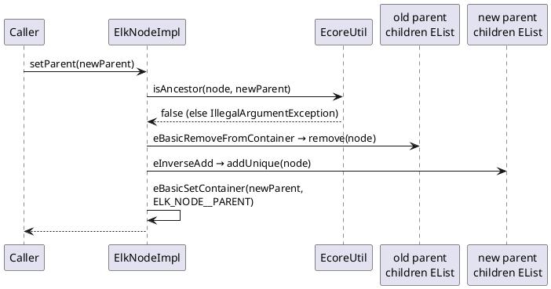
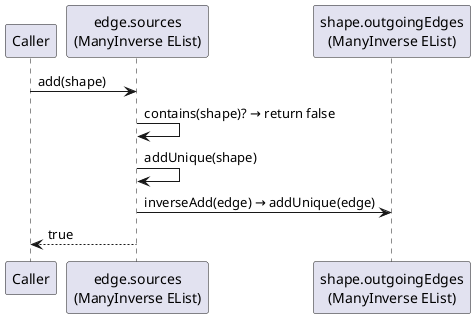
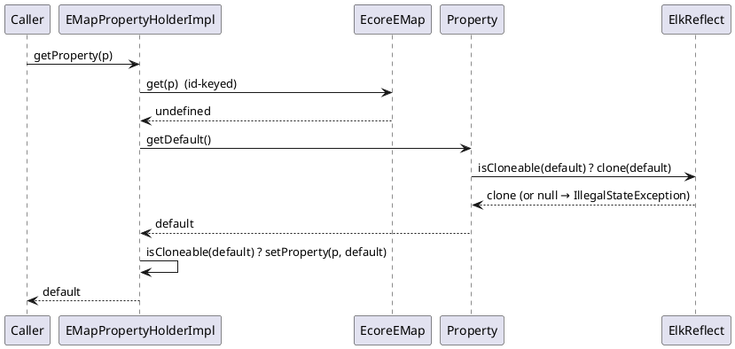

<!-- SPDX-License-Identifier: EPL-2.0 -->

# Data flow — elkgraph-model

## Vectors before code (AD-13, D9)

## Containment move: `node.setParent(newParent)` (D2)

## Inverse reference: `edge.getSources().add(shape)` (D2)

## Property read with default cloning (D5, D6)

