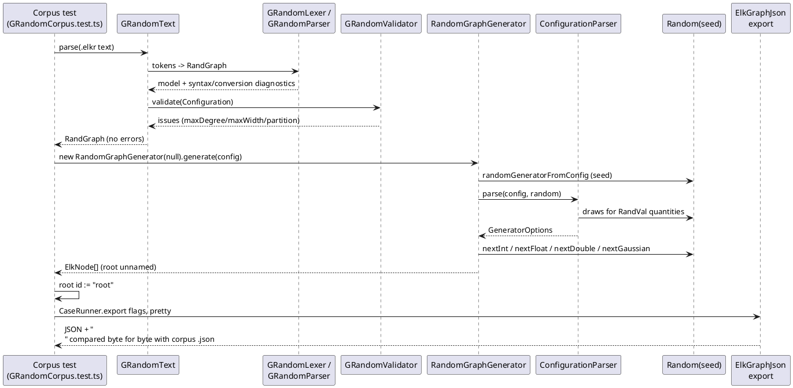
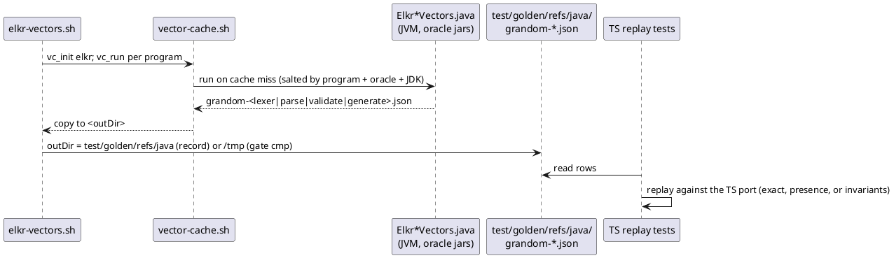

<!-- SPDX-License-Identifier: EPL-2.0 -->

# Data flow — `.elkr` text to ELK JSON

The corpus test (T12–T14) mirrors the oracle harness step for step; the vector replays check each stage on its own.

