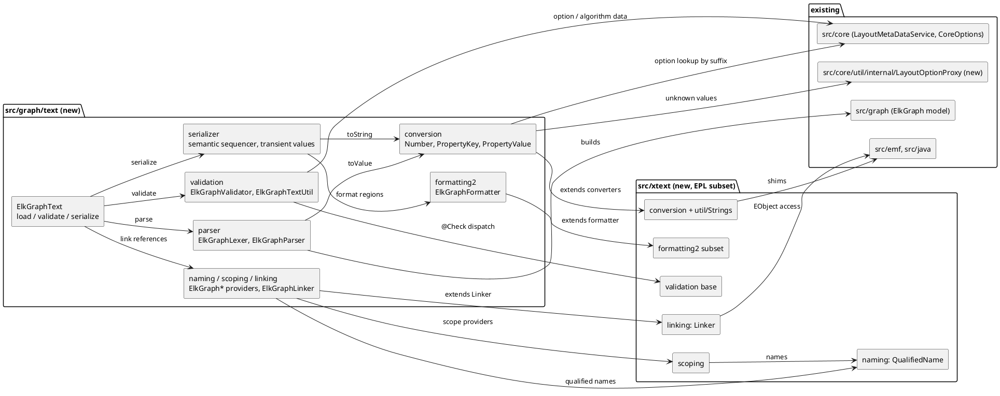

<!-- SPDX-License-Identifier: EPL-2.0 -->

# Component map — graph-text

New packages and the existing ones they depend on. Arrows are import direction; the fitness rules
(T6) enforce them. `src/xtext` never imports ELK code.

