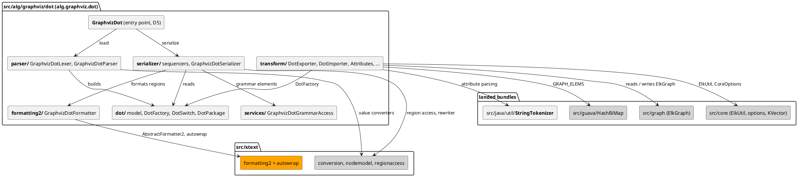

<!-- SPDX-License-Identifier: EPL-2.0 -->

# Component map: `src/alg/graphviz/dot/` and what it uses

Bold: new in this mission. Grey: landed, unchanged. Orange: landed, extended (D3). Arrows are imports. No arrow enters the
bundle from outside except its tests; step 3's layouter will import `GraphvizDot` and `transform/`.

