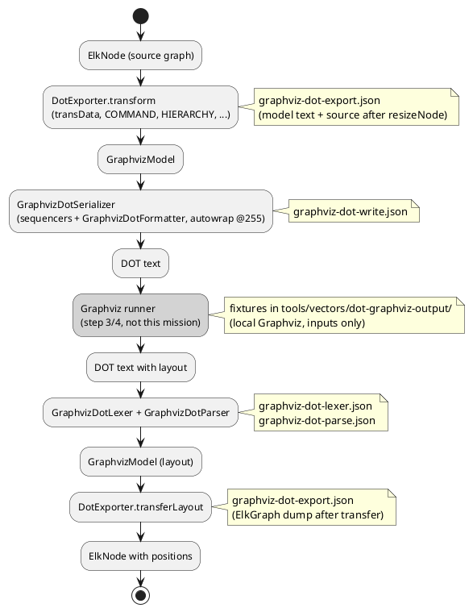

<!-- SPDX-License-Identifier: EPL-2.0 -->

# Data flow: export, (future) Graphviz run, transfer; and the evidence

The flow `GraphvizLayoutProvider.layout` runs (`GraphvizLayoutProvider.java:118-160`). This mission ports every box except the
runner and the provider (step 3 and step 4). The recorders in batch 1 capture each arrow marked with a ref.

`DotImporter` (DOT → ElkGraph, and its own `transferLayout`) is a separate flow with no caller in either bundle's `src/`. Its
evidence is `graphviz-dot-import.json`.
