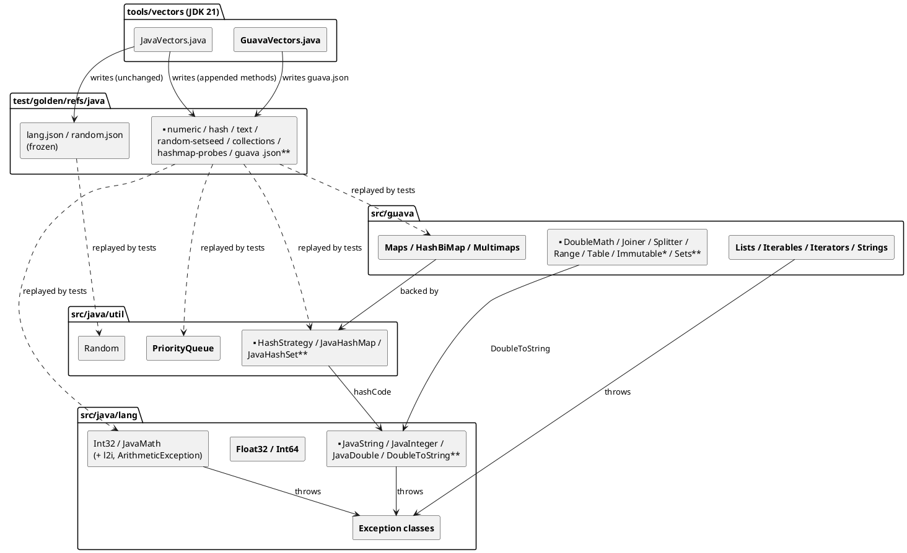

<!-- SPDX-License-Identifier: EPL-2.0 -->

# Component map — java-foundations

What this mission creates (bold) and how the pieces depend on each other. Arrows read
"depends on". `src/guava` may import only `src/java` (M6, T3).

