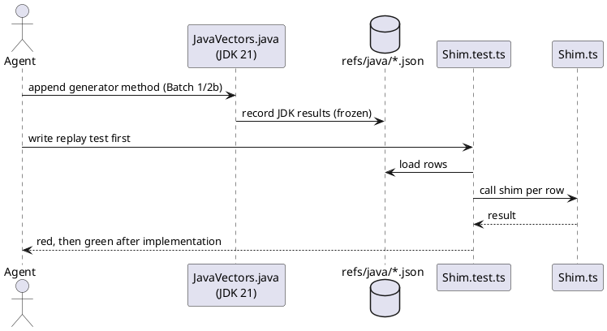
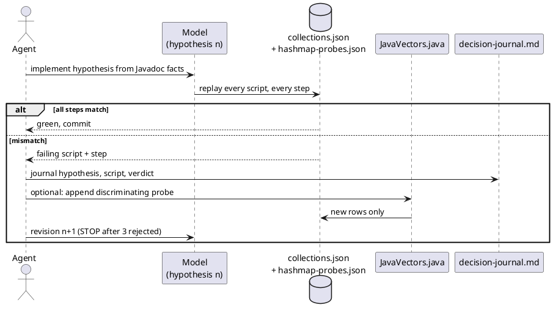

<!-- SPDX-License-Identifier: EPL-2.0 -->

# Data flow — java-foundations

## Vectors first, then the shim (every shim task, AD-13)

## Clean-room model loop (T11 JavaHashMap, T12 PriorityQueue — M1/M8)

