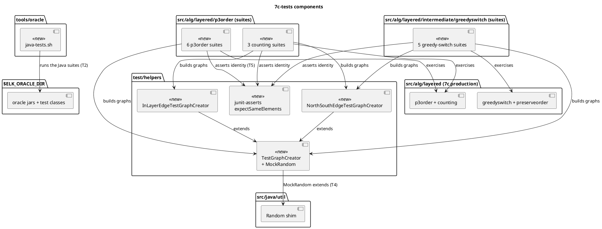

<!-- SPDX-License-Identifier: EPL-2.0 -->

# Component map — what 7c-tests adds and what it exercises

New components are the runner, the three creators, the assertion helper and the fourteen suites; the 7c production
classes are exercised, and touched only by an orchestrator fix under T7.

