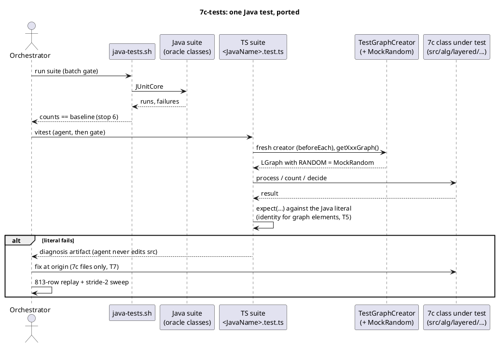

<!-- SPDX-License-Identifier: EPL-2.0 -->

# Data flow — how a ported suite proves a 7c class

The Java run establishes that a literal holds on the oracle (T1, T2); the ported suite asserts the same literal against
the TS class; a mismatch goes back to the orchestrator as a diagnosis (T7).

