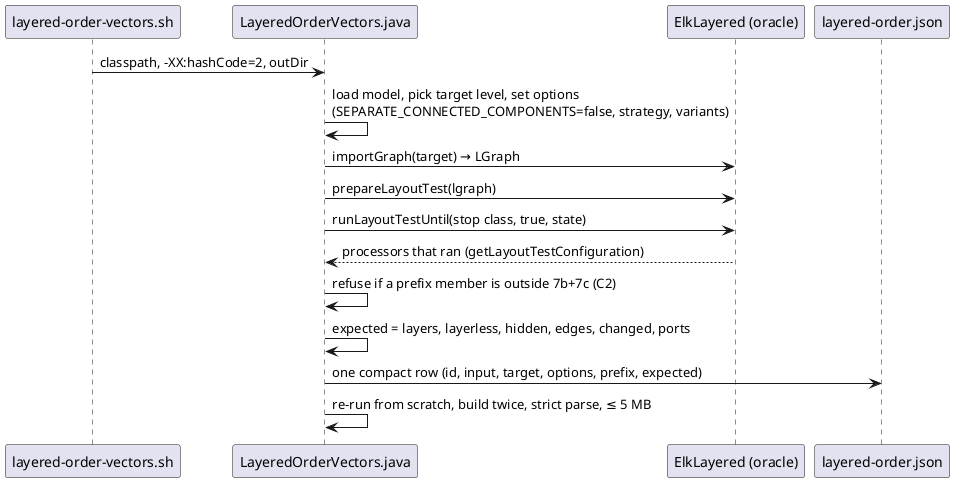
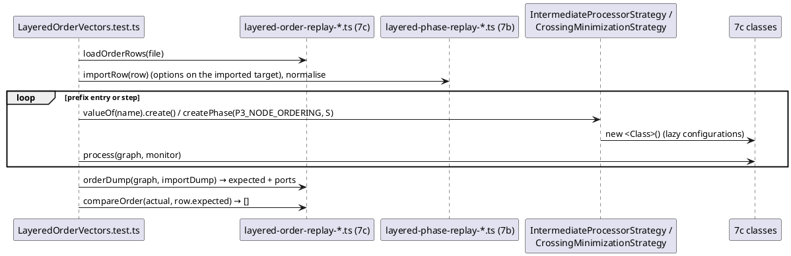
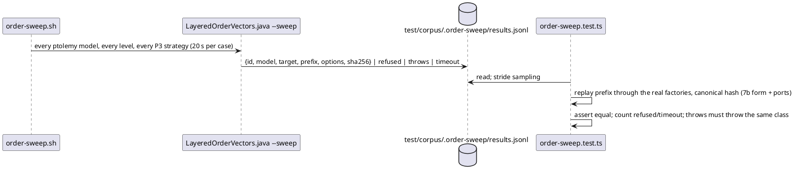

<!-- SPDX-License-Identifier: EPL-2.0 -->

# Data flow — layered-crossing-min (mission 7c)

## Recording a pipeline row at the P3 stop (T1)

## Replaying a row by name (T3, T8)

## The breadth sweep (T10)

