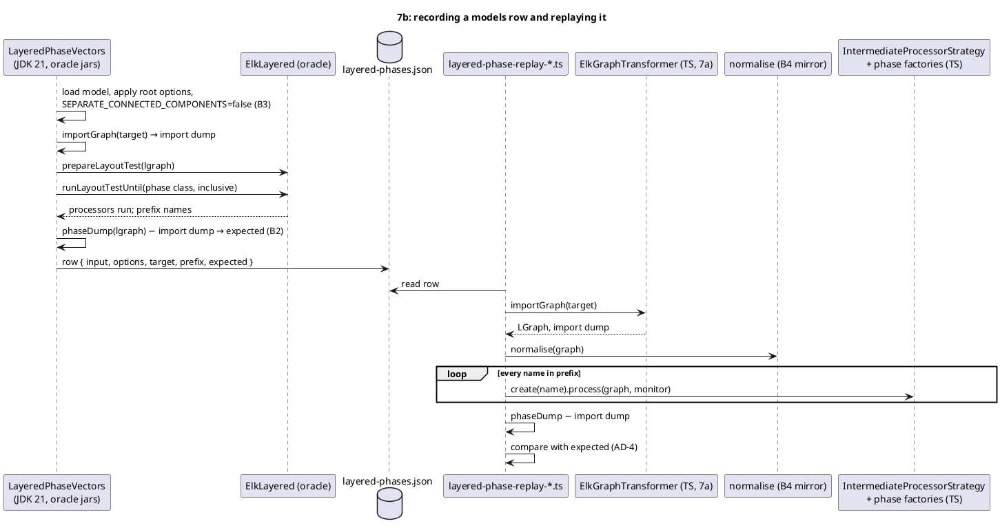
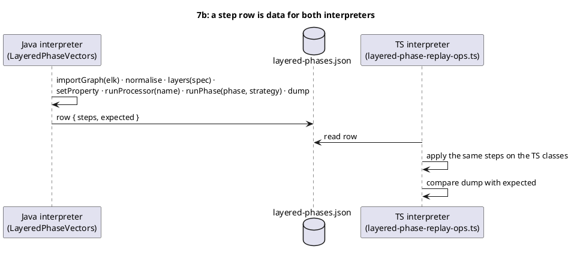
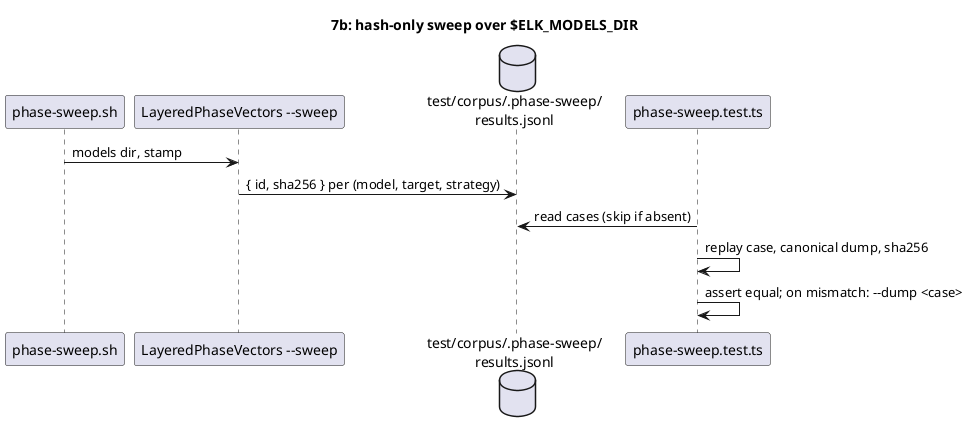

<!-- SPDX-License-Identifier: EPL-2.0 -->

# Data flow — layered-cycles-layers (mission 7b)

## Oracle rows to replay (B1, B4, AD-13)

## Step rows (scenarios, sites)

## Breadth sweep (B6, local only)

