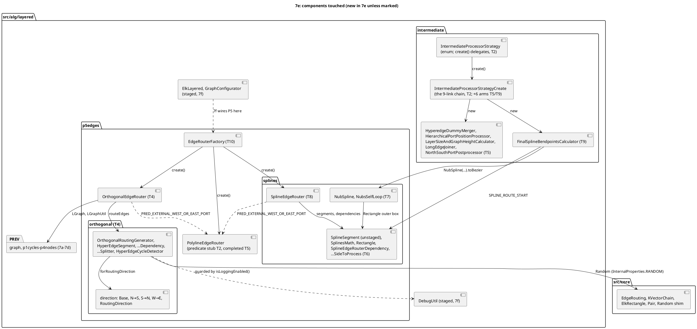

<!-- SPDX-License-Identifier: EPL-2.0 -->

# Component map — layered-edge-routing (mission 7e)

Proof components (tests and tooling): `tools/vectors/LayeredRoutingVectors.java` + `.sh` (T1, T12, T13) write
`test/golden/refs/java/{layered-routing,layered-routing-steps}.json`; `test/helpers/layered-routing-replay-*.ts` (T3)
and `layered-routing-sweep.ts` (T12) replay them; `src/alg/layered/LayeredRoutingVectors.test.ts` (T10) is the
authority, the colocated tests (T4–T9, T14) the per-class proofs, `test/corpus/routing-sweep.test.ts` (T12) the breadth.
