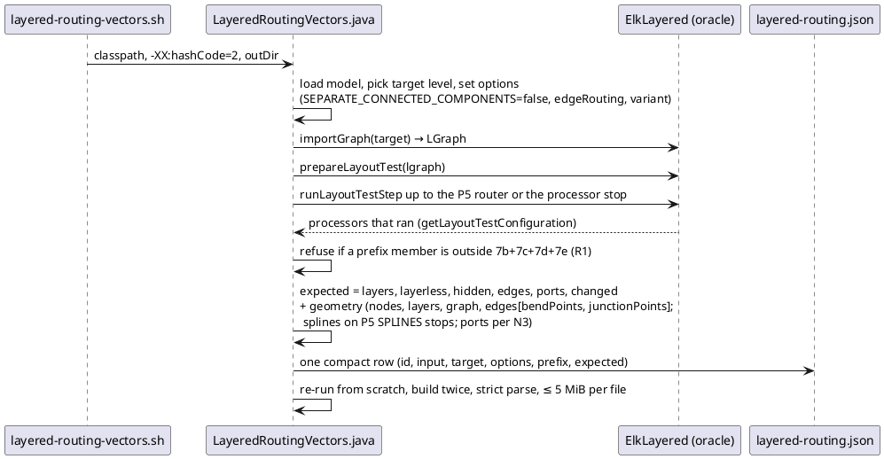
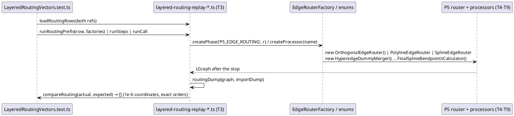
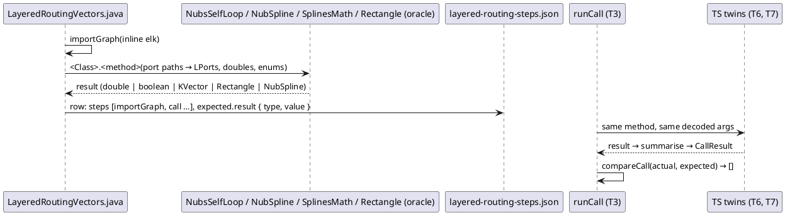
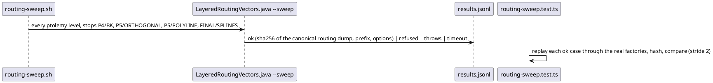

<!-- SPDX-License-Identifier: EPL-2.0 -->

# Data flow — layered-edge-routing (mission 7e)

## Recording a pipeline row at a P5 stop (T1)

## Replaying a row through the port (T10, T14)

## A `calls` row (T1, T3, T6, T7)

## A sweep case (T12)

