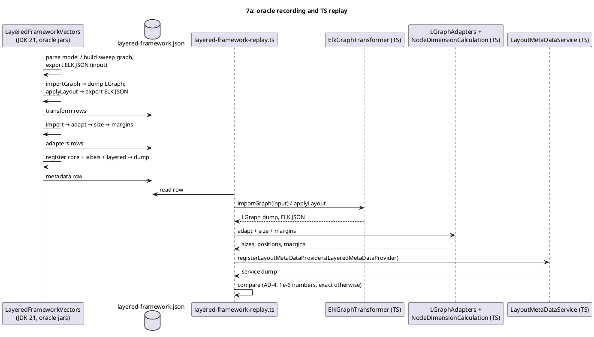
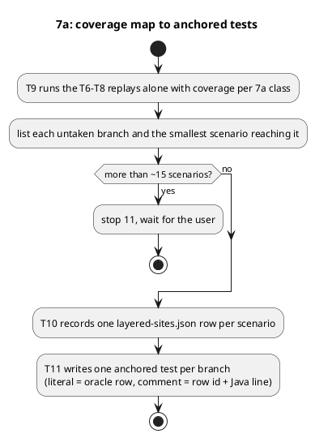

<!-- SPDX-License-Identifier: EPL-2.0 -->

# Data flow — layered-framework (mission 7a)

## Oracle rows to replay (L3, AD-13)

Every expectation is recorded from the source-built oracle before its TS consumer exists.

## Unreached branches (L4)

