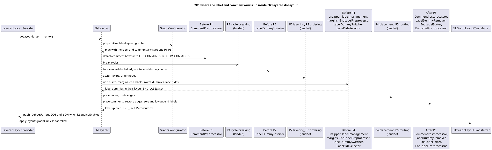
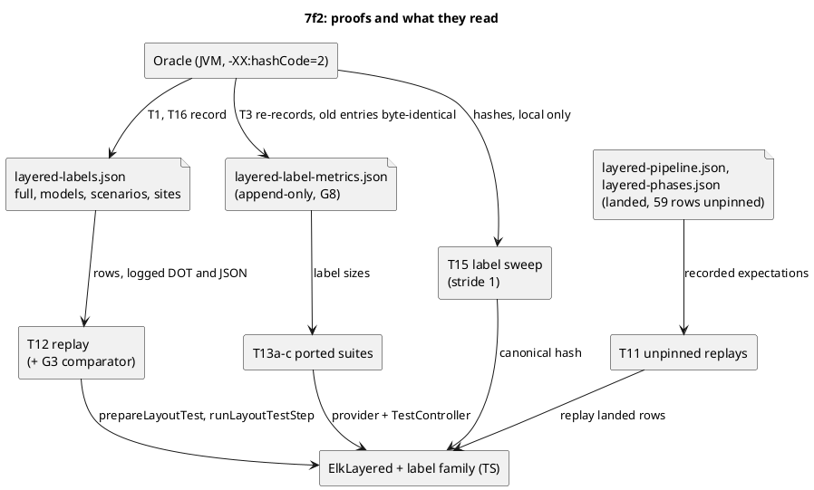

<!-- SPDX-License-Identifier: EPL-2.0 -->

# Data flow — layered-labels (mission 7f2)

## A labelled, commented layout through the driver

The order of the 12 arms is that of `J/intermediate/IntermediateProcessorStrategy.java:41-176`; `GraphConfigurator` only decides which
arms enter the plan (for example a set `LABEL_MANAGER` adds the two label-management arms, `GraphConfigurator.java:221`).

## How each kind of proof reaches the port

